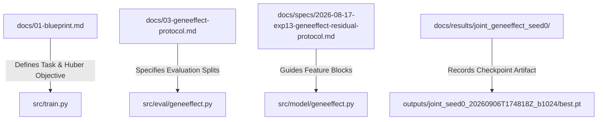
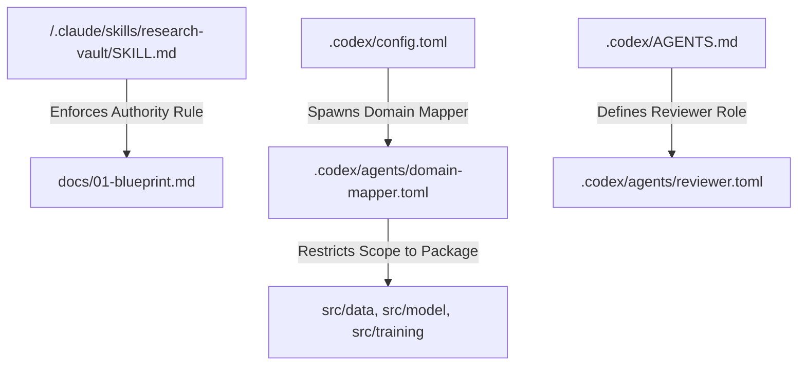

# Research Contract and Documentation Vault

<details>
<summary>Relevant source files</summary>

The following files were used as context for generating this wiki page:

- [.claude/skills/hpc-execution/SKILL.md](.claude/skills/hpc-execution/SKILL.md)
- [.claude/skills/research-vault/SKILL.md](.claude/skills/research-vault/SKILL.md)
- [.codex/AGENTS.md](.codex/AGENTS.md)
- [.codex/agents/docs-guard.toml](.codex/agents/docs-guard.toml)
- [.codex/agents/domain-mapper.toml](.codex/agents/domain-mapper.toml)
- [.codex/agents/experiment-planner.toml](.codex/agents/experiment-planner.toml)
- [.codex/agents/implementation-worker.toml](.codex/agents/implementation-worker.toml)
- [.codex/agents/reviewer.toml](.codex/agents/reviewer.toml)
- [.codex/config.toml](.codex/config.toml)
- [.codex/skills/hpc-execution/SKILL.md](.codex/skills/hpc-execution/SKILL.md)
- [docs/01-blueprint.md](docs/01-blueprint.md)
- [docs/02-literature-review.md](docs/02-literature-review.md)
- [docs/03-geneeffect-protocol.md](docs/03-geneeffect-protocol.md)
- [docs/data/cell-line-geneeffect-226.md](docs/data/cell-line-geneeffect-226.md)
- [docs/figures/geneeffect_readout_learning_curves.png](docs/figures/geneeffect_readout_learning_curves.png)
- [docs/results/p1_response_pathway_diagnostics/README.md](docs/results/p1_response_pathway_diagnostics/README.md)
- [docs/specs/2026-08-17-exp13-geneeffect-residual-protocol.md](docs/specs/2026-08-17-exp13-geneeffect-residual-protocol.md)
- [docs/specs/2026-09-07-p1b_response_functionality_interface_adaptation_diagnostic.md](docs/specs/2026-09-07-p1b_response_functionality_interface_adaptation_diagnostic.md)
- [docs/specs/2026-09-10-readout-objective-and-selection-design.md](docs/specs/2026-09-10-readout-objective-and-selection-design.md)

</details>


### Purpose and Scope

This page documents the structural design, governance rules, and documentation hierarchy of the `docs/` vault and agent instruction infrastructure (`CLAUDE.md`, `.codex/`, `.claude/skills/`). In this codebase, written documentation serves as the binding authority: if code and the vault disagree, the vault wins and the code is treated as a bug [.claude/skills/research-vault/SKILL.md:6-9](). This page details the blueprint hierarchy, execution protocols, specification paths, empirical results registries, and multi-agent coordination systems.

---

## 1. Authority Ordering and Vault Hierarchy

The `docs/` hierarchy implements a strict authority ordering. Lower-level documents specify how higher-level blueprints are made executable, but they never relax or contradict the higher-level claims [.claude/skills/research-vault/SKILL.md:11-25]().

```
01-blueprint.md              contract + claim bars   (frozen)
  > 02-literature-review.md  related work, novelty boundary
    > 03-geneeffect-protocol.md  the implemented GeneEffect track, executable
      > 04-sl-ranking-protocol.md  the SL-pair protocol built on it
        > docs/specs/*.md        tracked designs, incl. the Exp13 GeneEffect residual spec
          > docs/results/*.md    evidence
```

- **`docs/01-blueprint.md`**: Defines the central research task, generalization boundaries (cell-line holdout vs gene holdout), math for the GeneEffect residual protocol, and claim boundaries [docs/01-blueprint.md:1-126](). It is permanently frozen [docs/01-blueprint.md:95-100]().
- **`docs/02-literature-review.md`**: Surveys related work, contextualizing model choices against prior art without introducing external novelty claims [docs/02-literature-review.md:1-111]().
- **`docs/03-geneeffect-protocol.md`**: The executable specification for the GeneEffect track, detailing input tensors, data splits, and model architectures [docs/03-geneeffect-protocol.md:1-130]().
- **`docs/specs/*.md`**: Engineering specifications and historical staged protocols, such as the Exp13 GeneEffect residual benchmark specification [docs/specs/2026-08-17-exp13-geneeffect-residual-protocol.md:1-102]().
- **`docs/results/*.md`**: Immutable evidentiary artifacts recording completed experiment outcomes, manifests, and comparative metrics [docs/results/p1_response_pathway_diagnostics/README.md:1-109]().

### Diagram: Natural Language Space to Code Entity Space (Blueprint & Protocols)



Sources: `docs/01-blueprint.md:1-126`, `docs/03-geneeffect-protocol.md:1-130`, `docs/specs/2026-08-17-exp13-geneeffect-residual-protocol.md:1-102`, `docs/results/p1_response_pathway_diagnostics/README.md:1-15`

---

## 2. The Freeze Rule and Vault Discipline

The primary operational rule governing the vault is the **Freeze Rule**: `docs/01-blueprint.md` is frozen. Edits must occur in place via dated paragraphs or restatements—never by appending unauthorized "v2" or revision files that contradict the core contract [.claude/skills/research-vault/SKILL.md:31-37]().

The vault functions as an instantaneous snapshot of current scientific state rather than an append-only changelog. Superseded designs retain a single `**Status:** retired` line and a link to their final result archive [.claude/skills/research-vault/SKILL.md:38-43]().

Sources: `.claude/skills/research-vault/SKILL.md:31-43`

---

## 3. Agent Instruction Files and Multi-Agent Configuration

The repository implements a structured agent instruction ecosystem under `.codex/` and `.claude/skills/` to regulate multi-agent workflows, model reasoning behaviors, and domain boundaries.

### Codex Multi-Agent Configuration

The project-local Codex configuration (`.codex/config.toml`) establishes approval policies, sandbox execution modes, and MCP server bindings (such as `context7` and `codebase-memory-mcp`) [.codex/config.toml:1-46](). It registers specialized subagents via `.codex/AGENTS.md` and dedicated TOML configuration files:

- **`domain_mapper`**: Read-only mapper for code, data, config, and documentation paths (`.codex/agents/domain-mapper.toml`) [.codex/config.toml:22-24](). It restricts modifications, requiring inspection of `src/data`, `src/model`, `src/training`, and `src/eval` [.codex/agents/domain-mapper.toml:7-13]().
- **`experiment_planner`**: Read-only planner for experiment configs and verification designs across the Exp13 GeneEffect residual benchmark [.codex/config.toml:26-29]().
- **`implementation_worker`**: Scoped code and config editing worker acting under explicit parent assignment [.codex/config.toml:30-32]().
- **`reviewer`**: Adversarial review agent focused on data leakage, silent defaults, data contracts, and missing tests [.codex/config.toml:34-36]().
- **`docs_guard`**: Read-only documentation guard protecting `docs/`, `README.md`, and agent instructions against drift [.codex/config.toml:38-41]().

### Diagram: Natural Language Space to Code Entity Space (Agent Infrastructure)



Sources: `.codex/config.toml:1-46`, `.codex/AGENTS.md:1-29`, `.codex/agents/domain-mapper.toml:1-13`, `.claude/skills/research-vault/SKILL.md:1-50`

---

## 4. Result Registration and Status Synchronization

To maintain evidentiary integrity, planned numbers or expected metrics are strictly prohibited from entering the vault. Results enter the documentation vault only after analysis execution is complete and verified against leak-detection gates [.claude/skills/research-vault/SKILL.md:50-59]().

### Result Registration Lifecycle

1. **Execution**: Run analyses and preserve required outputs (config, seeds, commit SHA, per-fold outputs, and hashes) [.claude/skills/research-vault/SKILL.md:55-56]().
2. **Admissibility Check**: Audit leakage and integrity rules defined in `docs/01-blueprint.md` §7 and protocol leakage sections [.claude/skills/research-vault/SKILL.md:57-59]().
3. **Verdict Classification**: Record outcomes using standard vocabulary (`negative`, `paused`, `closed`, `scope-closed`, `reportable-but-not-claimable`) [.claude/skills/research-vault/SKILL.md:60-62]().
4. **Drafting Evidence**: Author `docs/results/<slug.md>` following standard sections: Status, What was tested, Method and provenance, Result, Interpretation, Verdict and scope, and Reproduction [.claude/skills/research-vault/SKILL.md:63-65]().
5. **Status Sync**: Manually reconcile status strings across the root `README.md`, `docs/01-blueprint.md`, and active protocols, as no automated script enforces cross-file state synchronization [.claude/skills/research-vault/SKILL.md:71-78]().

Sources: `.claude/skills/research-vault/SKILL.md:50-78`

---