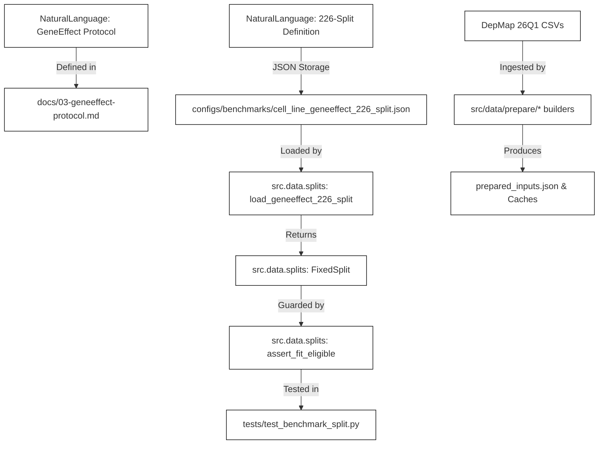
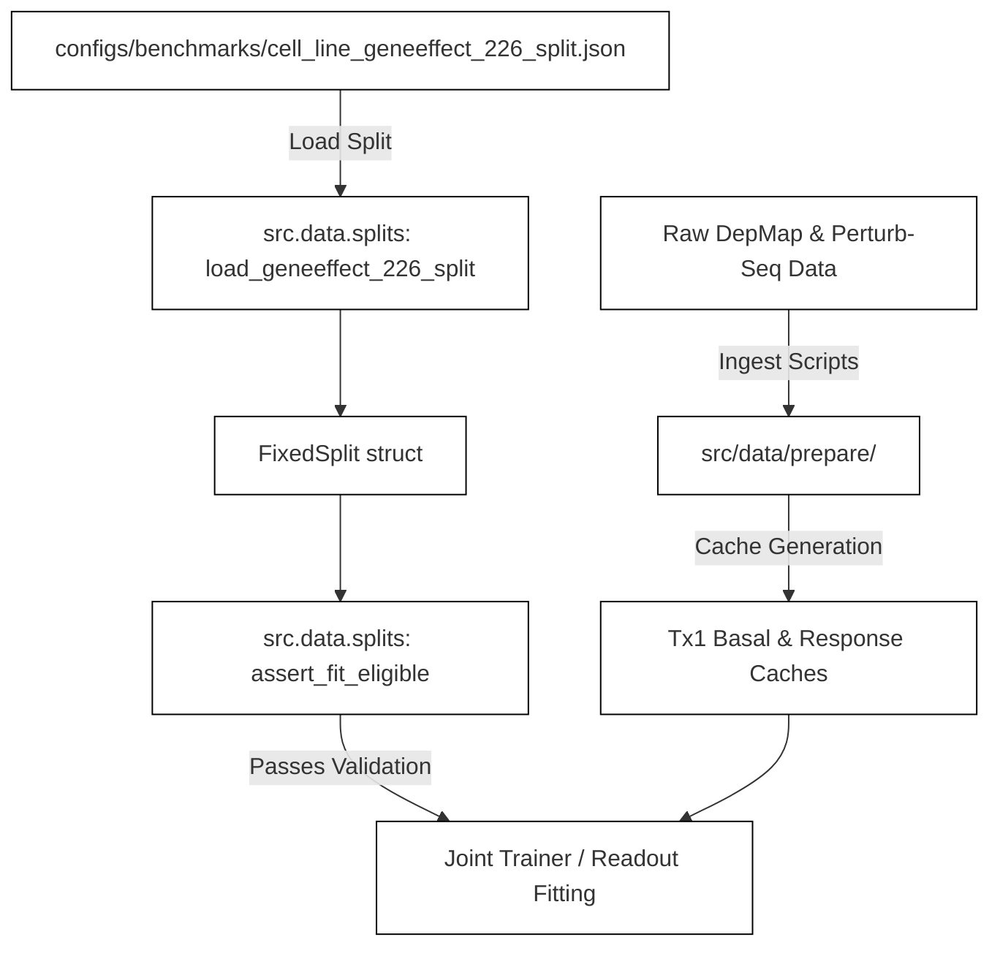

# Scientific Protocols and Benchmarks

Relevant source files

The following files were used as context for generating this wiki page:

- [configs/benchmarks/cell_line_geneeffect_226_split.csv](configs/benchmarks/cell_line_geneeffect_226_split.csv)
- [configs/benchmarks/cell_line_geneeffect_226_split.json](configs/benchmarks/cell_line_geneeffect_226_split.json)
- [configs/benchmarks/cell_line_geneeffect_226_split_audit.json](configs/benchmarks/cell_line_geneeffect_226_split_audit.json)
- [docs/03-geneeffect-protocol.md](docs/03-geneeffect-protocol.md)
- [docs/data/adamson-k562-perturbseq.md](docs/data/adamson-k562-perturbseq.md)
- [docs/data/depmap-public-26q1.md](docs/data/depmap-public-26q1.md)
- [docs/data/dixit-k562-perturbseq.md](docs/data/dixit-k562-perturbseq.md)
- [docs/data/jost-replogle-dual-sgrna-k562-crispri.md](docs/data/jost-replogle-dual-sgrna-k562-crispri.md)
- [docs/data/k562-perturbseq-sl-coverage.md](docs/data/k562-perturbseq-sl-coverage.md)
- [docs/data/norman-k562-crispra.md](docs/data/norman-k562-crispra.md)
- [docs/data/replogle-k562-essential.md](docs/data/replogle-k562-essential.md)
- [docs/data/replogle-k562-gwps.md](docs/data/replogle-k562-gwps.md)
- [docs/data/sl-benchmark-2024.md](docs/data/sl-benchmark-2024.md)
- [docs/figures/geneeffect_readout_learning_curves.png](docs/figures/geneeffect_readout_learning_curves.png)
- [docs/results/p1_response_pathway_diagnostics/README.md](docs/results/p1_response_pathway_diagnostics/README.md)
- [docs/specs/2026-09-07-p1b_response_functionality_interface_adaptation_diagnostic.md](docs/specs/2026-09-07-p1b_response_functionality_interface_adaptation_diagnostic.md)
- [docs/specs/2026-09-10-readout-objective-and-selection-design.md](docs/specs/2026-09-10-readout-objective-and-selection-design.md)
- [tests/test_benchmark_split.py](tests/test_benchmark_split.py)

## Purpose and Scope

This page documents the formal scientific protocols, benchmark splits, and raw data ingestion references governing the gene-perturbation prediction pipeline. It covers the held-out cell-line GeneEffect residual protocol, the 226-cell-line validation/test split structure, eligibility enforcement guards, and foundational datasets including DepMap 26Q1 and Perturb-seq collections [docs/03-geneeffect-protocol.md:1-16](), [tests/test_benchmark_split.py:1-7]().

---

## 1. GeneEffect Residual Protocol

The core prediction track under the research blueprint evaluates whether a single-cell perturbation-response model learns cell-line context information that improves held-out line dependency prediction beyond simple gene means and context ridges [docs/03-geneeffect-protocol.md:17-37]().

For a held-out cell line $c$ and target gene $g$, the model predicts the DepMap GeneEffect $y_{g,c}$ as a residual over a fixed training gene mean [docs/03-geneeffect-protocol.md:17-26]():

$$\hat y_{g,c} = \mu_{\text{train}}(g) + \hat\delta(g,c), \qquad \mu_{\text{train}}(g) = \operatorname{mean}_{c\in\mathcal C_{\text{train}}} y_{g,c}$$

- **Generalization Axis**: Generalization is strictly across **cell lines**, not unseen genes [docs/03-geneeffect-protocol.md:29-32]().
- **Data Leakage Prevention**: No GeneEffect measurement of the held-out line $c$ enters the deployable feature path or normalization statistics [docs/03-geneeffect-protocol.md:29-32]().
- **Inputs**: Frozen Tx1-3B basal embeddings ($128$ sampled cells per line), ESM-2 protein embeddings ($e_g \in \mathbb{R}^{1280}$), precomputed basal gene statistics $q_{g,c}$, and response anchors [docs/03-geneeffect-protocol.md:59-90]().

Sources: `docs/03-geneeffect-protocol.md:1-37`

---

## 2. The 226-Cell-Line Split and Eligibility Guards

Membership authority for training, validation, and testing is fixed by `configs/benchmarks/cell_line_geneeffect_226_split.json` [docs/03-geneeffect-protocol.md:38-56](), [configs/benchmarks/cell_line_geneeffect_226_split.json:1-240]().

### Cohort Distribution

| Cohort | Total Members | Labeled Members | Role & Description |
| :--- | ---: | ---: | :--- |
| **train** | 172 | 170 | Supervised fitting; includes 47 original basal contexts and 125 patient-grouped atlas lines. `ACH-000779` (PC9) and `ACH-001086` (HeLa) are unlabeled train members [docs/03-geneeffect-protocol.md:44-50](), [tests/test_benchmark_split.py:104-108]() |
| **val** | 27 | 27 | Once-per-epoch evaluation, checkpoint selection, and early stopping [docs/03-geneeffect-protocol.md:47-47]() |
| **test** | 27 | 27 | One-shot final evaluation cohort, strictly isolated until model selection concludes [docs/03-geneeffect-protocol.md:48-48]() |

### Eligibility Enforcement Guard

Every fitting routine passes through strict eligibility validation implemented in `src/data/splits.py` (tested via `tests/test_benchmark_split.py`) [tests/test_benchmark_split.py:1-7](). The function `assert_fit_eligible` verifies that a given `model_id` belongs to the labeled training cohort, raising a `ValueError` if leakage or an unlabeled train member (such as PC9 or HeLa) is passed to a supervised fit [tests/test_benchmark_split.py:30-56]().

Sources: `docs/03-geneeffect-protocol.md:38-56`, `configs/benchmarks/cell_line_geneeffect_226_split.json:1-240`, `tests/test_benchmark_split.py:1-134`

---

## 3. Datasets: DepMap 26Q1 and Perturb-seq Collections

The pipeline integrates population-level CRISPR screening data with single-cell perturbation expression data.

### DepMap Public 26Q1
Used as the primary dependency label source for continuous CRISPR gene-effect scores ($\text{CRISPRGeneEffect.csv}$) and model metadata (`Model.csv`) [docs/data/depmap-public-26q1.md:1-17](). 
- **K562 Mapping**: Pinned to ModelID `ACH-000551` (`K-562`, CCLE name `K562_HAEMATOPOIETIC_AND_LYMPHOID_TISSUE`) [docs/data/depmap-public-26q1.md:38-45]().
- **Semantics**: Gene-effect scores represent population-level cell fitness changes under targeted CRISPR knockout, not single-cell death events [docs/data/depmap-public-26q1.md:5-7]().

### Perturb-seq Datasets
- **Dixit K562 Perturb-seq**: Early transcription-factor CRISPR-KO single-cell response dataset (`dixit_2016.h5ad`, 99,722 cells $\times$ 18,531 genes) used for response-to-dependency alignment sanity checks [docs/data/dixit-k562-perturbseq.md:1-29]().
- **Response Anchors**: Four training cell lines (`ACH-000551` K562, `ACH-000971` HCT116, `ACH-000995` Jurkat, `ACH-000739` HepG2) provide genetic perturbation responses and non-targeting controls [docs/03-geneeffect-protocol.md:68-76]().

Sources: `docs/data/depmap-public-26q1.md:1-53`, `docs/data/dixit-k562-perturbseq.md:1-63`, `docs/03-geneeffect-protocol.md:68-76`

---

## 4. Architecture and Protocol-to-Code Mapping

To bridge natural language protocol specifications to concrete code artifacts, the following diagram illustrates how split configurations, eligibility guards, and dataset ingestion map directly to modules in the codebase.

*Figure 1. Protocol-to-code provenance mapping linking split definitions, validation guards, and dataset ingestion.*

Sources: `docs/03-geneeffect-protocol.md:1-130`, `configs/benchmarks/cell_line_geneeffect_226_split.json:1-240`, `tests/test_benchmark_split.py:1-134`

---

## 5. Execution Flow and Validation Checks

The data flow from raw inputs through the 226-split verification and feature caching layer is summarized below.

*Figure 2. Execution data flow from raw storage and split manifests through split verification guards to training modules.*

Sources: `docs/03-geneeffect-protocol.md:91-102`, `tests/test_benchmark_split.py:1-134`

---