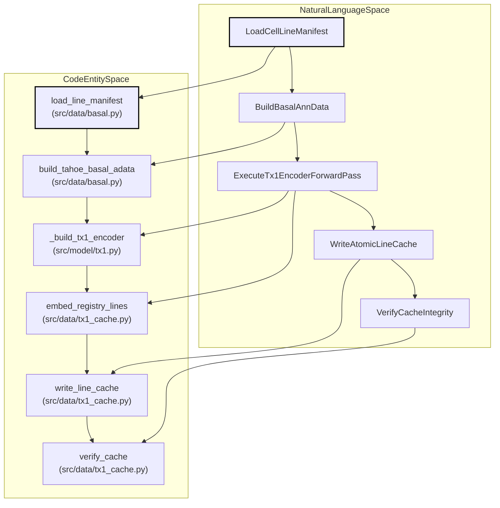
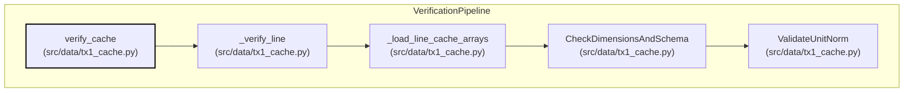

# Tx1 Basal Embedding Cache

<details>
<summary>Relevant source files</summary>

The following files were used as context for generating this wiki page:

- [src/data/tx1_cache.py](src/data/tx1_cache.py)
- [src/experiments/prepare.py](src/experiments/prepare.py)
- [tests/test_joint_integration.py](tests/test_joint_integration.py)
- [tests/test_tx1_basal.py](tests/test_tx1_basal.py)
- [tests/test_tx1_embed_cache.py](tests/test_tx1_embed_cache.py)
- [tests/test_tx1_response_data.py](tests/test_tx1_response_data.py)

</details>


The Tx1 Basal Embedding Cache system (`src/data/tx1_cache.py`) provides an encoder-agnostic storage, retrieval, and verification layer for Tx1-3B basal cell embeddings (`tahoe_x1_3b`, `EMBEDDING_WIDTH = 2560`) and Highly Variable Gene (HVG) expressions [src/data/tx1_cache.py:1-46](). It ensures immutability, atomic writes via staging directories, strict provenance tracking through metadata sidecars, and automated verification (`verify_cache`) prior to downstream model ingestion [src/data/tx1_cache.py:1-75]().

Sources: [src/data/tx1_cache.py:1-75](), [src/experiments/prepare.py:42-91]()

---

## Directory Layout and Sharding Architecture

Each cell line (`model_id`) in the dataset maintains an isolated subdirectory under the primary cache root. Within each line directory, arrays and sidecars are stored using strict naming conventions and binary formats (`.npy`, `.parquet`, `.json`).

```
cache_root/
├── ACH-000001/
│   ├── embeddings.npy          # Float32 array of shape (n_cells, 2560)
│   ├── hvg.npy                 # Float32 array of shape (n_cells, n_hvg_genes)
│   ├── obs.parquet             # Cell metadata DataFrame (obs)
│   ├── run_manifest.json       # Array shapes and schema version
│   ├── hvg_gene_order.json     # HVG gene order hash sidecar
│   ├── sample_provenance.json  # Cell selection, seed, and cap metadata
│   └── encoder_settings.json   # Tx1 model parameters and batch configs
├── ACH-000002/
...
```

### Core File Artifacts Table

| Artifact Name | File Format | Shape / Schema | Role |
| :--- | :--- | :--- | :--- |
| `embeddings.npy` | NumPy binary | `(n_cells, 2560)` | Cached Tx1-3B basal cell representations [src/data/tx1_cache.py:46]() |
| `hvg.npy` | NumPy binary | `(n_cells, n_genes)` | Aligned log-normalized counts for HVG panel |
| `obs.parquet` | Apache Parquet | `DataFrame` | Cell indices, barcodes, and experimental identifiers |
| `run_manifest.json` | JSON | Object | Records array dimensions, `_SCHEMA_VERSION`, and checksums |
| `hvg_gene_order.json` | JSON | Object | Tracks the STATE model's expected gene order hash [src/data/tx1_cache.py:59-65]() |
| `sample_provenance.json`| JSON | Object | Records sampling seed, cell cap, and extracted cell barcodes [src/data/tx1_cache.py:67-71]() |

Sources: [src/data/tx1_cache.py:44-75](), [src/experiments/prepare.py:42-90]()

---

## Natural Language Space to Code Entity Space: Cache Preparation Flow

This diagram maps conceptual pipeline operations to the specific codebase entities responsible for building, validating, and caching Tx1 basal embeddings.



Sources: [src/experiments/prepare.py:42-91](), [src/data/tx1_cache.py:130-220]()

---

## Key Functions and Implementation Details

### Writing Caches Atomically (`write_line_cache`)
To prevent partial writes or corrupted files during concurrent execution or interruption, `write_line_cache` writes all artifacts into a temporary sibling directory (using a UUID suffix) before performing an atomic directory rename (`os.replace`) into the final `cache_dir / model_id` location.

```python
# Conceptual flow inside write_line_cache
tmp_dir = cache_dir / f".tmp_{model_id}_{uuid.uuid4().hex}"
tmp_dir.mkdir(parents=True, exist_ok=False)
# Serialize embeddings.npy, hvg.npy, obs.parquet, run_manifest.json
os.replace(tmp_dir, cache_dir / model_id)
```

### Verification and Integrity (`verify_cache` / `_verify_line`)
The `verify_cache` function inspects the entire cache tree to validate:
1. Presence of required files (`embeddings.npy`, `hvg.npy`, `obs.parquet`, `run_manifest.json`).
2. Shape consistency between metadata declarations and NumPy array dimensions.
3. Unit-norm properties of the embedding space (`_UNIT_NORM_ATOL`).
4. HVG gene order consistency via `hvg_gene_order.json`.



Sources: [src/data/tx1_cache.py:100-350](), [tests/test_tx1_embed_cache.py:1-102]()

---

## Provenance Sidecars and Authority Controls

### Registration Authentication
Before embedding or loading cached assets, Stage 2 enforces rigid authority checks against pinned cryptographic digests. `authenticate_tx1_registration` verifies the SHA-256 hash of the Phase-A registration JSON against `PINNED_TX1_REGISTRATION_SHA256` [src/data/tx1_cache.py:52-54, 136-164]().

### Provenance Sidecars
- **`hvg_gene_order.json`**: Records the SHA-256 hash of the gene order list against which `hvg.npy` was projected, ensuring downstream models receive features aligned with the STATE backbone [src/data/tx1_cache.py:59-65]().
- **`sample_provenance.json`**: Captures deterministic sampling seeds, maximum cell caps per line, and exact cell indices selected during extraction [src/data/tx1_cache.py:67-71]().
- **`encoder_settings.json`**: Documents batch sizes, sequence length caps, and checkpoint directories used during inference [src/experiments/prepare.py:77-90]().

Sources: [src/data/tx1_cache.py:50-80](), [src/experiments/prepare.py:77-90](), [tests/test_tx1_embed_cache.py:86-102]()

---