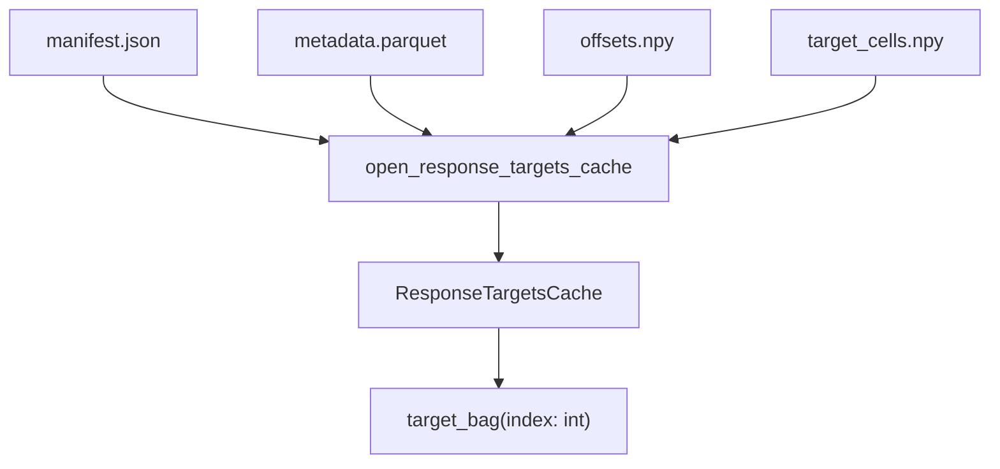
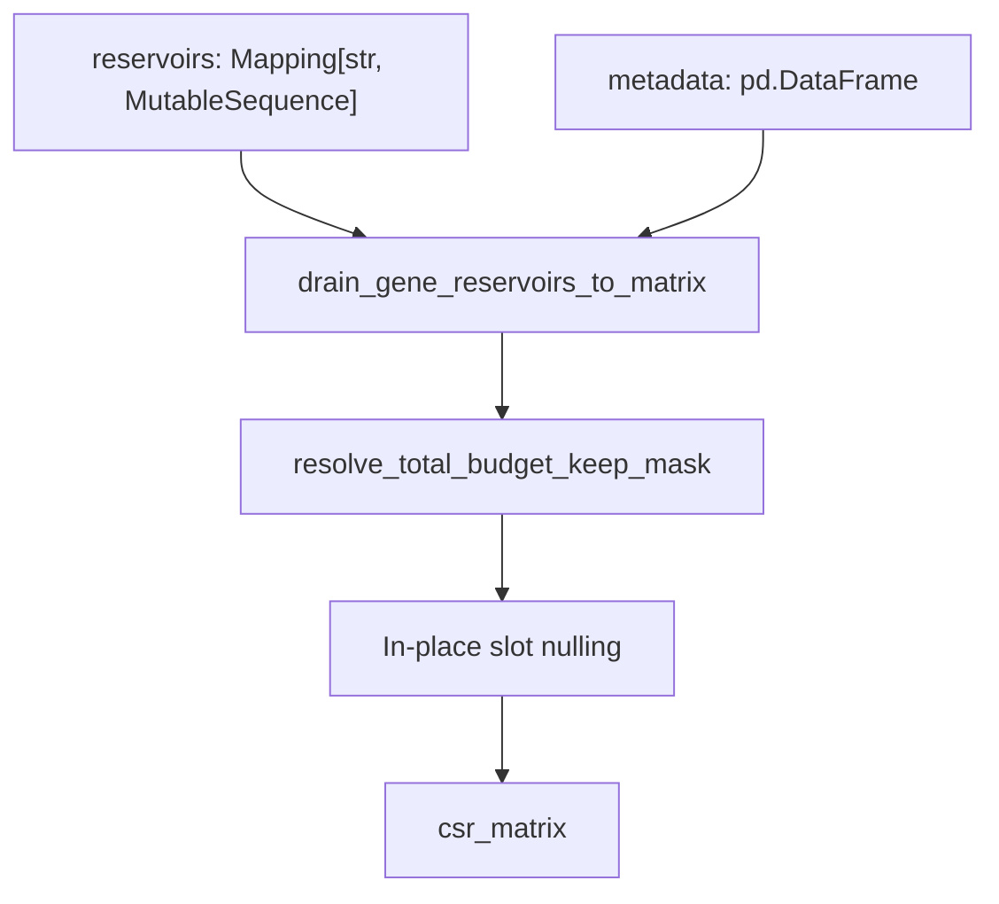
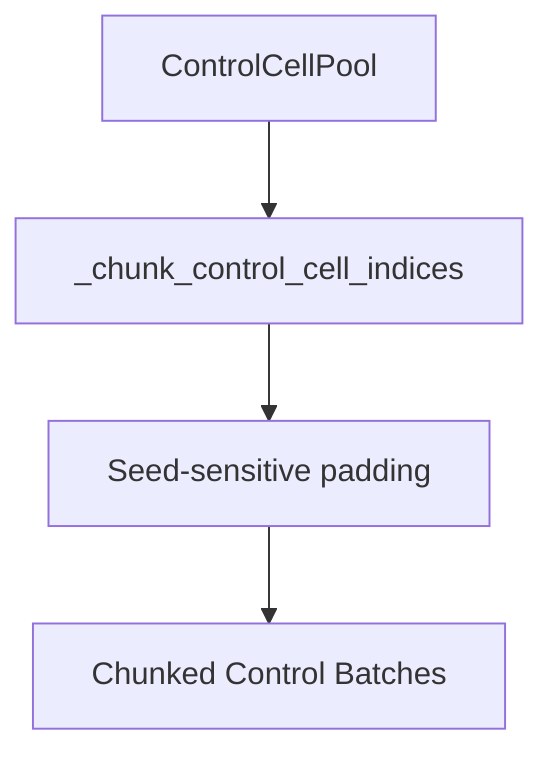
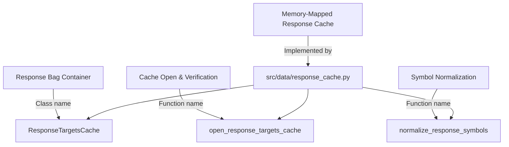
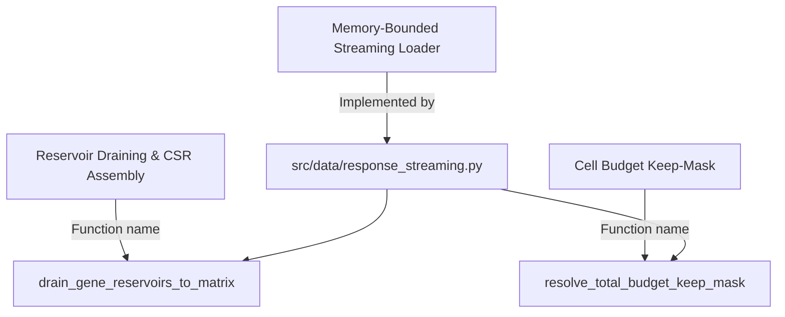

# Response Caches and Streaming

Relevant source files

The following files were used as context for generating this wiki page:

- [src/data/response_cache.py](src/data/response_cache.py)
- [src/data/response_streaming.py](src/data/response_streaming.py)
- [tests/test_tx1_predicted_response.py](tests/test_tx1_predicted_response.py)
- [tests/test_tx1_response_gene_bags_cache.py](tests/test_tx1_response_gene_bags_cache.py)
- [tests/test_tx1_response_streaming.py](tests/test_tx1_response_streaming.py)

## Purpose and Scope
This page details the implementation of response gene bags, memory-mapped response target caches, memory-bounded streaming loaders, and predicted-response cache controls within the codebase. These modules govern how observed cellular response states and baseline controls are ingested, stored on disk via memory-mapped layouts, streamed under tight memory budgets, and validated against canonical HVG orders.

Sources: `src/data/response_cache.py:1-46`, `src/data/response_streaming.py:1-43`

---

## 1. Memory-Mapped Response Targets (`ResponseTargetsCache`)

Observed response targets are stored using structured memory-mapped files to allow random access to multi-cell gene bags without holding entire datasets in RAM. The core data structure is `ResponseTargetsCache`, defined in `src/data/response_cache.py:27-36`.

### On-Disk Layout and Schema
The response cache directory contains a manifest file (`manifest.json`), a metadata table (`metadata.parquet`), and three binary array files (`target_cells.npy`, `offsets.npy`, `genes.npy`) adhering to schema version `1` (`src/data/response_cache.py:17-25`).

- `target_cells.npy`: A 2D `float32` array containing concatenated expression vectors for all cells across all bags, shaped `[total_cells, len(hvg_order)]` (`src/data/response_cache.py:126-135`).
- `offsets.npy`: An `int64` array of shape `[n_bags + 1]` marking the start and stop indices in `target_cells.npy` for each response bag (`src/data/response_cache.py:136-151`).
- `metadata.parquet`: A table tracking bag provenance containing columns `perturbation_gene`, `model_id`, and `n_cells` (`src/data/response_cache.py:152-159`).

### Key Functions
- `normalize_response_metadata`: Canonicalizes perturbation symbols by stripping whitespace, converting to uppercase, and checking for duplicate normalized conditions (`src/data/response_cache.py:47-58`).
- `open_response_targets_cache`: Validates manifest schema versions, HVG matching, array data types, offset monotonicity, and returns a initialized `ResponseTargetsCache` instance (`src/data/response_cache.py:61-174`).
- `ResponseTargetsCache.target_bag`: Slices the memory-mapped `target_cells` array using `offsets` to return the cell expression matrix for a specific bag index (`src/data/response_cache.py:41-45`).

Sources: `src/data/response_cache.py:17-174`, `tests/test_tx1_response_gene_bags_cache.py:32-62`

---

## 2. Streaming Loaders and Reservoir Draining

To prevent out-of-memory errors when processing massive datasets (such as HCT116 with over 18,000 perturbed genes where unflattened Python lists consume hundreds of gigabytes), the system uses a memory-bounded streaming and reservoir-draining pipeline (`src/data/response_streaming.py:1-43`).

### Reservoir Draining Algorithm
`drain_gene_reservoirs_to_matrix` builds a compressed sparse row (`csr_matrix`) from per-gene cell reservoirs while actively mutating and draining the reservoir in place (`src/data/response_streaming.py:86-122`).

1. **Total Budget Resolution**: `resolve_total_budget_keep_mask` computes an optional deterministic boolean mask across cells if a total cell budget is specified (`src/data/response_streaming.py:57-84`).
2. **In-Place Draining**: As cells are consumed from reservoirs sorted by gene name, processed slots are explicitly set to `None`. This allows Python's garbage collector to reclaim memory immediately rather than retaining references until the entire builder returns (`src/data/response_streaming.py:32-37`).
3. **Vectorized CSR Construction**: Component arrays (`indices`, `indptr`, `data`) are assembled using vectorized numpy routines rather than plain Python boxed-list iterations (`src/data/response_streaming.py:26-37`).

Sources: `src/data/response_streaming.py:1-146`, `tests/test_tx1_response_streaming.py:68-158`

---

## 3. Predicted-Response Caches and Control Cell Chunking

When evaluating predicted response states or establishing baseline controls, cell indices must be grouped into deterministic batches or windows.

### Control Cell Chunking
The helper `_chunk_control_cell_indices` divides control cell pools into fixed-size sets, handling tail padding deterministically using a configurable random seed (`tests/test_tx1_response_gene_bags_cache.py:148-164`). Because tail window filling depends on the seed, the seed forms part of cache fingerprints.

Sources: `tests/test_tx1_predicted_response.py:13-164`, `tests/test_tx1_response_gene_bags_cache.py:148-164`

---

## 4. Natural Language to Code Entity Mapping

The following diagrams bridge natural language concepts to their concrete code symbols and classes in the repository.

### Diagram: Response Storage Architecture

Sources: `src/data/response_cache.py:27-174`

### Diagram: Streaming Pipeline Architecture

Sources: `src/data/response_streaming.py:57-146`

---