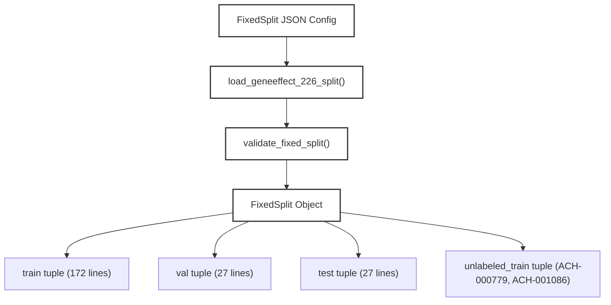
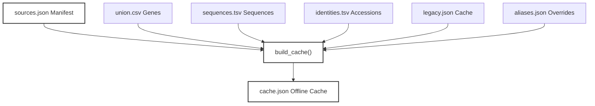
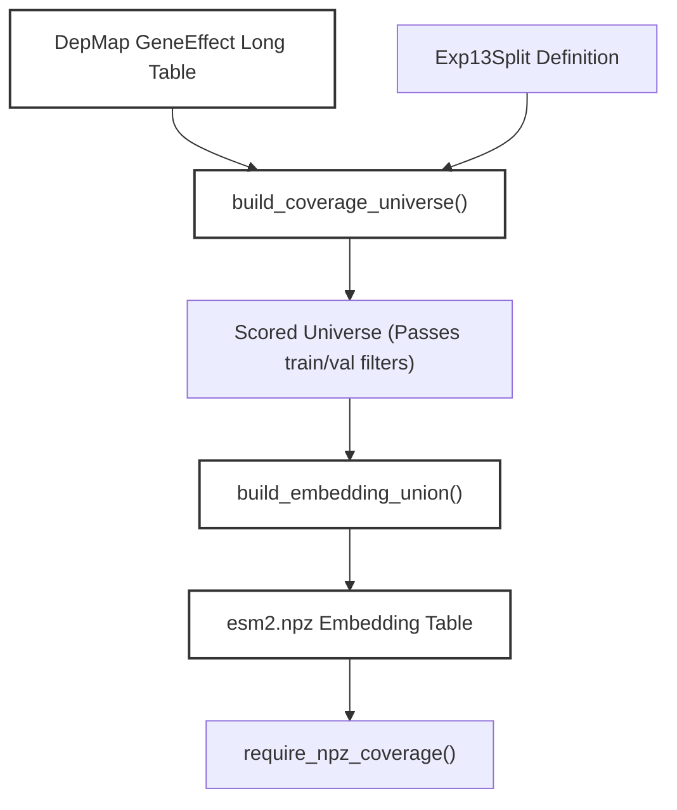

# Gene and Protein Feature Tables

Relevant source files

The following files were used as context for generating this wiki page:

- [configs/benchmarks/exp13_uniprot_accession_aliases.json](configs/benchmarks/exp13_uniprot_accession_aliases.json)
- [configs/benchmarks/exp13_uniprot_offline_sources.json](configs/benchmarks/exp13_uniprot_offline_sources.json)
- [src/data/geneeffect.py](src/data/geneeffect.py)
- [src/data/q_sc.py](src/data/q_sc.py)
- [src/data/splits.py](src/data/splits.py)
- [tests/test_bootstrap_exp13_uniprot_cache.py](tests/test_bootstrap_exp13_uniprot_cache.py)
- [tests/test_build_exp13_copy_prior.py](tests/test_build_exp13_copy_prior.py)
- [tests/test_build_exp13_esm2_universe.py](tests/test_build_exp13_esm2_universe.py)
- [tests/test_build_exp13_q_sc_cache.py](tests/test_build_exp13_q_sc_cache.py)
- [tests/test_geneeffect_data.py](tests/test_geneeffect_data.py)
- [tests/test_precompute_esm2_embeddings.py](tests/test_precompute_esm2_embeddings.py)

## Purpose and Scope

This page documents the immutable input-preparation phase and its underlying feature tables, offline caches, data structures, and membership splits. The system relies on strictly verified precomputed caches for protein language model embeddings (ESM2), UniProt offline provenance records, single-cell count population summaries (`q_sc`), the K562 copy prior, and fixed 226-cell-line train/val/test partitions. These structures isolate the training loop from raw single-cell AnnData files and remote web services during execution.

---

## 1. Cell Line Splits and Authority

Line partitioning is governed by fixed JSON configuration files that establish strict membership for the 226 DepMap cell lines. The codebase implements split management via `FixedSplit` and `Exp13Split` dataclasses, which enforce disjoint train, validation, and test partitions, as well as designated unlabeled training lines.

*Figure 1: Split Validation and Authority Dataflow.*

* `FixedSplit` defines line partitions where models and context metrics are fitted strictly on the training partition (`src/data/splits.py:10-34`()).
* `load_geneeffect_226_split` parses split JSON definitions, validating string types, duplicate entries, and partition disjointness (`src/data/splits.py:71-107`()).
* `assert_fit_eligible` acts as a hard guard, raising an error if an inference-only validation/test line or an unlabeled training line enters a fitting or training loop (`src/data/splits.py:110-140`()).
* `Exp13Split` provides strict validation against a pinned SHA-256 hash representing the canonical benchmark state (`src/data/geneeffect.py:51-76`(), `src/data/geneeffect.py:149-186`()).

Sources: `src/data/splits.py:1-140`(), `src/data/geneeffect.py:51-186`()

---

## 2. UniProt Offline Cache Bootstrap

To avoid runtime network dependencies on the UniProt API during ESM2 embedding precomputation, the pipeline bootstraps an offline cache of protein sequences, accessions, and gene identifiers governed by explicit source manifests.

*Figure 2: UniProt Offline Cache Bootstrap Pipeline.*

* `build_cache` resolves primary protein sequences, UniProt accessions, and explicit alias overrides using a verified multi-artifact source bundle (`tests/test_bootstrap_exp13_uniprot_cache.py:40-88`()).
* Source manifests (`configs/benchmarks/exp13_uniprot_offline_sources.json`) pin the cryptographic SHA-256 hashes of all input files (`configs/benchmarks/exp13_uniprot_offline_sources.json:1-25`()).
* Accession aliases (`configs/benchmarks/exp13_uniprot_accession_aliases.json`) handle ambiguous gene symbols or multi-mapping entries like `GPR89A` and `H3C4` (`configs/benchmarks/exp13_uniprot_accession_aliases.json:1-22`()).
* Integrity checks reject any record where a sequence SHA-256 hash diverges from the pinned source manifest or legacy cache expectations (`tests/test_bootstrap_exp13_uniprot_cache.py:99-139`()).

Sources: `tests/test_bootstrap_exp13_uniprot_cache.py:1-185`(), `configs/benchmarks/exp13_uniprot_offline_sources.json:1-25`(), `configs/benchmarks/exp13_uniprot_accession_aliases.json:1-22`()

---

## 3. ESM2 Embedding Precomputation and Universe Construction

Protein language model features are precomputed for a union of scored genes and response-bag genes. The universe builder reconciles raw gene coverage requirements across splits before embedding table extraction.

*Figure 3: Coverage Universe and ESM2 Embedding Union Construction.*

* `build_coverage_universe` evaluates coverage requirements per gene, assigning explicit drop reasons (such as `train_finite_lt5` or `val_finite_lt3`) when observation counts fall below thresholds (`tests/test_build_exp13_esm2_universe.py:48-54`()).
* `build_embedding_union` combines scored genes and response-only evaluation genes into a sorted, duplicate-free universe (`tests/test_build_exp13_esm2_universe.py:62-66`()).
* `require_npz_coverage` validates that precomputed `.npz` files match the expected symbol order, dimension width, and resolution flags exactly, throwing errors on dimension mismatches or unexpected symbols (`tests/test_build_exp13_esm2_universe.py:79-114`()).
* Provenance utilities authenticate ESM2 embedding tables and ensure complete vector coverage prior to model initialization (`tests/test_precompute_esm2_embeddings.py:26-28`()).

Sources: `tests/test_build_exp13_esm2_embeddings.py:1-200`(), `tests/test_build_exp13_esm2_universe.py:1-165`()

---

## 4. Single-Cell Count Population Summaries (`q_sc` Cache)

Single-cell auxiliary features are precomputed per cell line into isolated shards (`.npz`) containing population summaries derived from raw UMI counts.

| Shard Array Key | Shape | Dtype | Description |
| :--- | :--- | :--- | :--- |
| `model_id` | `()` (scalar) | string / object | DepMap model identifier (e.g., `ACH-000551`) |
| `gene_symbols` | `(N,)` | string / object | Canonical uppercase gene symbol panel |
| `values` | `(N, 3)` | `np.float32` | Population metrics: `[mean, detected_fraction, variance]` |
| `available` | `(N,)` | `np.bool_` | Boolean flag indicating valid quantification |

*Table 1: Shard Layout and Array Schemas for Prepared `q_sc` Caches.*

* `load_q_sc_line` opens prepared `q_sc` shards without consulting raw AnnData source files, verifying shapes, dtypes, model ID alignment, and gene ordering (`src/data/q_sc.py:29-115`()).
* `compute_q_sc` computes mean expression, detected fraction, and population variance directly from raw UMI count matrices (`src/data/q_sc.py:118-170`()). It enforces strict validation rules, requiring finite, non-negative, integer raw counts and rejecting non-raw representations (e.g., `log1p` transformed matrices) (`tests/test_build_exp13_q_sc_cache.py:15-60`()).

Sources: `src/data/q_sc.py:1-170`(), `tests/test_build_exp13_q_sc_cache.py:1-79`()

---

## 5. Copy Prior Materialization

The pipeline incorporates a K562-based copy-number/gene-effect prior (`copy_prior.csv`) derived from DepMap CRISPR gene effect tables.

* `materialize_copy_prior` extracts K562 gene effect data (using donor model ID `ACH-000551`), filters out missing values, and writes out the prior alongside a cryptographic manifest (`tests/test_build_exp13_copy_prior.py:36-47`()).
* Manifest validation guards against unpinned source modifications by verifying SHA-256 sums of incoming `CRISPRGeneEffect.csv` tables and output prior files (`tests/test_build_exp13_copy_prior.py:104-124`()).
* `restrict_scored_universe_to_copy_prior` applies a strict universe gate, flagging genes missing from the copy prior with `copy_prior_missing` drop reasons (`tests/test_build_exp13_copy_prior.py:136-158`()).

Sources: `tests/test_build_exp13_copy_prior.py:1-170`()

---

## 6. Architecture-to-Code Mapping

This section bridges the natural language system components to their concrete Python code entities across the data preparation module.

```mermaid
graph TD
    subgraph Natural_Language_Space ["Natural Language Space"]
        NS_Split["Fixed Split Authority"]
        NS_UniProt["UniProt Offline Cache"]
        NS_ESM2["ESM2 Embedding Precompute"]
        NS_QSC["Single-Cell Count Summary q_sc"]
        NS_CopyPrior["K562 Copy Prior Materializer"]
    end

    subgraph Code_Entity_Space ["Code Entity Space"]
        CE_Split["src.data.splits.FixedSplit & src.data.geneeffect.Exp13Split"]
        CE_UniProt["src.data.prepare.bootstrap_exp13_uniprot_cache.build_cache"]
        CE_ESM2["src.data.prepare.build_exp13_esm2_universe & src.data.embeddings"]
        CE_QSC["src.data.q_sc.load_q_sc_line & src.data.q_sc.compute_q_sc"]
        CE_CopyPrior["src.data.prepare.build_exp13_copy_prior.materialize_copy_prior"]
    end

    NS_Split --> CE_Split
    NS_UniProt --> CE_UniProt
    NS_ESM2 --> CE_ESM2
    NS_QSC --> CE_QSC
    NS_CopyPrior --> CE_CopyPrior

    style Natural_Language_Space fill:none,stroke:#333,stroke-width:2px
    style Code_Entity_Space fill:none,stroke:#333,stroke-width:2px
    style NS_Split fill:none,stroke:#333,stroke-width:2px
    style NS_UniProt fill:none,stroke:#333,stroke-width:2px
    style NS_ESM2 fill:none,stroke:#333,stroke-width:2px
    style NS_QSC fill:none,stroke:#333,stroke-width:2px
    style NS_CopyPrior fill:none,stroke:#333,stroke-width:2px
    style CE_Split fill:none,stroke:#333,stroke-width:2px
    style CE_UniProt fill:none,stroke:#333,stroke-width:2px
    style CE_ESM2 fill:none,stroke:#333,stroke-width:2px
    style CE_QSC fill:none,stroke:#333,stroke-width:2px
    style CE_CopyPrior fill:none,stroke:#333,stroke-width:2px
```

*Figure 4: Mapping Natural Language Concepts to Code Entities for Feature Tables.*

Sources: `src/data/splits.py:10-34`(), `src/data/geneeffect.py:51-76`(), `src/data/prepare/bootstrap_exp13_uniprot_cache.py`(), `src/data/prepare/build_exp13_esm2_universe.py`(), `src/data/q_sc.py:20-115`()

---