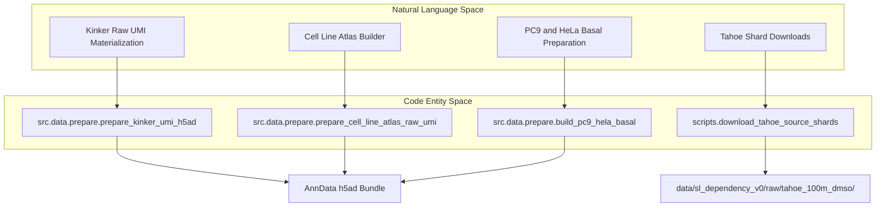
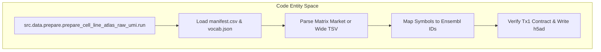

# Raw Data Ingestion Scripts

<details>
<summary>Relevant source files</summary>

The following files were used as context for generating this wiki page:

- [configs/benchmarks/context_screen_v2_basal_registry.json](configs/benchmarks/context_screen_v2_basal_registry.json)
- [configs/benchmarks/context_screen_v2_split.json](configs/benchmarks/context_screen_v2_split.json)
- [docs/data/sl-context-screen.md](docs/data/sl-context-screen.md)
- [scripts/README.md](scripts/README.md)
- [tests/test_build_pc9_hela_basal.py](tests/test_build_pc9_hela_basal.py)
- [tests/test_build_sl_context_benchmark.py](tests/test_build_sl_context_benchmark.py)
- [tests/test_materialize_exp13_original47_raw_umi.py](tests/test_materialize_exp13_original47_raw_umi.py)
- [tests/test_prepare_cell_line_atlas_raw_umi.py](tests/test_prepare_cell_line_atlas_raw_umi.py)
- [tests/test_prepare_kinker_cpm_h5ad.py](tests/test_prepare_kinker_cpm_h5ad.py)
- [tests/test_prepare_kinker_umi_h5ad.py](tests/test_prepare_kinker_umi_h5ad.py)

</details>


## Purpose and Scope

This section documents the raw data ingestion pipeline located in `src/data/prepare/`, the operational utility scripts in `scripts/`, and the source registries governing immutable input preparation [scripts/README.md:1-14](). The ingestion scripts transform raw single-cell RNA-seq count matrices (such as Kinker cell line screens, Tahoe shards, and published Perturb-seq datasets) into immutable, Tx1-contract-verified `AnnData` (`.h5ad`) bundles and provenance-tracked benchmark registries.

Sources: [scripts/README.md:1-14]()

---

## 1. Ingestion Architecture and Pipeline Orchestration

The raw data ingestion subsystem coordinates external data retrieval, metadata validation, matrix format normalization, and contract verification prior to any embedding or model training phase.


Sources: [scripts/README.md:10-14](), [tests/test_prepare_kinker_umi_h5ad.py:22-24](), [tests/test_prepare_cell_line_atlas_raw_umi.py:13-13](), [tests/test_build_pc9_hela_basal.py:12-12]()

---

## 2. Kinker Raw UMI and CPM Ingestion Builders

The Kinker pipeline separates raw integer UMI count ingestion from normalized CPM sensitivity matrices. The script `src/data/prepare/prepare_kinker_umi_h5ad.py` enforces strict integer validation and reconciliation against selected cell metadata [tests/test_prepare_kinker_umi_h5ad.py:1-25]().

### Key Functions and Guards
- `build(args)`: Main entry point for the Kinker raw UMI builder [tests/test_prepare_kinker_umi_h5ad.py:23]().
- Non-integer check: Refuses non-integer matrices to prevent normalized or scaled values from entering raw count pipelines [tests/test_prepare_kinker_umi_h5ad.py:126-131]().
- Cell-line reconciliation: Asserts that the matrix row `Cell_line` matches the expected manifest selection [tests/test_prepare_kinker_umi_h5ad.py:134-149]().

```python
# Conceptual usage of the Kinker raw UMI build entrypoint
uv run python -m src.data.prepare.prepare_kinker_umi_h5ad --help
```
[scripts/README.md:11-11]()

Sources: [scripts/README.md:11-11](), [tests/test_prepare_kinker_umi_h5ad.py:1-190]()

---

## 3. Cell Line Atlas and Original 47 Materialization

Cell line atlases combine heterogeneous sources (such as Matrix Market format and wide TSV files) into a unified AnnData layout mapped to Ensembl IDs and Tx1 vocabulary tokens [tests/test_prepare_cell_line_atlas_raw_umi.py:16-117]().

### Atlas Pipeline Flow


Sources: [tests/test_prepare_cell_line_atlas_raw_umi.py:13-122](), [tests/test_materialize_exp13_original47_raw_umi.py:6-10]()

- `run(config_path, output_dir, only_model_id)`: Orchestrates multi-source ingestion in `src/data/prepare/prepare_cell_line_atlas_raw_umi.py` [tests/test_prepare_cell_line_atlas_raw_umi.py:120-122]().
- Symbol mapping: `_map_symbols_to_ensembl` filters ambiguous gene symbols and resolves Ensembl identifiers [tests/test_materialize_exp13_original47_raw_umi.py:7-43]().
- Stable ranking: `_stable_rank` and `_update_top_cells` manage deterministic cell sampling using stable hashing [tests/test_materialize_exp13_original47_raw_umi.py:8-28]().

Sources: [tests/test_prepare_cell_line_atlas_raw_umi.py:1-164](), [tests/test_materialize_exp13_original47_raw_umi.py:1-43]()

---

## 4. Basal Registries and Context Screen Benchmarks

Context-conditioned SL ranking and gene effect prediction rely on locked basal registries (`configs/benchmarks/context_screen_v2_basal_registry.json`) and explicit split configurations (`configs/benchmarks/context_screen_v2_split.json`) [configs/benchmarks/context_screen_v2_basal_registry.json:1-101](), [configs/benchmarks/context_screen_v2_split.json:1-123]().

### Basal Registry Schema Structure

| Field | Type | Description |
| :--- | :--- | :--- |
| `context` | String | Canonical cell line name (e.g., `A549`, `K562`, `PC9`) |
| `model_id` | String | DepMap ModelID (e.g., `ACH-000681`) |
| `basal_source` | String | Origin description and assay type |
| `artifact_path` | String | Relative path to raw count or AnnData artifact |
| `artifact_sha256` | String | Cryptographic checksum of input artifact |
| `artifact_status` | String | Verification status (`source_registered`, `tx1_contract_verified`) |

Sources: [configs/benchmarks/context_screen_v2_basal_registry.json:1-101](), [configs/benchmarks/context_screen_v2_split.json:1-123]()

### PC9 and HeLa Basal Preparation

The module `src/data/prepare/build_pc9_hela_basal.py` handles specific data repairs required for older or formatted matrices [tests/test_build_pc9_hela_basal.py:12-12]().
- Excel symbol repairs: `_repair_hela_symbols` corrects date-mangled gene symbols (e.g., `1-Mar` to `MARC1`) position-aware [tests/test_build_pc9_hela_basal.py:15-30]().
- Quality Control gating: `_minimum_qc_mask` filters cells by gene detection thresholds and mitochondrial content [tests/test_build_pc9_hela_basal.py:32-42]().

Sources: [tests/test_build_pc9_hela_basal.py:1-87](), [configs/benchmarks/context_screen_v2_basal_registry.json:1-101]()

---

## 5. Tahoe Data Downloads and Operational Scripts

Raw source shards and large external dependencies are retrieved using shell scripts located in `scripts/` [scripts/README.md:1-14]().

- `download_tahoe_source_shards.sh`: Downloads requested Tahoe source shards [scripts/README.md:3-4]().
- Execution pattern: Ingestion and preparation scripts are executed from the repository root as Python modules via `uv run` [scripts/README.md:6-14]().

Sources: [scripts/README.md:1-14]()

---