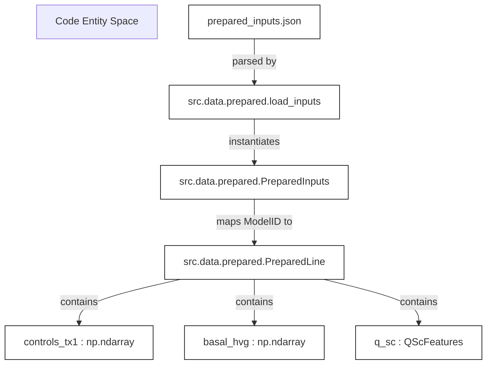
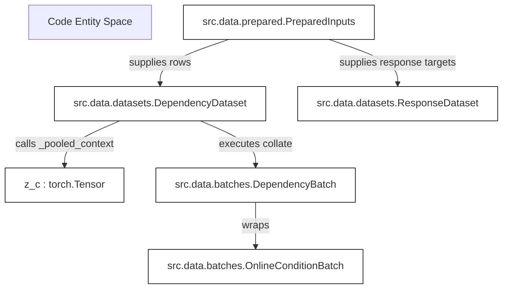
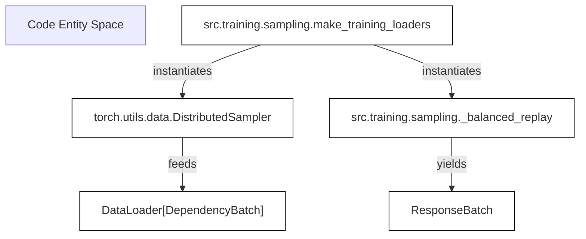

# Datasets, Batching and Sampling

Relevant source files

The following files were used as context for generating this wiki page:

- [src/data/__init__.py](src/data/__init__.py)
- [src/data/batches.py](src/data/batches.py)
- [src/data/datasets.py](src/data/datasets.py)
- [src/data/prepared.py](src/data/prepared.py)
- [src/model/__init__.py](src/model/__init__.py)
- [src/training/sampling.py](src/training/sampling.py)
- [tests/test_joint_data.py](tests/test_joint_data.py)
- [tests/test_joint_sampling.py](tests/test_joint_sampling.py)

## Purpose and Scope
This section details the data ingestion, dataset definition, batch construction, and sampling infrastructure defined in `src/data/datasets.py` [src/data/datasets.py:1-254](), `src/data/batches.py` [src/data/batches.py:1-319](), and `src/training/sampling.py` [src/training/sampling.py:1-122](). These modules consume serialized metadata (`prepared_inputs.json`) and backing arrays to supply deterministic, distributed training and evaluation batches for joint GeneEffect and response-replay training.

---

## 1. Prepared Inputs and Metadata Loading (`prepared_inputs.json`)
The immutable foundation for all datasets is initialized via `load_inputs()` in `src/data/prepared.py` [src/data/prepared.py:1-507](), which parses the `prepared_inputs.json` manifest. The manifest enforces schema version `geneeffect-joint-prepared-v1` [src/data/prepared.py:27-27]() and defines global partitions, common gene panels, HVG orders, ESM2 vectors, and response anchor pools [src/data/prepared.py:159-174]().

Each cell line's basal representations are encapsulated by `PreparedLine` [src/data/prepared.py:31-37](), holding pooled Tx1 control embeddings (`controls_tx1`), highly variable gene basal values (`basal_hvg`), and single-cell q-score features (`QScFeatures`).

Sources: `src/data/prepared.py:1-508]`, `tests/test_joint_data.py:1-178]()`

---

## 2. Dataset Classes and Collators

`src/data/datasets.py` provides two primary PyTorch `Dataset` implementations for joint training and evaluation: `DependencyDataset` and `ResponseDataset`.

### `DependencyDataset`
`DependencyDataset` manages finite GeneEffect rows for train, validation, or test splits [src/data/datasets.py:30-84](). 
- **Initialization**: Filters `labels` by ModelIDs corresponding to the requested split (`supervised_train`, `val`, or `test`) [src/data/datasets.py:36-44](). Caches worker-device tensors for basal controls and HVG profiles [src/data/datasets.py:70-77]().
- **Context Pooling**: Computes pooled cell contexts (`z_c`) via `_pooled_context()` [src/data/datasets.py:23-28](), concatenating the mean and variance across Tx1 control embedding dimensions.
- **Collator (`collate`)**: Groups integer indices into a `DependencyBatch` [src/data/datasets.py:85-144]() containing an `OnlineConditionBatch`, residual target tensor, gene means, and a validity mask.

### `ResponseDataset`
`ResponseDataset` indexes prepared response conditions from the response targets cache, partitioned by holdout status (`holdout=True` or `False`) [src/data/datasets.py:147-167]().

Sources: `src/data/datasets.py:1-255]()`

---

## 3. Batch Data Structures

Batch containers are defined in `src/data/batches.py` as immutable dataclasses with rigorous validation methods (`validate()`) [src/data/batches.py:1-319]().

- `FeatureBatch` [src/data/batches.py:11-82](): Unstandardized live head features including projection deltas, single-cell features, ESM2 vectors, and context tensors.
- `OnlineConditionBatch` [src/data/batches.py:84-175](): Differentiable joint response-feature inputs containing tuple sequences of control cell bags (`controls_tx1`, `basal_hvg`), target genes, model IDs, and alignment masks.
- `DependencyBatch`: Combines an `OnlineConditionBatch` with target residuals, training gene means, and row validity flags [src/data/datasets.py:133-141]().

Sources: `src/data/batches.py:1-320]`, `src/data/datasets.py:85-144]()`

---

## 4. Sampling and Loader Construction

Deterministic dependency epochs and independently cycling anchor replay are implemented in `src/training/sampling.py` [src/training/sampling.py:1-122]().

### `make_training_loaders`
`make_training_loaders()` builds a sharded PyTorch `DataLoader` for dependency training and an infinite iterator for response replay [src/training/sampling.py:52-120]().
- **Dependency Stream**: Uses PyTorch's `DistributedSampler` with `seed=0`, shuffling per epoch (`sampler.set_epoch(epoch)`) and dropping incomplete trailing batches (`drop_last=True`) [src/training/sampling.py:95-103]().
- **Response Replay Stream (`_balanced_replay`)**: Independent of DistributedSampler state, `_balanced_replay()` divides `response_batch_size` across exactly four response anchors (`response_anchors`) [src/training/sampling.py:17-50](). It cycles through condition indices using isolated random number generators initialized with `SeedSequence([0, epoch, rank, anchor])` [src/training/sampling.py:32-35]().

Sources: `src/training/sampling.py:1-123]()`

---

## 5. Verification and Integration Tests

Data loading, batch validation, and sampling invariants are verified by the test suites in `tests/test_joint_data.py` [src/tests/test_joint_data.py:1-434]() and `tests/test_joint_sampling.py` [src/tests/test_joint_sampling.py:1-142](). Key tests ensure:
- Zero-drift reproducibility across epoch/rank restarts without global RNG pollution [tests/test_joint_sampling.py:45-65]().
- Strict exclusion of holdout response conditions from the training replay stream [tests/test_joint_sampling.py:21-44]().
- Validation failures on invalid response batch sizes (e.g. not divisible by four) or non-zero base runtime seeds [tests/test_joint_sampling.py:67-83]().

Sources: `tests/test_joint_data.py:1-434]`, `tests/test_joint_sampling.py:1-142]()`

---