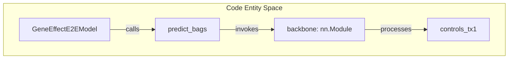
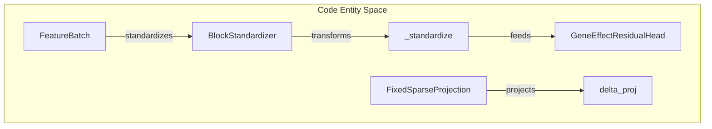

# Model Architecture

Relevant source files

The following files were used as context for generating this wiki page:

- [docs/results/tx1-hvg-geneeffect-phase-f.md](docs/results/tx1-hvg-geneeffect-phase-f.md)
- [docs/specs/2026-07-22-k562-mechanism-and-geneeffect-generalization-plan.md](docs/specs/2026-07-22-k562-mechanism-and-geneeffect-generalization-plan.md)
- [docs/specs/2026-07-23-tx1-st-geneeffect-backbone-design.md](docs/specs/2026-07-23-tx1-st-geneeffect-backbone-design.md)
- [src/model/features.py](src/model/features.py)
- [src/model/geneeffect.py](src/model/geneeffect.py)

## Purpose and Scope

The model architecture module defines the end-to-end neural network pipeline used to predict cellular dependencies and gene perturbation responses. At its core, the system composes a state-transition dynamics backbone with a five-block residual head to map basal single-cell transcriptomes and target gene perturbations into DepMap GeneEffect scores and distributional response predictions [`src/model/geneeffect.py:22-24()`]. This page provides a high-level overview of the backbone adapters, feature extraction pipelines, residual heads, and loss formulations. For deep technical implementation details, refer to the respective child pages.

Sources: `src/model/geneeffect.py:22-24()`

---

## 3.1 STATE Backbone Adapters

The STATE backbone adapters encapsulate single-cell perturbation forward passes, handling context-conditioned bag predictions, chunking strategies for large cell populations, and distributed data-parallel (DDP) safety. The central orchestrator is the `GeneEffectE2EModel` class, which invokes the state transition models via `predict_bags` to simulate post-perturbation cellular states [`src/model/geneeffect.py:68-73()`].

For detailed implementation of `StateForwardAdapter`, `ForwardOnlyStateModel`, chunking mechanisms, DDP safety guards, and mock models, see [STATE Backbone Adapters](#3.1).

Sources: `src/model/geneeffect.py:68-73()`

---

## 3.2 GeneEffect Head and Features

The gene effect head subsystem extracts structured numerical descriptors from predicted cell bags and projects them through a five-block residual architecture (`GeneEffectResidualHead`). Features include sparse Johnson-Lindenstrauss projections (`FixedSparseProjection`), HVG panel metrics, and baseline representations [`src/model/features.py:71-116()`, `src/model/geneeffect.py:22-38()`]. Features are normalized using `BlockStandardizer` prior to head ingestion [`src/model/geneeffect.py:41-64()`].

For detailed information on the five-feature residual head, feature blocks, normalization routines, initialization, and loss functions, see [GeneEffect Head and Features](#3.2).

Sources: `src/model/geneeffect.py:22-64()`, `src/model/features.py:71-116()`

---

## 3.3 Response Prediction and Distributional Losses

To evaluate the fidelity of predicted perturbation responses against empirical single-cell distributions, the architecture computes distributional metrics such as energy distance and mean-delta MSE [`src/model/features.py:10-11()`]. Bag padding, deterministic random number generator (RNG) isolation, and online feature computation ensure reproducible training dynamics across distributed nodes [`src/model/geneeffect.py:66-93()`].

For comprehensive coverage of bag padding strategies, energy distance calculations, mean-delta MSE formulations, and RNG isolation controls, see [Response Prediction and Distributional Losses](#3.3).

Sources: `src/model/geneeffect.py:66-93()`, `src/model/features.py:10-11()`

---