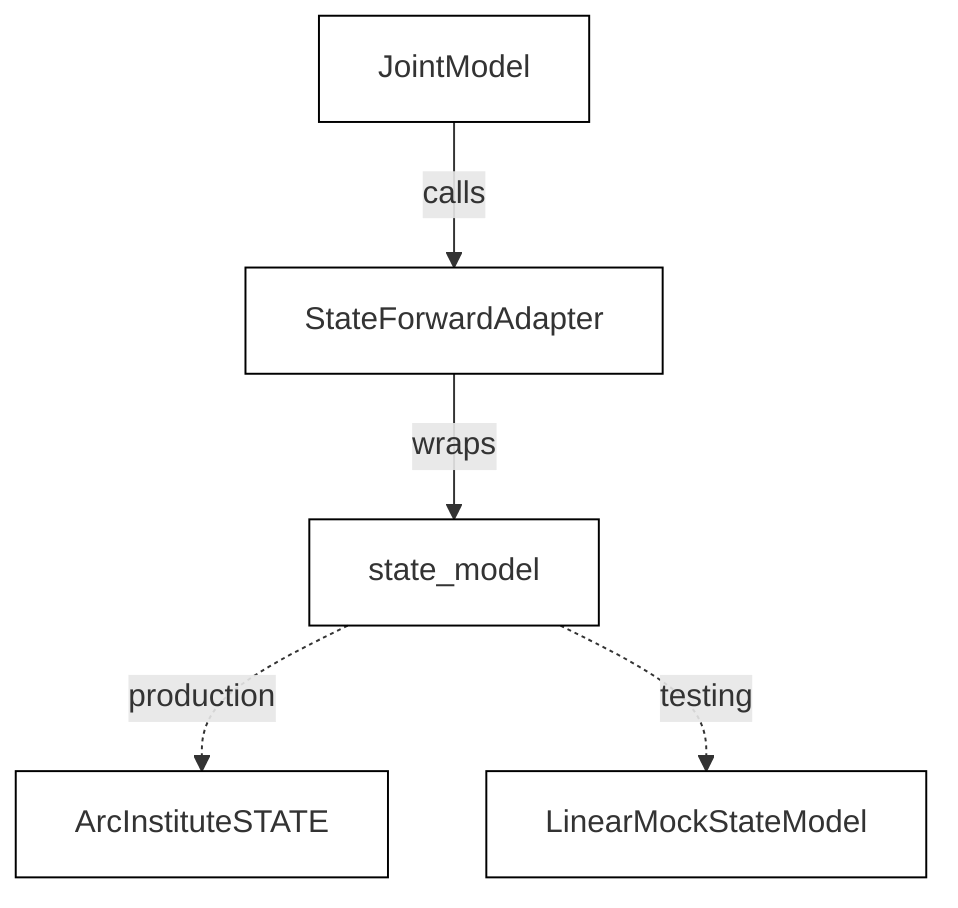
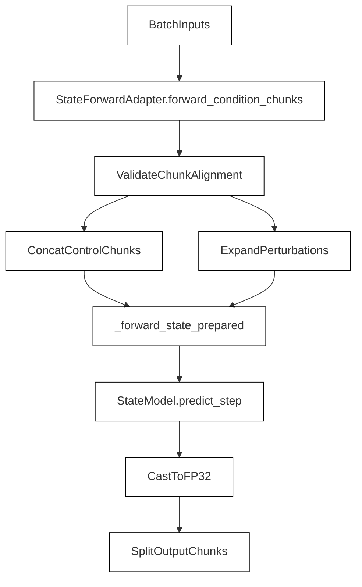

# STATE Backbone Adapters

<details>
<summary>Relevant source files</summary>

The following files were used as context for generating this wiki page:

- [src/experiments/profile_joint.py](src/experiments/profile_joint.py)
- [src/model/state.py](src/model/state.py)
- [tests/test_joint_objective.py](tests/test_joint_objective.py)
- [tests/test_state_core.py](tests/test_state_core.py)

</details>


## Purpose and Scope
This page documents the STATE backbone adapter subsystem (`src/model/state.py`), which acts as an integration layer between the modular perturbation head/joint trainer and the ArcInstitute STATE transition model backbone [src/model/state.py:34-40](). It covers `StateForwardAdapter`, support for mock architectures (`LinearMockStateModel`), batched condition chunking, memory-efficient tensor expansions, mixed-precision gradient preservation, and Distributed Data Parallel (DDP) safety considerations.

---

## 1. Core Classes and Mock Models

The backbone subsystem provides an abstraction boundary so that downstream modules interact uniformly with either real STATE checkpoints or lightweight test doubles.

### `LinearMockStateModel`
`LinearMockStateModel` is a lightweight, fully self-contained neural network that mimics the input-output shape signature of a STATE backbone [src/model/state.py:9-32](). It is used extensively in unit tests and local smoke runs where checkpoint assets are absent [tests/test_state_core.py:3-8]().

* **Inputs**: Expects a dictionary containing `ctrl_cell_emb` (basal cell embeddings) and `pert_emb` (perturbation embeddings) [src/model/state.py:25-30]().
* **Operation**: Concatenates basal and perturbation vectors along dimension 1 and passes them through a two-layer `nn.Sequential` block with a `GELU` activation [src/model/state.py:17-31]().

### `StateForwardAdapter`
`StateForwardAdapter` wraps an underlying STATE model (`state_model`), standardizing input formatting, batch annotations, and output extraction [src/model/state.py:34-40](). It handles three execution modes:
1. **Unpadded Single Condition (`forward`)**: Processes a single control cell tensor and perturbation vector for one gene [src/model/state.py:41-55]().
2. **Equal-Size Chunks (`forward_chunks`)**: Splits control matrices into equal-sized condition chunks [src/model/state.py:57-70]().
3. **Batched Condition Chunks (`forward_condition_chunks`)**: Packs multiple gene conditions into a single batched sequence pass to maximize GPU utilization [src/model/state.py:72-130]().

Diagram: STATE Backbone Integration Hierarchy


*Sources: `src/model/state.py:9-40](), [tests/test_state_core.py:32-44`*

---

## 2. Chunking and Batch Expansion

To handle varying batch layouts without kernel overheads, `StateForwardAdapter.forward_condition_chunks` implements batched condition expansion [src/model/state.py:72-130]().

### Validation and Constraints
Before executing a forward pass, the adapter verifies structural invariants:
* Perturbations must form a 2D tensor of shape `[chunks, features]` [src/model/state.py:80-81]().
* Control chunks, perturbation rows, gene names, and batch indices must align in length [src/model/state.py:82-89]().
* Chunk sizes must match the backbone's configured `cell_sentence_len` attribute [src/model/state.py:92-99]().

### Memory-Efficient Perturbation Expansion
Rather than invoking separate forward passes or independent reduction kernels per chunk, perturbations are expanded across the sentence length dimension in a single batched operation [src/model/state.py:106-112]():

```python
perturbation_cells = (
    perturbations.unsqueeze(1)
    .expand(-1, chunk_sizes[0], -1)
    .reshape(control_cells.shape[0], -1)
)
```[src/model/state.py:108-112]()

Diagram: StateForwardAdapter Chunking Flow


*Sources: `src/model/state.py:72-130](), [tests/test_state_core.py:48-85`*

---

## 3. Mixed-Precision and Gradient Preservation

STATE backbones often operate in lower-precision formats (`float16` or `bfloat16`) to conserve memory. `StateForwardAdapter` manages numerical stability and gradient flow across precision boundaries:

* **Single-Cast Normalization**: Output tensors from the backbone are converted to `float32` once prior to view splitting [src/model/state.py:125-129](). This avoids redundant casting operations and backward pass overheads for each condition chunk.
* **Gradient Equivalence**: Unit tests verify that running chunked, bfloat16-native forward passes yields identical gradient magnitudes and storage sharing behavior compared to unquantized reference computations [tests/test_state_core.py:115-138]().

---

## 4. DDP-Safety and Distributed Execution

When training joint models across multiple GPUs using HuggingFace `Accelerate`, backbone adapters must interoperate correctly with Distributed Data Parallel (DDP) wrappers.

* **Unused Parameter Handling**: Because certain perturbation embedding tables or conditioning projections may not receive gradients on every micro-step, launchers explicitly configure DDP to tolerate unused parameters [src/experiments/profile_joint.py:40-43]() via `DistributedDataParallelKwargs(find_unused_parameters=True)`.
* **Device Placement**: Probes and training routines validate that worker accelerators are active CUDA devices before invoking state forward passes [src/experiments/profile_joint.py:44-48]().

*Sources: `src/experiments/profile_joint.py:40-48](), [src/model/state.py:160-173`*

---