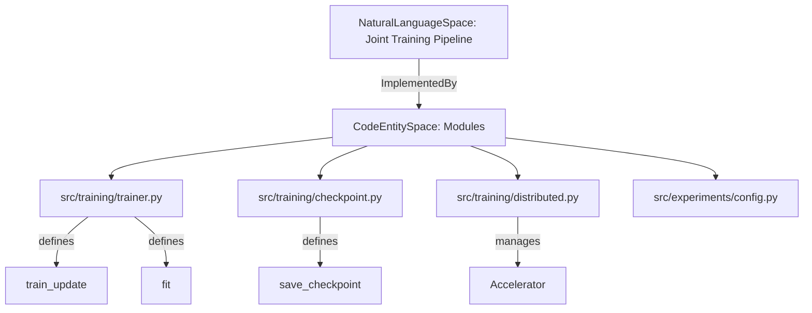
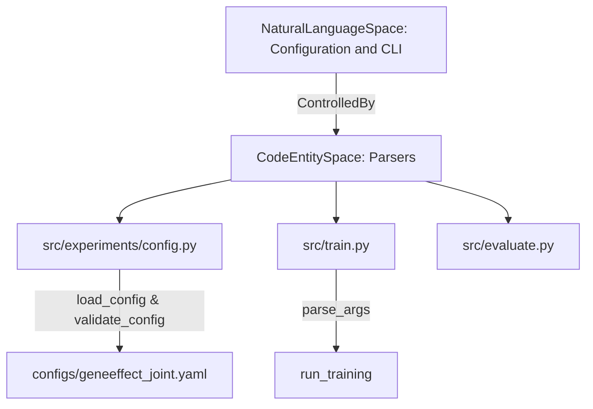

# Joint Training System

Relevant source files

The following files were used as context for generating this wiki page:

- [docs/specs/2026-09-06-modular-joint-training-design.md](docs/specs/2026-09-06-modular-joint-training-design.md)
- [docs/specs/2026-09-06-modular-joint-training-plan.md](docs/specs/2026-09-06-modular-joint-training-plan.md)
- [src/training/trainer.py](src/training/trainer.py)
- [tests/test_joint_cli.py](tests/test_joint_cli.py)
- [tests/test_joint_distributed.py](tests/test_joint_distributed.py)
- [tests/test_joint_resume.py](tests/test_joint_resume.py)
- [tests/test_joint_training.py](tests/test_joint_training.py)

The Joint Training System unifies context-conditioned GeneEffect regression with recurring Perturb-seq response supervision into a single coherent training loop `[docs/specs/2026-09-06-modular-joint-training-design.md:10-21]`. By replacing historical staged training runs with a unified architecture, the system coordinates dependency batches and multi-anchor response replay updates simultaneously `[docs/specs/2026-09-06-modular-joint-training-design.md:80-94]`.

For details on child topics, refer to:
- [Trainer Loop and Objective](#4.1)
- [Configuration and CLI](#4.2)
- [Checkpointing, Resume and Distributed Execution](#4.3)
- [Performance Profiling and Throughput](#4.4)

Sources: `docs/specs/2026-09-06-modular-joint-training-design.md:10-21`, `src/training/trainer.py:31-176`

---

## 4.1 Trainer Loop and Objective

The training loop coordinates fine-grained gradient updates using Huber loss for GeneEffect prediction alongside mean-delta MSE and energy distance for response supervision `[docs/specs/2026-09-06-modular-joint-training-design.md:68-79]`. Every optimizer update processes a dependency batch, while periodic replay steps inject response supervision from four anchors (`K562`, `Jurkat`, `HepG2`, `HCT116`) at a configurable cadence (`src/training/trainer.py`) `[docs/specs/2026-09-06-modular-joint-training-design.md:80-94, src/training/trainer.py:53-118]`. Early stopping and best checkpoint selection strictly monitor `val_geneeffect_loss` `[docs/specs/2026-09-06-modular-joint-training-plan.md:19-21]`.

For deep technical details, see [Trainer Loop and Objective](#4.1).

Sources: `docs/specs/2026-09-06-modular-joint-training-design.md:68-94`, `src/training/trainer.py:53-118`

---

## 4.2 Configuration and CLI

Configurations are strictly specified via YAML files such as `configs/geneeffect_joint.yaml` `[tests/test_joint_cli.py:16-17]`. The configuration loader enforces schema bounds and rejects missing or unknown keys to prevent silent misconfigurations `[tests/test_joint_cli.py:56-65]`. Command-line interfaces like `src.train` and `src.evaluate` handle execution entrypoints and parameter overrides without importing heavy libraries unnecessarily during help commands `[tests/test_joint_cli.py:80-99]`.

Sources: `tests/test_joint_cli.py:16-65`, `docs/specs/2026-09-06-modular-joint-training-plan.md:56`

For details, see [Configuration and CLI](#4.2).

Sources: `tests/test_joint_cli.py:16-99`, `docs/specs/2026-09-06-modular-joint-training-plan.md:56`

---

## 4.3 Checkpointing, Resume and Distributed Execution

Distributed execution leverages `Accelerate` and Distributed Data Parallel (DDP) wrappers to coordinate multi-rank training over PyTorch `[src/training/trainer.py:171-176, tests/test_joint_distributed.py:32-51]`. Checkpointing utilities (`src/training/checkpoint.py`) perform strict state loads, capturing optimizer states, RNG states, and training progress to enable exact resume behavior `[tests/test_joint_resume.py:26-95]`. HPC orchestration scripts (`hpc/run.sh`) manage large-scale resource provisioning and execution `[docs/specs/2026-09-06-modular-joint-training-plan.md:56]`.

For complete architectural details, see [Checkpointing, Resume and Distributed Execution](#4.3).

Sources: `src/training/trainer.py:171-176`, `tests/test_joint_distributed.py:32-51`, `tests/test_joint_resume.py:26-95`

---

## 4.4 Performance Profiling and Throughput

System throughput and memory utilization are continuously evaluated using diagnostic profiling probes (`profile_joint.py`) `[docs/specs/2026-09-06-modular-joint-training-design.md:115-117]`. Profiling results drive optimizations such as scaled batch sizing per rank (e.g., dependency batch size of 1024) to maximize GPU core efficiency across large cohorts `[docs/specs/2026-09-06-modular-joint-training-design.md:115-117]`.

For profiling metrics and diagnosis guides, see [Performance Profiling and Throughput](#4.4).

Sources: `docs/specs/2026-09-06-modular-joint-training-design.md:115-117`

---