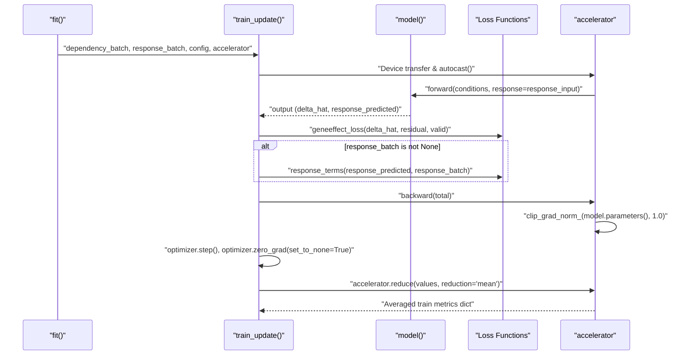

# Trainer Loop and Objective

<details>
<summary>Relevant source files</summary>

The following files were used as context for generating this wiki page:

- [src/train.py](src/train.py)
- [src/training/trainer.py](src/training/trainer.py)
- [tests/test_joint_distributed.py](tests/test_joint_distributed.py)
- [tests/test_joint_resume.py](tests/test_joint_resume.py)
- [tests/test_joint_training.py](tests/test_joint_training.py)

</details>


The trainer loop and objective system orchestrates joint optimization of GeneEffect dependency prediction and single-cell response replay. This module manages parameter partitioning, gradient scaling, mixed-precision autocasting, distributed metric reduction via Hugging Face `accelerate`, and validation-driven early stopping based on validation GeneEffect loss.

Sources: `src/training/trainer.py:1-176](), `tests/test_joint_training.py:1-190]()

---

## Optimizer Partitioning and Parameter Groups

The optimizer configuration partitions model parameters into three distinct groups corresponding to the STATE backbone, the ESM2 perturbation adapter, and the prediction head. `make_optimizer` inspects `model` and constructs a `torch.optim.AdamW` optimizer with group-specific learning rates and shared weight decay [src/training/trainer.py:31-50]().

```mermaid
graph TD
    subcode ["Code Entities"]
        Model["model"] --> StateMod["model.backbone.state_adapter"]
        Model --> AdapterMod["model.backbone.perturbations"]
        Model --> HeadMod["model.head"]
        
        StateMod --> GroupState["Group: state (lr: train.state_learning_rate)"]
        AdapterMod --> GroupAdapter["Group: adapter (lr: train.adapter_learning_rate)"]
        HeadMod --> GroupHead["Group: head (lr: train.head_learning_rate)"]
        
        GroupState --> Opt["torch.optim.AdamW"]
        GroupAdapter --> Opt
        GroupHead --> Opt
    end
```
*Figure 1: Parameter partitioning flow from model components to optimizer groups.*

Sources: `src/training/trainer.py:31-50]()

---

## The Training Update Step (`train_update`)

The core gradient-update iteration is executed by `train_update`. It accepts dependency and optional response batches, performs a forward pass under mixed precision, computes joint losses, executes backpropagation with gradient clipping, and applies optimizer steps [src/training/trainer.py:53-117]().


*Figure 2: Execution sequence of a single training update step.*

### Implementation Mechanics

1. **Device Placement and Input Conversion**: Batches are moved to the target `accelerator.device` [src/training/trainer.py:59-61](). Response inputs are filtered into `ResponseForwardBatch` structures [src/training/trainer.py:62-66]().
2. **Forward Autocast**: Model execution is wrapped in `accelerator.autocast()` context [src/training/trainer.py:67-68]().
3. **Loss Aggregation**: Dependency loss (`geneeffect_loss`) is computed on residual targets [src/training/trainer.py:69-71](). If a response replay batch is present, `response_terms` calculates mean-delta MSE and energy distance, scaled by `response_weight` [src/training/trainer.py:74-78]().
4. **Gradient Clipping and Optimization**: Non-finite loss validation triggers explicit failure [src/training/trainer.py:79-80](). Backpropagation runs through `accelerator.backward()`, followed by gradient norm clipping at `1.0` [src/training/trainer.py:84-85]().
5. **Distributed Reduction**: Loss values across ranks are averaged using `accelerator.reduce` before returning logging metrics [src/training/trainer.py:93-117]().

Sources: `src/training/trainer.py:53-117](), `tests/test_joint_training.py:1-190]()

---

## Objective Formulation and Loss Components

The joint training objective combines dependency prediction error with single-cell response distributional alignment:

$$\mathcal{L}_{\text{total}} = \mathcal{L}_{\text{geneeffect}} + \lambda_{\text{response}} \left( \mathcal{L}_{\text{delta\_mse}} + \mathcal{L}_{\text{energy}} \right)$$

- **GeneEffect Loss ($\mathcal{L}_{\text{geneeffect}}$)**: Evaluated via Huber-style or customized robust regression on valid target pairs (`dependency_batch.residual`) [src/training/trainer.py:69-71]().
- **Response Replay Losses**: When active based on `response_interval` cadence, `response_terms` computes:
  - `mean_delta_mse`: Mean squared error of predicted versus observed single-cell response changes [src/training/trainer.py:77]().
  - `energy_distance`: Distributional discrepancy metric between predicted and observed response sets [src/training/trainer.py:78]().

Sources: `src/training/trainer.py:69-78](), `src/model/losses.py:1](), `src/model/response.py:1]()

---

## Training Orchestration (`fit`) and Early Stopping

The `fit` function manages epoch loops, startup standardizer fitting, checkpoint loading/saving, and state restoration [src/training/trainer.py:130-176]().

### Early Stopping and Checkpoint Selection

- **Validation Metric**: Model selection and patience tracking operate strictly on validation GeneEffect loss (`val_geneeffect_loss`), avoiding train-set overfitting interference [tests/test_joint_training.py:128-138]().
- **State Persistence**: Checkpoints (`best.pt` and `last.pt`) record optimizer states, AMP scaling states, RNG states, and training progression metrics via `TrainState` [src/training/trainer.py:17-22]().
- **DDP Configuration**: Distributed Data Parallel handles dynamic parameters via `find_unused_parameters = True` to support conditional auxiliary heads [src/training/trainer.py:171-174]().

Sources: `src/training/trainer.py:130-176](), `tests/test_joint_resume.py:1-162]()

---