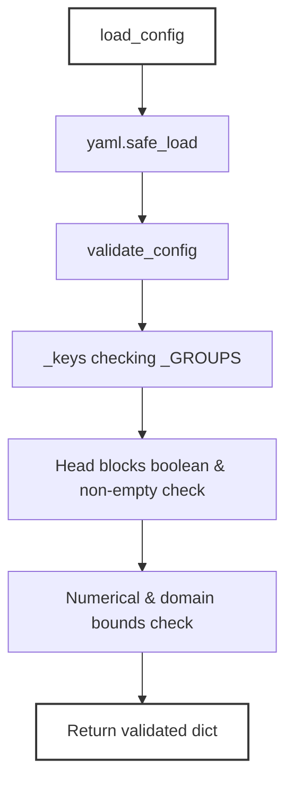
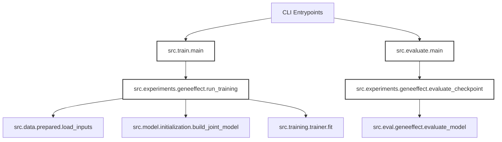

# Configuration and CLI

<details>
<summary>Relevant source files</summary>

The following files were used as context for generating this wiki page:

- [configs/geneeffect_joint.yaml](configs/geneeffect_joint.yaml)
- [docs/specs/2026-09-06-modular-joint-training-design.md](docs/specs/2026-09-06-modular-joint-training-design.md)
- [docs/specs/2026-09-06-modular-joint-training-plan.md](docs/specs/2026-09-06-modular-joint-training-plan.md)
- [src/evaluate.py](src/evaluate.py)
- [src/experiments/config.py](src/experiments/config.py)
- [src/experiments/geneeffect.py](src/experiments/geneeffect.py)
- [tests/test_joint_cli.py](tests/test_joint_cli.py)

</details>


## Purpose and Scope

This section covers the configuration system and Command Line Interfaces (CLIs) for the joint GeneEffect prediction and response-replay training pipeline. It details the structure of `configs/geneeffect_joint.yaml`, the strict schema validation enforcement implemented in `src/experiments/config.py`, the execution entrypoints (`src/train.py` and `src/evaluate.py`), and the launcher integration tests in `tests/test_joint_cli.py`.

---

## 1. Configuration Schema (`configs/geneeffect_joint.yaml`)

The joint training protocol relies on a single comprehensive YAML configuration file, `configs/geneeffect_joint.yaml`. The schema is partitioned into discrete logical groups: `seeds`, `train`, `selection`, `features`, `model`, `preparation`, and `paths`, alongside top-level parameters (`precision`, `output_root`, `prepared_root`).

```yaml
seeds: {train: 0, collator: 0, projection: 0}
train:
  max_epochs: 50
  patience: 5
  dependency_batch_size: 1024
  response_batch_size: 64
  response_interval: 4
  response_weight: 1.0
  state_learning_rate: 0.000001
  adapter_learning_rate: 0.00001
  head_learning_rate: 0.0001
  weight_decay: 0.01
selection: {metric: val_geneeffect_loss, mode: min}
precision: bf16
output_root: outputs/geneeffect_joint
prepared_root: data/geneeffect_joint/v1
...
```

Sources: [configs/geneeffect_joint.yaml:1-58]()

---

## 2. Strict Configuration Validation (`src/experiments/config.py`)

Configuration parsing is handled by `src/experiments/config.py`, which defines `load_config` and `validate_config`. Validation is executed strictly without opening input files or importing `torch`, enabling fast CLI help and boundary checking.

### Key Validation Rules
- **Schema Conformity**: Missing or unknown keys within any group (`_GROUPS`) or top-level field trigger a `ValueError` [src/experiments/config.py:41-48]().
- **Type Safety**: Boolean flags (such as `model.head_blocks`) must be real booleans; string paths must be non-empty strings [src/experiments/config.py:62-71]().
- **Head Block Constraint**: At least one head block (`use_delta_proj`, `use_s`, `use_q_sc`, `use_e_g`, `use_z_c`) must be enabled [src/experiments/config.py:64-65]().
- **Domain Constraints**: Learning rates, batch sizes, and percentiles are verified for finite numerical bounds and expected domains (e.g., `train.response_batch_size` must be divisible by 4, `train.response_interval` must equal `4`) [src/experiments/config.py:115-118]().
- **Fixed Seeds**: Base seeds (`seeds.train`, `seeds.collator`, `seeds.projection`) are strictly locked to `0` [src/experiments/config.py:76-78]().


*Figure 1: Configuration Loading and Strict Validation Flow*

Sources: [src/experiments/config.py:1-136]()

---

## 3. Training and Evaluation CLIs (`src/train.py`, `src/evaluate.py`)

The codebase exposes two primary entrypoint scripts for executing experiments and inspecting saved checkpoints.

### Training CLI (`src/train.py` / `src/experiments/geneeffect.py`)
`src/train.py` parses arguments (`--run-id` or `--resume`) and dispatches control to `run_training` in `src/experiments/geneeffect.py`. 
- **Initialization**: Sets up the run directory (`output_root / run_id`), writes `run.json` containing revision hashes, seeds, environment stats (Python, PyTorch, Accelerate, device), and copies the validated configuration [src/experiments/geneeffect.py:96-125]().
- **Execution & Resuming**: Loads inputs via `load_inputs`, constructs the joint model via `build_joint_model` or restores it via `_restore_model`, and passes control to the trainer loop (`fit`) [src/experiments/geneeffect.py:137-150]().

### Evaluation CLI (`src/evaluate.py`)
`src/evaluate.py` provides independent evaluation over saved checkpoints (`--checkpoint`, `--split train|val|test`), invoking `evaluate_checkpoint` without triggering optimizer steps [src/evaluate.py:1-23](), [src/experiments/geneeffect.py:179-188]().


*Figure 2: CLI Command Dispatch and Execution Architecture*

Sources: [src/evaluate.py:1-23](), [src/experiments/geneeffect.py:61-188]()

---

## 4. Launcher and CLI Unit Tests (`tests/test_joint_cli.py`)

Testing safeguards are codified in `tests/test_joint_cli.py`. These tests validate configuration boundaries and execution behavior without requiring heavy GPU resources or full model initialization where possible.

- **`test_approved_defaults_and_conflicts`**: Ensures default values match specification and mutations to constrained fields correctly raise `ValueError` [tests/test_joint_cli.py:16-37]().
- **`test_ablation_flags_require_real_booleans`**: Verifies that integer or string representations of booleans (e.g., `0`, `"false"`) in `head_blocks` are rejected [tests/test_joint_cli.py:39-45]().
- **`test_all_disabled_head_is_rejected`**: Guards against fully disabled head configurations [tests/test_joint_cli.py:47-53]().
- **`test_help_does_not_import_torch`**: Executes module `--help` runs via `runpy` and asserts that `torch` is not loaded into `sys.modules`, ensuring lightweight CLI responsiveness [tests/test_joint_cli.py:77-99]().
- **`test_missing_cache_training_fails_without_raw_rebuild`**: Asserts that running training against missing prepared caches fails cleanly with a `FileNotFoundError` pointing to preparation instructions rather than silently falling back to raw assembly [tests/test_joint_cli.py:122-148]().

Sources: [tests/test_joint_cli.py:1-183]()

---