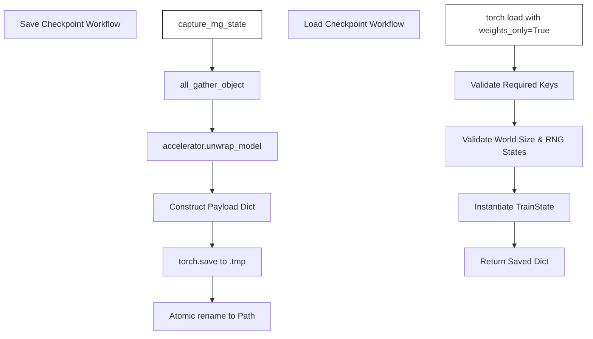
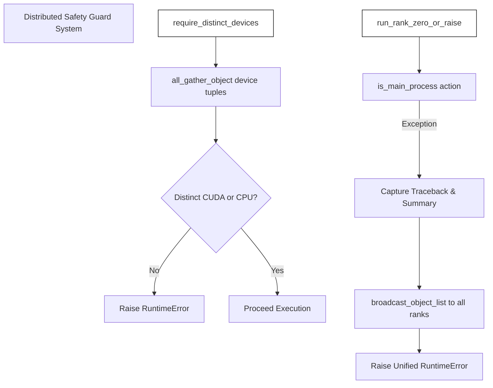
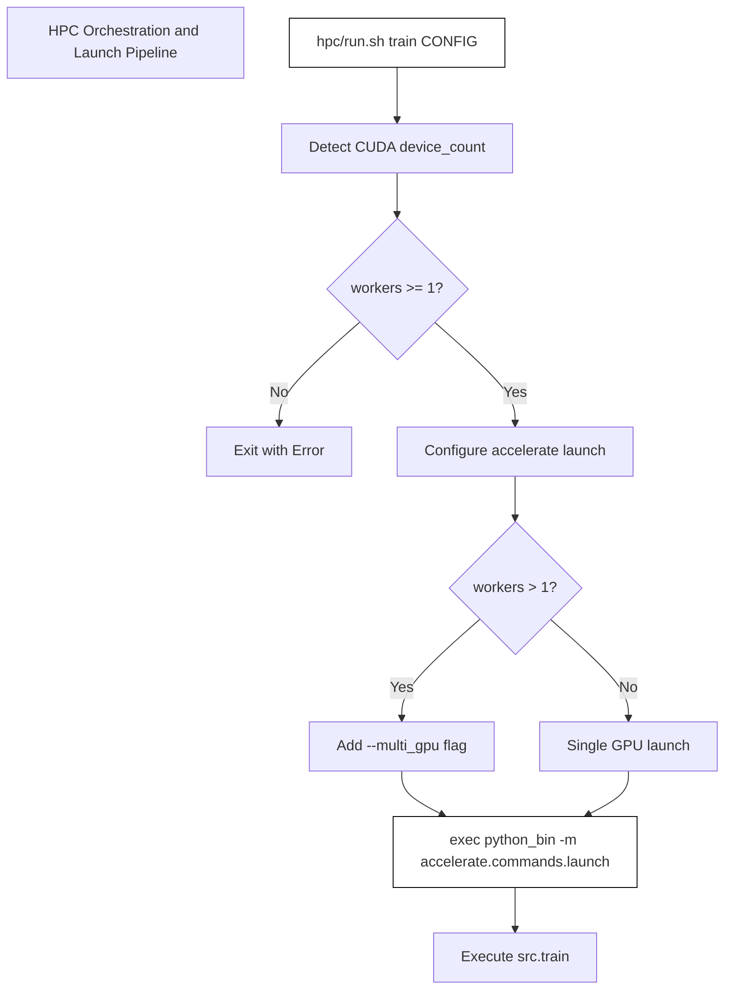

# Checkpointing, Resume and Distributed Execution

Relevant source files

The following files were used as context for generating this wiki page:

- [hpc/run.sh](hpc/run.sh)
- [src/training/checkpoint.py](src/training/checkpoint.py)
- [src/training/distributed.py](src/training/distributed.py)
- [tests/test_distributed.py](tests/test_distributed.py)

## Purpose and Scope
This page documents the joint training infrastructure's state management, fault tolerance, and distributed execution mechanisms. It covers strict checkpoint serialization and resumption (`src/training/checkpoint.py`), multi-rank distributed data parallel (DDP) safety and synchronization (`src/training/distributed.py`), unit test coverage for DDP invariants (`tests/test_distributed.py`), and job orchestration through the HPC entrypoint script (`hpc/run.sh`).

Sources: `src/training/checkpoint.py`, `src/training/distributed.py`, `tests/test_distributed.py`, `hpc/run.sh`

---

## 1. Checkpoint Architecture and State Management (`checkpoint.py`)

The checkpoint system manages epoch-boundary persistence, tracking validation loss metrics, and ensuring complete reproducibility across resume cycles.

### Key Data Structures and Functions
- **`TrainState`**: A dataclass tracking optimization progress (`src/training/checkpoint.py:16-23`):
  - `next_epoch`: The index of the next training epoch to execute.
  - `global_step`: Total optimizer update steps performed.
  - `best_loss`: Best recorded validation metric (`val_geneeffect_loss`), initialized to `math.inf`.
  - `best_epoch`: Epoch index where `best_loss` was achieved.
  - `bad_epochs`: Count of consecutive epochs without validation improvement (used for early stopping).
- **`record_validation()`**: Evaluates epoch metrics against `val_geneeffect_loss` and updates `TrainState` strictly on GeneEffect loss decrease (`src/training/checkpoint.py:25-38`).
- **`capture_rng_state()` & `restore_rng_state()`**: Isolate and serialize random number generator states across Python `random`, `numpy.random` (converting MT19937 state words into tensor-compatible representations), `torch`, and accelerator-specific devices (`cuda` or `mps`) (`src/training/checkpoint.py:41-65`).
- **`save_checkpoint()`**: Collects RNG states from all active distributed ranks via `torch.distributed.all_gather_object`, unwraps the model via `accelerator.unwrap_model()`, serializes model weights, projection states, normalizer states, optimizer states, AMP scalers, and rank-specific RNG states into an atomic `.tmp` file before renaming it to the final destination path (`src/training/checkpoint.py:67-106`).
- **`load_checkpoint()`**: Performs CPU-side loading (`weights_only=True`), validates all required keys against a strict schema, and verifies that the saved world size matches the expected number of RNG states (`src/training/checkpoint.py:108-130`).

### Checkpoint Save and Load Flow

Sources: `src/training/checkpoint.py`

---

## 2. Distributed Coordination and DDP Invariants (`distributed.py`)

Multi-rank execution in joint training requires strict device validation and collective error propagation to prevent silent deadlocks or desynchronization across ranks.

### Key Functions
- **`require_distinct_devices()`**: Validates device assignments across all processes when `accelerator.num_processes > 1` (`src/training/distributed.py:10-39`). It gathers local device representations using `torch.distributed.all_gather_object` and asserts that either all ranks run on CPU/Gloo or all ranks are assigned distinct CUDA device indices.
- **`raise_rank_errors()`**: Collects error states across ranks prior to dependent collectives or optimizer updates, raising a unified `RuntimeError` if any rank reported a failure (`src/training/distributed.py:41-49`).
- **`run_rank_zero_or_raise()`**: Executes a callback function exclusively on the main process (`accelerator.is_main_process`), captures any raised exceptions, and broadcasts the failure summary and stack trace to all worker ranks using `torch.distributed.broadcast_object_list` (`src/training/distributed.py:51-72`).

### Distributed Guard Architecture

Sources: `src/training/distributed.py`

### DDP Unit Testing (`tests/test_distributed.py`)
The test suite utilizes a mock accelerator (`FakeAccelerator`) and monkeypatches `torch.distributed.all_gather_object` to validate distributed safety rules without initializing a real process group (`tests/test_distributed.py:1-35`):
- `test_require_distinct_devices_single_process_is_noop`: Confirms no collectives execute for single-process training (`tests/test_distributed.py:36-43`).
- `test_require_distinct_devices_raises_on_duplicate_cuda_index`: Guards against duplicate GPU assignments (`tests/test_distributed.py:45-54`).
- `test_require_distinct_devices_raises_on_non_cuda_rank`: Ensures homogeneous device assignment across workers (`tests/test_distributed.py:56-65`).
- `test_run_rank_zero_or_raise_reraises_rank_zero_failure`: Verifies exception propagation from rank zero to worker nodes (`tests/test_distributed.py:102-110`).

Sources: `src/training/distributed.py`, `tests/test_distributed.py`

---

## 3. HPC Job Orchestration (`hpc/run.sh`)

Job execution across single-node and multi-GPU environments is orchestrated by `hpc/run.sh`. The script manages environment resolution, accelerator configuration, and subcommand routing.

### CLI Commands and Workflow
`hpc/run.sh` supports the following primary subcommands (`hpc/run.sh:4-15`):
- `prepare`: Data preparation entrypoint (`src.experiments.prepare`).
- `train`: Joint training execution (`src.train`).
- `test`: Evaluation entrypoint against specified checkpoints (`src.evaluate`).
- `p1a`, `p1b`, `p1c`: Diagnostic experiment pipeline stages.

### GPU Detection and Launch Orchestration
For the `train` command, `hpc/run.sh` dynamically queries visible GPUs using PyTorch, configures Hugging Face `accelerate`, and launches training with mixed precision (`bf16`) (`hpc/run.sh:34-44`):
1. Detects available worker devices: `workers=$("$python_bin" -c 'import torch; print(torch.cuda.device_count())')` (`hpc/run.sh:36`).
2. Validates that at least one GPU is visible.
3. Constructs launch arguments for `accelerate.commands.launch`, appending `--multi_gpu` if `workers > 1` (`hpc/run.sh:41-43`).

Sources: `hpc/run.sh`

---