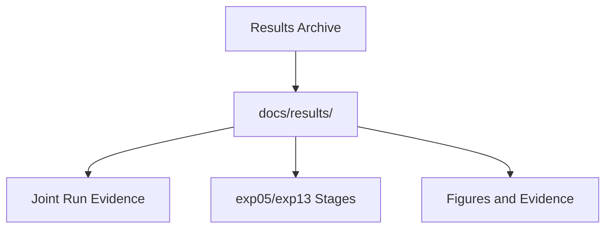

# Evaluation and Baselines

<details>
<summary>Relevant source files</summary>

The following files were used as context for generating this wiki page:

- [src/eval/geneeffect.py](src/eval/geneeffect.py)
- [src/eval/metrics.py](src/eval/metrics.py)
- [src/eval/response.py](src/eval/response.py)
- [tests/test_joint_checkpoint.py](tests/test_joint_checkpoint.py)
- [tests/test_joint_evaluation.py](tests/test_joint_evaluation.py)

</details>


## Purpose and Scope

This page provides a high-level overview of the evaluation systems, metric definitions, and baseline controls used to assess gene perturbation predictions and response distributions within the codebase. The evaluation framework handles aligned-row GeneEffect scoring (measuring residual prediction performance across cell lines and genes) alongside distributional response metrics, while storing artifacts and running systematic baseline comparisons. 

For deep technical details, see the child pages:
- [GeneEffect and Response Metrics](#5.1)
- [Baseline Controls](#5.2)
- [Results Archive and Evidence](#5.3)

---

## 5.1 GeneEffect and Response Metrics

The evaluation infrastructure measures two primary prediction modalities: continuous GeneEffect residuals and single-cell response distributions. The module `src/eval/geneeffect.py` coordinates evaluation runs, metric gathering across parallel processes, and correlation aggregation [src/eval/geneeffect.py:1-53](). Simultaneously, `src/eval/response.py` evaluates single-cell response predictions using metrics like mean-delta MSE and energy distance [src/eval/response.py:1-59](). The underlying statistical operations, such as unit-level Pearson and Spearman correlations with strict minimum-observation thresholds, are housed in `src/eval/metrics.py` [src/eval/metrics.py:100-118]().

```mermaid
graph TD
    EvalModule[""Evaluation System""] --> GeneEffectEval[""src/eval/geneeffect.py""]
    EvalModule --> ResponseEval[""src/eval/response.py""]
    EvalModule --> MetricsEngine[""src/eval/metrics.py""]
    GeneEffectEval --> ComposeMetrics[""compose_metrics()""]
    ResponseEval --> AggregateResponse[""aggregate_response()""]
    MetricsEngine --> PerGeneSpearman[""macro_per_gene_spearman()""]
```
Sources: `src/eval/geneeffect.py:1-53`, `src/eval/response.py:1-60`, `src/eval/metrics.py:100-118`

For details, see [GeneEffect and Response Metrics](#5.1).

---

## 5.2 Baseline Controls

To contextualize the performance of the neural network architectures, the repository incorporates multiple analytical baseline controls. These range from simple unconditional predictors like gene-mean and copy-number priors to more sophisticated contextual models including nearest-line matching, context-PCA ridge regression, and tx1 GMM ridge baselines. These baselines provide rigorous lower bounds and calibration references for both GeneEffect and perturbation response predictions.

For details, see [Baseline Controls](#5.2).

---

## 5.3 Results Archive and Evidence

The evaluation and experimentation outputs are cataloged under the documentation and results hierarchy. This structure preserves joint-training evidence, multi-stage diagnostic outcomes from programs such as `exp05` and `exp13`, prior internal validation reports, and publication-ready figures.


Sources: `docs/results`

For details, see [Results Archive and Evidence](#5.3).

---