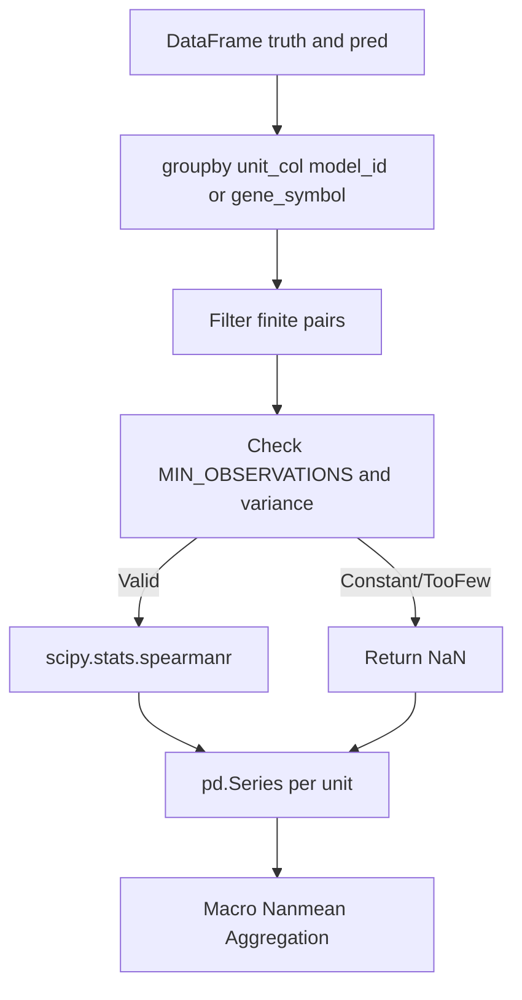

# GeneEffect and Response Metrics

<details>
<summary>Relevant source files</summary>

The following files were used as context for generating this wiki page:

- [src/eval/geneeffect.py](src/eval/geneeffect.py)
- [src/eval/metrics.py](src/eval/metrics.py)
- [src/eval/response.py](src/eval/response.py)
- [tests/test_build_cell_line_geneeffect_226_split.py](tests/test_build_cell_line_geneeffect_226_split.py)
- [tests/test_joint_checkpoint.py](tests/test_joint_checkpoint.py)
- [tests/test_joint_evaluation.py](tests/test_joint_evaluation.py)
- [tests/test_residual_metrics.py](tests/test_residual_metrics.py)
- [tests/test_residual_target.py](tests/test_residual_target.py)
- [tests/test_run_r1_residual_ladder.py](tests/test_run_r1_residual_ladder.py)

</details>


## Purpose and Scope
This page documents the evaluation architecture, metrics, and residual target definitions located in `src/eval/geneeffect.py`, `src/eval/response.py`, `src/eval/metrics.py`, and `src/data/residual_target.py`. These modules provide row-aligned inference scoring, multi-axis correlation calculation (per-line and per-gene Spearman/Pearson), response distribution loss aggregation (mean-delta MSE and energy distance), and the immutable residual baseline framework.

Sources: `src/eval/geneeffect.py:1-31`, `src/eval/response.py:1-12`, `src/eval/metrics.py:1-35`

---

## GeneEffect Evaluation and Aggregation (`src/eval/geneeffect.py`)

The GeneEffect evaluation engine collects predictions across batched dependencies, computes Huber loss against residual targets, and gathers distributed outputs across ranks. 

### Key Classes and Functions
*   `EvalResult`: A dataclass encapsulating scalar metrics dictionaries, flat predictions dataframes, per-line metrics, per-gene metrics, and response metrics [src/eval/geneeffect.py:23-30]().
*   `compose_metrics`: Combines GeneEffect and response losses using a configured `response_weight`, validating finiteness across all metrics [src/eval/geneeffect.py:32-53]().
*   `_dependency_rows`: Computes forward passes (`model(batch.conditions).delta_hat`), extracts predictions, maps residues back to raw GeneEffect space (`delta + gene_mean`), and filters valid score rows [src/eval/geneeffect.py:56-91]().
*   `_gather_batch_rows`: Handles distributed gather operations using `accelerator.gather_for_metrics`, propagating rank-local evaluation failures [src/eval/geneeffect.py:94-110]().
*   `aggregate_geneeffect`: Derives pair errors, root-mean-square error (RMSE), mean absolute error (MAE), standard deviation ratios, and both correlation axes (`per_line` and `per_gene`) from the gathered frame [src/eval/geneeffect.py:156-177]().

### Evaluation Pipeline Architecture

```mermaid
graph TD
  DependencyBatch["DependencyBatch"] -->|model(batch.conditions)| ModelForward["Model Forward Pass"]
  ModelForward -->|delta_hat| DependencyRows["_dependency_rows"]
  DependencyRows -->|Gather Ranks| GatherBatch["_gather_batch_rows"]
  GatherBatch -->|DataFrame Rows| AggregateGE["aggregate_geneeffect"]
  AggregateGE --> EvalRes["EvalResult"]
```
Sources: `src/eval/geneeffect.py:23-177`

---

## Response Metrics and Aggregation (`src/eval/response.py`)

Response metrics evaluate distributional shifts on held-out single-cell expression bags.

### Key Functions
*   `response_rows`: Evaluates held-out conditions using the unwrapped evaluation-only backbone via `predict_bags` and `response_terms` [src/eval/response.py:13-36]().
*   `aggregate_response`: Averages response terms (`mean_delta_mse` and `energy_distance`) within each `model_id`, then aggregates equally across four distinct evaluation anchors (`anchors`) [src/eval/response.py:39-59](). It computes `response_loss` as the sum of mean MSE and mean energy distance.

Sources: `src/eval/response.py:1-60`

---

## Statistical Metrics and Correlation Axes (`src/eval/metrics.py`)

The metrics module defines two distinct correlation axes for dependency prediction performance: **per-line** (predicting gene effects across genes within a given cell line) and **per-gene** (predicting gene effects across cell lines for a given gene).

### Key Classes and Functions
*   `MacroPerGeneSpearman`: Named tuple tracking `macro` mean, `per_gene` series, `n_scored`, and `n_undefined` [src/eval/metrics.py:15-31]().
*   `macro_per_gene_spearman`: Computes macro per-gene Spearman across contexts using tensor shapes `[n_genes, n_contexts]` [src/eval/metrics.py:33-94]().
*   `_unit_spearman`: Evaluates Spearman rank correlation on finite pairs for a single unit, returning `nan` (never `0.0` or raised exceptions) if fewer than `MIN_OBSERVATIONS` (3) finite pairs exist or if truth/prediction vectors are constant [src/eval/metrics.py:120-148]().
*   `score_predictions`: High-level driver computing residual scores, macro metrics, and shuffle controls [tests/test_residual_metrics.py:20-27]().

### Metric Computation Flow


Sources: `src/eval/metrics.py:15-184`, `tests/test_residual_metrics.py:20-27`

---

## Residual Targets and Baseline Framework (`src/data/residual_target.py` & `src/baselines/residual.py`)

To prevent models from exploiting gene-mean baselines, GeneEffect targets are formulated as residuals relative to historical gene means.

### Key Components
*   `fit_gene_means`: Computes gene means ($\mu_g$) strictly from training lines (`train_lines`), ensuring held-out validation or test lines never leak into the mean calculation [tests/test_residual_target.py:21-42]().
*   `build_residual_targets`: Materializes `ResidualTargets`, combining raw `gene_effect`, fitted `gene_mean`, and computed `residual` ($y_{g,c} - \hat{\mu}_g$) [tests/test_residual_target.py:47-53]().
*   `run_r1_ladder`: Executes the numerical baseline ladder (including gene-mean, copy-prior, nearest-line, context-PCA-ridge, and tx1 GMM ridge) across specified outer folds or leave-one-line-out (`lolo`) schemes [tests/test_run_r1_residual_ladder.py:144-146]().

Sources: `tests/test_residual_target.py:9-55`, `tests/test_run_r1_residual_ladder.py:23-28`

---