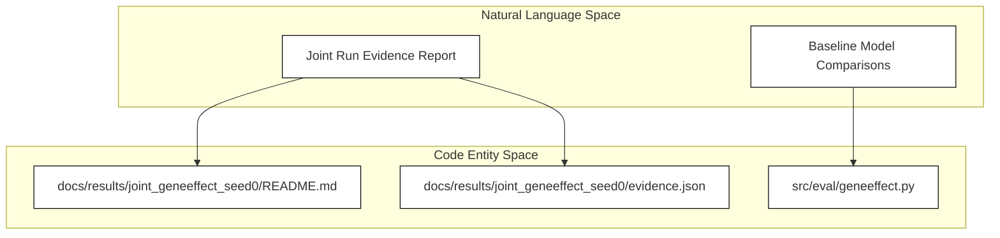
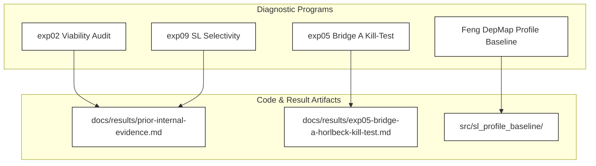

# Results Archive and Evidence

Relevant source files

The following files were used as context for generating this wiki page:

- [docs/data/exp05-fixed-and-external-tests.md](docs/data/exp05-fixed-and-external-tests.md)
- [docs/data/horlbeck-2018-k562-gi.md](docs/data/horlbeck-2018-k562-gi.md)
- [docs/results/exp05-bridge-a-horlbeck-kill-test.md](docs/results/exp05-bridge-a-horlbeck-kill-test.md)
- [docs/results/exp05-hct116-frozen-backbone-transport.md](docs/results/exp05-hct116-frozen-backbone-transport.md)
- [docs/results/exp13_stage2_full/learning_curves.png](docs/results/exp13_stage2_full/learning_curves.png)
- [docs/results/exp13_stage2_full/plot_learning_curves.py](docs/results/exp13_stage2_full/plot_learning_curves.py)
- [docs/results/feng-depmap-geneeffect-profile-baseline.md](docs/results/feng-depmap-geneeffect-profile-baseline.md)
- [docs/results/horlbeck-k562-exp05-coverage.md](docs/results/horlbeck-k562-exp05-coverage.md)
- [docs/results/joint_geneeffect_seed0/README.md](docs/results/joint_geneeffect_seed0/README.md)
- [docs/results/joint_geneeffect_seed0/evidence.json](docs/results/joint_geneeffect_seed0/evidence.json)
- [docs/results/prior-internal-evidence.md](docs/results/prior-internal-evidence.md)
- [scripts/download_tahoe_source_shards.sh](scripts/download_tahoe_source_shards.sh)

## Purpose and Scope
This leaf page documents the contents, provenance, and interpretation of the `docs/results/` hierarchy and related experimental archives within the codebase. It details verified empirical evidence from joint model runs (`docs/results/joint_geneeffect_seed0/`), stage-level diagnostic audits (`exp05`, `exp13`), prior internal evidence (`exp02`, `exp09`), baseline control evaluations (`Feng2024` profile baseline), and genetic-interaction coverage records (`Horlbeck 2018` K562 GI map).

---

## 1. Joint Run Evidence (`docs/results/joint_geneeffect_seed0/`)

The joint training run evidence is anchored by outputs generated under `outputs/geneeffect_joint/joint_seed0_20260906T174818Z_b1024/` [docs/results/joint_geneeffect_seed0/README.md:1-6](). The evaluation uses validation-selected `best.pt` at epoch 3 (stored index 2, global step 13250) [docs/results/joint_geneeffect_seed0/evidence.json:10-21](), [docs/results/joint_geneeffect_seed0/README.md:5]().

### Performance Comparison Table
All methods evaluate on the exact same 478,501 observed `(ModelID, gene_symbol)` keys across 27 test cell lines, with 1,748 missing labels excluded out of 480,249 possible pairs [docs/results/joint_geneeffect_seed0/README.md:9]() (SHA-256 checkpoint: `37405454717cb12164497542623722cd31e9dc793ebbfef3d79a3ef868e63c59`) [docs/results/joint_geneeffect_seed0/evidence.json:7]().

| Method | Huber Loss ↓ | RMSE ↓ | Absolute Pearson ↑ | Absolute Spearman ↑ | Residual Pearson ↑ | Residual Spearman ↑ | Loss Reduction vs Gene Mean |
|---|---:|---:|---:|---:|---:|---:|---:|
| `joint_best_epoch3` | 0.01611905 | 0.18038516 | 0.91050399 | 0.73338939 | 0.05414127 | 0.05280360 | +0.0773% |
| `context_pca_ridge[hvg]` | 0.01635306 | 0.18167029 | 0.90920119 | 0.72759752 | 0.07736289 | 0.08323587 | -1.3733% |
| `context_pca_ridge[tx1]` | 0.01625512 | 0.18106113 | 0.90983343 | 0.72777157 | 0.12160618 | 0.11573946 | -0.7662% |
| `copy_prior` | 0.03389791 | 0.26316988 | 0.81686034 | 0.54343217 | undefined | undefined | -110.1347% |
| `gene_mean` | 0.01613152 | 0.18044272 | 0.91047146 | 0.73393976 | undefined | undefined | 0.0000% |
| `nearest_line[hvg]` | 0.02853913 | 0.24133962 | 0.84602658 | 0.58732115 | 0.05900657 | 0.06130214 | -76.9154% |
| `nearest_line[tx1]` | 0.02868782 | 0.24203011 | 0.84576280 | 0.59698253 | 0.06077659 | 0.05973719 | -77.8371% |

### Key Findings
1. **Marginal Improvement**: Joint Huber loss improves over gene mean by only `0.0773%`, and absolute Spearman is slightly lower, indicating that the high absolute Pearson is largely driven by the context-blind prior [docs/results/joint_geneeffect_seed0/README.md:23]().
2. **Residual Signal Limitation**: Joint residual Pearson/Spearman (`0.05414`/`0.05280`) fall below Tx1 PCA-ridge (`0.12161`/`0.11574`), demonstrating limited context-modeling superiority in this configuration [docs/results/joint_geneeffect_seed0/README.md:24]().
3. **Response Replay Metrics**: Response MSE, energy distance, and total loss measure 3,285 held-out conditions from 4 training anchors, serving as auxiliary replay telemetry rather than direct test-line GeneEffect evaluations [docs/results/joint_geneeffect_seed0/README.md:26]().

Sources: `docs/results/joint_geneeffect_seed0/README.md`, `docs/results/joint_geneeffect_seed0/evidence.json`

---

## Diagram: Natural Language to Code Entity Mapping (Joint Evidence)

Sources: `docs/results/joint_geneeffect_seed0/README.md`, `docs/results/joint_geneeffect_seed0/evidence.json`

---

## 2. Experiment 05 Stages & Audits (`exp05`)

Experiment 05 evaluated fixed-split cell-line transport, response-to-fitness generalization, and mechanical pair composition [docs/data/exp05-fixed-and-external-tests.md:1-7]().

### HCT116 Frozen-Backbone Transport Closeout
The HCT116 formal relative-Z evaluation passed observed perturbation responses through the frozen K562 response encoder, GMM pooler, and GeneEffect head [docs/results/exp05-hct116-frozen-backbone-transport.md:10-15]().

| System | Spearman (95% CI) | Pearson | RMSE | MAE | R² | AUROC (GE < -0.5) |
| --- | ---: | ---: | ---: | ---: | ---: | ---: | ---: |
| Frozen K562 response head on HCT116 | -0.001 (-0.050, 0.049) | -0.017 | 0.419 | 0.280 | -0.053 | 0.475 |
| Direct K562 GeneEffect transfer | 0.554 (0.517, 0.591) | 0.751 | 0.296 | 0.200 | 0.474 | 0.945 |
| K562-train mean | undefined | undefined | 0.420 | 0.292 | -0.058 | 0.500 |

*Conclusion*: The frozen response head failed to transport across cell lines (Spearman `-0.001`), collapsing in output standard deviation (`0.059` vs `0.409` for HCT116 GeneEffect), while direct K562 GeneEffect transfer retained strong correlation (`0.554`) [docs/results/exp05-hct116-frozen-backbone-transport.md:35-70]().

### Bridge A Horlbeck Kill-Test
Bridge A evaluated whether single-perturbation exp05 backbones, composed pairwise via counterfactual co-dependency shifts `s_A(a,b) = 0.5 * [Delta(a->b) + Delta(b->a)]`, recover measured Horlbeck 2018 K562 genetic interactions (`gi_score`) [docs/results/exp05-bridge-a-horlbeck-kill-test.md:19-26]().

| Slice | Pairs | Strong-SL | Spearman(s_A, gi) | AUROC(s_A → strong-SL) |
| --- | ---: | ---: | ---: | ---: |
| Full universe | 83,028 | 1,281 | +0.004 (p=0.31) | 0.518 |
| Primary (both genes ≥ 64 cells) | 56,616 | 841 | +0.009 (p=0.03) | 0.526 |
| Cleanest (≥ 64 cells, low seed-variance) | 6,795 | 78 | -0.008 (p=0.52) | 0.617 |

*Verdict*: Negative. $|\text{Spearman}| < 0.01$ across slices; composition added no actionable predictive power over noise, triggering the protocol kill-rule [docs/results/exp05-bridge-a-horlbeck-kill-test.md:66-90]().

Sources: `docs/data/exp05-fixed-and-external-tests.md`, `docs/results/exp05-hct116-frozen-backbone-transport.md`, `docs/results/exp05-bridge-a-horlbeck-kill-test.md`

---

## 3. Experiment 13 Training Telemetry and Learning Curves (`exp13`)

Experiment 13 formalizes warmup and joint training stages. Telemetry data is parsed and plotted via `docs/results/exp13_stage2_full/plot_learning_curves.py` [docs/results/exp13_stage2_full/plot_learning_curves.py:1-25]().

### Telemetry Pipeline Implementation
The plotting utility enforces strict data contracts:
- Loads `learning_curves.csv` containing numerical telemetry for `warmup` (16 epochs) and `joint` (3 epochs) phases [docs/results/exp13_stage2_full/plot_learning_curves.py:28-60]().
- Validates finite metric values and exact single-epoch selection markers (`selected == 1.0`) [docs/results/exp13_stage2_full/plot_learning_curves.py:52-65]().
- Renders a 6-panel publication figure at 300 DPI, displaying training objectives, Pearson penalty terms, Huber losses, validation macro per-gene Spearman curves, and lambda-weighted dependency components [docs/results/exp13_stage2_full/plot_learning_curves.py:135-212]().

Sources: `docs/results/exp13_stage2_full/plot_learning_curves.py`, `docs/results/exp13_stage2_full/learning_curves.png`

---

## 4. Prior Internal Evidence & Baselines

### Exp02 — Replogle K562 Viability-Axis Audit
Investigated whether perturbation delta expression learns a generic cell-death/proliferation "response burden" axis [docs/results/prior-internal-evidence.md:8-16]().
- NAR viability score alone: Spearman `0.244` [docs/results/prior-internal-evidence.md:19]()
- Full baseline (`delta_all`): Spearman `0.494` [docs/results/prior-internal-evidence.md:21]()
- **NAR-residualized transcriptome** (`nar_resid_delta_all`): Spearman **`0.503`** [docs/results/prior-internal-evidence.md:22]()

*Finding*: Residualizing out generic viability improves DepMap anchor prediction, confirming that signal specificity is not reducible to bulk viability [docs/results/prior-internal-evidence.md:25-34]().

### Exp09 — K562 SL Pair Selectivity
Tested whether DepMap selectivity contrast features lift gene-pair SL prediction. Removal of pan-essential pairs caused non-pan-essential slice AUROC to drop from `0.645` to `0.583` on CV3, showing that pan-essentiality structure accounts for a major portion of unadjusted lift [docs/results/prior-internal-evidence.md:36-55]().

### Feng DepMap GeneEffect Profile Baseline
Evaluated empirical ceilings using single-gene DepMap profiles `[x_a + x_b, |x_a - x_b|]` without SL graphs [docs/results/feng-depmap-geneeffect-profile-baseline.md:10-25](). Summary XGBoost achieved AP `0.832` (CV1) and `0.792` (CV2), but performance degraded substantially when evaluated on the non-pan-essential slice, proving that marginal profiles encode essentiality priors rather than pairwise interaction mechanisms alone [docs/results/feng-depmap-geneeffect-profile-baseline.md:50-80]().

Sources: `docs/results/prior-internal-evidence.md`, `docs/results/feng-depmap-geneeffect-profile-baseline.md`

---

## Diagram: Experiment and Baseline Evidence Flow

Sources: `docs/results/prior-internal-evidence.md`, `docs/results/exp05-bridge-a-horlbeck-kill-test.md`, `docs/results/feng-depmap-geneeffect-profile-baseline.md`

---

## 5. Horlbeck K562 GI Coverage & Datasets

The Horlbeck 2018 K562 CRISPRi genetic-interaction dataset provides continuous `gi_score` benchmarks [docs/data/horlbeck-2018-k562-gi.md:1-8]() (SHA-256 raw archive: `d389b3ebdd2c88f86cc446f272f3ff6526df635d666cd17d67440bf10c0f9115`, extracted matrix `K562_gene.cdt`: `e3f7c4caa860cda8daec94be56e6900d9737781499e5357eaf7b5f18e7534c19`) [docs/data/horlbeck-2018-k562-gi.md:19-24]().

### Coverage Boundaries
- **Replogle GWPS (≥ 8 observed cells)**: 436 / 448 genes, 94,830 / 100,128 pairs (`94.71%`) [docs/results/horlbeck-k562-exp05-coverage.md:17-19]()
- **Replogle GWPS + Exp05 Fixed Pool**: 408 / 448 genes, 83,028 / 100,128 pairs (`82.92%`) [docs/results/horlbeck-k562-exp05-coverage.md:20-21]()

Reproduction is executed via `scripts/prepare_horlbeck_2018.py`, yielding verified processed tables under `data/sl_dependency_v0/processed/horlbeck_2018/` [docs/data/horlbeck-2018-k562-gi.md:85-106]().

Sources: `docs/data/horlbeck-2018-k562-gi.md`, `docs/results/horlbeck-k562-exp05-coverage.md`

---