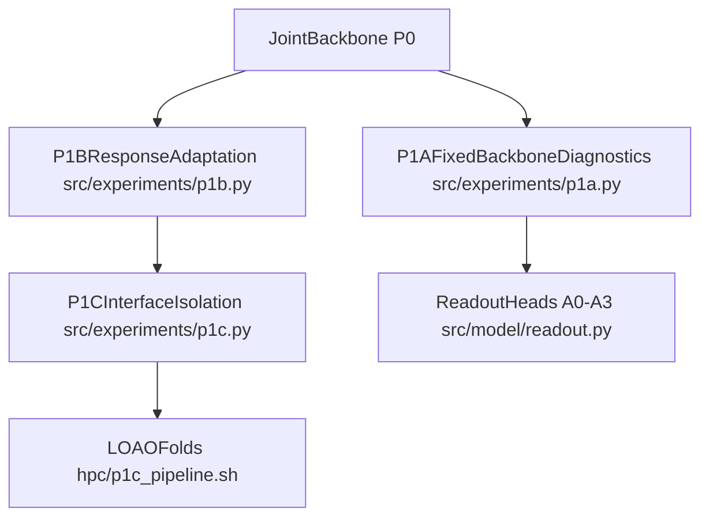
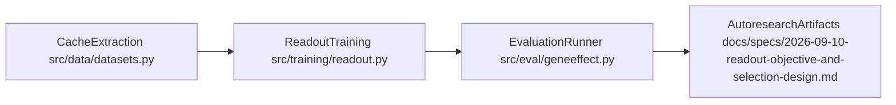

# Diagnostic Experiment Programs (P1-A/B/C)

Relevant source files

The following files were used as context for generating this wiki page:

- [docs/03-geneeffect-protocol.md](docs/03-geneeffect-protocol.md)
- [docs/figures/geneeffect_readout_learning_curves.png](docs/figures/geneeffect_readout_learning_curves.png)
- [docs/results/p1_response_pathway_diagnostics/README.md](docs/results/p1_response_pathway_diagnostics/README.md)
- [docs/results/p1_response_pathway_diagnostics/evidence/p1c/tier0/tier0.md](docs/results/p1_response_pathway_diagnostics/evidence/p1c/tier0/tier0.md)
- [docs/specs/2026-09-07-p1b_response_functionality_interface_adaptation_diagnostic.md](docs/specs/2026-09-07-p1b_response_functionality_interface_adaptation_diagnostic.md)
- [docs/specs/2026-09-10-readout-objective-and-selection-design.md](docs/specs/2026-09-10-readout-objective-and-selection-design.md)

This parent wiki page provides a high-level overview of the response-pathway diagnostic program (P1 phases A, B, and C) used to investigate backbone generalization, interface adaptation limits, and readout mechanisms [docs/03-geneeffect-protocol.md:1-15](), [docs/results/p1_response_pathway_diagnostics/README.md:1-15](). 

Sources: [docs/03-geneeffect-protocol.md:1-16](), [docs/results/p1_response_pathway_diagnostics/README.md:1-15]()

Sources: [docs/results/p1_response_pathway_diagnostics/README.md:35-42](), [src/experiments/p1a.py:1-50]()

---

## 6.1 P1-A Fixed-Backbone Readout Diagnostics

Phase P1-A investigates whether freezing the P0 model backbone and applying explicit gene-specific context slopes (derived from PCA of Tx1 features) improves GeneEffect residual prediction [docs/specs/2026-09-07-p1a-fixed-backbone-head-diagnostics-design.md:1-45](). It evaluates multiple readout arms (`A0` through `A3`) using feature cache extraction, `fit_readout`, and paired bootstrap comparison over validation lines [docs/specs/2026-09-07-p1a-fixed-backbone-head-diagnostics-design.md:30-60]().

For details, see [P1-A Fixed-Backbone Readout Diagnostics](#6.1).

Sources: [docs/specs/2026-09-07-p1a-fixed-backbone-head-diagnostics-design.md:1-50](), [src/experiments/p1a.py:1-35]()

---

## 6.2 P1-B Response Adaptation Bundles

Phase P1-B focuses on response-pathway functionality, checking whether the model correctly leverages perturbation identity and whether independently adapting the new interface (`prepare_bundle` / `build_snapshot`) recovers response prediction across source anchors (K562, HepG2, HCT116) and transfers to unseen lines like Jurkat [docs/specs/2026-09-07-p1b_response_functionality_interface_adaptation_diagnostic.md:1-50](). It utilizes `ResponseView` and controlled training loops [docs/specs/2026-09-07-p1b_response_functionality_interface_adaptation_diagnostic.md:55-100]().

For details, see [P1-B Response Adaptation Bundles](#6.2).

Sources: [docs/specs/2026-09-07-p1b_response_functionality_interface_adaptation_diagnostic.md:1-55](), [src/experiments/p1b.py:1-40]()

---

## 6.3 P1-C Interface Isolation Variants

Phase P1-C explores interface isolation variants (`V0` to `V3` and `N-native`), performing build-variant provenance auditing, leave-one-anchor-out (LOAO) fold preparation, and orchestrating execution waves through the GPU queueing infrastructure [docs/specs/2026-09-08-p1c-interface-isolation-design.md:1-45](), [hpc/p1c_pipeline.sh:1-30]().

For details, see [P1-C Interface Isolation Variants](#6.3).

Sources: [docs/specs/2026-09-08-p1c-interface-isolation-design.md:1-50](), [hpc/p1c_pipeline.sh:1-25]()

---

## 6.4 Autoresearch Plans and Residual Diagnosis

This section aggregates autoresearch handoff artifacts, residual prediction diagnosis scripts, and future readout objective selection frameworks designed to overcome mean-squared error flooring and alignment issues between loss functions and macro metrics [docs/specs/2026-09-10-readout-objective-and-selection-design.md:1-45](), [docs/results/p1_response_pathway_diagnostics/README.md:70-110]().

For details, see [Autoresearch Plans and Residual Diagnosis](#6.4).

Sources: [docs/specs/2026-09-10-readout-objective-and-selection-design.md:1-40](), [docs/results/p1_response_pathway_diagnostics/README.md:70-105]()

Sources: [docs/specs/2026-09-10-readout-objective-and-selection-design.md:90-110](), [src/training/readout.py:1-30]()

---