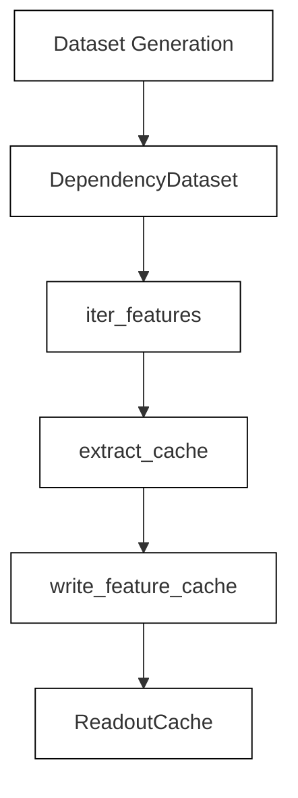
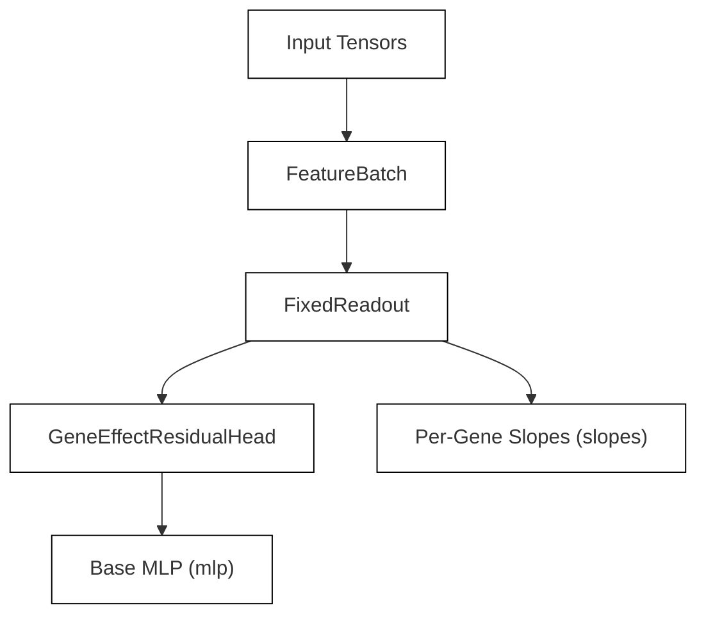
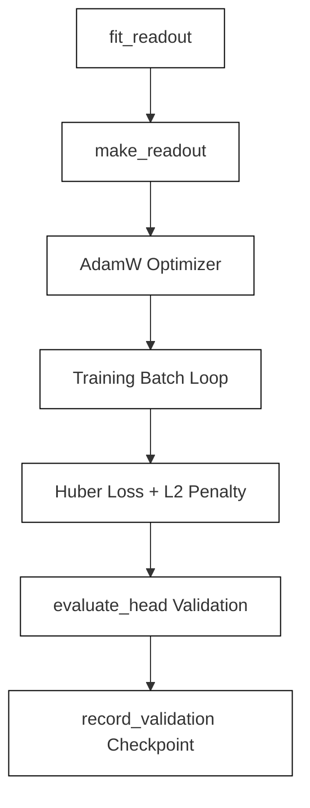

# P1-A Fixed-Backbone Readout Diagnostics

<details>
<summary>Relevant source files</summary>

The following files were used as context for generating this wiki page:

- [docs/results/p1_response_pathway_diagnostics/evidence/p1a/analysis/audit.json](docs/results/p1_response_pathway_diagnostics/evidence/p1a/analysis/audit.json)
- [docs/results/p1_response_pathway_diagnostics/evidence/p1a/comparison/paired.json](docs/results/p1_response_pathway_diagnostics/evidence/p1a/comparison/paired.json)
- [docs/results/p1_response_pathway_diagnostics/evidence/p1a/comparison/selected.csv](docs/results/p1_response_pathway_diagnostics/evidence/p1a/comparison/selected.csv)
- [docs/results/p1_response_pathway_diagnostics/evidence/p1a/heads/A0/metrics.jsonl](docs/results/p1_response_pathway_diagnostics/evidence/p1a/heads/A0/metrics.jsonl)
- [docs/results/p1_response_pathway_diagnostics/evidence/p1a/heads/A2/metrics.jsonl](docs/results/p1_response_pathway_diagnostics/evidence/p1a/heads/A2/metrics.jsonl)
- [docs/results/p1_response_pathway_diagnostics/evidence/p1a/heads/A2/run.json](docs/results/p1_response_pathway_diagnostics/evidence/p1a/heads/A2/run.json)
- [docs/specs/2026-09-07-p1a-fixed-backbone-head-diagnostics-design.md](docs/specs/2026-09-07-p1a-fixed-backbone-head-diagnostics-design.md)
- [src/data/readout_cache.py](src/data/readout_cache.py)
- [src/eval/readout.py](src/eval/readout.py)
- [src/eval/readout_comparison.py](src/eval/readout_comparison.py)
- [src/experiments/p1a.py](src/experiments/p1a.py)
- [src/model/readout.py](src/model/readout.py)
- [src/training/readout.py](src/training/readout.py)
- [tests/test_joint_launcher.py](tests/test_joint_launcher.py)
- [tests/test_p1a.py](tests/test_p1a.py)

</details>


## Purpose and Scope

The P1-A diagnostic program evaluates whether incorporating explicit gene-specific context slopes and fixed response features improves the GeneEffect readout from a frozen P0 backbone model. This experimental phase is constrained to held-out-cell-line GeneEffect prediction on training-covered genes, utilizing immutable feature caches extracted from a pre-trained backbone (`src/experiments/p1a.py`, `docs/specs/2026-09-07-p1a-fixed-backbone-head-diagnostics-design.md`). Backbone parameters remain fixed during optimization; no response replay or backbone gradient updates occur.

Sources: `src/experiments/p1a.py:1-93` [src/experiments/p1a.py:1-93](), `docs/specs/2026-09-07-p1a-fixed-backbone-head-diagnostics-design.md:1-40` [docs/specs/2026-09-07-p1a-fixed-backbone-head-diagnostics-design.md:1-40]()

---

## Feature Cache Extraction and Memory-Mapped Storage

To eliminate redundant backbone evaluations across experimental heads, feature extraction passes the pre-trained model over dataset splits once, serializing condition features, response projections, and mask tensors to disk (`src/experiments/p1a.py`).


*Figure 1: Natural Language to Code Entity Space for Feature Cache Pipeline.*

Sources: `src/experiments/p1a.py:12-92` [src/experiments/p1a.py:12-92](), `src/data/readout_cache.py:47-110` [src/data/readout_cache.py:47-110]()

The `ReadoutCache` class (`src/data/readout_cache.py`) consumes numpy memory-mapped (`mmap_mode="r"`) files for shared arrays (`z_c`, `e_g`) and split-specific pair indices (`delta_proj`, `s`, masks, residuals). During batching, `ReadoutCache.batch()` applies training-only standardization via `BlockStandardizer` and constructs `FeatureBatch` structures for consumption by readout heads.

Sources: `src/data/readout_cache.py:47-98` [src/data/readout_cache.py:47-98](), `tests/test_p1a.py:119-146` [tests/test_p1a.py:119-146]()

---

## Readout Arms A0–A3 Architecture

The diagnostic framework defines four readout configurations (arms A0, A1, A2, and A3) combining base MLP architectures with or without response blocks ($R = \{\text{delta\_proj}, s\}$) and explicit per-gene context slopes (`src/model/readout.py`).


*Figure 2: Natural Language to Code Entity Space for Readout Architecture.*

The `FixedReadout` module (`src/model/readout.py`) wraps a `GeneEffectResidualHead` and an optional parameter tensor `slopes` of shape `(n_genes, 8)`:

```python
residual_hat(g, c) = shared_mlp(F(g, c)) + w[g]^T u[c]
```

where `u[c]` represents the training-fitted, standardized PCA-8 context scores (`src/model/readout.py`, `docs/specs/2026-09-07-p1a-fixed-backbone-head-diagnostics-design.md`).

| Arm | Head Structure | Inputs | Description |
| --- | --- | --- | --- |
| **A0** | Shared MLP | $D$ | Direct-feature reference (no response features, no slopes) |
| **A1** | Shared MLP | $D + R$ | Response-block included (delta projections and summary statistics) |
| **A2** | MLP + Slope | $D$ | Explicit gene-specific context slopes, no response features |
| **A3** | MLP + Slope | $D + R$ | Response-block and explicit context slopes combined |

Sources: `src/model/readout.py:18-69` [src/model/readout.py:18-68](), `docs/specs/2026-09-07-p1a-fixed-backbone-head-diagnostics-design.md:41-73` [docs/specs/2026-09-07-p1a-fixed-backbone-head-diagnostics-design.md:41-73]()

---

## Optimization Loop and Early Stopping

Head training is handled by `fit_readout` in `src/training/readout.py`. Optimization uses `torch.optim.AdamW` with a constant learning rate of `1e-4`, global gradient norm clipping (`1.0`), and a global batch size of 1024 pairs (`src/training/readout.py`, `docs/specs/2026-09-07-p1a-fixed-backbone-head-diagnostics-design.md`).


*Sources: `src/training/readout.py:39-170` [src/training/readout.py:39-170](), `docs/specs/2026-09-07-p1a-fixed-backbone-head-diagnostics-design.md:93-125` [docs/specs/2026-09-07-p1a-fixed-backbone-head-diagnostics-design.md:93-125]()*

The total training objective incorporates an explicit L2 regularization penalty over the gene slopes for arms A2 and A3:

$$\mathcal{L} = \text{Huber}_{\delta=1}(\hat{y}, y) + \frac{0.01}{N_{\text{genes}}} \sum_{g,k} w_{g,k}^2$$

Early stopping monitors validation GeneEffect Huber loss with a patience parameter of 5 epochs (maximum 50 epochs).

Sources: `src/training/readout.py:116-170` [src/training/readout.py:116-170](), `src/model/readout.py:42-47` [src/model/readout.py:42-47]()

---

## Evaluation and Paired Bootstrap Comparison

Evaluations are performed by `evaluate_head` and `evaluate_readout` (`src/eval/readout.py`), generating parquet export files containing predicted residuals and GeneEffect values. 

Paired performance differences across arms are computed via `paired_diagnostic` (`src/eval/readout_comparison.py`), which:
1. Aligns prediction data frames strictly by keys (`model_id`, `gene_symbol`) using `align_predictions`.
2. Resamples cell-line clusters to construct bootstrap distributions of Huber loss differences and metric deltas (Pearson, Spearman, standard deviation ratios).

Sources: `src/eval/readout.py:15-58` [src/eval/readout.py:15-58](), `src/eval/readout_comparison.py:16-145` [src/eval/readout_comparison.py:16-145]()

---