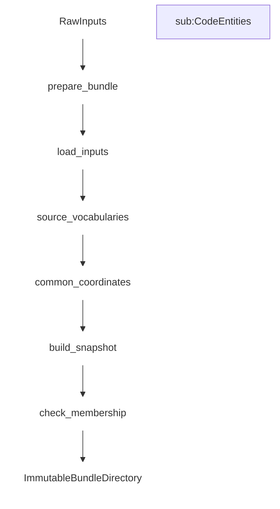
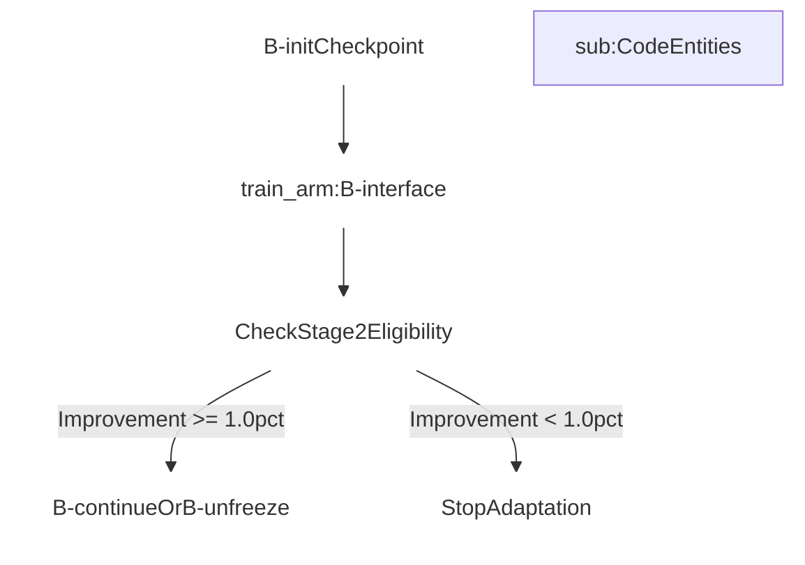

# P1-B Response Adaptation Bundles

Relevant source files

The following files were used as context for generating this wiki page:

- [docs/results/p1_response_pathway_diagnostics/evidence/p1b/analysis.md](docs/results/p1_response_pathway_diagnostics/evidence/p1b/analysis.md)
- [docs/specs/2026-09-07-p1b-response-adaptation-design.md](docs/specs/2026-09-07-p1b-response-adaptation-design.md)
- [src/data/p1b.py](src/data/p1b.py)
- [src/data/p1c.py](src/data/p1c.py)
- [src/eval/p1b_comparison.py](src/eval/p1b_comparison.py)
- [src/experiments/p1b.py](src/experiments/p1b.py)
- [src/experiments/p1b_preparation.py](src/experiments/p1b_preparation.py)
- [src/experiments/p1c_preparation.py](src/experiments/p1c_preparation.py)
- [src/model/p1b.py](src/model/p1b.py)
- [src/training/p1b.py](src/training/p1b.py)
- [tests/test_p1b.py](tests/test_p1b.py)

## Purpose and Scope
This page documents the **P1-B Response Adaptation Bundles** subsystem, which evaluates whether the assembled `Tx1` + `ESM2` + `STATE` backbone correctly uses perturbation identity and cellular context to predict Perturb-seq transcriptional responses [docs/specs/2026-09-07-p1b-response-adaptation-design.md:1-12](). It covers snapshot preparation, dataset sharding, exact parameter provenance auditing (`configure_parameters`), the single-process training and early-stopping loop (`fit`), and paired comparative evaluation against baseline states (`B-native`, `B-init`, `B-joint`, `B-interface`, `B-continue`, `B-unfreeze`) [src/experiments/p1b_preparation.py:1-24]().

---

## 1. Bundle Preparation and Snapshot Building

P1-B snapshot construction freezes data splits, common gene coordinate masks, and basal controls into an immutable bundle directory via `prepare_bundle` [src/experiments/p1b_preparation.py:114-170](). 

### Membership and Validation Invariants
The bundle enforces strict condition partitioning across three source training anchors (`K562`, `HepG2`, `HCT116`) and one external evaluation anchor (`Jurkat`) [src/data/p1b.py:8-30]().

| Split Role | Anchor Cell Lines | ModelIDs | Condition Count |
| :--- | :--- | :--- | :--- |
| **Train** | K562, HepG2, HCT116 | ACH-000551, ACH-000739, ACH-000971 | 27,361 [docs/specs/2026-09-07-p1b-response-adaptation-design.md:25]() |
| **Internal Validation** | Condition holdouts within source anchors | ACH-000551, ACH-000739, ACH-000971 | 3,047 [docs/specs/2026-09-07-p1b-response-adaptation-design.md:26]() |
| **External Evaluation** | Jurkat (adaptation held-out) | ACH-000995 | 2,377 [docs/specs/2026-09-07-p1b-response-adaptation-design.md:27]() |

The `check_membership` function validates these exact counts against `P1B_EXPECTATIONS` [src/experiments/p1b_preparation.py:25-83](). It also ensures that exactly **1,957 common measured coordinates** are isolated using `common_coordinates` across source vocabularies [src/data/p1b.py:55-62]().

*Figure 1: Natural Language Space to Code Entity Space mapping for `prepare_bundle` [src/experiments/p1b_preparation.py:114-170]().*

Sources: [src/experiments/p1b_preparation.py:1-170](), [src/data/p1b.py:1-62](), [docs/specs/2026-09-07-p1b-response-adaptation-design.md:21-48]()

---

## 2. Response Views and Balanced Sampling

During training and evaluation, `ResponseView` exposes batched access to conditions while masking self-perturbation targets [src/data/p1b.py:186](). To ensure uniform exposure across anchor cell lines, `balanced_epoch` generates deterministic training batches [src/data/p1b.py:33-53]().

### Epoch Balancing Mechanics
`balanced_epoch` constructs per-anchor pools from training indices and draws exactly `per_anchor` (default: `64`) samples per anchor per sub-batch, producing global batches of 192 conditions [src/data/p1b.py:33-53](), [docs/specs/2026-09-07-p1b-response-adaptation-design.md:95](). Randomness is isolated using `np.random.default_rng` seeded with epoch and anchor identifiers [src/data/p1b.py:37-40]().

Sources: [src/data/p1b.py:33-53](), [src/experiments/p1b.py:35-46]()

---

## 3. Parameter Provenance and Configuration

To perform response-only adaptation without degrading the frozen `STATE` and `ESM2` representations, `configure_parameters` in `src/model/p1b.py` audits and restricts trainable weights [src/model/p1b.py:1-51]().

### Parameter Classification Table
| Parameter Name | Shape | Origin | Role |
| :--- | :--- | :--- | :--- |
| `state_adapter.state_model.basal_encoder.0.weight` | `(328, 2560)` | `new` | Trainable in `B-interface`, `B-continue`, `B-unfreeze` [docs/specs/2026-09-07-p1b-response-adaptation-design.md:60-64]() |
| `perturbations.adapter.net.0.weight` / `bias` | `(512, 1280)` / `(512,)` | `new` | Trainable ESM2 adapter layer 0 |
| `perturbations.adapter.net.2.weight` / `bias` | `(2024, 512)` / `(2024,)` | `new` | Trainable ESM2 adapter layer 2 |
| Inherited `STATE` parameters | Various | `inherited` | Frozen in `B-interface`/`B-continue`; unfrozen at `1e-6` LR in `B-unfreeze` [docs/specs/2026-09-07-p1b-response-adaptation-design.md:56-58](), [src/model/p1b.py:33-42]() |

`configure_parameters` raises a `ValueError` if any unexpected fresh parameters or unclassified inherited parameters are encountered [src/model/p1b.py:8-25]().

Sources: [src/model/p1b.py:1-51](), [docs/specs/2026-09-07-p1b-response-adaptation-design.md:49-77]()

---

## 4. Training Loop, Objectives, and Stage Gates

The single-process training loop in `src/training/p1b.py` coordinates optimization via `fit` [src/training/p1b.py:30-171]().

### Objective Function
The training and validation objective combines FP32 mean-shift MSE (`mean_delta_mse`) and energy distance (`energy_distance`) equally weighted over common measured coordinates [docs/specs/2026-09-07-p1b-response-adaptation-design.md:88-90](), [src/experiments/p1b.py:35-46]():

$$\mathcal{L} = \mathcal{L}_{\text{MSE}}(\Delta \mu) + \mathcal{L}_{\text{Energy}}(\text{predicted}, \text{observed})$$

### Early Stopping and Stage-Two Trigger
- **Epoch Zero Evaluation**: Epoch `0` evaluates the initial model before gradient updates [src/training/p1b.py:86-90]().
- **Early Stopping**: Patience is set to `5` epochs based on validation response loss (`val_response_loss`) [docs/specs/2026-09-07-p1b-response-adaptation-design.md:105](), [src/training/p1b.py:41]().
- **Stage-Two Eligibility (`stage2_eligible`)**: Stage-two arms (`B-continue` and `B-unfreeze`) execute only if the best `B-interface` validation response loss is at least 1% lower than the initial loss [src/training/p1b.py:18-21](), [docs/specs/2026-09-07-p1b-response-adaptation-design.md:116]():

*Figure 2: Stage-two transition lifecycle managed by `train_arm` and `stage2_eligible` [src/experiments/p1b.py:130-186](), [src/training/p1b.py:18-21]().*

Sources: [src/training/p1b.py:1-171](), [src/experiments/p1b.py:35-186](), [docs/specs/2026-09-07-p1b-response-adaptation-design.md:85-121]()

---

## 5. Evaluation and Paired Comparison

After training individual arms, `src/eval/p1b_comparison.py` executes paired evaluation across states [src/eval/p1b_comparison.py:78-174]().

### Paired Bootstrap Resampling
`paired_difference` aligns predictions across models and resamples effect genes synchronously (`repeats=1000`) to compute confidence intervals and relative improvements [src/eval/p1b_comparison.py:10-59](). 

### Diagnostic Findings Summary
Empirical evaluations from P1-B runs indicate substantial reduction in response error upon adapting interface weights (`B-interface`), while unfreezing internal `STATE` parameters (`B-unfreeze`) yields further improvements on training distributions [docs/results/p1_response_pathway_diagnostics/evidence/p1b/analysis.md:1-20]().

Sources: [src/eval/p1b_comparison.py:1-174](), [docs/results/p1_response_pathway_diagnostics/evidence/p1b/analysis.md:1-23]()

---