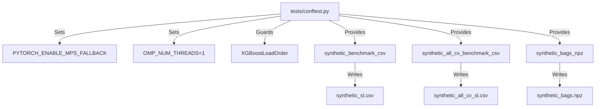
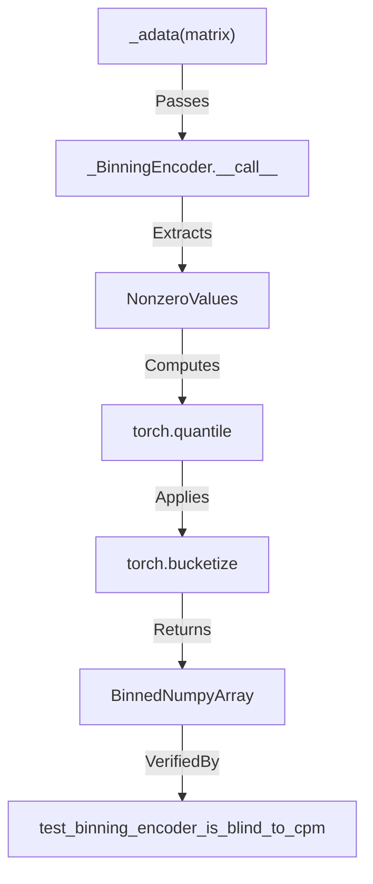

# Fixtures and Synthetic Data

Relevant source files

The following files were used as context for generating this wiki page:

- [tests/conftest.py](tests/conftest.py)
- [tests/test_stage0_tx1_input_probe.py](tests/test_stage0_tx1_input_probe.py)

### Purpose and Scope
This section details the testing infrastructure and synthetic data generation mechanisms defined in `tests/conftest.py` [tests/conftest.py:1-173]() and validated by probes such as `tests/test_stage0_tx1_input_probe.py` [tests/test_stage0_tx1_input_probe.py:1-179](). It establishes deterministic environments, mock tensor generation, and invariant verification routines used across the pytest suite without relying on heavy external runtime artifacts.

---

## Shared Pytest Fixtures (`tests/conftest.py`)

The test suite relies on a shared configuration file (`tests/conftest.py`) that initializes global environment guards and supplies reusable data factories [tests/conftest.py:1-155]().

### Environment Guards
Before test execution commences, `conftest.py` sets critical environment variables to prevent runtime crashes, cross-library deadlocks, or backend incompatibilities:
* **MPS Fallback**: `PYTORCH_ENABLE_MPS_FALLBACK` is set to `"1"` to force CPU fallbacks for operations like `torch.cdist` whose backward pass is unimplemented on Apple Silicon MPS [tests/conftest.py:7-12]().
* **OpenMP Thread-Pool Guard**: `OMP_NUM_THREADS` is pinned to `"1"` to prevent segmentation faults arising from competing OpenMP runtimes inside `scipy` sparse conversions and `torch` sparse tensor allocations [tests/conftest.py:14-19]().
* **OpenMP Load-Order Guard**: `xgboost` is conditionally imported prior to `torch` initialization to establish a safe memory load-order sequence [tests/conftest.py:21-29]().

### Synthetic Data Generators
`tests/conftest.py` defines internal helpers that provision temporary files representing benchmark datasets and cell-bag arrays:
* `_write_synthetic_benchmark(path)`: Generates a CV1-shaped CSV containing 2 folds, balancing positive and negative Synthetic Lethality (SL) labels, with gene effects skewing more negative for positive classes [tests/conftest.py:40-78](). Exposed via the `synthetic_benchmark_csv` fixture [tests/conftest.py:81-84]().
* `_write_synthetic_all_cv_benchmark(path)`: Creates multi-split benchmark CSVs supporting both CV1 and CV2 split types [tests/conftest.py:87-116](). Exposed via `synthetic_all_cv_benchmark_csv` [tests/conftest.py:119-122]().
* `_write_synthetic_bags_npz(path)`: Builds an NPZ archive containing cell-bag arrays (`cell_delta_pcs`, `bag_offsets`, `perturbation_gene`) for covered genes [tests/conftest.py:125-148](). Exposed via `synthetic_bags_npz` [tests/conftest.py:151-154]().

Sources: `tests/conftest.py` [tests/conftest.py:1-155]()

---

## Stage 0 Input Probes and Verification

The evaluation of raw-count assumptions and input tokenization mechanics is verified via `tests/test_stage0_tx1_input_probe.py` [tests/test_stage0_tx1_input_probe.py:1-179]() and its underlying implementation module `src/experiments/historical/stage0_tx1_input_probe.py` [tests/test_stage0_tx1_input_probe.py:24-31]().

### Raw-Count Guards and CPM Transforms
The test suite ensures that input matrices are properly validated before ingestion:
* `assert_raw_counts()` confirms that stored values are non-negative integer counts, rejecting normalized or floating-point inputs [tests/test_stage0_tx1_input_probe.py:98-114]().
* `to_cpm()` transforms raw counts to Counts-Per-Million (CPM) targeting `CPM_TARGET_SUM`, verifying that zero-patterns and within-cell orderings remain invariant [tests/test_stage0_tx1_input_probe.py:119-140]().

### Mock Binning Encoder (`_BinningEncoder`)
To test whether downstream quantile binners are invariant to library-size rescaling, `tests/test_stage0_tx1_input_probe.py` implements `_BinningEncoder` [tests/test_stage0_tx1_input_probe.py:59-92](). This test double mirrors the collator's per-cell quantile binning rule by bucketizing each cell against quantiles of its nonzero values [tests/test_stage0_tx1_input_probe.py:61-66]():

Sources: `tests/test_stage0_tx1_input_probe.py` [tests/test_stage0_tx1_input_probe.py:34-161]()

---