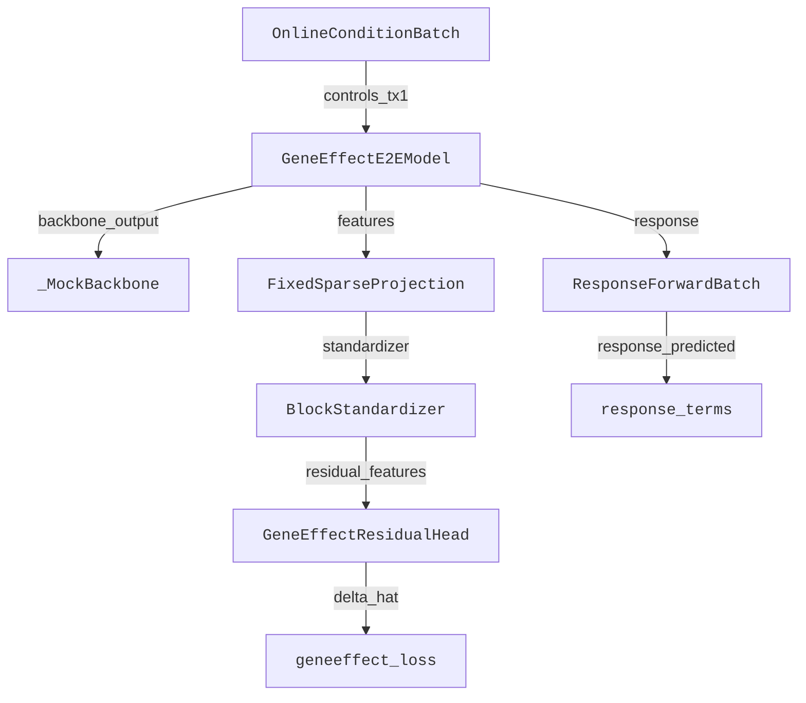
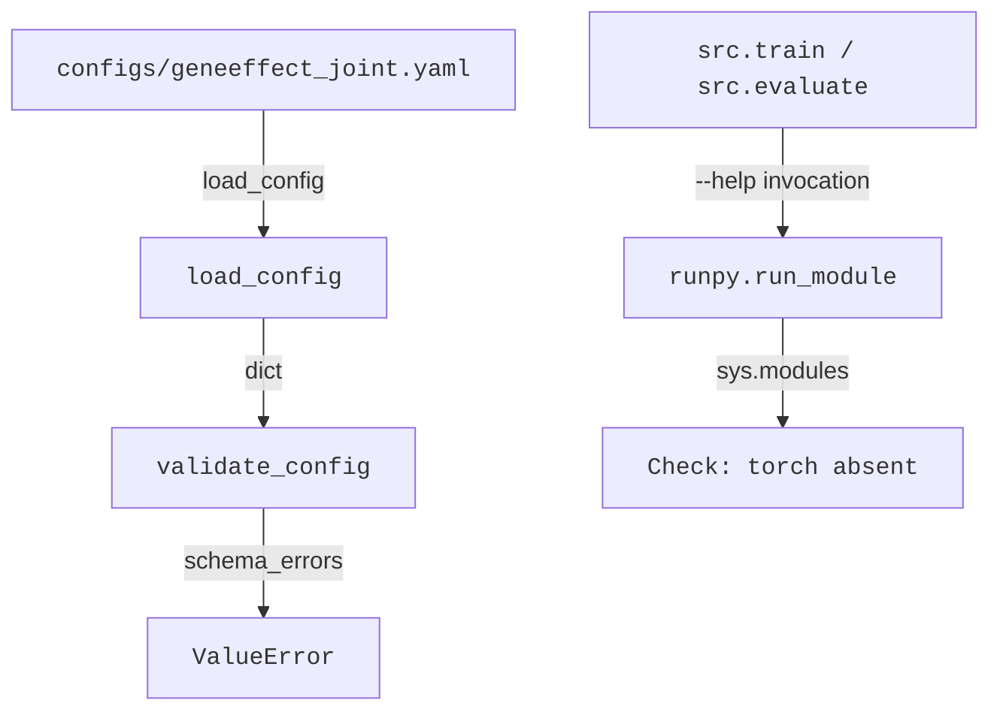

# Integration and End-to-End Tests

Relevant source files

The following files were used as context for generating this wiki page:

- [docs/specs/2026-09-06-modular-joint-training-design.md](docs/specs/2026-09-06-modular-joint-training-design.md)
- [docs/specs/2026-09-06-modular-joint-training-plan.md](docs/specs/2026-09-06-modular-joint-training-plan.md)
- [src/model/initialization.py](src/model/initialization.py)
- [src/training/trainer.py](src/training/trainer.py)
- [tests/test_geneeffect_e2e.py](tests/test_geneeffect_e2e.py)
- [tests/test_joint_cli.py](tests/test_joint_cli.py)
- [tests/test_joint_distributed.py](tests/test_joint_distributed.py)
- [tests/test_joint_resume.py](tests/test_joint_resume.py)
- [tests/test_joint_training.py](tests/test_joint_training.py)

The integration and end-to-end testing infrastructure validates the entire lifecycle of the gene perturbation prediction codebase. It guards against regression in model execution paths, distributed coordination, CLI argument parsing, configuration validation, checkpoint atomicity, and self-contained resume mechanics. These tests reside primarily in `tests/test_geneeffect_e2e.py`, `tests/test_joint_cli.py`, `tests/test_joint_distributed.py`, `tests/test_joint_resume.py`, and `tests/test_joint_training.py`.

---

## 1. End-to-End Model Execution and Gradient Flow

The end-to-end model tests executed in `tests/test_geneeffect_e2e.py` guard the forward and backward computation paths of `GeneEffectE2EModel`. They verify that gradients correctly traverse the composite pipeline, reaching both the trainable state transition backbone and the feature head when specific configuration blocks (`use_delta_proj`, `use_s`) are active, while properly detaching disabled pathways.

*Figure 1: Data flow and gradient paths through `GeneEffectE2EModel`.*

Sources: `tests/test_geneeffect_e2e.py:20-103()`, `src/model/geneeffect.py:1-1()`.

The test suite exercises several boundary conditions:
* **Gradient Reachability:** `test_online_gradient_reaches_trainable_backbone` ensures that when response readout blocks are enabled, pulling gradients from `delta_hat` updates `model.backbone.shift` (representing the trainable components) [tests/test_geneeffect_e2e.py:70-103](). If response readout features are disabled, the GeneEffect path does not update the backbone, but response supervision paths via `ResponseForwardBatch` still permit gradient flow [tests/test_geneeffect_e2e.py:92-102]().
* **Feature Ablation Masking:** `test_disabled_features_and_masks_do_not_enter_standardization_or_readout` checks that disabling feature blocks (such as `delta_proj` or `s`) completely excludes them from standardization and backpropagation [tests/test_geneeffect_e2e.py:116-138]().
* **Batch Validation:** `test_online_batch_rejects_non_panel_gene_with_index` guards against malformed inputs where non-HVG genes contain unexpected indices [tests/test_geneeffect_e2e.py:140-157]().

Sources: `tests/test_geneeffect_e2e.py:20-179()`.

---

## 2. CLI Boundaries, Validation, and Environment Guards

CLI tests in `tests/test_joint_cli.py` validate configuration parsing, schema validation rules, and environment isolation. 

*Figure 2: Configuration validation and Torch-free CLI discovery.*

Sources: `tests/test_joint_cli.py:16-99()`, `src/experiments/config.py:1-1()`.

Key guarantees enforced by the CLI test harness include:
* **Strict Configuration Enforcement:** `test_approved_defaults_and_conflicts` and `test_config_rejects_missing_and_unknown_keys` invoke `load_config` and `validate_config` against `configs/geneeffect_joint.yaml`, asserting that invalid hyperparameters, missing keys, or unexpected parameters raise a `ValueError` [tests/test_joint_cli.py:16-65]().
* **Boolean Type Verification:** `test_ablation_flags_require_real_booleans` guards against string or integer falsy values passed to head block ablation settings [tests/test_joint_cli.py:39-45]().
* **Torch-Free Help Execution:** `test_help_does_not_import_torch` spawns subprocesses to invoke command-line help flags (`--help`) on entrypoints like `src.train`, `src.evaluate`, and `src.experiments.prepare`, guaranteeing that help text renders instantly without initializing the PyTorch runtime or GPU libraries [tests/test_joint_cli.py:77-99]().
* **Cache Fail-Closed Behavior:** `test_missing_cache_training_fails_without_raw_rebuild` ensures that missing prepared caches trigger a `FileNotFoundError` pointing to the explicit preparation script rather than silently assembling raw inputs [tests/test_joint_cli.py:122-148]().

Sources: `tests/test_joint_cli.py:1-149()`.

---

## 3. Distributed Data Parallel (DDP) Parity and Failure Isolation

Distributed training logic is evaluated using multi-process test routines in `tests/test_joint_distributed.py`. These tests use `torch.multiprocessing.spawn` to spin up Gloo-backed worker processes that simulate multi-GPU or multi-CPU distributed runs via `Accelerator` [tests/test_joint_distributed.py:32-71]().

* **Parameter Synchronization and Parity:** `test_ddp_update_matches_effective_serial_batch_and_trims_eval_tail` verifies that a 2-process DDP update matches expected serial gradient steps and correctly accumulates gathered metrics across ranks [tests/test_joint_distributed.py:148-195]().
* **Coordinated Error Propagation:** When a non-finite tensor or illegal target (e.g., `NaN` residuals) occurs on any rank during `train_update`, `raise_rank_errors` catches the exception and propagates a synchronized failure state across all active processes [tests/test_joint_distributed.py:91-120]().
* **Rank-Zero Checkpoint Guards:** `_parity_worker` tests that file system errors (such as blocked write paths on rank zero) correctly raise errors during synchronization and do not leave corrupted partial checkpoints [tests/test_joint_distributed.py:100-118]().

Sources: `tests/test_joint_distributed.py:1-311()`, `src/training/distributed.py:1-1()`.

---

##  4. Epoch Resume, RNG, and Atomic Checkpoints

Checkpointing, state reconstruction, and resumption mechanisms are tested in `tests/test_joint_resume.py`. These tests verify that training can be interrupted at arbitrary epoch boundaries and resumed with bitwise parity on subsequent updates.

* **Exact Next-Update Reproduction:** `test_epoch_resume_exact_next_update_and_remaining_replay` interrupts an active training run after the first epoch, reloads state via `restore_model` (discarding external checkpoints), and verifies that model weights, optimizer states, epoch counts, and RNG states produce identical subsequent updates [tests/test_joint_resume.py:26-112]().
* **World Size Enforcement:** `test_resume_rejects_world_size_change_before_fitting` guards against mismatched cluster topologies by rejecting resume attempts where the restored `world_size` differs from the active accelerator process count [tests/test_joint_resume.py:113-128]().
* **Atomic Checkpoint Safeguards:** `test_atomic_checkpoint_failure_preserves_previous_file_and_rng` simulates disk failures during model persistence (`torch.save`), confirming that checkpoints are written to temporary staging files first and that failure leaves existing checkpoints and device RNG states pristine [tests/test_joint_resume.py:130-161]().

Sources: `tests/test_joint_resume.py:1-162()`, `src/training/checkpoint.py:1-1()`.

---