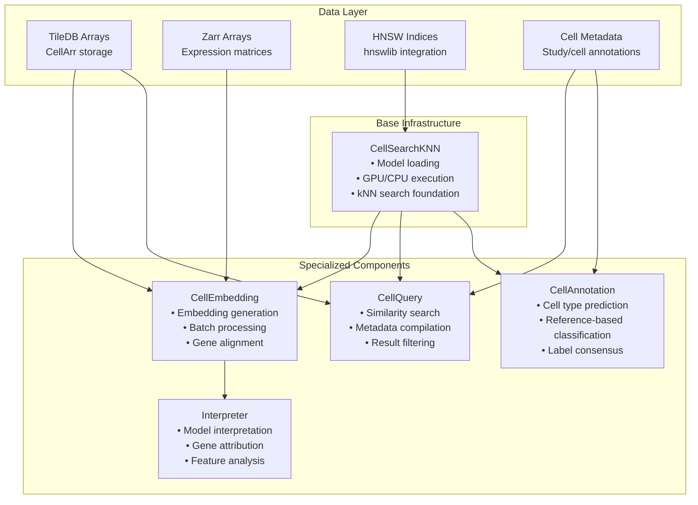
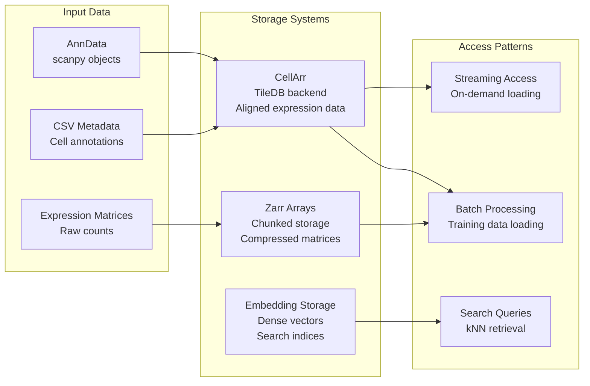
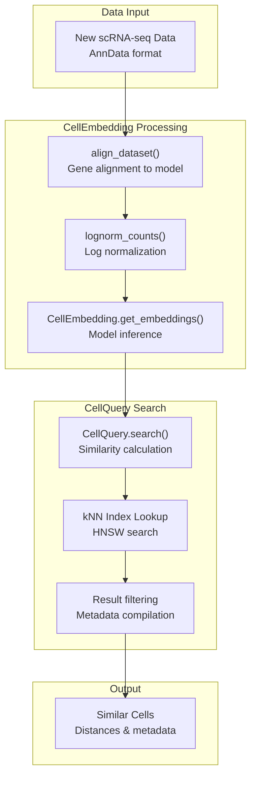
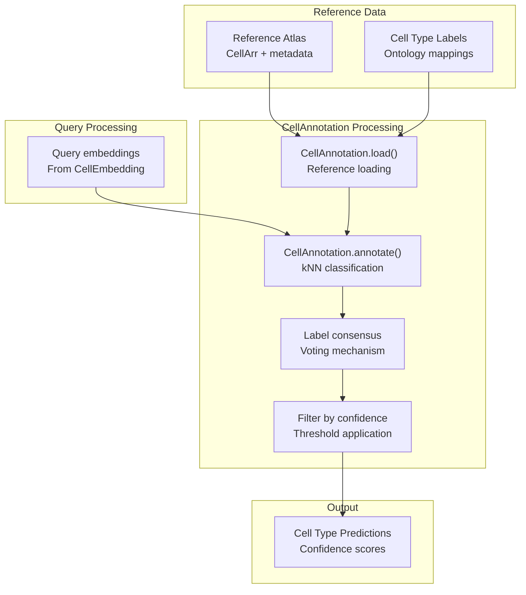
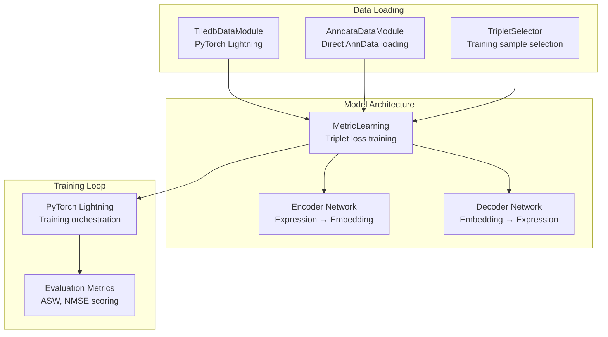

# SCimilarity Overview

Relevant source files

The following files were used as context for generating this wiki page:

- [README.rst](README.rst)
- [docs/about.rst](docs/about.rst)
- [setup.cfg](setup.cfg)

## Purpose and Scope

This document provides a comprehensive overview of the SCimilarity system architecture, core components, and fundamental workflows. SCimilarity is a cell atlas foundation model that enables scalable similarity search across millions of single-cell RNA sequencing profiles.

This overview covers the system's high-level design, key classes, and data flow patterns. For detailed installation instructions, see [Installation & Setup](#2). For specific API documentation, see [Core API Reference](#3). For hands-on examples, see [Tutorials & Examples](#8).

## What is SCimilarity

SCimilarity is a machine learning system that creates unified representations of single-cell expression profiles, enabling quantitative similarity measurements between cellular states. The system provides a novel cell search capability that can efficiently query millions of single-cell profiles to find cells similar to a query state, allowing researchers to systematically leverage massive public scRNA-seq atlases.

Key capabilities include:
- **Cell similarity search**: Find cells with similar expression patterns across large atlases
- **Cell type annotation**: Automatically classify cells based on reference datasets  
- **Cross-study generalization**: Represent new studies without additional model training
- **Scalable embedding**: Process millions of single-cell profiles efficiently

**Sources:** [README.rst:1-43](), [setup.cfg:6-15]()

## System Architecture

SCimilarity follows a hierarchical, data-centric architecture built around efficient storage and retrieval of single-cell embeddings and metadata.

### Core Class Hierarchy

**Sources:** Architecture diagrams provided, [setup.cfg:49-62]()

### Data Storage Architecture  

**Sources:** [setup.cfg:54-61]()

## Core Workflows

SCimilarity supports three primary workflows, each implemented through specific class interfaces and data processing pipelines.

### Embedding and Search Pipeline

### Annotation Workflow

**Sources:** Architecture diagrams provided

## Key Components and Dependencies

### Core Dependencies

SCimilarity integrates several key technologies to provide its functionality:

| Component | Purpose | Implementation |
|-----------|---------|----------------|
| `torch` | Deep learning framework | Model training and inference |
| `pytorch-lightning` | Training orchestration | Metric learning pipeline |
| `tiledb` | Array storage | CellArr data backend |
| `tiledb-vector-search` | Vector indices | Fast similarity search |
| `hnswlib` | Approximate kNN | HNSW index implementation |
| `scanpy` | Single-cell analysis | Data preprocessing |
| `zarr` | Array storage | Chunked data arrays |
| `captum` | Model interpretation | Gene attribution analysis |

### Training Infrastructure

**Sources:** [setup.cfg:49-62]()

## Data Flow and Processing

The SCimilarity system processes single-cell data through a series of standardized steps that ensure compatibility across different studies and datasets.

### End-to-End Data Processing

```mermaid
flowchart LR
    subgraph "Input Processing"
        RAW["Raw Counts<br/>Study-specific genes"]
        ALIGN_STEP["Gene Alignment<br/>Map to model features"]
        NORM_STEP["Log Normalization<br/>log1p transformation"]
    end
    
    subgraph "Model Inference"
        MODEL["Pretrained Model<br/>MetricLearning weights"]
        ENCODE["Encoder Forward Pass<br/>Generate embeddings"]
    end
    
    subgraph "Search Infrastructure"
        INDEX["Search Index<br/>HNSW or TileDB-VS"]
        SEARCH_EXEC["Search Execution<br/>kNN retrieval"]
        METADATA["Metadata Lookup<br/>Cell annotations"]
    end
    
    subgraph "Result Compilation"
        COMPILE["Result Compilation<br/>Distances + metadata"]
        FORMAT["Output Formatting<br/>DataFrames/AnnData"]
    end
    
    RAW --> ALIGN_STEP
    ALIGN_STEP --> NORM_STEP
    NORM_STEP --> MODEL
    MODEL --> ENCODE
    ENCODE --> INDEX
    INDEX --> SEARCH_EXEC
    SEARCH_EXEC --> METADATA
    METADATA --> COMPILE
    COMPILE --> FORMAT
```

**Sources:** Architecture diagrams provided

## Deployment and Distribution

SCimilarity is distributed through multiple channels to support different usage patterns:

- **PyPI Package**: Core API installation via `pip install scimilarity`
- **Docker Container**: Complete environment at `ghcr.io/genentech/scimilarity`  
- **Zenodo Assets**: Pretrained models, embeddings, and indices
- **Documentation Site**: API docs and tutorials at GitHub Pages

The system supports both local development and cloud deployment scenarios, with GPU acceleration available for large-scale processing tasks.

**Sources:** [README.rst:19-32](), [setup.cfg:1-43]()

---