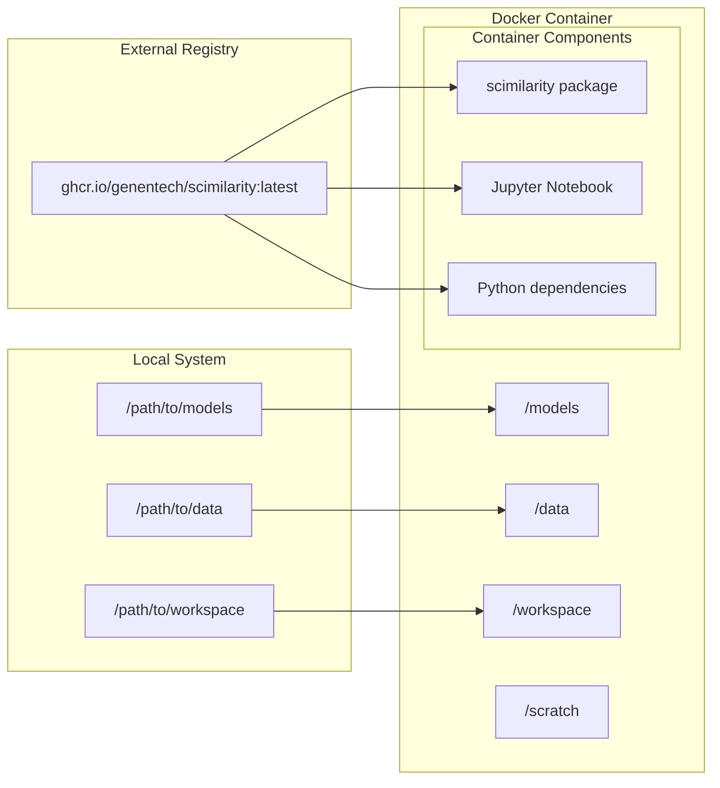
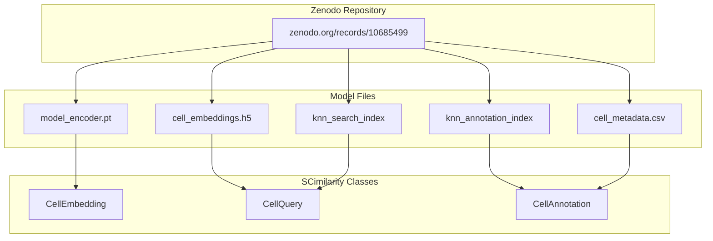
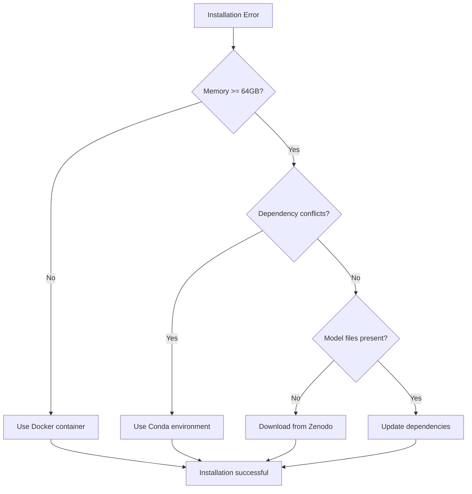

# Installation & Setup

<details>
<summary>Relevant source files</summary>

The following files were used as context for generating this wiki page:

- [.github/workflows/docker.yaml](.github/workflows/docker.yaml)
- [docker/Dockerfile](docker/Dockerfile)
- [docs/_static/environment.yaml](docs/_static/environment.yaml)
- [docs/install.rst](docs/install.rst)

</details>


This document provides comprehensive instructions for installing and configuring SCimilarity, including system requirements, installation methods, and setup of pretrained models. SCimilarity is a foundation model for single-cell similarity search that requires specific hardware and software configurations to function optimally.

For information about using the core API after installation, see [Core API Reference](#3). For training custom models, see [Model Training](#4).

## System Requirements

SCimilarity has significant memory requirements to enable rapid searches across millions of cells. The minimum system specifications are:

| Component | Requirement | Notes |
|-----------|-------------|-------|
| **RAM** | 64 GB minimum | Required for loading embeddings and search indices |
| **GPU** | Optional | Not required for inference, but necessary for model training |
| **Python** | 3.10+ | Tested with Python 3.10 |
| **Operating System** | Linux/macOS/Windows | Docker recommended for consistency |

**Installation Methods Overview**

```mermaid
graph TB
    subgraph "Installation Options"
        PIP["pip install"]
        CONDA["Conda Environment"]
        DOCKER["Docker Container"]
        DEV["Development Install"]
    end
    
    subgraph "Dependencies"
        PYTHON["Python 3.10+"]
        TORCH["PyTorch"]
        TILEDB["TileDB"]
        HNSWLIB["hnswlib"]
        SCANPY["scanpy"]
    end
    
    subgraph "External Resources"
        ZENODO["Zenodo Models"]
        GHCR["GitHub Container Registry"]
        PYPI["PyPI Package"]
    end
    
    PIP --> PYPI
    CONDA --> PYTHON
    CONDA --> TORCH
    DOCKER --> GHCR
    DEV --> "GitHub Repository"
    
    PIP --> PYTHON
    PIP --> TORCH
    PIP --> TILEDB
    PIP --> HNSWLIB
    PIP --> SCANPY
    
    DOCKER --> ZENODO
    CONDA --> ZENODO
    PIP --> ZENODO
```

Sources: [docs/install.rst:26-42](), [docker/Dockerfile:1-98]()

## Package Installation

### Standard Installation

The simplest installation method uses pip to install the latest stable release:

```bash
pip install scimilarity
```

This installs the `scimilarity` package and its core dependencies from PyPI. However, due to the complexity of dependencies, using a Conda environment or Docker container is recommended for production use.

Sources: [docs/install.rst:9-14]()

### Development Installation

For access to the latest features or to contribute to development, install directly from the GitHub repository:

```bash
git clone https://github.com/genentech/scimilarity.git
cd scimilarity
pip install -e .
```

The `-e` flag creates an editable installation, allowing you to modify the source code and see changes immediately.

Sources: [docs/install.rst:16-24]()

### Conda Environment Setup

The recommended approach uses a Conda environment with curated dependencies to avoid version conflicts:

```yaml
name: scimilarity
channels:
  - nvidia
  - pytorch
  - bioconda
  - conda-forge
dependencies:
  - python=3.10
  - ipykernel
  - ipython
  - ipywidgets
  - leidenalg
  - pip
```

Create and activate the environment:

```bash
conda env create -f environment.yaml
conda activate scimilarity
pip install scimilarity
```

Sources: [docs/install.rst:52-63](), [docs/_static/environment.yaml:1-13]()

## Docker Container Setup

The Docker container provides a complete, pre-configured environment with all dependencies installed. This is the most reliable installation method for production use.

**Docker Architecture**



Sources: [docs/install.rst:65-89](), [docker/Dockerfile:6-10]()

### Pulling the Container

Pull the latest container from the GitHub Container Registry:

```bash
docker pull ghcr.io/genentech/scimilarity:latest
```

### Running with Jupyter

Launch a Jupyter notebook session with appropriate volume mounts:

```bash
docker run -it --platform linux/amd64 -p 8888:8888 \
    -v /path/to/workspace:/workspace \
    -v /path/to/data:/data \
    -v /path/to/models:/models \
    ghcr.io/genentech/scimilarity:latest start-notebook
```

The container provides four bind points for organizing your work:
- `/models` - Pretrained SCimilarity models
- `/data` - Single-cell RNA-seq datasets  
- `/workspace` - Jupyter notebooks and analysis scripts
- `/scratch` - Temporary storage

Sources: [docs/install.rst:78-98](), [docker/Dockerfile:7-10]()

## Pretrained Models

SCimilarity requires pretrained models for embedding generation and similarity search. Models are hosted on Zenodo and must be downloaded separately from the package installation.

**Model Components**



Sources: [docs/install.rst:44-49]()

### Downloading Models

Download the pretrained models from Zenodo:

```bash
# Manual download from web interface
# https://zenodo.org/records/10685499

# Or using wget/curl (replace with actual download URLs)
wget https://zenodo.org/records/10685499/files/model_files.tar.gz
tar -xzf model_files.tar.gz
```

Set the `SCMODEL_HOME` environment variable to point to your models directory:

```bash
export SCMODEL_HOME=/path/to/models
```

In the Docker container, this is automatically set to `/models`.

Sources: [docker/Dockerfile:17]()

## Installation Verification

After installation, verify that SCimilarity is working correctly:

```python
import scimilarity
from scimilarity import CellEmbedding, CellQuery, CellAnnotation

# Check version
print(f"SCimilarity version: {scimilarity.__version__}")

# Test basic import (requires models to be downloaded)
try:
    ce = CellEmbedding()
    print("✓ CellEmbedding loaded successfully")
except Exception as e:
    print(f"✗ CellEmbedding failed: {e}")
```

## Troubleshooting

### Memory Issues

If you encounter memory-related crashes despite having sufficient RAM:

1. **Check available memory**: Ensure you have at least 64 GB of free RAM
2. **Close other applications**: Free up memory by closing unnecessary programs
3. **Use Docker**: The containerized environment has optimized memory settings

### Dependency Conflicts

If you encounter import errors or version conflicts:

1. **Use Conda environment**: Create a fresh environment with the provided `environment.yaml`
2. **Update dependencies**: Ensure you have compatible versions of `hnswlib`, `numpy`, and `tiledb`
3. **Use Docker container**: Avoids all dependency management issues

### Model Loading Issues

If models fail to load:

1. **Verify download**: Ensure all model files are downloaded completely
2. **Check file paths**: Verify `SCMODEL_HOME` points to the correct directory
3. **File permissions**: Ensure the model files are readable

Sources: [docs/install.rst:32-37]()

**Installation Troubleshooting Flow**



Sources: [docs/install.rst:26-37]()

---