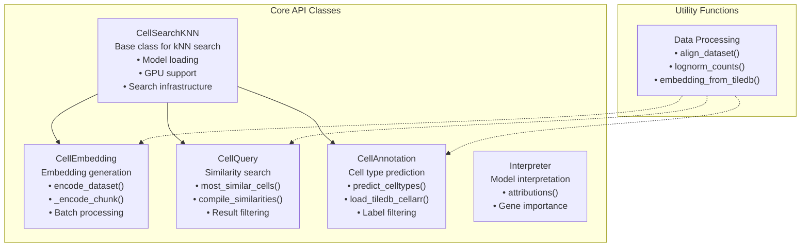
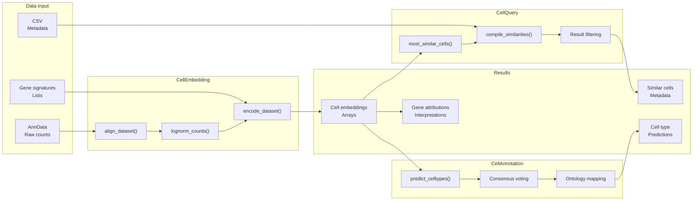
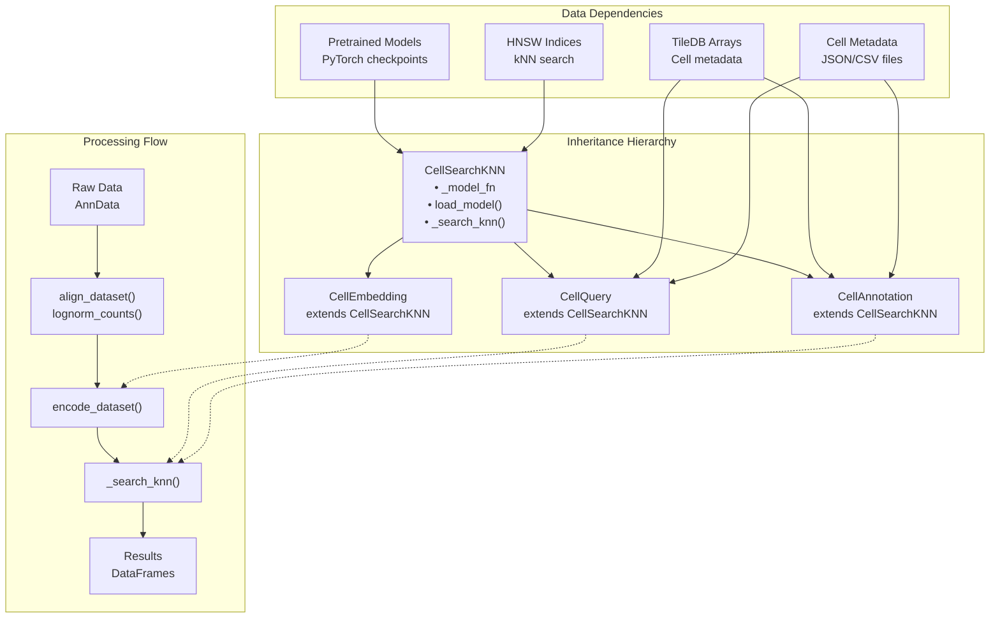

# Core API Reference

<details>
<summary>Relevant source files</summary>

The following files were used as context for generating this wiki page:

- [setup.py](setup.py)
- [src/scimilarity/__init__.py](src/scimilarity/__init__.py)
- [tox.ini](tox.ini)

</details>


This document provides comprehensive documentation of SCimilarity's core Python API classes and methods for cell embedding generation, similarity search, and automated annotation. The API is designed around a hierarchical class structure that enables efficient large-scale single-cell analysis workflows.

For detailed model training procedures, see [Model Training](#4). For data storage and management systems, see [Data Management & Storage](#5). For step-by-step usage examples, see [Tutorials & Examples](#8).

## API Overview

SCimilarity's core API is built around four primary classes that handle different aspects of single-cell similarity analysis. All user-facing functionality is accessible through these main entry points.

### Class Hierarchy



Sources: [src/scimilarity/__init__.py:18-22]()

### Core Workflow Architecture



Sources: [src/scimilarity/__init__.py:18-22]()

## Main API Classes

| Class | Purpose | Key Methods | Detailed Documentation |
|-------|---------|-------------|----------------------|
| `CellEmbedding` | Generate embeddings from single-cell data | `encode_dataset()`, `encode_adata()` | [Cell Embedding & Search Infrastructure](#3.1) |
| `CellQuery` | Perform similarity searches and compile results | `most_similar_cells()`, `compile_similarities()` | [Cell Query System](#3.2) |
| `CellAnnotation` | Automated cell type prediction | `predict_celltypes()`, `load_tiledb_cellarr()` | [Cell Annotation](#3.3) |
| `Interpreter` | Model interpretation and gene attribution | `attributions()` | [Advanced Topics](#9) |

### Core Utility Functions

| Function | Purpose | Input | Output |
|----------|---------|-------|---------|
| `align_dataset()` | Align query genes to model vocabulary | AnnData object | Aligned AnnData |
| `lognorm_counts()` | Log-normalize count matrices | Raw counts | Normalized counts |

Sources: [src/scimilarity/__init__.py:22]()

## Class Relationships and Data Flow



Sources: [src/scimilarity/__init__.py:18-21]()

## API Entry Points

### Primary Imports

```python
from scimilarity import (
    CellEmbedding,      # Embedding generation
    CellQuery,          # Similarity search  
    CellAnnotation,     # Cell type prediction
    Interpreter,        # Model interpretation
    align_dataset,      # Data alignment utility
    lognorm_counts      # Normalization utility
)
```

### Common Usage Patterns

The API follows a consistent pattern across all main classes:

1. **Initialization**: Load pretrained models and configure parameters
2. **Data Preparation**: Align and normalize input data using utilities  
3. **Processing**: Generate embeddings, perform searches, or make predictions
4. **Results**: Return structured DataFrames with metadata and confidence scores

Each class provides both high-level convenience methods for common workflows and lower-level methods for advanced customization. GPU acceleration is automatically detected and utilized when available.

For implementation details and method signatures of each class, refer to the dedicated subsection pages linked in the table above.

Sources: [src/scimilarity/__init__.py:1-23]()

---