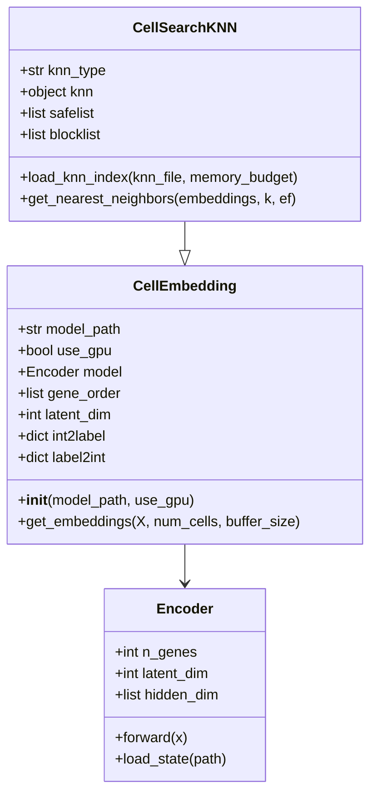
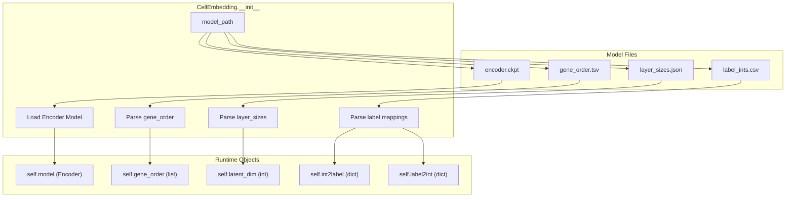
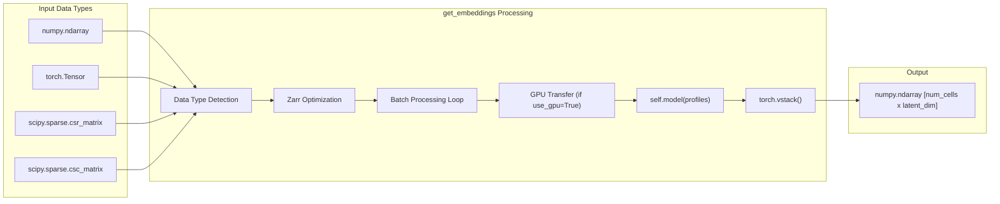
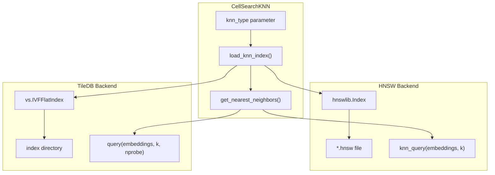
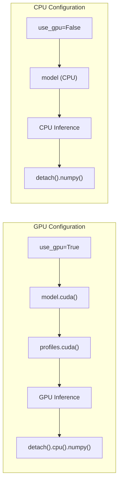

# Cell Embedding & Search Infrastructure

Relevant source files

The following files were used as context for generating this wiki page:

- [docs/api.rst](docs/api.rst)
- [src/scimilarity/cell_embedding.py](src/scimilarity/cell_embedding.py)
- [src/scimilarity/cell_search_knn.py](src/scimilarity/cell_search_knn.py)
- [src/scimilarity/triplet_selector.py](src/scimilarity/triplet_selector.py)

This document covers the foundational classes `CellEmbedding` and `CellSearchKNN` that provide the core infrastructure for generating cell embeddings and performing similarity searches in SCimilarity. These classes form the base layer upon which higher-level functionality is built.

For cell similarity queries and metadata compilation, see [Cell Query System](#3.2). For automated cell type prediction, see [Cell Annotation](#3.3). For data preprocessing and alignment utilities, see [Data Processing Utilities](#3.4).

## Architecture Overview

The embedding and search infrastructure follows a hierarchical design where `CellSearchKNN` extends `CellEmbedding` to add kNN search capabilities on top of the base embedding functionality.

### Class Hierarchy

Sources: [src/scimilarity/cell_embedding.py:4-71](), [src/scimilarity/cell_search_knn.py:6-104]()

## CellEmbedding Class

The `CellEmbedding` class handles model loading, gene alignment, and embedding generation from gene expression data.

### Model Loading Infrastructure

Sources: [src/scimilarity/cell_embedding.py:24-71]()

### Embedding Generation Workflow

The `get_embeddings` method processes gene expression data through several stages:

| Stage | Input | Output | Purpose |
|-------|-------|--------|---------|
| Data Type Detection | `scipy.sparse`, `numpy.ndarray`, `torch.Tensor` | Normalized format | Handle multiple input formats |
| Zarr Optimization | Zarr-backed sparse matrices | Loaded arrays | Optimize small batch performance |
| Batch Processing | Expression matrix | Embedding chunks | Memory-efficient processing |
| GPU Transfer | CPU tensors | GPU tensors | Accelerate inference |
| Model Inference | Gene expression | Latent embeddings | Generate cell representations |

Sources: [src/scimilarity/cell_embedding.py:72-156]()

## CellSearchKNN Class

The `CellSearchKNN` class extends `CellEmbedding` to provide approximate nearest neighbor search capabilities using either HNSW or TileDB vector search backends.

### kNN Backend Support

Sources: [src/scimilarity/cell_search_knn.py:40-103]()

### Search Parameter Configuration

The kNN search behavior is controlled by several parameters:

| Parameter | Backend | Purpose | Default |
|-----------|---------|---------|---------|
| `k` | Both | Number of nearest neighbors | 50 |
| `ef` | HNSW | Dynamic list size for search | 100 |
| `memory_budget` | TileDB | Memory allocation for index | 50000000 |
| `nprobe` | TileDB | Number of clusters to search | `√partitions` |

## GPU Support and Performance

Both classes support GPU acceleration through the `use_gpu` parameter:

Sources: [src/scimilarity/cell_embedding.py:62-63](), [src/scimilarity/cell_embedding.py:139-151]()

## Error Handling and Validation

The infrastructure includes several validation mechanisms:

- **Data Type Validation**: Supports `numpy.ndarray`, `torch.Tensor`, and `scipy.sparse` matrices [src/scimilarity/cell_embedding.py:129-137]()
- **NaN Detection**: Validates embedding outputs for numerical stability [src/scimilarity/cell_embedding.py:153-154]()
- **kNN Index Validation**: Ensures index files exist and match expected formats [src/scimilarity/cell_search_knn.py:55-62]()
- **Empty Batch Handling**: Handles edge cases with no valid cells [src/scimilarity/cell_embedding.py:143-144]()

## Integration Points

These base classes integrate with the broader SCimilarity ecosystem:

- **Model Training**: Uses `Encoder` from neural network training pipeline [src/scimilarity/cell_embedding.py:27]()
- **Data Processing**: Works with alignment utilities for gene space matching
- **Higher-Level APIs**: Extended by `CellQuery` and `CellAnnotation` classes
- **Storage Backends**: Interfaces with TileDB and Zarr data stores through preprocessing

Sources: [src/scimilarity/cell_embedding.py:1-157](), [src/scimilarity/cell_search_knn.py:1-104]()

---