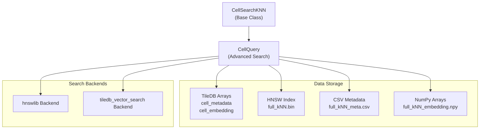
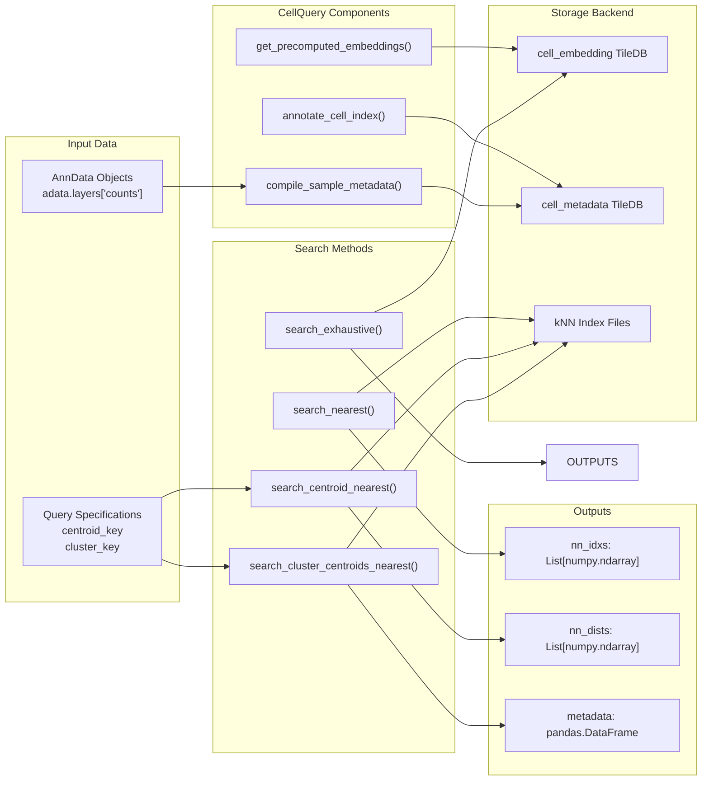
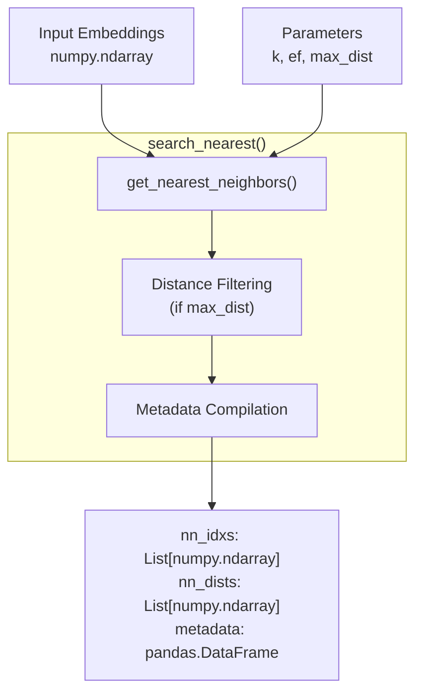
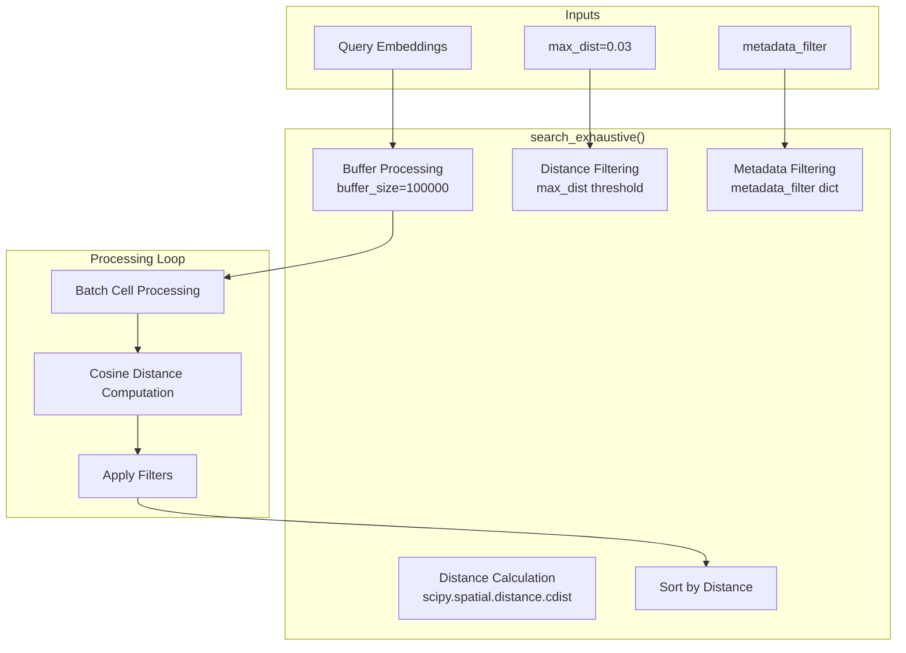

# Cell Query System

<details>
<summary>Relevant source files</summary>

The following files were used as context for generating this wiki page:

- [src/scimilarity/cell_query.py](src/scimilarity/cell_query.py)

</details>


The Cell Query System provides advanced similarity search capabilities for single-cell data through the `CellQuery` class. This system extends the base cell search infrastructure to enable complex queries with metadata compilation, result filtering, and multiple search strategies including both approximate and exhaustive search methods.

For basic cell embedding and search infrastructure, see [Cell Embedding & Search Infrastructure](#3.1). For cell type annotation functionality, see [Cell Annotation](#3.3).

## Architecture Overview

The `CellQuery` class serves as the primary interface for cell similarity searches, extending `CellSearchKNN` with enhanced query capabilities and metadata management.

### Class Hierarchy and Dependencies



**Sources:** [src/scimilarity/cell_query.py:1-84]()

### Data Integration Architecture



**Sources:** [src/scimilarity/cell_query.py:93-116](), [src/scimilarity/cell_query.py:150-204]()

## Initialization and Configuration

The `CellQuery` class requires a model path and supports extensive configuration for different use cases:

| Parameter | Type | Default | Description |
|-----------|------|---------|-------------|
| `model_path` | str | Required | Path to the model directory |
| `use_gpu` | bool | False | Enable GPU acceleration |
| `metadata_tiledb_uri` | str | "cell_metadata" | TileDB cell metadata storage path |
| `embedding_tiledb_uri` | str | "cell_embedding" | TileDB cell embedding storage path |
| `knn_type` | str | "hnswlib" | kNN backend: "hnswlib" or "tiledb_vector_search" |
| `load_knn` | bool | True | Whether to load the kNN index |

The system automatically constructs file paths within a `cellsearch` subdirectory and initializes connections to TileDB arrays for metadata and embeddings.

**Sources:** [src/scimilarity/cell_query.py:31-92]()

## Core Data Access Methods

### Embedding Retrieval

The `get_precomputed_embeddings()` method provides efficient access to precomputed cell embeddings from TileDB storage:

```python
# Fast retrieval of specific cell embeddings
embeddings = cq.get_precomputed_embeddings([0, 1, 100])
embeddings = cq.get_precomputed_embeddings(slice(0, 1000))
```

**Sources:** [src/scimilarity/cell_query.py:93-116]()

### Cell Index Annotation

The `annotate_cell_index()` method maps global cell indices to sample-specific indices, enabling proper data alignment:

```python
# Convert global indices to per-sample cell indices
metadata_with_cell_index = cq.annotate_cell_index(metadata)
```

This method requires metadata with `study`, `sample`, and `data_type` columns and adds a `cell_index` column representing the position within each sample dataset.

**Sources:** [src/scimilarity/cell_query.py:117-148]()

### Sample Metadata Compilation

The `compile_sample_metadata()` method aggregates nearest neighbor results at the sample level:

```python
# Compile sample-level statistics for search results
sample_metadata = cq.compile_sample_metadata(
    nn_idxs, 
    levels=["study", "sample", "tissue", "disease"]
)
```

This method calculates cell counts and fractions per sample, providing insights into which samples contain cells similar to the query.

**Sources:** [src/scimilarity/cell_query.py:150-204]()

## Search Methods

The `CellQuery` class provides multiple search strategies optimized for different use cases:

### Search Method Comparison

| Method | Search Type | Performance | Use Case |
|--------|-------------|-------------|----------|
| `search_nearest` | Approximate (kNN) | Fast | General similarity search |
| `search_exhaustive` | Exact | Slow | Precise distance filtering |
| `search_centroid_nearest` | Approximate (kNN) | Fast | Single cluster queries |
| `search_cluster_centroids_nearest` | Approximate (kNN) | Fast | Multiple cluster queries |
| `search_centroid_exhaustive` | Exact | Slow | Precise centroid search |
| `search_cluster_centroids_exhaustive` | Exact | Slow | Precise multi-cluster search |

### kNN-Based Search Methods

#### Basic Nearest Neighbor Search



**Sources:** [src/scimilarity/cell_query.py:206-275]()

#### Centroid-Based Search

The system supports searching using centroids computed from marked cells:

```python
# Mark cells for centroid calculation
adata.obs["used_in_query"] = (adata.obs["celltype"] == "macrophage").astype(int)

# Search using centroid
centroid_embedding, nn_idxs, nn_dists, metadata, qc_stats = cq.search_centroid_nearest(
    adata, 
    centroid_key='used_in_query',
    k=10000,
    qc=True
)
```

The method includes quality control metrics to assess query coherence through k-means clustering analysis.

**Sources:** [src/scimilarity/cell_query.py:277-375]()

#### Cluster Centroid Search

For analyzing multiple clusters simultaneously:

```python
# Search all cluster centroids
centroid_embeddings, cluster_idx, nn_idxs, nn_dists, metadata = cq.search_cluster_centroids_nearest(
    adata, 
    cluster_key="leiden",
    k=10000
)
```

This method returns results organized by cluster labels, enabling comparative analysis across cell types.

**Sources:** [src/scimilarity/cell_query.py:377-473]()

### Exhaustive Search Methods

#### Distance-Based Exhaustive Search



The exhaustive search provides exact distance calculations but processes cells in batches for memory efficiency.

**Sources:** [src/scimilarity/cell_query.py:475-559]()

#### Exhaustive Centroid Search

Combines centroid calculation with exhaustive search for precise results:

```python
# Exhaustive search with metadata filtering
nn_idxs, nn_dists, metadata = cq.search_centroid_exhaustive(
    adata,
    centroid_key='used_in_query',
    max_dist=0.03,
    metadata_filter={"tissue": "lung", "disease": "healthy"}
)
```

**Sources:** [src/scimilarity/cell_query.py:561-652]()

## Quality Control and Validation

The centroid search methods include built-in quality control through query coherence analysis:

- **K-means clustering** of query cells to assess homogeneity
- **Overlap analysis** between cluster centroids and search results
- **Query coherence score** indicating result reliability

This ensures that centroid-based queries represent coherent cell populations rather than heterogeneous mixtures.

**Sources:** [src/scimilarity/cell_query.py:362-374](), [src/scimilarity/cell_query.py:639-651]()

## Performance Considerations

The `CellQuery` system balances performance and accuracy through:

- **Approximate search** via HNSW indices for fast queries
- **Exhaustive search** for precise distance-based filtering
- **Batch processing** to manage memory usage during exhaustive search
- **TileDB integration** for efficient large-scale data access
- **Configurable parameters** (`ef`, `k`, `buffer_size`) for performance tuning

The choice between approximate and exhaustive methods depends on the specific requirements for speed versus precision in each use case.

**Sources:** [src/scimilarity/cell_query.py:475-559](), [src/scimilarity/cell_query.py:206-275]()

---