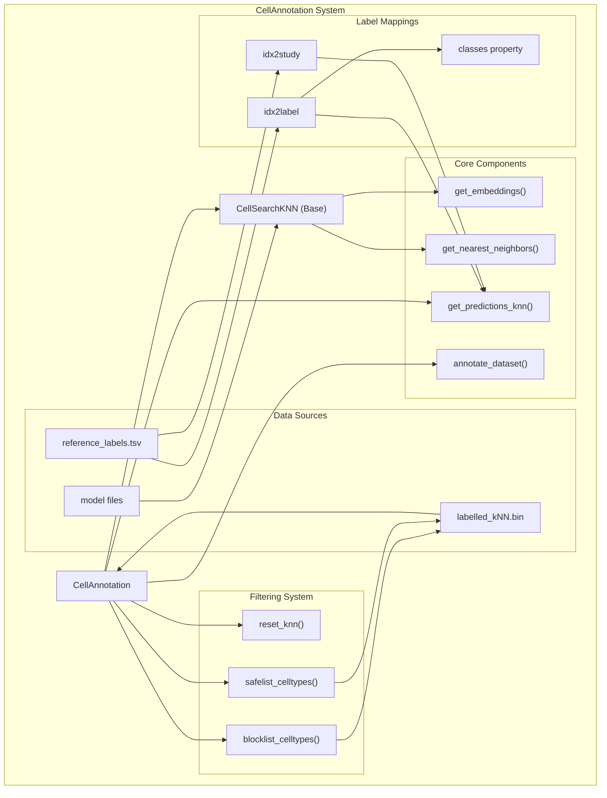
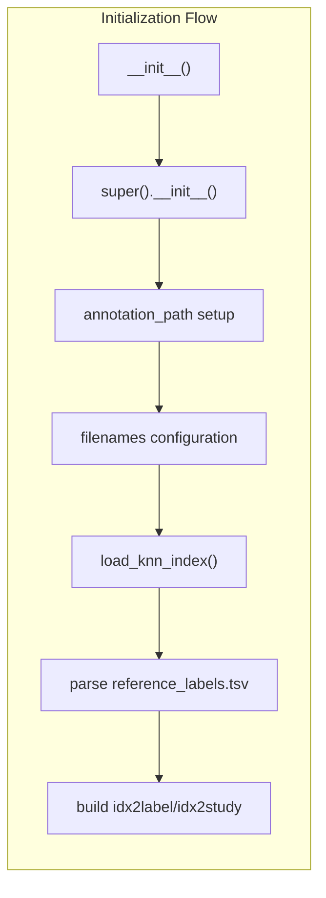
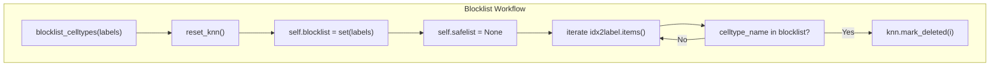
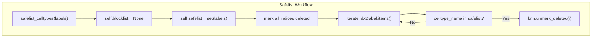
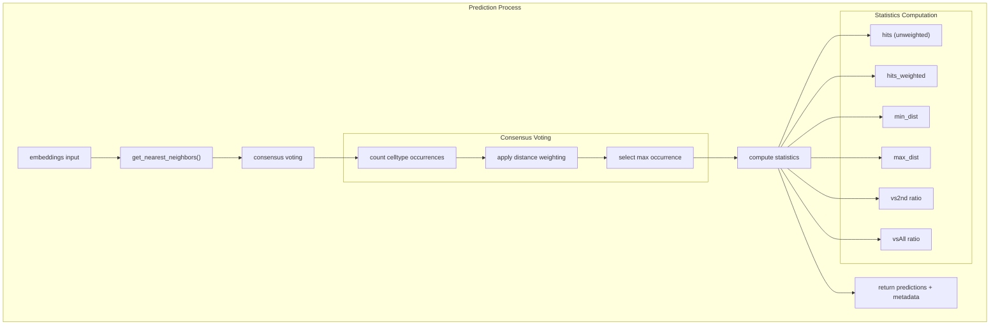
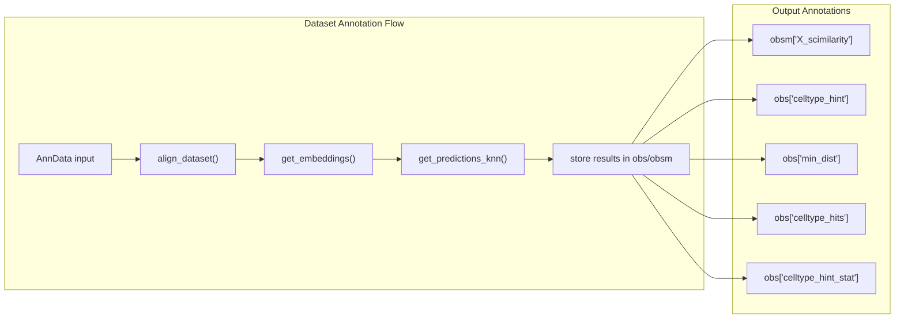
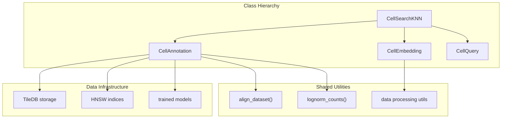

# Cell Annotation

Relevant source files

The following files were used as context for generating this wiki page:

- [src/scimilarity/cell_annotation.py](src/scimilarity/cell_annotation.py)

## Purpose and Scope

This document covers the `CellAnnotation` class and its associated workflows for automated cell type prediction and classification in SCimilarity. The `CellAnnotation` system enables researchers to predict cell types for new single-cell datasets using pre-trained reference models and nearest neighbor search algorithms.

For information about similarity search workflows without cell type prediction, see [Cell Query System](#3.2). For details about the underlying embedding and search infrastructure, see [Cell Embedding & Search Infrastructure](#3.1).

## System Overview

The `CellAnnotation` class extends the `CellSearchKNN` base class to provide specialized functionality for cell type prediction. It combines embedding generation, nearest neighbor search, and consensus voting to assign cell type labels to query cells.

### CellAnnotation Architecture

**Sources:** [src/scimilarity/cell_annotation.py:1-320]()

## Core Functionality

### Initialization and Setup

The `CellAnnotation` class initializes by loading pre-built kNN indices and reference cell type labels. The initialization process sets up the annotation-specific file paths and data structures needed for prediction.

Key configuration elements:
- `annotation_path`: Directory containing annotation-specific files ([src/scimilarity/cell_annotation.py:37-38]())
- `knn` filename: Binary file containing the labeled kNN index ([src/scimilarity/cell_annotation.py:43-45]())
- `celltype_labels` filename: TSV file mapping indices to cell type labels ([src/scimilarity/cell_annotation.py:46-49]())

**Sources:** [src/scimilarity/cell_annotation.py:23-64]()

### Cell Type Filtering System

The annotation system provides flexible filtering mechanisms to control which cell types can be predicted through blocklists and safelists.

#### Blocklist Functionality

The `blocklist_celltypes()` method prevents specific cell types from being predicted by marking corresponding indices as deleted in the kNN index.

#### Safelist Functionality

The `safelist_celltypes()` method restricts predictions to only specified cell types by marking all indices as deleted, then unmarking only the safelisted ones.

**Sources:** [src/scimilarity/cell_annotation.py:92-147]()

### Prediction Engine

The core prediction functionality is implemented in `get_predictions_knn()`, which performs nearest neighbor search and consensus voting to assign cell type labels.

#### Prediction Workflow

#### Voting Mechanisms

The system supports two voting strategies:
- **Unweighted**: Simple count of cell type occurrences among k nearest neighbors
- **Distance-weighted**: Inverse distance weighting where closer neighbors have higher influence

**Sources:** [src/scimilarity/cell_annotation.py:148-279]()

### Dataset Annotation

The `annotate_dataset()` method provides a high-level interface for annotating entire AnnData objects with cell type predictions and embedding information.

**Sources:** [src/scimilarity/cell_annotation.py:281-319]()

## Data Structures and File Format

### Reference Label Format

The `reference_labels.tsv` file contains the mapping between kNN index positions and cell type labels:

| Column | Description | Required |
|--------|-------------|----------|
| Cell Type | Human-readable cell type label | Yes |
| Study | Source study identifier | Optional |

### Label Mapping Dictionaries

The class maintains two key mapping structures:
- `idx2label`: Maps integer indices to cell type strings ([src/scimilarity/cell_annotation.py:55]())
- `idx2study`: Maps integer indices to study identifiers ([src/scimilarity/cell_annotation.py:56]())

### Prediction Statistics

The prediction statistics returned by `get_predictions_knn()` include:

| Field | Type | Description |
|-------|------|-------------|
| `hits` | JSON string | Unweighted vote counts per cell type |
| `hits_weighted` | JSON string | Distance-weighted vote counts |
| `min_dist` | float | Minimum distance to nearest neighbors |
| `max_dist` | float | Maximum distance to nearest neighbors |
| `vs2nd` | float | Best vs second-best ratio (unweighted) |
| `vsAll` | float | Best vs all votes ratio (unweighted) |
| `vs2nd_weighted` | float | Best vs second-best ratio (weighted) |
| `vsAll_weighted` | float | Best vs all votes ratio (weighted) |

**Sources:** [src/scimilarity/cell_annotation.py:181-189](), [src/scimilarity/cell_annotation.py:215-274]()

## Integration with SCimilarity Ecosystem

The `CellAnnotation` class integrates with other SCimilarity components through inheritance and shared interfaces:

**Sources:** [src/scimilarity/cell_annotation.py:3](), [src/scimilarity/cell_annotation.py:306]()

---