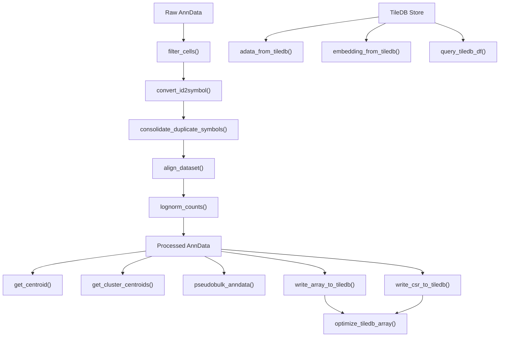
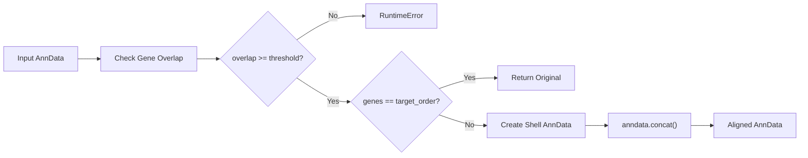
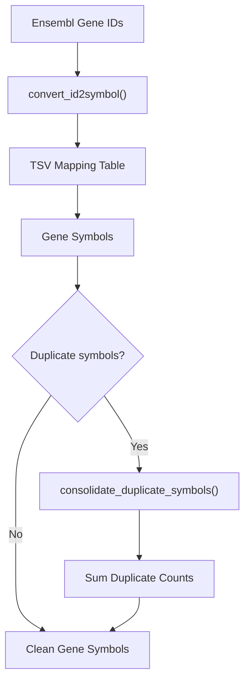
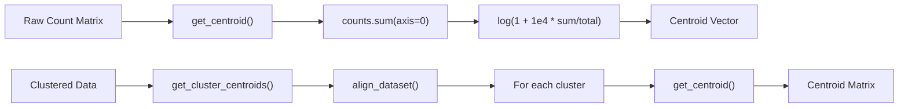
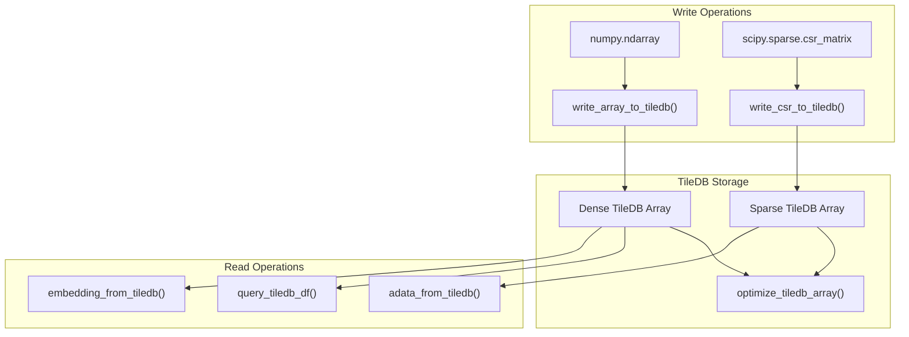
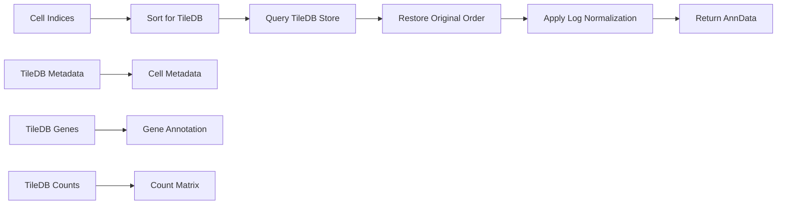
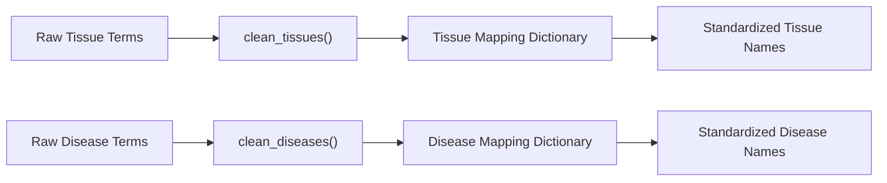
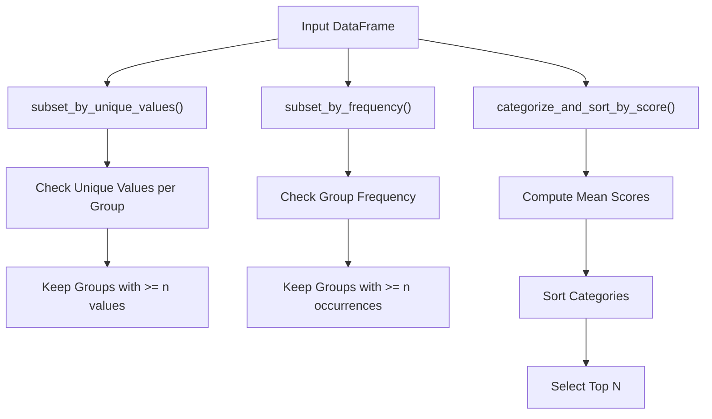

# Data Processing Utilities

<details>
<summary>Relevant source files</summary>

The following files were used as context for generating this wiki page:

- [src/scimilarity/utils.py](src/scimilarity/utils.py)

</details>


This page documents the utility functions in SCimilarity that handle data preprocessing, transformation, and integration with storage systems. These utilities provide the foundational data operations needed for embedding generation, similarity search, and cell annotation workflows.

For information about the main embedding and search classes that utilize these utilities, see [Cell Embedding & Search Infrastructure](#3.1), [Cell Query System](#3.2), and [Cell Annotation](#3.3). For details about the underlying data storage systems, see [Data Management & Storage](#5).

## Data Processing Pipeline Overview

The data processing utilities in SCimilarity form a comprehensive pipeline for transforming raw single-cell data into analysis-ready formats compatible with the embedding models and search infrastructure.



**Sources:** [src/scimilarity/utils.py:1-1465]()

## Core Data Preprocessing Functions

### Normalization and Alignment

The `lognorm_counts` function provides standardized log normalization for gene expression data, implementing the canonical preprocessing approach used throughout SCimilarity:

| Function | Purpose | Input | Output |
|----------|---------|-------|---------|
| `lognorm_counts` | Log normalize counts per 10k | AnnData with `layers["counts"]` | AnnData with normalized `X` |
| `align_dataset` | Align gene space to target order | AnnData + target gene list | Gene-aligned AnnData |

The `align_dataset` function ensures that datasets match the expected gene space for SCimilarity models. It validates gene overlap, handles missing genes by padding with zeros, and maintains data integrity through format conversions.



**Sources:** [src/scimilarity/utils.py:4-47](), [src/scimilarity/utils.py:50-131]()

### Cell Quality Control

The `filter_cells` function implements standard single-cell QC filtering based on gene count and mitochondrial content thresholds:

```python
# Key parameters for cell filtering
min_genes: int = 400           # Minimum expressed genes
mito_percent: float = 30.0     # Maximum mitochondrial percentage
mito_prefix: str = "MT-" | "mt-"  # Auto-detected prefix
```

**Sources:** [src/scimilarity/utils.py:134-190]()

## Gene Symbol Processing

### ID Conversion and Deduplication

SCimilarity provides utilities for handling gene identifier conversion and managing duplicate gene symbols:



The `consolidate_duplicate_symbols` function handles gene symbols that appear multiple times by summing their expression counts, ensuring a one-to-one mapping between symbols and expression values.

**Sources:** [src/scimilarity/utils.py:193-237](), [src/scimilarity/utils.py:240-301]()

## Centroid and Aggregation Utilities

### Expression Centroids

The centroid calculation functions enable analysis of cluster-level expression patterns:

| Function | Purpose | Key Features |
|----------|---------|--------------|
| `get_centroid` | Calculate centroid from raw counts | Log normalization, sparse matrix support |
| `get_cluster_centroids` | Multiple cluster centroids | Batch processing, null handling |
| `get_dist2centroid` | Distance to centroid | Cosine distance, embedding space |



**Sources:** [src/scimilarity/utils.py:304-335](), [src/scimilarity/utils.py:374-442](), [src/scimilarity/utils.py:338-371]()

### Pseudobulk Analysis

The `pseudobulk_anndata` function aggregates single-cell data into pseudobulk profiles with configurable grouping and quality control:

```python
# Pseudobulk grouping example
groupby_labels = ["sample", "tissue", "disease", "celltype_name"]
qc_filters = {
    "mito_percent": 20.0,
    "min_counts": 1000, 
    "min_genes": 500,
    "max_nn_dist": 0.03
}
```

**Sources:** [src/scimilarity/utils.py:785-887]()

## TileDB Integration

### Data Storage Operations

SCimilarity integrates deeply with TileDB for efficient storage and retrieval of large-scale single-cell datasets:



### TileDB Configuration and Optimization

The utilities include specialized configuration for TileDB performance optimization:

```python
# Default TileDB optimization config
config = {
    "sm.consolidation.steps": 500000,
    "sm.consolidation.step_min_frags": 2,
    "sm.consolidation.step_max_frags": 10,
    "sm.consolidation.buffer_size": 1000000000,  # 1GB
    "sm.mem.total_budget": 200000000000,         # 200GB
}
```

**Sources:** [src/scimilarity/utils.py:445-473](), [src/scimilarity/utils.py:475-521](), [src/scimilarity/utils.py:523-565]()

### Data Retrieval Functions

The `adata_from_tiledb` and `embedding_from_tiledb` functions provide efficient access to stored data with automatic sorting and normalization:



**Sources:** [src/scimilarity/utils.py:599-730](), [src/scimilarity/utils.py:733-782](), [src/scimilarity/utils.py:567-596]()

## Metadata Processing Utilities

### Tissue and Disease Standardization

SCimilarity includes comprehensive mapping functions for standardizing tissue and disease nomenclature across datasets:



The mapping dictionaries contain extensive term hierarchies, for example:

| Standardized Term | Mapped Variants |
|------------------|-----------------|
| `"lung"` | `"lung"`, `"alveolar system"`, `"BAL"`, `"lung parenchyma"`, `"upper lobe of lung"` |
| `"cancer"` | `"hepatocellular carcinoma"`, `"melanoma"`, `"acute myeloid leukemia"`, `"glioblastoma multiforme"` |
| `"brain"` | `"brain"`, `"cortex"`, `"prefrontal cortex"`, `"cerebrospinal fluid"`, `"spinal cord"` |

**Sources:** [src/scimilarity/utils.py:1006-1322](), [src/scimilarity/utils.py:1325-1464]()

## Data Manipulation and Filtering

### Statistical Filtering Functions

SCimilarity provides several utilities for filtering and transforming datasets based on statistical criteria:

| Function | Purpose | Key Parameters |
|----------|---------|----------------|
| `subset_by_unique_values` | Filter by unique value count | `group_columns`, `value_column`, `n` |
| `subset_by_frequency` | Filter by group frequency | `group_columns`, `n` |
| `categorize_and_sort_by_score` | Sort and subset by scores | `name_column`, `score_column`, `topn` |



**Sources:** [src/scimilarity/utils.py:890-922](), [src/scimilarity/utils.py:925-954](), [src/scimilarity/utils.py:957-1003]()

---