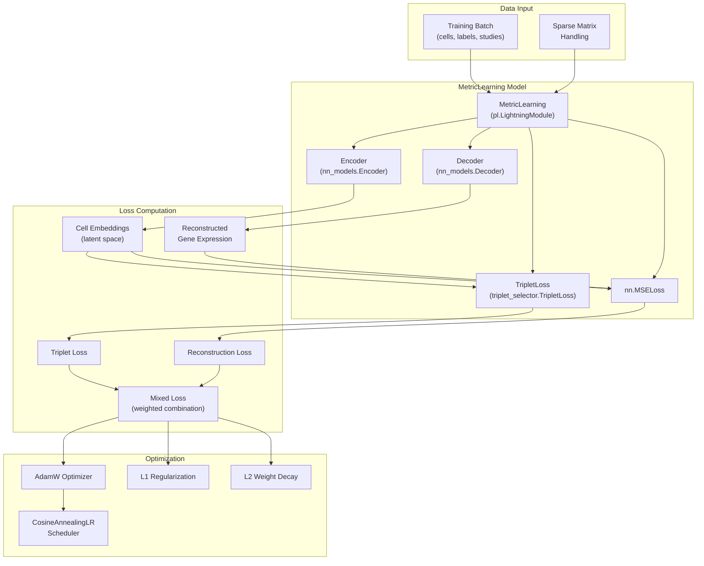
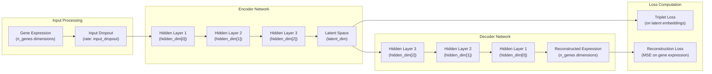
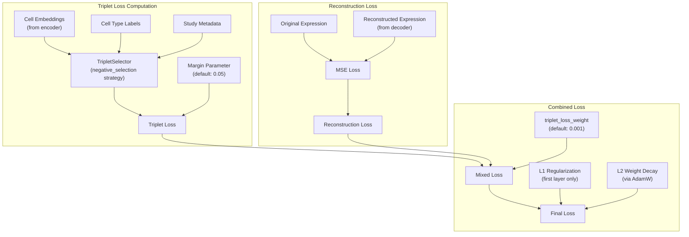
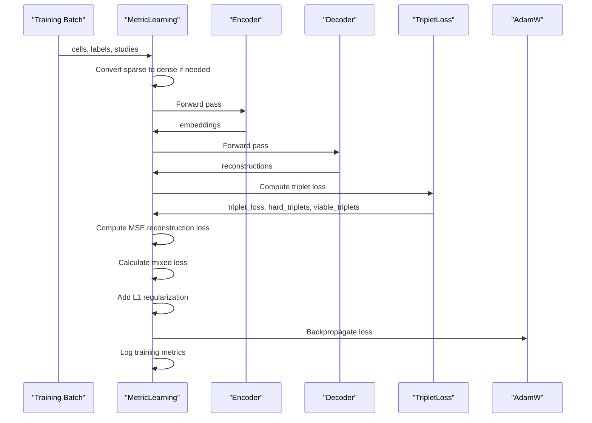

# Model Training

<details>
<summary>Relevant source files</summary>

The following files were used as context for generating this wiki page:

- [src/scimilarity/training_models.py](src/scimilarity/training_models.py)

</details>


This document covers SCimilarity's model training system, which implements metric learning for single-cell RNA sequencing data using PyTorch Lightning. The training system learns cell embeddings that preserve biological similarity relationships while maintaining reconstructive capabilities through an encoder-decoder architecture.

For information about data loading during training, see [Data Loading Systems](#4.1). For details about training scripts and practical examples, see [Training Scripts & Examples](#4.2). For post-training workflows including embedding generation and index building, see [Post-Training Workflows](#6).

## Training System Architecture

The SCimilarity training system centers around the `MetricLearning` class, which implements a PyTorch Lightning module that combines triplet loss for metric learning with reconstruction loss for autoencoder functionality.

### Core Training Components



**Sources:** [src/scimilarity/training_models.py:15-171]()

## MetricLearning Model Class

The `MetricLearning` class serves as the central training component, implementing a PyTorch Lightning module that orchestrates the entire training process.

### Key Architecture Parameters

| Parameter | Default | Description |
|-----------|---------|-------------|
| `n_genes` | Required | Number of input genes (dimensionality) |
| `latent_dim` | 128 | Embedding space dimensions |
| `hidden_dim` | [1024, 1024, 1024] | Hidden layer sizes for encoder/decoder |
| `dropout` | 0.5 | Dropout rate for hidden layers |
| `input_dropout` | 0.4 | Dropout rate for input layer |
| `triplet_loss_weight` | 0.001 | Weight for triplet vs reconstruction loss |
| `margin` | 0.05 | Margin parameter for triplet loss |
| `negative_selection` | "semihard" | Strategy for negative sample selection |

### Network Architecture

The model implements an encoder-decoder architecture where the encoder compresses gene expression into a latent embedding space, and the decoder reconstructs the original expression:



**Sources:** [src/scimilarity/training_models.py:118-131](), [src/scimilarity/training_models.py:187-205]()

## Loss Function Implementation

SCimilarity uses a hybrid loss function combining triplet loss for metric learning with reconstruction loss for maintaining expression patterns.

### Mixed Loss Calculation

The training optimizes a weighted combination of losses:

```
Mixed Loss = (triplet_loss_weight × triplet_loss) + ((1 - triplet_loss_weight) × reconstruction_loss)
```

### Loss Components



**Sources:** [src/scimilarity/training_models.py:207-291](), [src/scimilarity/training_models.py:293-315](), [src/scimilarity/training_models.py:343-352]()

## Training Process

### Training Step Implementation

The training process follows a standard PyTorch Lightning pattern with custom loss computation and metric tracking:



### Validation and Evaluation

During validation, the model computes additional metrics including Average Silhouette Width (ASW) and Normalized MSE (NMSE):

- **ASW**: Measures how well cell types cluster in embedding space
- **NMSE**: Normalized reconstruction error
- **Evaluation Metric**: Combined metric `(1 - ASW) / 2 + NMSE` for model selection

**Sources:** [src/scimilarity/training_models.py:317-394](), [src/scimilarity/training_models.py:450-499](), [src/scimilarity/training_models.py:501-566]()

## Model Persistence and Configuration

### Model Saving

The `save_all` method persists the complete training state for reproducibility:

| Component | File | Description |
|-----------|------|-------------|
| Encoder weights | `encoder.ckpt` | Trained encoder parameters |
| Decoder weights | `decoder.ckpt` | Trained decoder parameters |
| Layer architecture | `layer_sizes.json` | Network structure metadata |
| Hyperparameters | `hyperparameters.json` | Training configuration |
| Gene order | `gene_order.tsv` | Input gene ordering |
| Label mapping | `label_ints.csv` | Cell type label encodings |
| Training metadata | `metadata.json` | Data paths and timestamps |
| Training cells | `train_cells.csv.gz` | Training set composition |
| Validation cells | `val_cells.csv.gz` | Validation set composition |

### Model Loading

The `load_state` method supports loading pretrained models with optional parameter freezing for transfer learning scenarios.

**Sources:** [src/scimilarity/training_models.py:568-641](), [src/scimilarity/training_models.py:642-689]()

## Training Configuration

### Optimizer and Scheduling

The training uses AdamW optimizer with cosine annealing learning rate scheduling:

- **Optimizer**: AdamW with L2 weight decay
- **Learning Rate**: Default 5e-3 with cosine annealing
- **Scheduler**: `CosineAnnealingLR` over training epochs
- **Regularization**: L1 penalty on first encoder layer, L2 via weight decay

### Hyperparameter Defaults

The model provides sensible defaults optimized for single-cell data:

- **Architecture**: 3-layer encoder/decoder with 1024 hidden units
- **Latent Space**: 128-dimensional embeddings
- **Loss Balance**: Heavy emphasis on reconstruction (weight 0.999) vs triplet loss (0.001)
- **Dropout**: 50% hidden layer, 40% input layer for regularization
- **Triplet Mining**: Semi-hard negative selection with 0.05 margin

**Sources:** [src/scimilarity/training_models.py:171-185](), [src/scimilarity/training_models.py:73-93]()

---