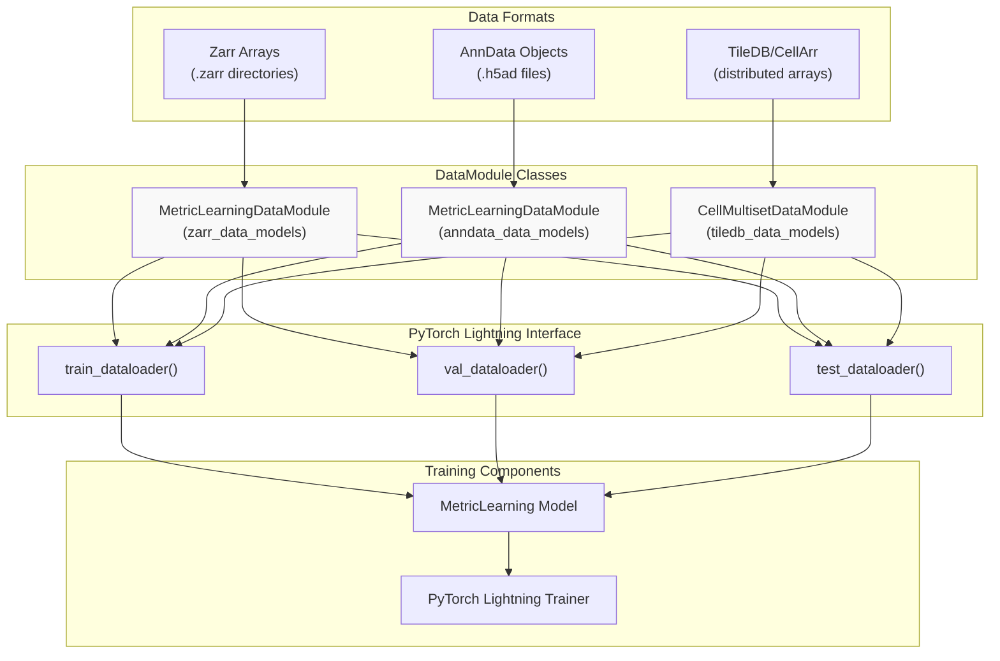
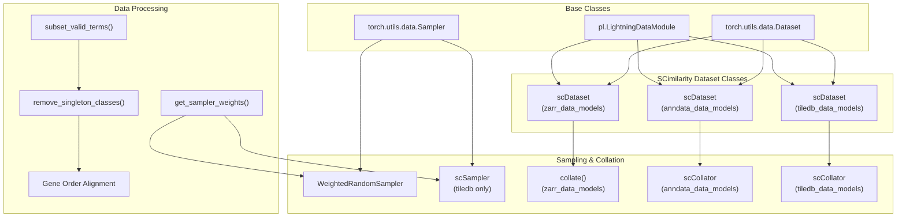
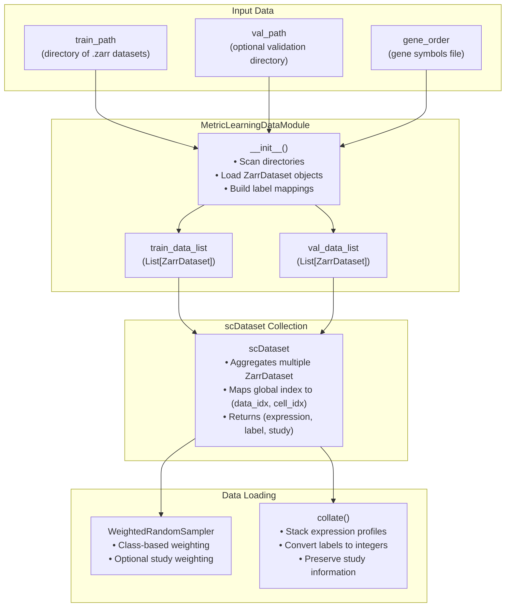
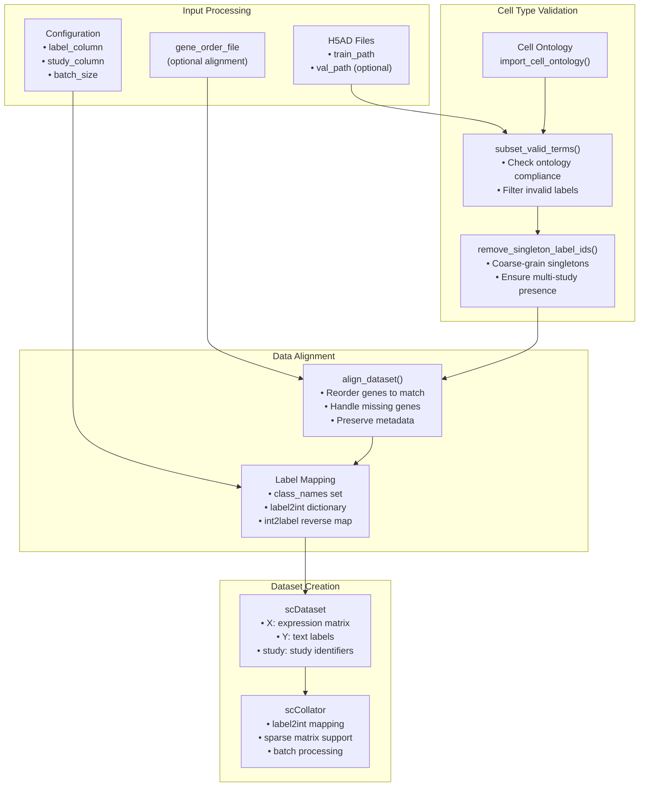
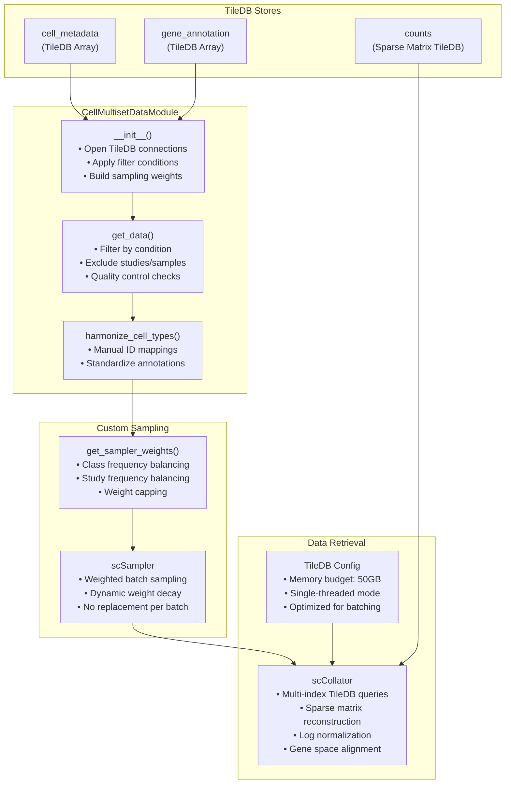
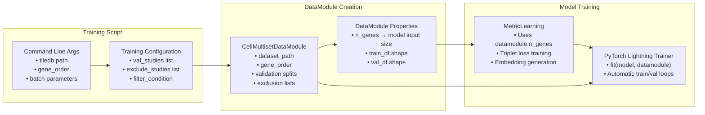

# Data Loading Systems

<details>
<summary>Relevant source files</summary>

The following files were used as context for generating this wiki page:

- [scripts/train.py](scripts/train.py)
- [src/scimilarity/anndata_data_models.py](src/scimilarity/anndata_data_models.py)
- [src/scimilarity/tiledb_data_models.py](src/scimilarity/tiledb_data_models.py)
- [src/scimilarity/zarr_data_models.py](src/scimilarity/zarr_data_models.py)

</details>


This document covers the data loading infrastructure used during SCimilarity model training. The system provides three distinct data loading pipelines optimized for different storage formats: Zarr arrays, AnnData objects, and TileDB/CellArr stores. Each pipeline implements PyTorch Lightning DataModule interfaces to provide efficient, scalable data loading with weighted sampling, gene space alignment, and cell type validation.

For information about data storage formats and CellArr architecture, see [Data Management & Storage](#5). For training scripts and examples using these data loaders, see [Training Scripts & Examples](#4.2).

## Data Loading Architecture Overview

SCimilarity's training system supports three primary data formats through specialized DataModule implementations. Each format addresses different storage and access patterns while maintaining consistent interfaces.



**Sources:** [src/scimilarity/zarr_data_models.py:54-86](), [src/scimilarity/anndata_data_models.py:75-115](), [src/scimilarity/tiledb_data_models.py:208-279]()

## Common DataModule Patterns

All three data loading systems follow consistent patterns and implement shared functionality for training metric learning models.

### Core Components and Interfaces



**Sources:** [src/scimilarity/zarr_data_models.py:13-52](), [src/scimilarity/anndata_data_models.py:17-41](), [src/scimilarity/tiledb_data_models.py:23-43]()

### Weighted Sampling Strategy

All DataModules implement sophisticated weighted sampling to balance cell types and studies during training:

| Component | Zarr Implementation | AnnData Implementation | TileDB Implementation |
|-----------|-------------------|----------------------|---------------------|
| **Class Balancing** | Inverse frequency | Log-normalized inverse frequency | Log-normalized inverse frequency |
| **Study Balancing** | Log-normalized weights | Log-normalized weights | Optional study weights |
| **Weight Capping** | None | 99.9th percentile × 2 | 99.9th percentile × 2 |
| **Dynamic Weights** | No | No | Yes (with decay factor) |

**Sources:** [src/scimilarity/zarr_data_models.py:175-209](), [src/scimilarity/anndata_data_models.py:273-319](), [src/scimilarity/tiledb_data_models.py:547-592]()

## Zarr-Based Data Loading

The Zarr data loading system handles collections of single-cell datasets stored in Zarr format, optimized for datasets that have been preprocessed and aligned to a common gene space.

### Zarr DataModule Architecture



**Sources:** [src/scimilarity/zarr_data_models.py:88-137](), [src/scimilarity/zarr_data_models.py:13-52]()

### Zarr Dataset Discovery and Loading

The system automatically discovers Zarr datasets by walking directory structures:

```python
# Directory scanning pattern from zarr_data_models.py:116-123
self.train_file_list = [
    (
        root.replace(self.train_path, "").split(os.sep)[0],  # study name
        dirs[0].replace(".aligned.zarr", ""),                # sample name
    )
    for root, dirs, files in os.walk(self.train_path)
    if dirs and dirs[0].endswith(".aligned.zarr")
]
```

**Sources:** [src/scimilarity/zarr_data_models.py:116-134]()

## AnnData-Based Data Loading  

The AnnData system loads single-cell data from H5AD files with comprehensive cell type validation and ontology compliance checking.

### AnnData DataModule Features



**Sources:** [src/scimilarity/anndata_data_models.py:149-200](), [src/scimilarity/anndata_data_models.py:202-271]()

### Ontology Validation and Cell Type Harmonization

The AnnData system performs rigorous cell type validation:

| Validation Step | Implementation | Purpose |
|----------------|---------------|---------|
| **Valid Terms** | `subset_valid_terms()` | Filter cells with valid Cell Ontology IDs |
| **Singleton Removal** | `remove_singleton_label_ids()` | Remove cell types in only one study |
| **Parent Mapping** | `find_most_viable_parent()` | Map singletons to viable parent terms |
| **Multi-study Check** | `n_studies >= 2` | Ensure robust cross-study representation |

**Sources:** [src/scimilarity/anndata_data_models.py:202-224](), [src/scimilarity/anndata_data_models.py:226-271]()

## TileDB-Based Data Loading

The TileDB/CellArr system provides the most sophisticated data loading pipeline, designed for large-scale distributed single-cell datasets with complex metadata queries.

### TileDB DataModule Architecture



**Sources:** [src/scimilarity/tiledb_data_models.py:281-465](), [src/scimilarity/tiledb_data_models.py:45-110](), [src/scimilarity/tiledb_data_models.py:112-206]()

### TileDB Query and Filtering System

The TileDB system supports complex filtering through query conditions:

```python
# Example filter from scripts/train.py:135
filter_condition = (
    "cellTypeOntologyID!='nan' and "
    "total_counts>1000 and "
    "n_genes_by_counts>500 and "
    "pct_counts_mt<20 and "
    "predicted_doublets==0 and "
    "cellTypeOntologyID!='CL:0009010'"
)
```

The system also supports study and sample exclusion lists for creating validation splits and removing problematic datasets.

**Sources:** [scripts/train.py:135-155](), [src/scimilarity/tiledb_data_models.py:466-480]()

### Real-time Data Processing in scCollator

The TileDB `scCollator` performs sophisticated data processing during batch loading:

| Processing Step | Implementation | Configuration |
|----------------|---------------|---------------|
| **Multi-index Query** | `counts_tdb.multi_index[cell_idx, :]` | Batch cell retrieval |
| **Sparse Matrix** | `coo_matrix()` → `tocsr()` | Memory-efficient storage |
| **Gene Filtering** | `counts[:, self.gene_indices]` | Gene space alignment |
| **Normalization** | Log1p after target sum scaling | `target_sum=1e4` (default) |
| **Memory Management** | 50GB TileDB budget | Single-threaded access |

**Sources:** [src/scimilarity/tiledb_data_models.py:176-205](), [src/scimilarity/tiledb_data_models.py:136-148]()

## Training Integration

The data loading systems integrate seamlessly with PyTorch Lightning training workflows. The training script demonstrates typical usage patterns:

### DataModule Usage in Training



**Sources:** [scripts/train.py:137-155](), [scripts/train.py:158-176](), [scripts/train.py:207-221]()

### Validation Split Strategy

The training system uses predefined study lists for validation splits to ensure robust generalization:

```python
# Validation studies from scripts/train.py:12-28
val_studies = [
    "DS000012424", "DS000015749", "DS000012615", "DS000012500",
    "DS000012585", "DS000016072", "DS000012588", "DS000015711",
    "DS000015743", "DS000015752", "DS000010060", "DS000010475",
    "DS000011735", "DS000012592", "DS000012595"
]
```

This ensures that validation performance reflects the model's ability to generalize to entirely unseen studies, providing a realistic evaluation of cross-dataset performance.

**Sources:** [scripts/train.py:12-28](), [scripts/train.py:376-404]()

---