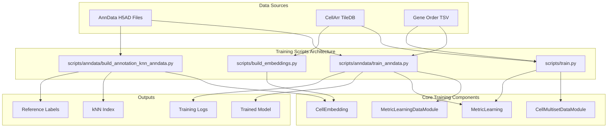
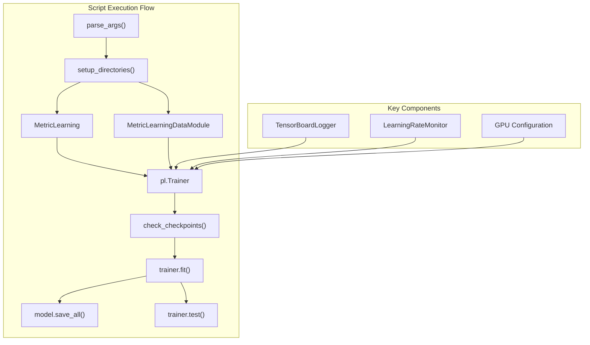
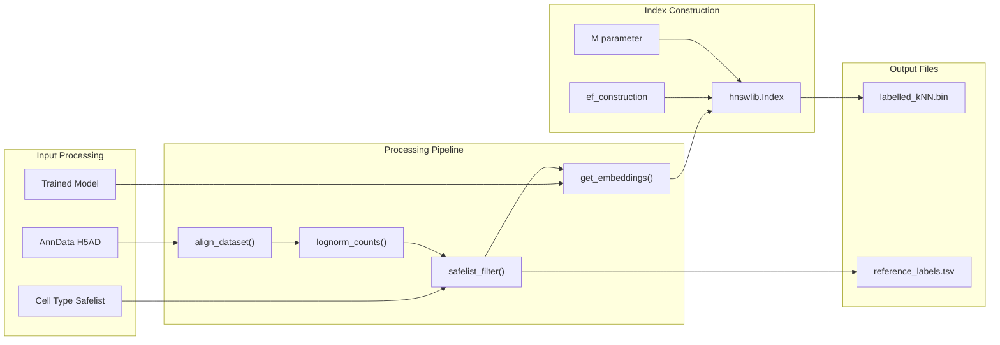
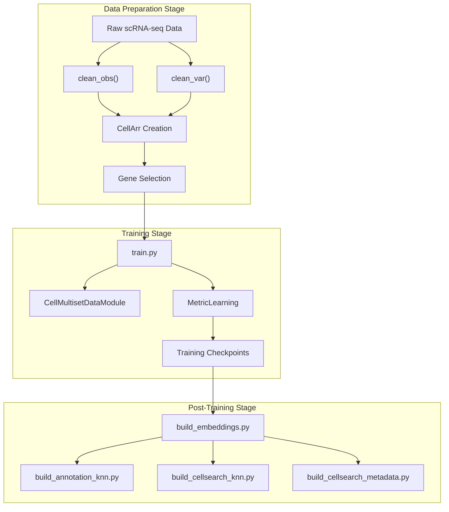

# Training Scripts & Examples

<details>
<summary>Relevant source files</summary>

The following files were used as context for generating this wiki page:

- [MANIFEST.in](MANIFEST.in)
- [docs/modules/tiledb_data_models.rst](docs/modules/tiledb_data_models.rst)
- [docs/notebooks/training_tutorial.ipynb](docs/notebooks/training_tutorial.ipynb)
- [scripts/anndata/build_annotation_knn_anndata.py](scripts/anndata/build_annotation_knn_anndata.py)
- [scripts/anndata/train_anndata.py](scripts/anndata/train_anndata.py)

</details>


This document provides practical examples and ready-to-use scripts for training SCimilarity models with different data formats and configurations. It covers command-line training scripts, their parameters, and integration with post-training workflows.

For information about the underlying training infrastructure and data loading systems, see [Data Loading Systems](#4.1). For details on post-training index and metadata construction, see [Post-Training Workflows](#6).

## Overview

SCimilarity provides training scripts in the `scripts/` directory that demonstrate different training approaches. These scripts serve as starting points for custom training workflows and showcase best practices for model training with various data formats.



**Sources:** [scripts/anndata/train_anndata.py:1-171](), [scripts/anndata/build_annotation_knn_anndata.py:1-98](), [docs/notebooks/training_tutorial.ipynb:310-327]()

## AnnData Training Script

The `train_anndata.py` script provides a complete training pipeline for AnnData H5AD files. This script demonstrates the essential components needed for metric learning training with SCimilarity.

### Core Training Parameters

The script accepts comprehensive command-line arguments for model configuration:

| Parameter | Description | Default | Type |
|-----------|-------------|---------|------|
| `--train` | Training H5AD filename | Required | str |
| `--val` | Validation H5AD filename | None | str |
| `--label_column` | Cell type label column | "celltype_name" | str |
| `--study_column` | Study identifier column | "study" | str |
| `--gene_order` | Gene order TSV file | None | str |
| `--latent_dim` | Latent space dimensions | 128 | int |
| `--hidden_dim` | Hidden layer sizes | [1024, 1024, 1024] | list |
| `--batch_size` | Training batch size | 1000 | int |
| `--max_epochs` | Maximum training epochs | 500 | int |
| `--lr` | Learning rate | 0.005 | float |
| `--margin` | Triplet loss margin | 0.05 | float |
| `--triplet_loss_weight` | Triplet loss weight | 0.001 | float |

**Sources:** [scripts/anndata/train_anndata.py:134-164]()

### Training Workflow Implementation



The training script implements several key features:

1. **Checkpoint Resume**: Automatically resumes training from the latest checkpoint if available [scripts/anndata/train_anndata.py:110-122]()
2. **Model Naming**: Generates descriptive model names based on hyperparameters [scripts/anndata/train_anndata.py:29-31]()
3. **Logging Integration**: Uses TensorBoard for training visualization [scripts/anndata/train_anndata.py:80-88]()
4. **Validation Handling**: Supports separate validation datasets [scripts/anndata/train_anndata.py:46-47]()

**Sources:** [scripts/anndata/train_anndata.py:11-132]()

### Data Module Configuration

The script configures the `MetricLearningDataModule` with specific parameters for AnnData processing:

```python
datamodule = MetricLearningDataModule(
    train_path=args.train,
    val_path=args.val,
    label_column=args.label_column,
    study_column=args.study_column,
    gene_order_file=args.gene_order,
    batch_size=batch_size,
    num_workers=args.num_workers,
    remove_singleton_classes=True,
    sparse=False,
    persistent_workers=True,
    multiprocessing_context="fork"
)
```

Key configuration options include:
- `remove_singleton_classes=True`: Filters out cell types with single examples
- `sparse=False`: Uses dense matrix representation
- `persistent_workers=True`: Maintains data loading workers across epochs
- `multiprocessing_context="fork"`: Optimizes for Unix-based systems

**Sources:** [scripts/anndata/train_anndata.py:45-57]()

## Annotation kNN Building Script

The `build_annotation_knn_anndata.py` script demonstrates post-training index construction for cell type annotation. This script shows how to generate embeddings and build searchable indices.

### Script Components



The script implements a complete pipeline for annotation index creation:

1. **Data Alignment**: Ensures gene order matches the trained model [scripts/anndata/build_annotation_knn_anndata.py:46-48]()
2. **Preprocessing**: Applies log normalization to expression data [scripts/anndata/build_annotation_knn_anndata.py:48]()
3. **Cell Type Filtering**: Optional safelist filtering for annotation quality control [scripts/anndata/build_annotation_knn_anndata.py:51-55]()
4. **Batch Processing**: Processes cells in configurable buffer sizes [scripts/anndata/build_annotation_knn_anndata.py:60-69]()

**Sources:** [scripts/anndata/build_annotation_knn_anndata.py:17-95]()

### HNSW Index Configuration

The script uses HNSW (Hierarchical Navigable Small World) for efficient approximate nearest neighbor search:

| Parameter | Description | Default |
|-----------|-------------|---------|
| `ef_construction` | Construction time accuracy/speed tradeoff | 1000 |
| `M` | Maximum connections per element | 80 |
| `space` | Distance metric | "cosine" |

The index construction process:
1. Initializes HNSW index with cosine distance [scripts/anndata/build_annotation_knn_anndata.py:85]()
2. Configures construction parameters [scripts/anndata/build_annotation_knn_anndata.py:86-87]()
3. Adds embedding vectors with sequential IDs [scripts/anndata/build_annotation_knn_anndata.py:88]()
4. Saves index to binary file [scripts/anndata/build_annotation_knn_anndata.py:91-94]()

**Sources:** [scripts/anndata/build_annotation_knn_anndata.py:83-94]()

## Training Tutorial Integration

The training scripts integrate with the comprehensive workflow described in the training tutorial notebook. This tutorial demonstrates the complete pipeline from data preparation to post-training structure creation.

### Workflow Stages



The tutorial emphasizes key requirements for successful training:

1. **Gene Symbol Standardization**: Convert Ensembl IDs to gene symbols and consolidate duplicates [docs/notebooks/training_tutorial.ipynb:44-50]()
2. **Required Metadata Columns**: Standardized columns for cell type ontology, QC metrics, and study identifiers [docs/notebooks/training_tutorial.ipynb:96-111]()
3. **Gene Space Selection**: Filter genes based on representation across studies [docs/notebooks/training_tutorial.ipynb:230-303]()

**Sources:** [docs/notebooks/training_tutorial.ipynb:8-327]()

## Example Usage Patterns

### Basic Training Command

```bash
python scripts/anndata/train_anndata.py \
    --train training_data.h5ad \
    --val validation_data.h5ad \
    --gene_order gene_order.tsv \
    --model_folder ./models \
    --log_folder ./logs \
    --suffix experiment_v1
```

### Advanced Configuration

```bash
python scripts/anndata/train_anndata.py \
    --train training_data.h5ad \
    --latent_dim 256 \
    --hidden_dim 2048 1024 512 \
    --batch_size 2000 \
    --lr 0.001 \
    --margin 0.1 \
    --triplet_loss_weight 0.005 \
    --max_epochs 1000 \
    --cross 1 \
    --perturb 1 \
    --perturb_fraction 0.3
```

### Post-Training Index Building

```bash
python scripts/anndata/build_annotation_knn_anndata.py \
    -d reference_data.h5ad \
    -m ./models/trained_model \
    --safelist_file cell_types_safelist.txt \
    --ef_construction 2000 \
    --M_construction 100
```

**Sources:** [scripts/anndata/train_anndata.py:134-171](), [scripts/anndata/build_annotation_knn_anndata.py:17-30]()

---