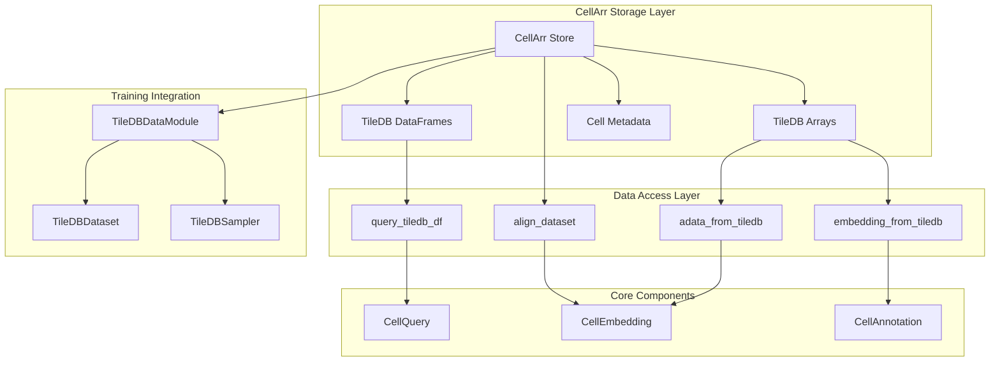
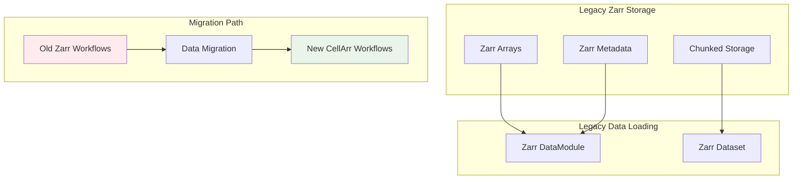
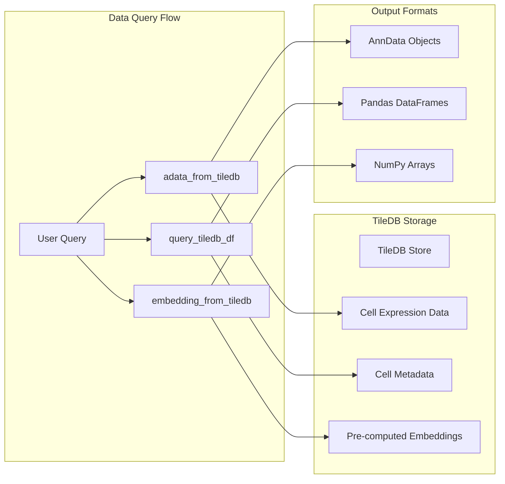
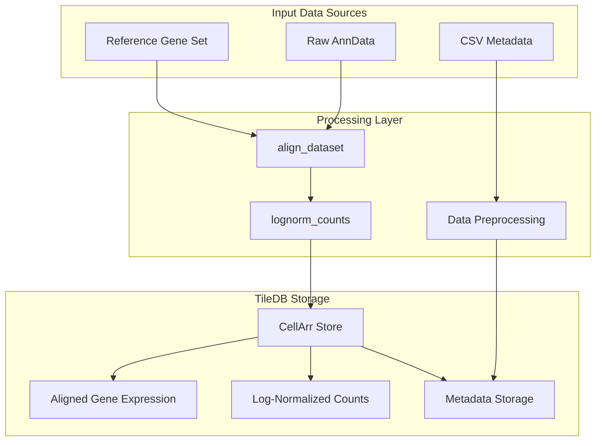
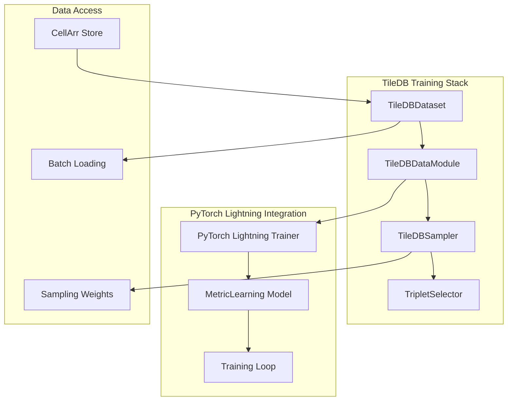
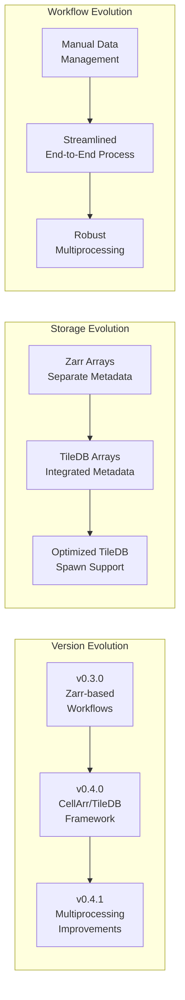

# Data Management & Storage

Relevant source files

The following files were used as context for generating this wiki page:

- [NEWS.rst](NEWS.rst)

## Purpose and Scope

This document covers SCimilarity's data management and storage infrastructure, including the evolution from Zarr-based storage to the current CellArr/TileDB framework. It details the data models, storage formats, and integration patterns that enable efficient single-cell data operations at scale.

For information about data loading during training, see [Data Loading Systems](#4.1). For post-training data structure creation, see [Post-Training Workflows](#6).

## Storage Architecture Evolution

SCimilarity has undergone a significant architectural evolution in its data storage approach. Version 0.4.0 introduced a major transition from Zarr-based workflows to CellArr, a TileDB-based framework, as the primary data store to streamline the end-to-end process.

### Current Architecture: CellArr/TileDB Framework

The current storage architecture centers around CellArr, which provides a TileDB-based framework for storing and accessing single-cell data efficiently.

#### CellArr/TileDB Storage System

**Sources:** [NEWS.rst:29-41]()

#### Data Storage Components

| Component | Purpose | File Location |
|-----------|---------|---------------|
| `CellArr Store` | Primary TileDB-based data storage | Referenced in training scripts |
| `TileDBDataModule` | PyTorch Lightning data module for TileDB | `scimilarity/tiledb_data_models.py` |
| `TileDBDataset` | Dataset class for TileDB data access | `scimilarity/tiledb_data_models.py` |
| `TileDBSampler` | Sampling strategies for TileDB data | `scimilarity/tiledb_data_models.py` |

### Legacy Architecture: Zarr Storage

Prior to version 0.4.0, SCimilarity used Zarr-based storage workflows. While this approach has been superseded, understanding it provides context for the architectural evolution.

**Sources:** [NEWS.rst:29-31]()

## Data Models and Access Patterns

### TileDB Data Access Utilities

SCimilarity provides several utility functions for accessing data stored in the TileDB format:

#### Core Data Access Functions

| Function | Purpose | Return Type |
|----------|---------|-------------|
| `query_tiledb_df` | Query TileDB dataframes with filtering | DataFrame |
| `adata_from_tiledb` | Extract cells from TileDB stores by index, including raw counts | AnnData |
| `embedding_from_tiledb` | Extract pre-computed embeddings from TileDB | Array |
| `align_dataset` | Align datasets with reference gene sets | AnnData |

**Sources:** [NEWS.rst:38-41]()

### Data Processing Pipeline Integration

The storage layer integrates with SCimilarity's data processing pipeline through several key interfaces:

#### Data Alignment and Normalization

**Sources:** [NEWS.rst:38-41]()

## Training Data Integration

The TileDB storage system is tightly integrated with the training infrastructure through specialized data modules and samplers.

### TileDB Training Components

**Sources:** [NEWS.rst:32-33]()

### Multiprocessing Support

Version 0.4.1 introduced refactoring to support `spawn` as the multiprocessing context for TileDB and AnnData dataloaders, improving compatibility across different systems.

**Sources:** [NEWS.rst:15-16]()

## Storage Performance and Optimization

### TileDB Advantages

The transition to TileDB provides several performance benefits:

| Feature | Benefit | Use Case |
|---------|---------|----------|
| Columnar Storage | Efficient compression and query performance | Large-scale expression matrices |
| Sparse Array Support | Memory-efficient storage of sparse single-cell data | scRNA-seq count matrices |
| Multi-dimensional Indexing | Fast querying by cell and gene indices | Rapid data retrieval |
| Metadata Integration | Co-located data and metadata | Unified data access patterns |

### Data Model Evolution

The evolution from Zarr to TileDB represents a strategic shift toward more integrated and performant data management:

**Sources:** [NEWS.rst:20-41]()

## Integration with Core Components

The storage layer provides the foundation for all major SCimilarity components:

### Component Storage Dependencies

| Component | Storage Dependencies | Key Methods |
|-----------|---------------------|-------------|
| `CellEmbedding` | TileDB arrays, gene alignment | `align_dataset`, `embedding_from_tiledb` |
| `CellQuery` | TileDB metadata, pre-computed embeddings | `query_tiledb_df`, `adata_from_tiledb` |
| `CellAnnotation` | Reference embeddings, cell metadata | `embedding_from_tiledb`, annotation indices |

**Sources:** [NEWS.rst:38-41]()

---