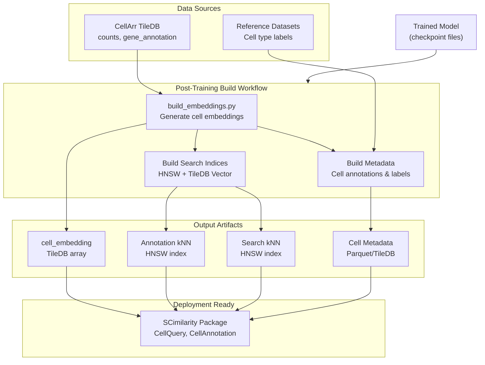
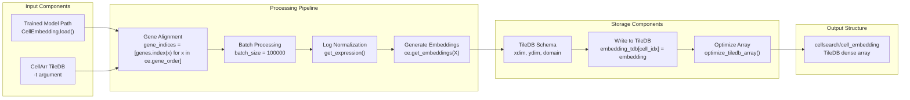
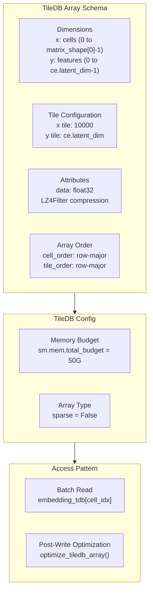
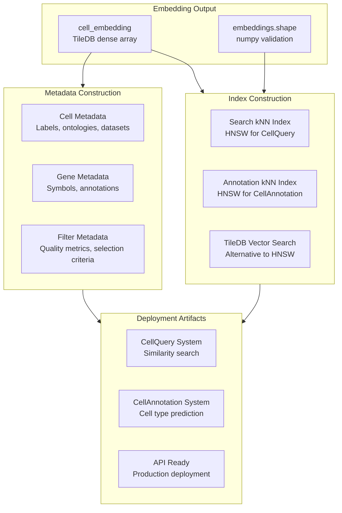

# Post-Training Workflows

Relevant source files

The following files were used as context for generating this wiki page:

- [scripts/build_embeddings.py](scripts/build_embeddings.py)

## Purpose and Scope

This page documents the workflows and processes that occur after training a SCimilarity model. These workflows transform trained models into production-ready systems by generating embeddings, building search indices, and constructing metadata structures required for similarity search and cell annotation.

Post-training workflows bridge the gap between trained model artifacts and the deployed SCimilarity system that end users interact with. For detailed information about the training process itself, see [Model Training](#4). For specific implementation details about search index construction, see [Building Search Indices](#6.1). For metadata construction processes, see [Metadata Construction](#6.2).

## Post-Training Workflow Overview

The post-training phase consists of several sequential steps that prepare trained models for deployment and use:

### High-Level Post-Training Pipeline

Sources: [scripts/build_embeddings.py:1-121]()

## Embedding Generation Workflow

The core post-training workflow begins with generating embeddings for all cells in the dataset using the trained model. This process is implemented in the `build_embeddings.py` script.

### Embedding Generation Architecture

Sources: [scripts/build_embeddings.py:39-121]()

### Key Processing Steps

| Step | Code Entity | Description | Configuration |
|------|-------------|-------------|---------------|
| **Gene Alignment** | `gene_indices = [genes.index(x) for x in ce.gene_order]` | Maps model gene order to CellArr gene indices | Uses `gene_annotation` TileDB array |
| **Expression Extraction** | `get_expression()` | Retrieves and normalizes cell expression data | `target_sum=1e4`, log1p transformation |
| **Batch Processing** | `for i in tqdm(range(0, matrix_shape[0], batch_size))` | Processes cells in configurable batches | Default batch size: 100,000 cells |
| **Embedding Generation** | `ce.get_embeddings(X)` | Generates embeddings using trained model | Uses `CellEmbedding` class |
| **TileDB Storage** | `embedding_tdb[cell_idx] = embedding` | Stores embeddings in dense TileDB array | LZ4 compression, row-major order |

Sources: [scripts/build_embeddings.py:17-37](), [scripts/build_embeddings.py:103-109]()

### TileDB Array Configuration

The embedding storage uses a specific TileDB schema optimized for efficient access patterns:

Sources: [scripts/build_embeddings.py:14-15](), [scripts/build_embeddings.py:74-94](), [scripts/build_embeddings.py:118]()

## Index and Metadata Construction

After embedding generation, the workflow continues with building search indices and constructing metadata structures. These components enable efficient similarity search and cell annotation functionality.

### Post-Embedding Workflow Integration

Sources: [scripts/build_embeddings.py:113-116]()

## Integration with SCimilarity Components

The post-training workflows produce artifacts that integrate directly with the main SCimilarity API components:

| Component | Input Artifacts | Purpose | Code Integration |
|-----------|----------------|---------|------------------|
| **CellEmbedding** | Trained model checkpoints | Generate embeddings for new data | `CellEmbedding(model_path)` |
| **CellQuery** | `cell_embedding` TileDB, search kNN indices | Similarity search functionality | Loads embeddings and indices automatically |
| **CellAnnotation** | `cell_embedding` TileDB, annotation kNN indices, cell metadata | Cell type prediction | Uses reference embeddings and labels |
| **CellSearchKNN** | kNN indices (HNSW or TileDB Vector) | Base search infrastructure | Shared by CellQuery and CellAnnotation |

The post-training workflow ensures that all these components have the necessary data structures and indices to operate efficiently in production environments.

Sources: [scripts/build_embeddings.py:51-52]()

---