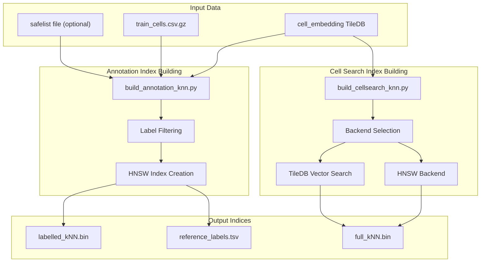
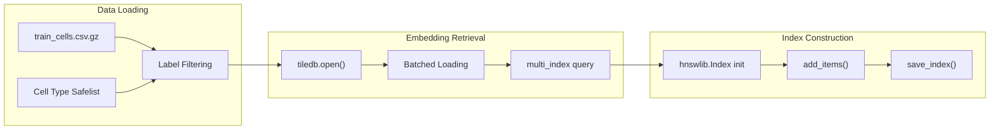
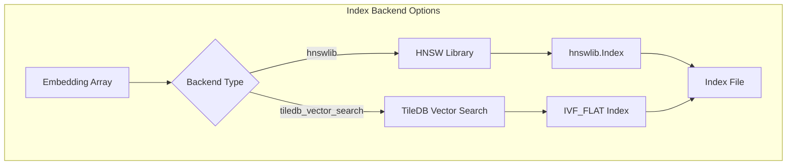

# Building Search Indices

<details>
<summary>Relevant source files</summary>

The following files were used as context for generating this wiki page:

- [scripts/build_annotation_knn.py](scripts/build_annotation_knn.py)
- [scripts/build_cellsearch_knn.py](scripts/build_cellsearch_knn.py)

</details>


This page covers the process of building search indices after model training to enable fast similarity search and cell type annotation. The index building system creates optimized data structures from embeddings generated by trained SCimilarity models.

For information about using these indices for cell queries, see [Cell Query System](#3.2). For cell type annotation workflows, see [Cell Annotation](#3.3). For the training process that precedes index building, see [Model Training](#4).

## Purpose and Scope

The index building system creates two types of search indices from precomputed cell embeddings:

1. **Annotation kNN indices** - Used for cell type prediction and classification
2. **Cell search kNN indices** - Used for general similarity search across all cells

Both index types use approximate nearest neighbor algorithms to provide fast similarity search capabilities over large-scale single-cell datasets.

## Index Building Architecture



Sources: [scripts/build_annotation_knn.py:1-101](), [scripts/build_cellsearch_knn.py:1-65]()

## Annotation Index Building Process

The annotation index building process creates indices specifically for cell type prediction using labeled reference cells.

### Script Configuration

The `build_annotation_knn.py` script accepts several key parameters:

| Parameter | Default | Description |
|-----------|---------|-------------|
| `--annotation` | `annotation` | Output directory for annotation indices |
| `--embeddings` | `cell_embedding` | Input embeddings TileDB path |
| `--label_column_name` | `cellTypeName` | Column for cell type labels |
| `--study_column_name` | `datasetID` | Column for dataset identifiers |
| `--knn` | `labelled_kNN.bin` | Output kNN index filename |
| `--labels` | `reference_labels.tsv` | Output labels filename |
| `--ef_construction` | `1000` | HNSW construction parameter |
| `--M_construction` | `80` | HNSW connectivity parameter |

Sources: [scripts/build_annotation_knn.py:15-28]()

### Data Processing Workflow



The process loads reference cell metadata, optionally filters by cell type safelist, retrieves embeddings in batches to manage memory usage, and constructs an HNSW index with cosine distance.

Sources: [scripts/build_annotation_knn.py:44-97]()

### Memory Management

The annotation index builder implements batched processing to handle large datasets:

- Uses configurable buffer sizes (default 500,000 cells)
- TileDB memory budget set to 50GB via `cfg["sm.mem.total_budget"]`
- Processes embeddings in chunks using `tqdm` progress tracking

Sources: [scripts/build_annotation_knn.py:41-72]()

## Cell Search Index Building Process

The cell search index building creates indices for general similarity search across all cells in the dataset.

### Backend Selection

The `build_cellsearch_knn.py` script supports two index backends:



Sources: [scripts/build_cellsearch_knn.py:17-55]()

### HNSW Backend Configuration

When using the `hnswlib` backend, the system creates indices with:

- Cosine distance metric
- Configurable `ef_construction` and `M` parameters
- Full dataset loading into memory for index construction

Sources: [scripts/build_cellsearch_knn.py:38-45]()

### TileDB Vector Search Backend

The TileDB Vector Search backend provides:

- `IVF_FLAT` index type for exact cosine similarity
- Built-in normalization support
- LZ4 compression filters
- Automatic vacuum operations for optimization

Sources: [scripts/build_cellsearch_knn.py:46-55]()

## Index Storage Structure

The index building process creates a standardized directory structure:

```
model_path/
├── cellsearch/
│   ├── cell_embedding/     # Input embeddings TileDB
│   └── full_kNN.bin       # Cell search index
└── annotation/
    ├── labelled_kNN.bin   # Annotation index
    └── reference_labels.tsv # Label mapping
```

### File Backup Strategy

Both scripts implement automatic backup of existing index files:

- Existing files renamed with `.bak` extension
- Prevents accidental overwrites during rebuilds
- Maintains previous index versions for rollback

Sources: [scripts/build_annotation_knn.py:80-81](), [scripts/build_annotation_knn.py:95-96]()

## Performance Considerations

### Index Parameters

Key performance parameters for HNSW indices:

| Parameter | Impact | Recommended Range |
|-----------|--------|------------------|
| `ef_construction` | Build time vs. accuracy | 500-2000 |
| `M` | Memory usage vs. connectivity | 16-80 |
| Buffer size | Memory usage vs. I/O efficiency | 100K-1M cells |

### Backend Comparison

| Backend | Use Case | Advantages | Limitations |
|---------|----------|------------|-------------|
| HNSW | General purpose | Fast queries, mature | Memory intensive |
| TileDB Vector Search | Large datasets | Disk-based, compressed | Newer technology |

Sources: [scripts/build_annotation_knn.py:26-27](), [scripts/build_cellsearch_knn.py:18-19]()

---