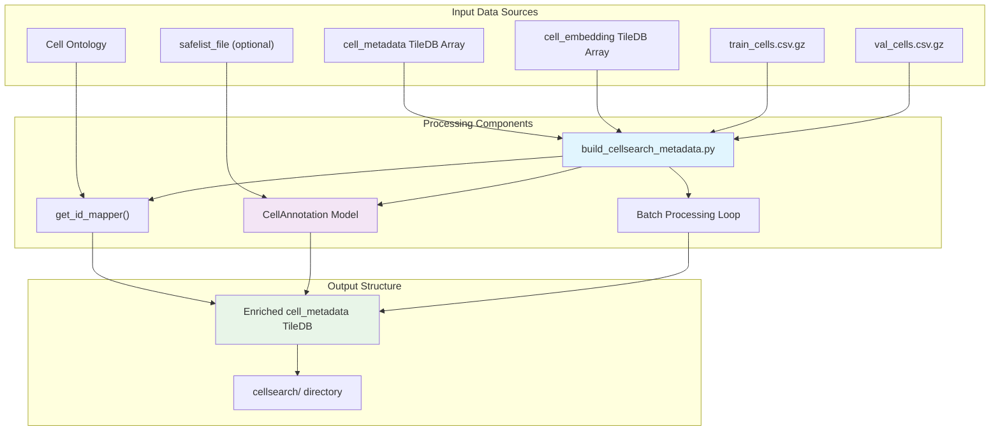
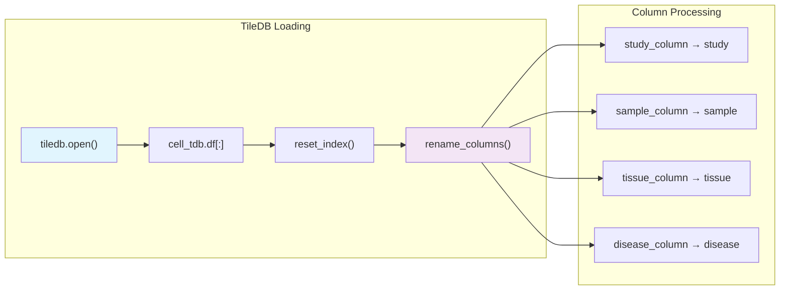
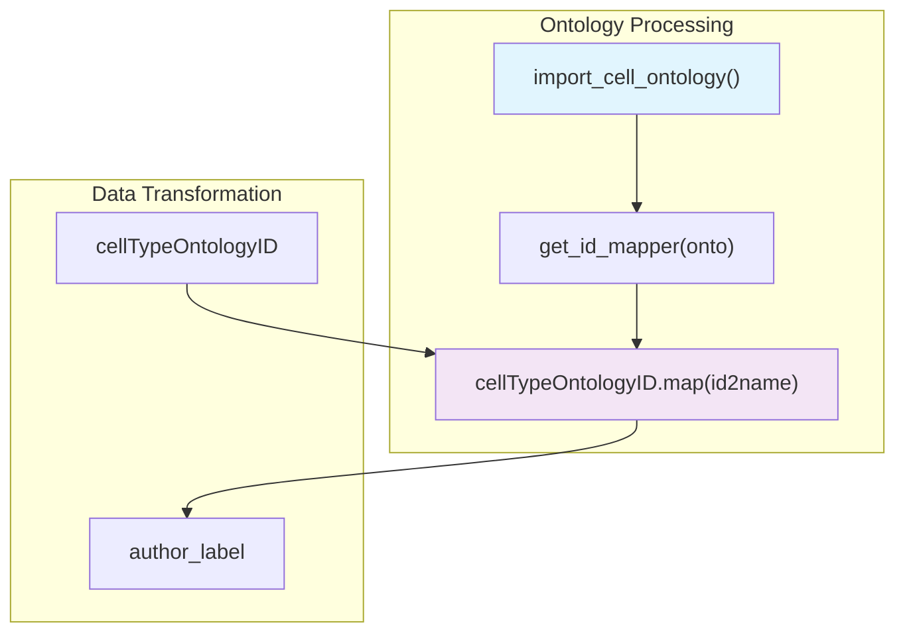
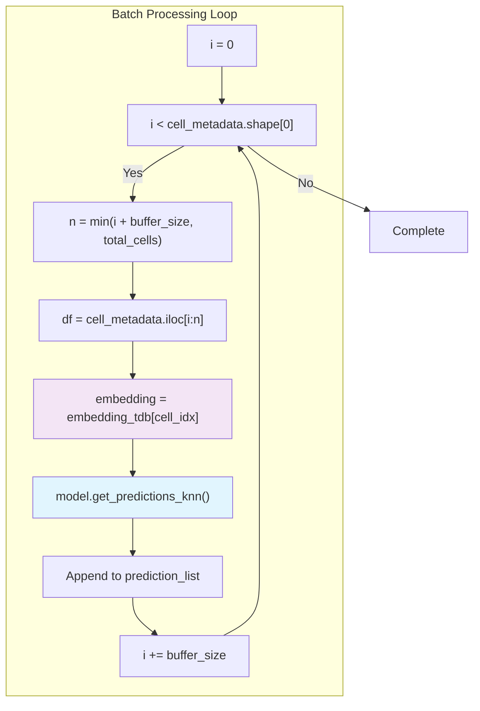
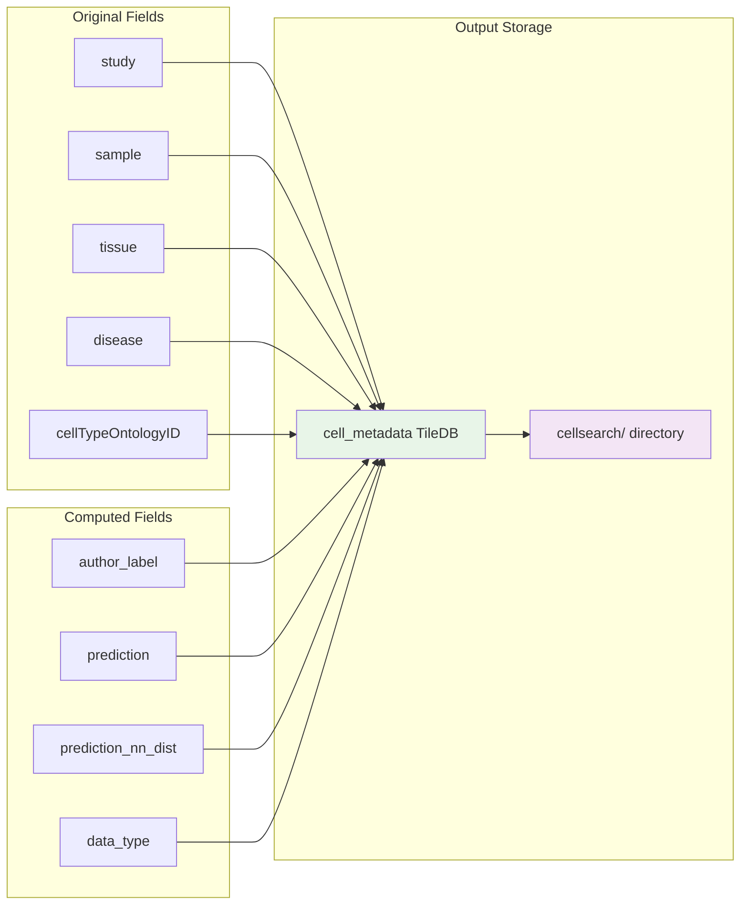

# Metadata Construction

Relevant source files

The following files were used as context for generating this wiki page:

- [scripts/build_cellsearch_metadata.py](scripts/build_cellsearch_metadata.py)

This document covers the construction of comprehensive cell metadata structures for the SCimilarity system. The metadata construction process occurs after model training and embedding generation, creating enriched metadata that enables efficient cell querying and search operations.

For information about building search indices, see [Building Search Indices](#6.1). For details about the training workflows that precede metadata construction, see [Model Training](#4).

## Purpose and Scope

The metadata construction system creates a unified metadata structure that combines:

- Original cell metadata from TileDB storage
- Cell type ontology mappings
- Model predictions and confidence scores
- Training/validation dataset annotations
- Nearest neighbor distances for quality assessment

This enriched metadata enables the `CellQuery` and `CellAnnotation` classes to perform efficient filtering, searching, and result compilation.

## Architecture Overview

**Title:** Metadata Construction Data Flow

Sources: [scripts/build_cellsearch_metadata.py:1-123]()

## Data Sources and Input Processing

### Cell Metadata Loading

The system loads base cell metadata from the TileDB `cell_metadata` array, performing column standardization to ensure consistent naming conventions:

| Original Column | Standardized Name | Purpose |
|----------------|-------------------|---------|
| `datasetID` | `study` | Study identifier |
| `sampleID` | `sample` | Sample identifier |
| `tissue` | `tissue` | Tissue type |
| `disease` | `disease` | Disease condition |

**Title:** Cell Metadata Column Standardization Process

Sources: [scripts/build_cellsearch_metadata.py:50-58]()

### Ontology Mapping

Cell type ontology IDs are mapped to human-readable names using the Cell Ontology:

**Title:** Cell Type Ontology Mapping Pipeline

Sources: [scripts/build_cellsearch_metadata.py:61-63]()

## Prediction and Annotation Processing

### Batch Processing Pipeline

The system processes cells in configurable batches to manage memory usage efficiently:

**Title:** Cell Metadata Batch Processing Loop

Sources: [scripts/build_cellsearch_metadata.py:87-108]()

### CellAnnotation Integration

The `CellAnnotation` model generates predictions and confidence scores for each cell:

| Output Field | Source | Description |
|-------------|--------|-------------|
| `prediction` | `predictions.values` | Predicted cell type |
| `prediction_nn_dist` | `distances.min(axis=1)` | Minimum neighbor distance |
| `data_type` | Train/val CSV lookup | Dataset partition |

Sources: [scripts/build_cellsearch_metadata.py:72-112]()

## Output Structure and Storage

### Final Metadata Schema

The enriched metadata combines original fields with computed annotations:

**Title:** Final Metadata Schema and Storage Structure

Sources: [scripts/build_cellsearch_metadata.py:110-121]()

### TileDB Storage Format

The final metadata is stored using `tiledb.from_pandas()` in the `cellsearch/cell_metadata` directory, enabling efficient querying by the search and annotation systems.

## Configuration and Command Line Interface

The `build_cellsearch_metadata.py` script accepts the following key parameters:

| Parameter | Default | Purpose |
|-----------|---------|---------|
| `-t` | Required | TileDB base path |
| `-m` | Required | Model path |
| `-b` | 100000 | Cell buffer size for batch processing |
| `--cellsearch` | "cellsearch" | Relative path to cellsearch folder |
| `--cellmetadata` | "cell_metadata" | Relative path to cell metadata folder |
| `--knn` | "labelled_kNN.bin" | kNN index filename |
| `--labels` | "reference_labels.tsv" | Reference labels filename |
| `--safelist_file` | None | Optional cell type safelist |

The script integrates with the post-training workflow to create searchable metadata structures that support the core SCimilarity query and annotation functionality.

Sources: [scripts/build_cellsearch_metadata.py:15-29]()

---