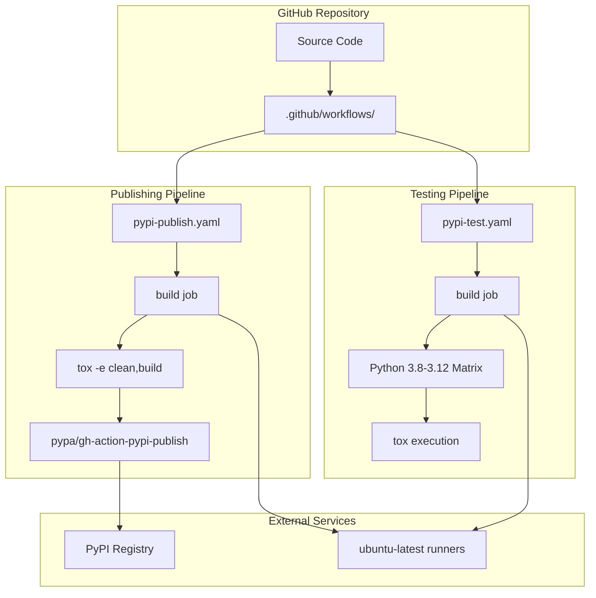
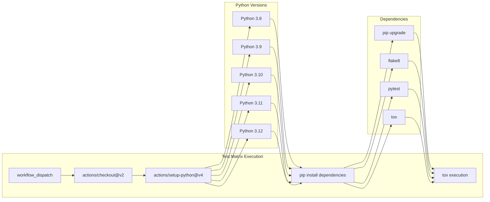
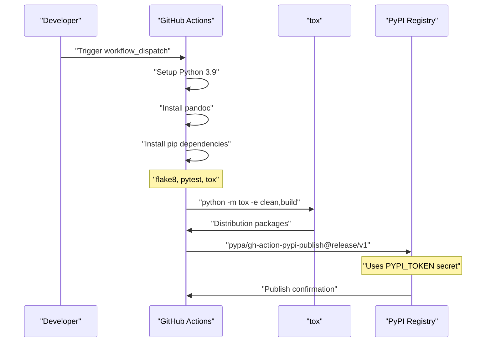
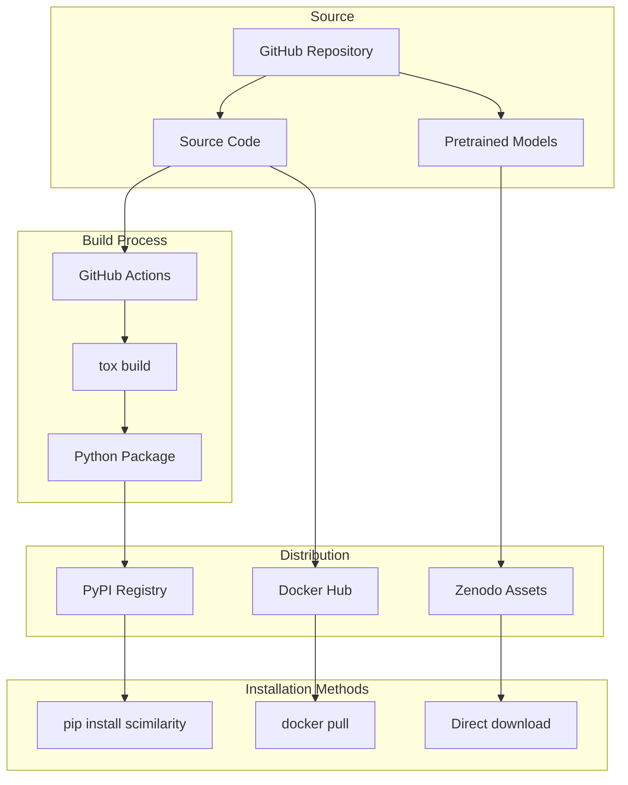

# Development & Deployment

<details>
<summary>Relevant source files</summary>

The following files were used as context for generating this wiki page:

- [.github/workflows/pypi-publish.yaml](.github/workflows/pypi-publish.yaml)
- [.github/workflows/pypi-test.yaml](.github/workflows/pypi-test.yaml)

</details>


## Purpose and Scope

This document covers the development infrastructure, continuous integration/continuous deployment (CI/CD) pipelines, package management, and deployment workflows for the SCimilarity codebase. It provides technical details on how the project is built, tested, and distributed to end users.

For information about building documentation, see [Documentation System](#7.1). For details about model training infrastructure, see [Model Training](#4). For post-training deployment workflows, see [Post-Training Workflows](#6).

## CI/CD Pipeline Overview

SCimilarity uses GitHub Actions to automate testing, building, and publishing workflows. The project maintains separate workflows for testing and deployment to ensure code quality and reliable releases.

### GitHub Actions Workflows



**Sources:** [.github/workflows/pypi-test.yaml:1-43](), [.github/workflows/pypi-publish.yaml:1-40]()

## Testing Infrastructure

The testing pipeline ensures code quality across multiple Python versions and validates package functionality before release.

### Test Workflow Configuration

| Component | Configuration |
|-----------|---------------|
| **Workflow Name** | `Test the library` |
| **Trigger** | Manual dispatch (`workflow_dispatch`) |
| **Python Versions** | 3.8, 3.9, 3.10, 3.11, 3.12 |
| **Runner** | `ubuntu-latest` |
| **Test Framework** | `tox` |

The test workflow uses a matrix strategy to validate compatibility across Python versions:



**Sources:** [.github/workflows/pypi-test.yaml:14-42]()

## Package Build and Publishing

The publishing pipeline handles package distribution to PyPI, enabling users to install SCimilarity via `pip install scimilarity`.

### Publishing Workflow Components

The publishing workflow executes the following sequence:

1. **Environment Setup**: Configures Python 3.9 environment with system dependencies
2. **Dependency Installation**: Installs build tools including `pandoc` for documentation processing
3. **Package Building**: Uses `tox -e clean,build` to create distribution packages
4. **PyPI Publishing**: Deploys packages using the official PyPI GitHub Action



**Sources:** [.github/workflows/pypi-publish.yaml:22-39]()

### Build Dependencies and Tools

| Tool | Purpose | Configuration |
|------|---------|---------------|
| **pandoc** | Documentation processing | System package via `apt` |
| **tox** | Build automation and testing | Python package |
| **flake8** | Code linting | Python package |
| **pytest** | Test execution | Python package |

**Sources:** [.github/workflows/pypi-publish.yaml:22-29]()

## Development Workflow

### Manual Trigger Strategy

Both workflows use `workflow_dispatch` triggers, indicating a manual release process rather than automatic deployment on pushes or tags. This provides controlled release management where:

- Testing can be executed on-demand for validation
- Publishing requires explicit developer action
- Release timing is fully controlled

The commented-out trigger configurations suggest the infrastructure supports automatic triggers that can be enabled when needed:

```yaml
# Commented automatic triggers:
# on:
#   push:
#     tags: '^[0-9]+.[0-9]+.[0-9]+'  # Publishing
#   push:
#     branches: [main]                # Testing
#   pull_request:
#     branches: [main]                # Testing
```

**Sources:** [.github/workflows/pypi-publish.yaml:6-9](), [.github/workflows/pypi-test.yaml:6-11]()

## Deployment Methods

SCimilarity supports multiple deployment strategies to accommodate different user environments and use cases:

### Distribution Channels



**Sources:** [.github/workflows/pypi-publish.yaml:32-39]()

### Authentication and Security

The publishing workflow uses secure token-based authentication:

- **PyPI Token**: Stored as `PYPI_TOKEN` GitHub secret
- **User Authentication**: Uses `__token__` as username with token-based auth
- **Action Security**: Leverages official PyPA publishing action for secure deployment

**Sources:** [.github/workflows/pypi-publish.yaml:36-39]()

---