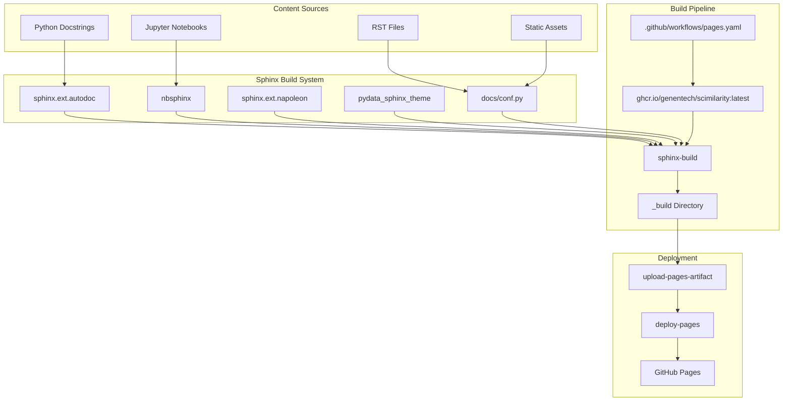
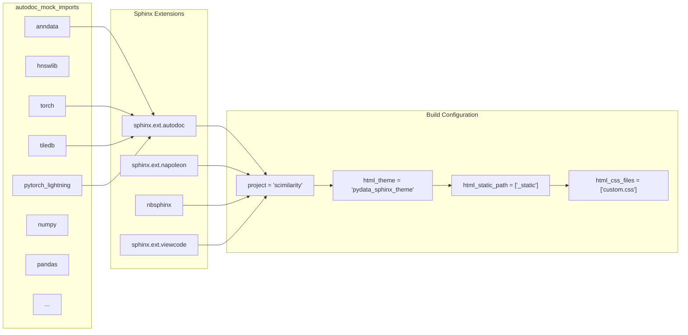
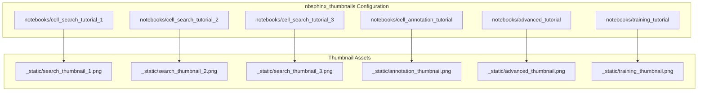
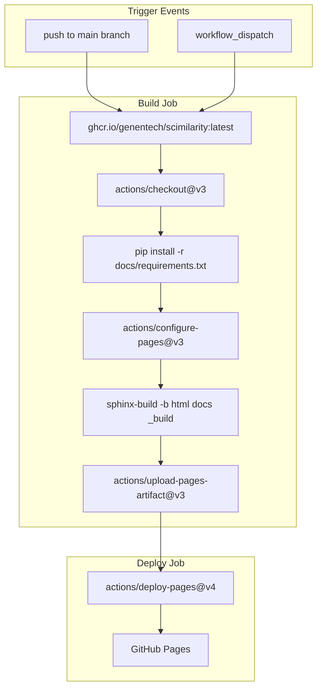
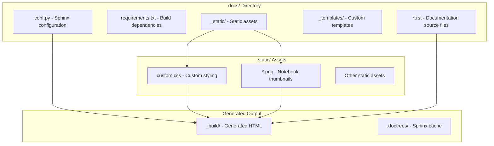
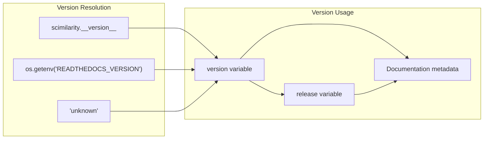
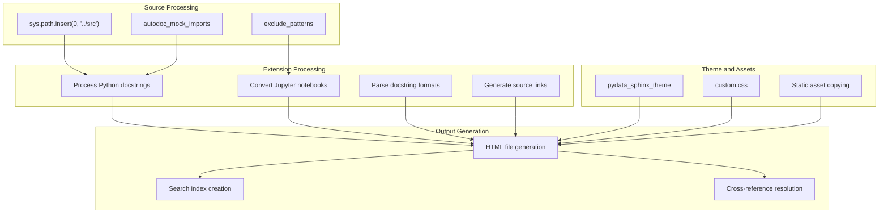

# Documentation System

Relevant source files

The following files were used as context for generating this wiki page:

- [.github/workflows/pages.yaml](.github/workflows/pages.yaml)
- [docs/_static/custom.css](docs/_static/custom.css)
- [docs/_static/training_thumbnail.png](docs/_static/training_thumbnail.png)
- [docs/conf.py](docs/conf.py)

## Purpose and Scope

The SCimilarity documentation system provides comprehensive technical documentation for the library using Sphinx, including API reference, tutorials, and user guides. This page covers the documentation build infrastructure, Sphinx configuration, automated deployment via GitHub Actions, and the integration of Jupyter notebook tutorials.

For information about the actual content and structure of tutorials, see [Tutorials & Examples](#8). For development workflows and CI/CD beyond documentation, see [Development & Deployment](#7).

## Documentation Architecture

The SCimilarity documentation system uses Sphinx as the primary documentation generator, configured to automatically build API documentation from docstrings, render Jupyter notebook tutorials, and deploy to GitHub Pages. The system integrates multiple content types into a unified documentation site.

Sources: [.github/workflows/pages.yaml:1-52](), [docs/conf.py:1-294]()

## Sphinx Configuration

The Sphinx configuration in `docs/conf.py` defines the comprehensive setup for building SCimilarity documentation, including extensions, theme selection, and content processing options.

### Core Extensions and Features

| Extension | Purpose | Configuration |
|-----------|---------|---------------|
| `sphinx.ext.autodoc` | Auto-generate API docs from docstrings | `autodoc_typehints = "description"` |
| `sphinx.ext.napoleon` | Parse Google/NumPy style docstrings | Enabled by default |
| `nbsphinx` | Render Jupyter notebooks | Custom thumbnails configured |
| `sphinx.ext.intersphinx` | Cross-reference external docs | Currently disabled |
| `sphinx.ext.viewcode` | Add source code links | Enabled |
| `sphinx.ext.mathjax` | Render mathematical expressions | Enabled |

Sources: [docs/conf.py:30-43](), [docs/conf.py:47-66](), [docs/conf.py:94-95](), [docs/conf.py:160]()

### Notebook Integration

The documentation system uses `nbsphinx` to render Jupyter notebooks as part of the documentation, with custom thumbnail configuration for tutorial notebooks.

Sources: [docs/conf.py:72-79]()

## Automated Deployment Pipeline

The documentation deployment uses GitHub Actions to automatically build and publish documentation to GitHub Pages whenever changes are pushed to the main branch.

### Build Workflow Components

Sources: [.github/workflows/pages.yaml:3-6](), [.github/workflows/pages.yaml:22-40](), [.github/workflows/pages.yaml:42-51]()

### Deployment Configuration

| Configuration | Value | Purpose |
|---------------|-------|---------|
| Container Image | `ghcr.io/genentech/scimilarity:latest` | Provides pre-built environment with dependencies |
| Build Command | `sphinx-build -b html docs _build` | Generates HTML documentation |
| Output Directory | `_build` | Target directory for generated documentation |
| Permissions | `contents: read, pages: write, id-token: write` | Required GitHub token permissions |

Sources: [.github/workflows/pages.yaml:8-12](), [.github/workflows/pages.yaml:25](), [.github/workflows/pages.yaml:35-36](), [.github/workflows/pages.yaml:40]()

## File Structure and Components

The documentation system follows a standard Sphinx project structure with custom configurations for SCimilarity-specific needs.

### Documentation Directory Structure

Sources: [docs/conf.py:82](), [docs/conf.py:192](), [docs/_static/custom.css:1-4]()

### Version Management

The documentation system automatically extracts version information from the package, with fallback to environment variables for Read the Docs compatibility.

Sources: [docs/conf.py:105-113]()

## Build Process and Integration

The documentation build process integrates multiple content sources and processing steps to generate the final documentation site.

### Content Processing Pipeline

Sources: [docs/conf.py:20](), [docs/conf.py:47-66](), [docs/conf.py:127](), [docs/conf.py:160](), [docs/conf.py:195]()

---