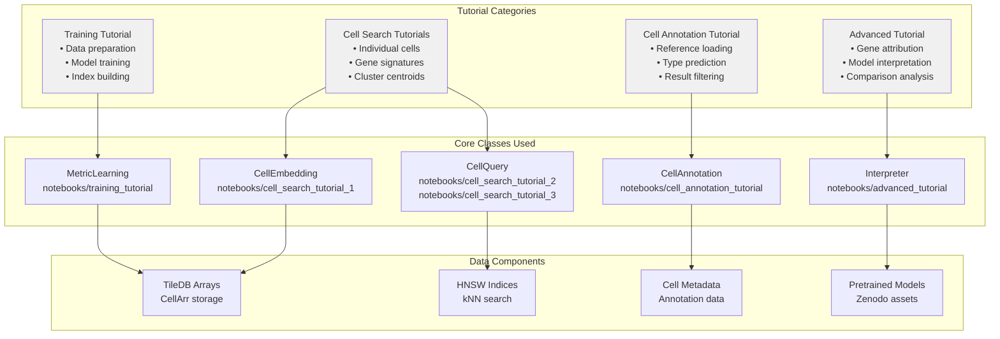
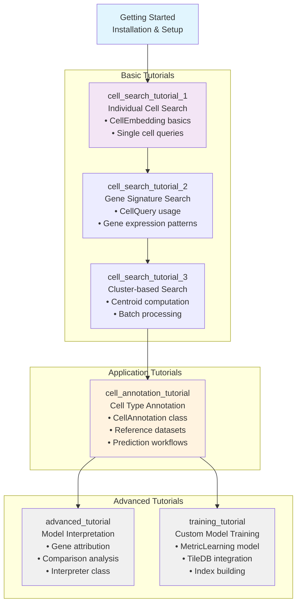

# Tutorials & Examples

<details>
<summary>Relevant source files</summary>

The following files were used as context for generating this wiki page:

- [docs/tutorials.rst](docs/tutorials.rst)

</details>


## Purpose and Scope

This page provides an overview of SCimilarity's interactive tutorials and practical examples that demonstrate the system's core functionality. The tutorials cover the complete workflow from basic cell searches to advanced model training and interpretation. Each tutorial is implemented as a Jupyter notebook with step-by-step instructions and working code examples.

For detailed API documentation of the classes used in these tutorials, see [Core API Reference](#3). For information about training custom models beyond the tutorial scope, see [Model Training](#4).

## Tutorial Architecture Overview

SCimilarity's tutorials are organized into distinct learning paths that correspond to the main system components and user workflows. The tutorial structure follows a progression from basic similarity search operations to advanced model training and interpretation.

### Tutorial Workflow Mapping



### Learning Path Structure



Sources: [docs/tutorials.rst:1-14]()

## Tutorial Categories

### Cell Search Tutorials

The cell search tutorials demonstrate SCimilarity's core similarity search capabilities using different query strategies:

| Tutorial | Notebook File | Primary Classes | Focus Area |
|----------|---------------|-----------------|------------|
| Individual Cell Search | `cell_search_tutorial_1` | `CellEmbedding` | Basic embedding generation and single cell queries |
| Gene Signature Search | `cell_search_tutorial_2` | `CellQuery` | Expression pattern-based searches and metadata compilation |
| Cluster-based Search | `cell_search_tutorial_3` | `CellQuery` | Centroid computation and batch query processing |

These tutorials progressively build understanding of the search system, starting with basic `CellEmbedding` operations and advancing to complex `CellQuery` workflows. For comprehensive documentation of these tutorials, see [Cell Search Tutorials](#8.1).

### Cell Annotation Tutorial

The cell annotation tutorial (`cell_annotation_tutorial`) demonstrates automated cell type prediction using the `CellAnnotation` class. This tutorial covers:

- Loading reference datasets and metadata
- Configuring annotation parameters and filters
- Running prediction workflows with consensus voting
- Interpreting annotation results and confidence scores

For detailed documentation of the annotation workflow, see [Cell Annotation Tutorial](#8.2).

### Advanced Features Tutorial

The advanced tutorial (`advanced_tutorial`) explores model interpretation capabilities using the `Interpreter` class. This tutorial demonstrates:

- Gene attribution analysis for understanding model decisions
- Comparative analysis across different cell types and conditions
- Visualization techniques for interpretation results
- Integration with ontology systems for hierarchical analysis

### Model Training Tutorial

The training tutorial (`training_tutorial`) provides a complete walkthrough of training custom SCimilarity models using the `MetricLearning` framework. This tutorial covers:

- Data preparation with `CellArr` and TileDB integration
- Model configuration and hyperparameter settings
- Training loop implementation with PyTorch Lightning
- Post-training index building and validation

Sources: [docs/tutorials.rst:8-13]()

## Tutorial Execution Environment

### Notebook Structure

All tutorials are implemented as Jupyter notebooks located in the `notebooks/` directory. Each notebook follows a consistent structure:

1. **Environment Setup**: Import statements and configuration
2. **Data Loading**: Loading pretrained models and reference datasets  
3. **Core Workflow**: Step-by-step demonstration of functionality
4. **Results Analysis**: Interpretation and visualization of outputs
5. **Next Steps**: Links to related tutorials and advanced topics

### Prerequisites

The tutorials assume basic familiarity with:
- Python data science stack (NumPy, Pandas, matplotlib)
- Single-cell RNA sequencing concepts
- Jupyter notebook environment

### Data Requirements

Most tutorials use publicly available datasets and pretrained models distributed via Zenodo. The notebooks include automated download and caching mechanisms for required data assets.

## Getting Started Guide

### Tutorial Progression

For new users, the recommended tutorial progression is:

1. **Start with Installation**: Complete setup as described in [Installation & Setup](#2)
2. **Basic Search**: Begin with `cell_search_tutorial_1` to understand `CellEmbedding`
3. **Advanced Search**: Progress through `cell_search_tutorial_2` and `cell_search_tutorial_3`
4. **Annotation Workflow**: Complete `cell_annotation_tutorial` for classification tasks
5. **Interpretation**: Explore `advanced_tutorial` for model understanding
6. **Custom Training**: Attempt `training_tutorial` for advanced use cases

### Running Tutorials

```bash
# Clone repository and install dependencies
git clone https://github.com/Genentech/scimilarity
cd scimilarity
pip install -e .

# Launch Jupyter and navigate to notebooks/
jupyter lab notebooks/
```

Each tutorial notebook includes detailed instructions for data download and environment configuration specific to that workflow.

Sources: [docs/tutorials.rst:1-14]()

---