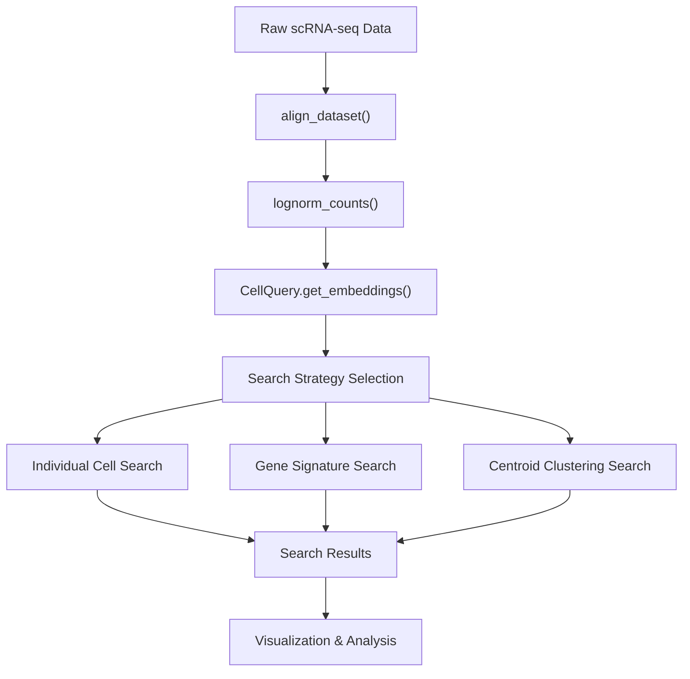
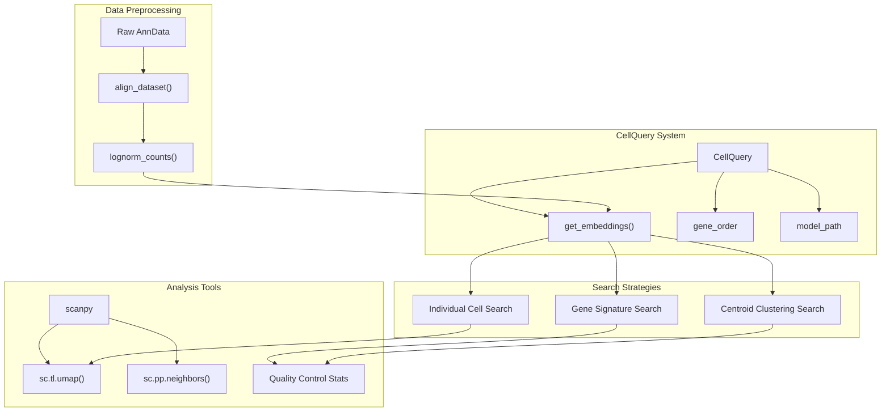
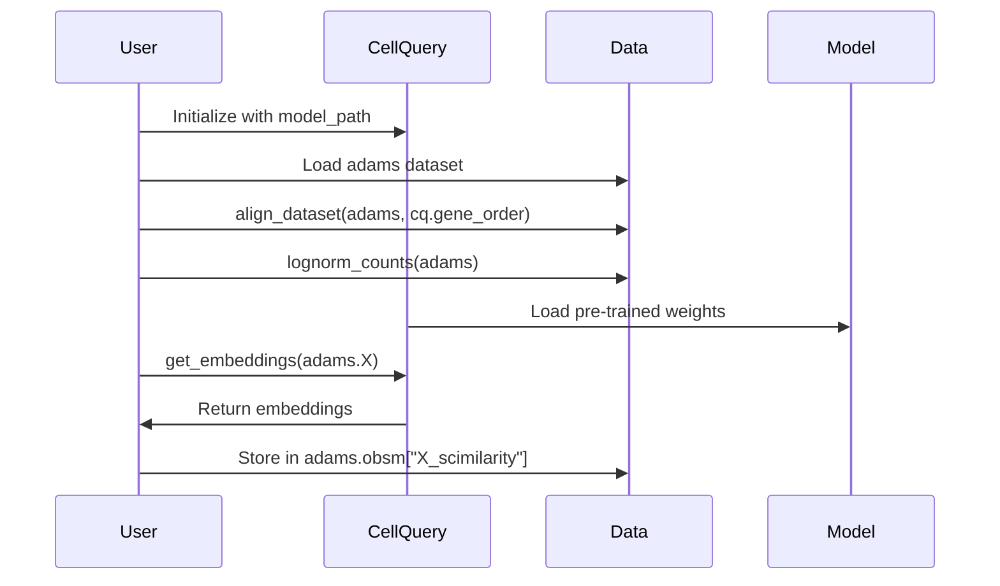
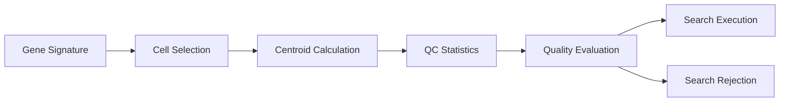
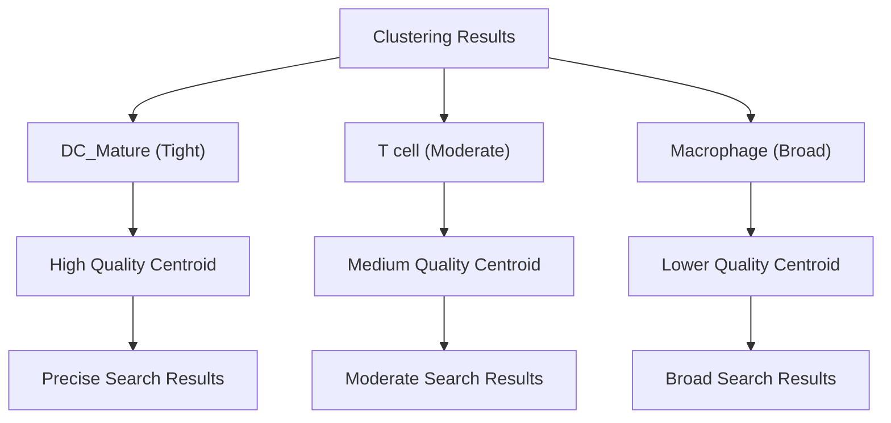

# Cell Search Tutorials

<details>
<summary>Relevant source files</summary>

The following files were used as context for generating this wiki page:

- [docs/notebooks/advanced_tutorial.ipynb](docs/notebooks/advanced_tutorial.ipynb)
- [docs/notebooks/cell_search_tutorial_1.ipynb](docs/notebooks/cell_search_tutorial_1.ipynb)
- [docs/notebooks/cell_search_tutorial_2.ipynb](docs/notebooks/cell_search_tutorial_2.ipynb)
- [docs/notebooks/cell_search_tutorial_3.ipynb](docs/notebooks/cell_search_tutorial_3.ipynb)

</details>


## Purpose and Scope

This document provides comprehensive tutorials for performing cell similarity searches using SCimilarity's `CellQuery` system. It demonstrates three distinct search strategies: individual cell search, centroid-based search with gene signatures, and clustering-based centroid search. These tutorials show how to identify similar cells across large-scale single-cell datasets using pre-trained SCimilarity models.

For information about the core API classes and methods, see [Core API Reference](#3). For cell annotation workflows, see [Cell Annotation Tutorial](#8.2).

## Tutorial Overview

The cell search tutorials demonstrate the complete workflow from data preprocessing to similarity search results. All tutorials use the Adams et al. 2020 lung scRNA-seq dataset as example query data to search across SCimilarity's 23.4M cell atlas.

### Core Workflow



**System Architecture for Cell Search**



Sources: [docs/notebooks/cell_search_tutorial_1.ipynb:87-242](), [docs/notebooks/cell_search_tutorial_2.ipynb:45-156](), [docs/notebooks/cell_search_tutorial_3.ipynb:45-156]()

## Tutorial Breakdown

### Tutorial 1: Individual Cell Search

The first tutorial demonstrates basic cell search functionality by identifying IPF-derived myofibroblasts across the full SCimilarity atlas.

**Key Components:**
- `CellQuery` instantiation with model path
- Data alignment using `align_dataset(adams, cq.gene_order)`
- Normalization with `lognorm_counts(adams)`
- Embedding generation via `cq.get_embeddings(adams.X)`
- Visualization using scanpy's UMAP implementation

**Workflow Steps:**



Sources: [docs/notebooks/cell_search_tutorial_1.ipynb:119-242]()

### Tutorial 2: Gene Signature and Centroid Search

This tutorial shows advanced search strategies using gene signatures to identify cell populations of interest, then performing centroid-based searches.

**Analysis Types:**
1. **Fibroblast signature search** - Uses specific gene signatures to identify target cells
2. **Non-specific signature demonstration** - Shows quality control for poor centroids

**Quality Control Integration:**
The tutorial demonstrates built-in QC statistics for evaluating centroid quality, ensuring meaningful search results when averaging scattered cell collections.



Sources: [docs/notebooks/cell_search_tutorial_2.ipynb:8-18](), [docs/notebooks/cell_search_tutorial_2.ipynb:129-242]()

### Tutorial 3: Clustering-Based Centroids

The third tutorial expands centroid search methodology by using clustering results to define search centroids across different cluster tightness levels.

**Cluster Analysis Examples:**
1. **DC_Mature centroid** - Tight, well-defined cluster
2. **T cell centroid** - Moderately tight cluster  
3. **Macrophage centroid** - Broad, diverse cluster

This progression demonstrates how cluster coherence affects search quality and result interpretation.



Sources: [docs/notebooks/cell_search_tutorial_3.ipynb:8-19](), [docs/notebooks/cell_search_tutorial_3.ipynb:129-242]()

## Data Requirements and Setup

### Prerequisites

| Component | Requirement |
|-----------|-------------|
| **Memory** | At least 64GB RAM |
| **Model** | SCimilarity pre-trained model v1.1 |
| **Data** | Adams et al. 2020 dataset (GSE136831_subsample.h5ad) |
| **Dependencies** | scanpy, matplotlib, scimilarity |

### Data Download Commands

```bash
# Model download
curl -L -o /models/model_v1.1.tar.gz https://zenodo.org/records/10685499/files/model_v1.1.tar.gz?download=1
tar -xzvf /models/model_v1.1.tar.gz

# Tutorial data download  
curl -L -o /data/GSE136831_subsample.h5ad https://zenodo.org/records/13685881/files/GSE136831_subsample.h5ad?download=1
```

### Standard Preprocessing Pipeline

All tutorials follow the same preprocessing requirements:

1. **Gene Alignment**: `align_dataset(data, cq.gene_order)` - Matches feature space with SCimilarity models
2. **Normalization**: `lognorm_counts(data)` - Applies log normalization to 10k procedure
3. **Embedding**: `cq.get_embeddings(data.X)` - Generates SCimilarity embeddings

Sources: [docs/notebooks/cell_search_tutorial_1.ipynb:169-193](), [docs/notebooks/cell_search_tutorial_2.ipynb:116-122](), [docs/notebooks/cell_search_tutorial_3.ipynb:116-122]()

## Key Methods and Classes

### CellQuery Class

The central class for performing similarity searches, instantiated with a model path:

```python
cq = CellQuery(model_path)
```

**Primary Methods:**
- `get_embeddings(X)` - Generates embeddings for input expression matrix
- `gene_order` - Property containing required gene ordering for alignment

### Utility Functions

**Data Processing:**
- `align_dataset(adata, gene_order)` - Aligns genes with model requirements
- `lognorm_counts(adata)` - Normalizes expression data consistently with training

**Visualization:**
- `sc.pp.neighbors(adata, use_rep="X_scimilarity")` - Builds neighbor graph from embeddings
- `sc.tl.umap(adata)` - Generates UMAP coordinates for visualization

Sources: [docs/notebooks/cell_search_tutorial_1.ipynb:99-100](), [docs/notebooks/cell_search_tutorial_2.ipynb:57-58](), [docs/notebooks/cell_search_tutorial_3.ipynb:57-58]()

---