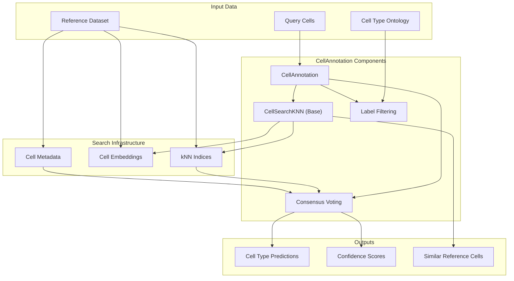
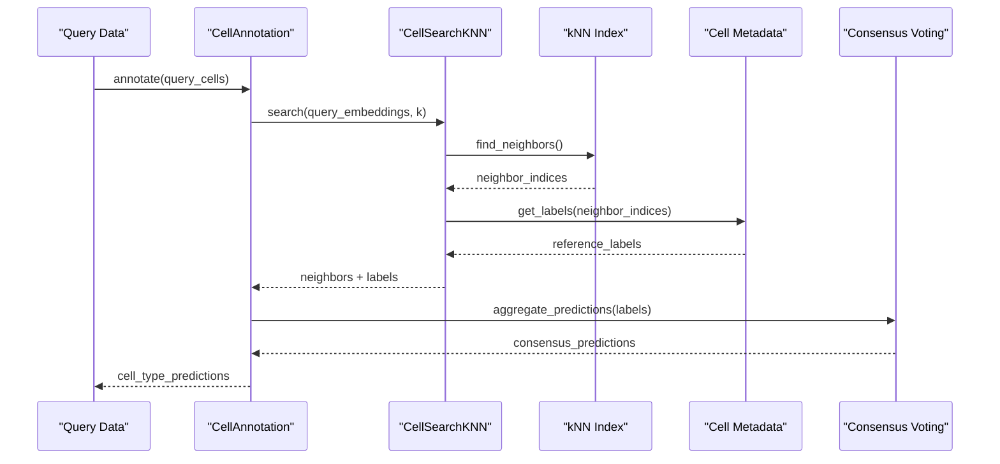
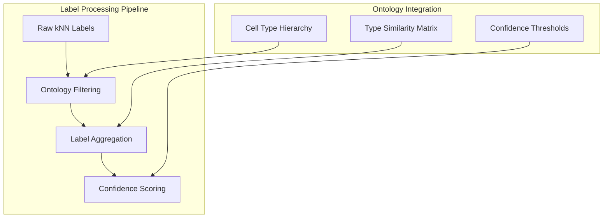
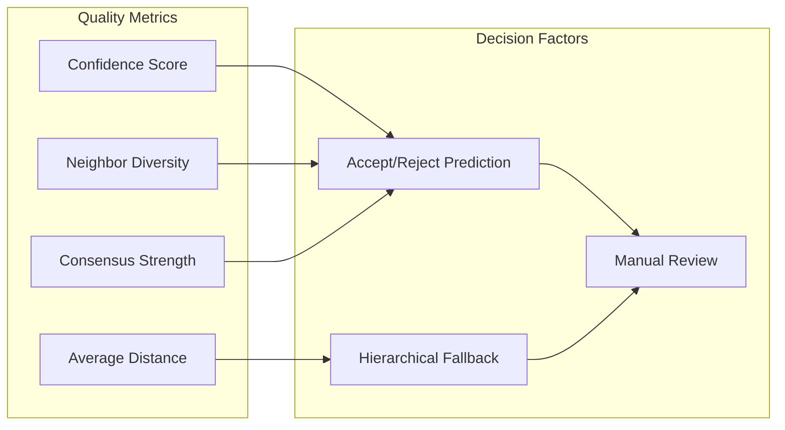

# Cell Annotation Tutorial

<details>
<summary>Relevant source files</summary>

The following files were used as context for generating this wiki page:

- [docs/notebooks/cell_annotation_tutorial.ipynb](docs/notebooks/cell_annotation_tutorial.ipynb)

</details>


## Purpose and Scope

This tutorial demonstrates how to use SCimilarity's cell annotation system to automatically predict cell types for single-cell RNA-seq data. The `CellAnnotation` class leverages reference datasets and similarity search to assign cell type labels through k-nearest neighbor consensus voting.

This tutorial covers the complete annotation workflow from loading reference data to interpreting prediction results. For information about the underlying similarity search infrastructure, see [Cell Embedding & Search Infrastructure](#3.1). For details on the `CellQuery` system used for broader similarity searches, see [Cell Query System](#3.2).

## Cell Annotation System Overview

The cell annotation system in SCimilarity operates by finding similar cells in reference datasets and using consensus voting to predict cell types. The system integrates with cell type ontologies to provide hierarchical predictions and filtering capabilities.

### System Architecture



Sources: System architecture diagrams, Core Component Relationships diagram

### Key Classes and Components

| Component | Purpose | Key Methods |
|-----------|---------|-------------|
| `CellAnnotation` | Main annotation interface | `annotate()`, `load_reference()` |
| `CellSearchKNN` | Base similarity search | `search()`, `load_model()` |
| Cell Type Ontologies | Hierarchical filtering | Similarity calculations |
| Consensus Voting | Prediction aggregation | Label frequency analysis |

Sources: Core Component Relationships diagram, Specialized Classes section

## Basic Annotation Workflow

### Step 1: Initialize CellAnnotation

The annotation process begins by creating a `CellAnnotation` instance and loading a pretrained model:

```python
from scimilarity import CellAnnotation

# Initialize with pretrained model
annotator = CellAnnotation()
annotator.load_model(model_path="path/to/model")
```

### Step 2: Load Reference Dataset

Reference datasets provide the labeled cells used for annotation. The system supports multiple reference data formats:

```python
# Load reference data with cell type labels
annotator.load_reference(
    reference_path="path/to/reference.h5ad",
    cell_type_column="cell_type",
    organism="human"
)
```

### Step 3: Perform Annotation

Query cells are annotated by finding similar reference cells and aggregating their labels:

```python
# Annotate query cells
predictions = annotator.annotate(
    query_data=query_adata,
    k=50,  # Number of neighbors to consider
    confidence_threshold=0.5
)
```

Sources: User Interaction Model diagram, Analysis & Query section

## Annotation Process Details

### kNN Search and Similarity Calculation

The annotation system performs the following steps internally:



Sources: Data Flow Architecture diagram, Core Analysis Engine section

### Label Filtering and Ontology Integration

The system applies hierarchical filtering using cell type ontologies:

1. **Ontology Loading**: Cell type hierarchies provide structure for filtering
2. **Similarity Filtering**: Related cell types are grouped for better predictions  
3. **Confidence Calculation**: Prediction strength based on neighbor agreement



Sources: Core Component Relationships diagram, Ontologies section

## Advanced Configuration Options

### Customizing Search Parameters

The annotation system provides several parameters to control prediction quality:

| Parameter | Description | Default | Impact |
|-----------|-------------|---------|---------|
| `k` | Number of neighbors | 50 | Higher k = more stable, less specific |
| `confidence_threshold` | Minimum prediction confidence | 0.5 | Higher threshold = fewer predictions |
| `max_distance` | Maximum neighbor distance | None | Limits poor matches |
| `min_consensus` | Minimum label agreement | 0.3 | Ensures prediction quality |

### Reference Dataset Selection

Different reference datasets provide different annotation capabilities:

```python
# Load multiple reference datasets
annotator.load_reference([
    {"path": "tissue_specific.h5ad", "weight": 1.0},
    {"path": "general_atlas.h5ad", "weight": 0.5}
], combine_strategy="weighted")
```

Sources: Specialized Classes section, Cell Annotation component

## Result Interpretation

### Prediction Output Structure

The annotation results include multiple information types:

```python
# Annotation results structure
results = {
    'predicted_labels': [...],      # Primary cell type predictions
    'confidence_scores': [...],     # Prediction confidence (0-1)
    'reference_neighbors': [...],   # Similar reference cell IDs
    'consensus_details': [...],     # Voting breakdown per prediction
    'hierarchy_info': [...]         # Ontology relationships
}
```

### Quality Assessment

Several metrics help assess annotation quality:

1. **Confidence Scores**: Higher scores indicate stronger consensus
2. **Neighbor Diversity**: More diverse neighbors suggest robust predictions  
3. **Distance Metrics**: Closer neighbors provide more reliable annotations
4. **Consensus Strength**: Agreement level among k-nearest neighbors



Sources: Evaluation Metrics section, ASW and NMSE components

## Troubleshooting and Best Practices

### Common Issues

1. **Low Confidence Predictions**: Increase k or use broader reference datasets
2. **Missing Cell Types**: Ensure reference data covers target cell populations
3. **Inconsistent Results**: Check data alignment and normalization consistency
4. **Performance Issues**: Use GPU acceleration for large datasets

### Optimization Strategies

- **Reference Curation**: Use high-quality, well-annotated reference datasets
- **Parameter Tuning**: Adjust k and thresholds based on dataset characteristics  
- **Hierarchical Annotation**: Leverage ontology structure for broad-to-specific predictions
- **Batch Processing**: Process large datasets in chunks for memory efficiency

Sources: Training and Deployment Pipeline diagram, Evaluation section

---