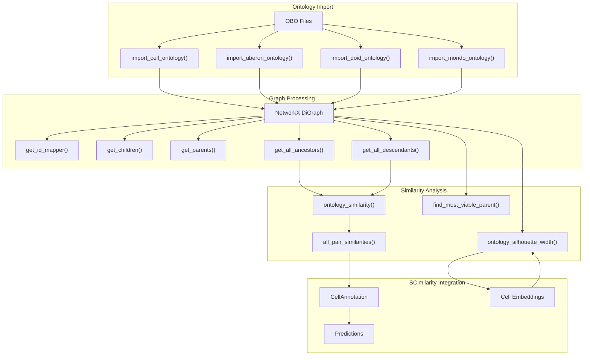
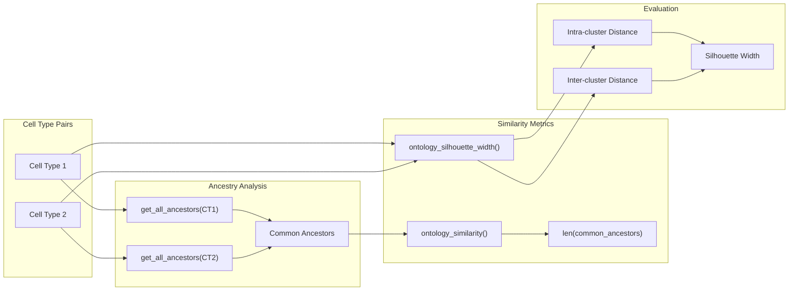
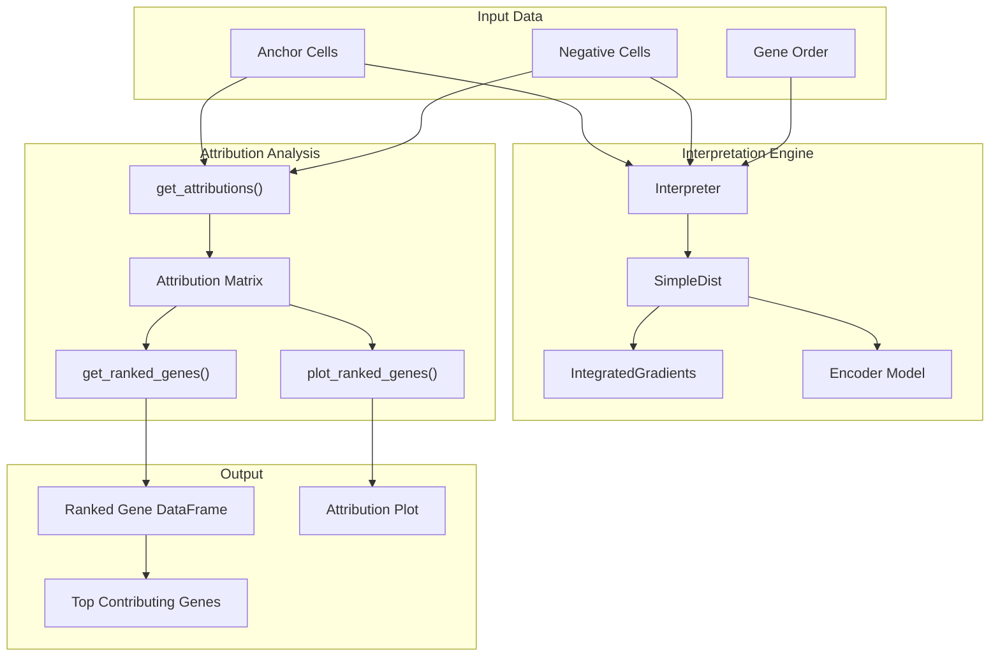
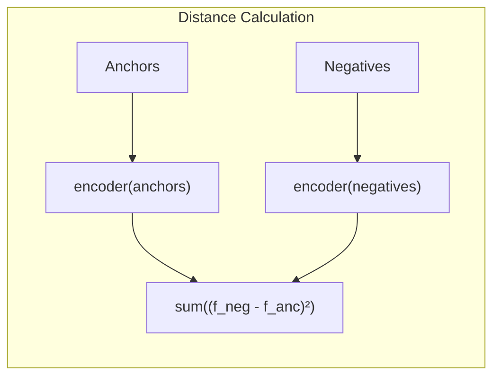
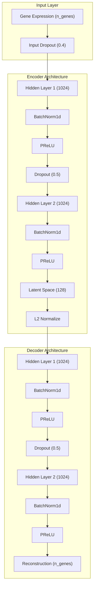
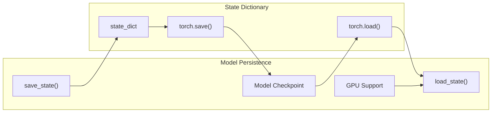
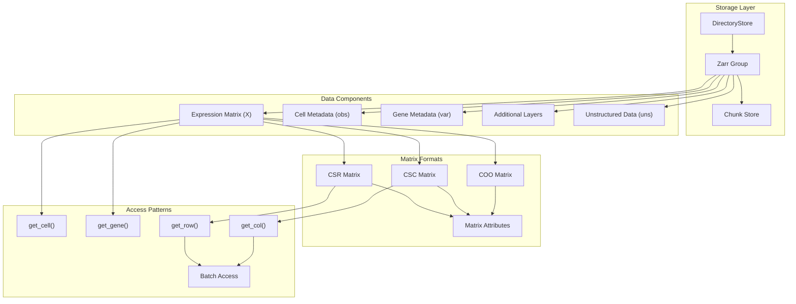
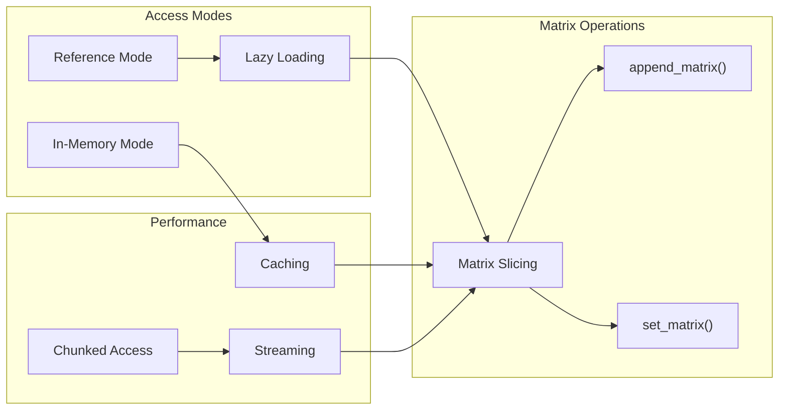
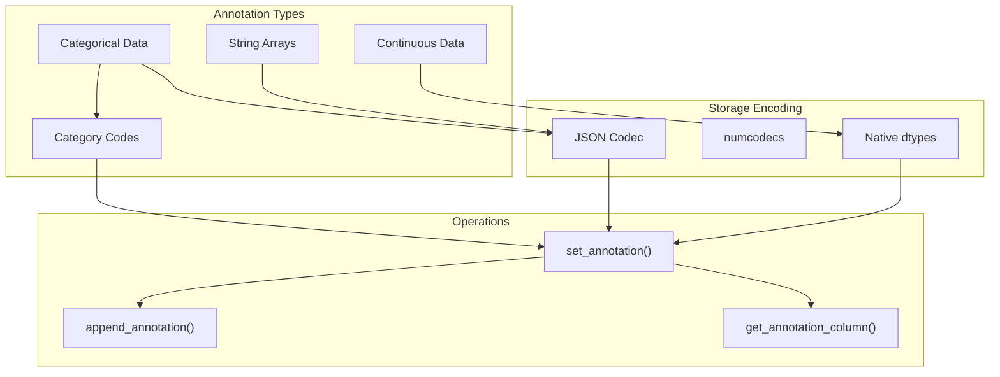

# Advanced Topics

Relevant source files

The following files were used as context for generating this wiki page:

- [src/scimilarity/interpreter.py](src/scimilarity/interpreter.py)
- [src/scimilarity/nn_models.py](src/scimilarity/nn_models.py)
- [src/scimilarity/ontologies.py](src/scimilarity/ontologies.py)
- [src/scimilarity/zarr_dataset.py](src/scimilarity/zarr_dataset.py)

This document covers advanced features and sophisticated use cases of SCimilarity that extend beyond the basic API workflows. Topics include ontology integration for hierarchical cell type analysis, model interpretation for understanding gene contributions, neural network architecture details, and advanced data storage capabilities.

For basic usage patterns, see [Core API Reference](#3). For training custom models, see [Model Training](#4). For standard data management workflows, see [Data Management & Storage](#5).

## Ontology Integration

SCimilarity provides sophisticated ontology integration capabilities that enable hierarchical analysis of cell types, tissues, and diseases. The system supports multiple standard ontologies and provides utilities for computing ontology-aware similarity metrics.

### Supported Ontologies

SCimilarity integrates with several standard biological ontologies through the `ontologies` module:

| Ontology | Function | Purpose |
|----------|----------|---------|
| Cell Ontology (CL) | `import_cell_ontology()` | Hierarchical cell type relationships |
| UBERON | `import_uberon_ontology()` | Anatomical structure and tissue ontology |
| Disease Ontology (DOID) | `import_doid_ontology()` | Disease classification hierarchy |
| MONDO | `import_mondo_ontology()` | Unified disease ontology |

### Ontology-Aware Analysis Workflow

**Sources:** [src/scimilarity/ontologies.py:30-123]()

### Hierarchical Similarity Computation

The ontology system enables sophisticated similarity calculations that consider hierarchical relationships between cell types:

**Sources:** [src/scimilarity/ontologies.py:372-517]()

### Ontology-Aware Silhouette Analysis

The `ontology_silhouette_width()` function provides evaluation metrics that respect cell type hierarchies, where ancestors are not considered inter-cluster and descendants are considered intra-cluster:

**Key Parameters:**
- `embeddings`: Cell embeddings matrix
- `labels`: Cell type names  
- `onto`: NetworkX ontology graph
- `name2id`: Mapping from cell type names to ontology IDs
- `metric`: Distance metric (default: "cosine")

**Returns:**
- Average silhouette width score
- DataFrame with per-cell-type silhouette metrics

**Sources:** [src/scimilarity/ontologies.py:439-517]()

## Model Interpretation

SCimilarity provides model interpretation capabilities through the `Interpreter` class, which uses integrated gradients to identify genes that contribute most to similarity relationships between cells.

### Interpretation Architecture

**Sources:** [src/scimilarity/interpreter.py:43-214]()

### Gene Attribution Workflow

The interpretation system computes gene attributions by measuring how changes in gene expression affect the distance between anchor and negative cell pairs:

#### SimpleDist Distance Function

The `SimpleDist` class implements the distance calculation used for attribution:

**Sources:** [src/scimilarity/interpreter.py:5-41]()

#### Attribution Computation Process

1. **Baseline Integration**: Uses negative cells as baselines for integrated gradients
2. **Directional Masking**: Multiplies attributions by `anchor > negative` to focus on upregulated genes
3. **Absolute Values**: Takes absolute value since attribution signs can be unreliable
4. **GPU Support**: Automatically handles GPU tensors if model is on GPU

**Sources:** [src/scimilarity/interpreter.py:69-131]()

### Attribution Analysis Results

The `get_ranked_genes()` method produces a comprehensive analysis DataFrame:

| Column | Description |
|--------|-------------|
| `gene` | Gene symbol |
| `gene_idx` | Gene index in original order |
| `attribution` | Mean attribution score |
| `attribution_std` | Standard deviation of attributions |
| `cells` | Number of cells in analysis |

**Sources:** [src/scimilarity/interpreter.py:133-163]()

## Neural Network Architecture

SCimilarity employs an encoder-decoder architecture with specific design choices optimized for single-cell data representation learning.

### Encoder-Decoder Design

**Sources:** [src/scimilarity/nn_models.py:12-207]()

### Architecture Configuration

#### Encoder Specifications

| Component | Default Value | Purpose |
|-----------|---------------|---------|
| `latent_dim` | 128 | Embedding dimensionality |
| `hidden_dim` | [1024, 1024] | Hidden layer sizes |
| `dropout` | 0.5 | Hidden layer dropout rate |
| `input_dropout` | 0.4 | Input layer dropout rate |
| Activation | PReLU | Parameterized ReLU activation |
| Normalization | BatchNorm1d | Batch normalization after linear layers |
| Output | L2 Normalize | Unit sphere embeddings |

**Sources:** [src/scimilarity/nn_models.py:31-81]()

#### Decoder Specifications

The decoder mirrors the encoder architecture in reverse:
- **Input**: Latent embeddings (128-dim)
- **Hidden Layers**: [1024, 1024] with BatchNorm1d and PReLU
- **Output**: Reconstructed gene expression (n_genes)
- **Dropout**: Applied to hidden layers (0.5 rate)

**Sources:** [src/scimilarity/nn_models.py:130-176]()

### Model State Management

Both encoder and decoder classes provide state management capabilities:

**Sources:** [src/scimilarity/nn_models.py:82-111](), [src/scimilarity/nn_models.py:178-206]()

## Advanced Data Storage

SCimilarity provides sophisticated data storage capabilities through the `ZarrDataset` class, enabling efficient access to large-scale single-cell datasets stored in Zarr format.

### Zarr Integration Architecture

**Sources:** [src/scimilarity/zarr_dataset.py:12-35]()

### Sparse Matrix Access Patterns

The `ZarrDataset` class provides optimized access patterns for different sparse matrix formats:

#### Format-Specific Slicing

| Format | Optimal Access | Method | Use Case |
|--------|----------------|--------|----------|
| CSR | Row-wise | `row_slice_csr()` | Cell-based queries |
| CSC | Column-wise | `col_slice_csc()` | Gene-based queries |
| COO | Flexible | `slice_coo()` | General purpose |

**Sources:** [src/scimilarity/zarr_dataset.py:555-643]()

#### Memory Management

**Sources:** [src/scimilarity/zarr_dataset.py:645-829]()

### Dynamic Data Manipulation

The system supports dynamic modification of stored datasets:

#### Matrix Appending Operations

- **Row Appending**: For CSR matrices along axis 0
- **Column Appending**: For CSC matrices along axis 1  
- **Flexible Appending**: For COO matrices with explicit axis specification
- **Metadata Updates**: Automatic shape and index updates

**Sources:** [src/scimilarity/zarr_dataset.py:725-829]()

#### Annotation Management

The annotation system handles both categorical and continuous metadata:

**Sources:** [src/scimilarity/zarr_dataset.py:910-999]()