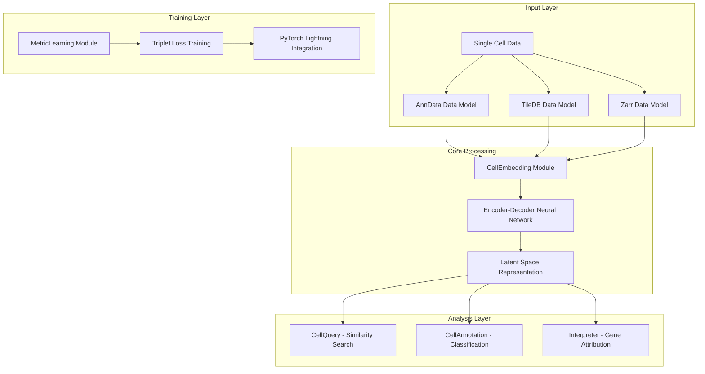
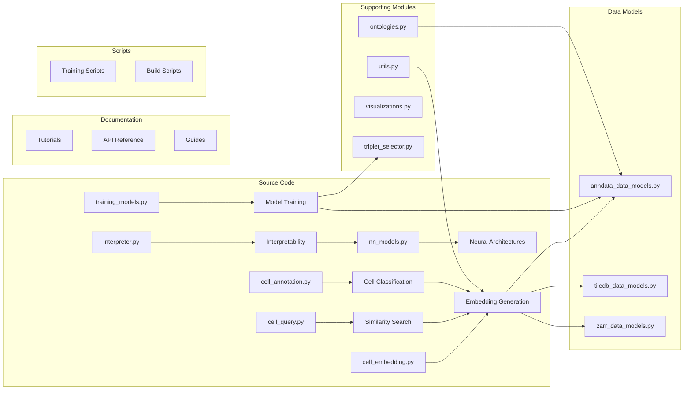

SCimilarity is a foundation model for single-cell biology that provides a **unifying representation of single cell expression profiles**, enabling researchers to quantify similarity between cell states across studies without requiring additional training or specialized preprocessing [docs/index.rst#L11-L13](https://github.com/Genentech/scimilarity/blob/main/docs/index.rst#L11-L13). The framework enables a novel cell search capability that can sift through millions of profiles to find cells similar to a query cell state, allowing researchers to systematically leverage massive public scRNA-seq atlases [README.rst#L5-L10](https://github.com/Genentech/scimilarity/blob/main/README.rst#L5-L10).

The framework's core innovation lies in its ability to generalize across studies using a pre-trained neural network architecture that learns meaningful latent representations of cellular expression profiles. This eliminates the need for batch correction, highly variable gene selection, or other complex preprocessing steps typically required in comparative single-cell analysis [docs/index.rst#L28-L30](https://github.com/Genentech/scimilarity/blob/main/docs/index.rst#L28-L30).

Sources: [README.rst](https://github.com/Genentech/scimilarity/blob/main/README.rst#L1-L43), [docs/index.rst](https://github.com/Genentech/scimilarity/blob/main/docs/index.rst#L1-L85), [src/scimilarity/__init__.py](https://github.com/Genentech/scimilarity/blob/main/src/scimilarity/__init__.py#L1-L23)

## Architecture

SCimilarity's architecture follows a modular design pattern centered around four core capabilities: cell embedding generation, similarity search, cell type annotation, and interpretability analysis. The system supports multiple data storage backends (AnnData, TileDB, Zarr) and provides both pre-trained models and training utilities for custom model development [src/scimilarity/__init__.py](https://github.com/Genentech/scimilarity/blob/main/src/scimilarity/__init__.py#L18-L23).

The foundation of this architecture is the **CellEmbedding** class, which loads pre-trained encoder-decoder neural network models and transforms gene expression profiles into 128-dimensional latent space vectors [src/scimilarity/cell_embedding.py#L19-L24](https://github.com/Genentech/scimilarity/blob/main/src/scimilarity/cell_embedding.py#L19-L24). This embedding generation capability serves as the foundation for both search and annotation functionality, with the neural network having been trained on diverse single-cell datasets to create a universal representation space [src/scimilarity/nn_models.py](https://github.com/Genentech/scimilarity/blob/main/src/scimilarity/nn_models.py).

Building upon the embedding layer, the framework provides specialized analysis modules. The **CellQuery** class enables similarity search across millions of pre-computed cell embeddings using efficient K-Nearest Neighbors algorithms (HNSW) [src/scimilarity/cell_query.py#L31-L40](https://github.com/Genentech/scimilarity/blob/main/src/scimilarity/cell_query.py#L31-L40), while **CellAnnotation** leverages the same K-NN infrastructure to classify cell types by finding the most similar cells in a reference catalog of 7 million author-annotated cells [docs/index.rst#L45-L52](https://github.com/Genentech/scimilarity/blob/main/docs/index.rst#L45-L52).

Sources: [src/scimilarity/cell_embedding.py](https://github.com/Genentech/scimilarity/blob/main/src/scimilarity/cell_embedding.py#L1-L157), [src/scimilarity/cell_query.py](https://github.com/Genentech/scimilarity/blob/main/src/scimilarity/cell_query.py#L1-L744), [src/scimilarity/cell_annotation.py](https://github.com/Genentech/scimilarity/blob/main/src/scimilarity/cell_annotation.py#L1-L320)

## Core Capabilities

SCimilarity provides three primary capabilities that address common challenges in single-cell analysis workflows:

| Capability | Primary Module | Key Features | Use Case |
|------------|----------------|--------------|----------|
| **Similarity Search** | CellQuery | HNSW K-NN, exhaustive search, metadata filtering | Find cells matching a query profile across millions of references |
| **Cell Type Classification** | CellAnnotation | Reference catalog of 7M cells, safelist/blocklist, prediction weighting | Annotate new datasets without user-provided references |
| **Interpretability** | Interpreter | Gene attribution, ranked gene comparison, visualization | Understand which genes drive similarity/differences between cell states |

### Cell Query

The **CellQuery** module provides tools to search for similar cells across large reference datasets. Users input a gene expression profile of a cell state of interest, and the system searches across tens of millions of cells to find cells that resemble the query cell state [docs/index.rst#L28-L36](https://github.com/Genentech/scimilarity/blob/main/docs/index.rst#L28-L36). This capability requires no special preprocessing such as batch correction or highly variable gene selection, making it accessible to researchers regardless of their bioinformatics expertise.

The module supports multiple search strategies including fast approximate K-NN search using HNSWlib (`search_nearest`, `search_centroid_nearest`) and exhaustive search with distance thresholds (`search_exhaustive`, `search_centroid_exhaustive`) [src/scimilarity/cell_query.py#L206-L287](https://github.com/Genentech/scimilarity/blob/main/src/scimilarity/cell_query.py#L206-L287). Users can also filter results based on metadata criteria such as tissue type, disease state, or study origin [src/scimilarity/cell_query.py#L479](https://github.com/Genentech/scimilarity/blob/main/src/scimilarity/cell_query.py#L479).

### Cell Type Annotation

The **CellAnnotation** class classifies cells by finding the most similar cells in a reference catalog of 7 million author-annotated cells [docs/index.rst#L45-L52](https://github.com/Genentech/scimilarity/blob/main/docs/index.rst#L45-L52). This eliminates the need for users to provide their own reference datasets, though users can subset the reference to cell types of interest to increase annotation accuracy. The module provides sophisticated cell type management through safelist and blocklist functionality, allowing researchers to control which cell types are considered during classification [src/scimilarity/cell_annotation.py#L92-L119](https://github.com/Genentech/scimilarity/blob/main/src/scimilarity/cell_annotation.py#L92-L119).

> [!TIP]
> The annotation process leverages prediction weighting strategies that can be enabled or disabled depending on use case requirements, providing flexibility between simple majority voting and weighted similarity-based classification.

### Model Training

For researchers requiring custom models, the **MetricLearning** class provides comprehensive functionality to train new SCimilarity models using PyTorch Lightning [src/scimilarity/training_models.py#L15-L16](https://github.com/Genentech/scimilarity/blob/main/src/scimilarity/training_models.py#L15-L16). The training framework implements metric learning with triplet loss, enabling the model to learn meaningful representations where similar cell types cluster together and dissimilar types are separated in latent space [src/scimilarity/training_models.py#L73-L93](https://github.com/Genentech/scimilarity/blob/main/src/scimilarity/training_models.py#L73-L93).

Key training features include configurable triplet selection strategies (semihard, random), study-aware sampling, label perturbation for robustness, and comprehensive tracking of training metrics through the PyTorch Lightning callback system [src/scimilarity/training_models.py#L82-L85](https://github.com/Genentech/scimilarity/blob/main/src/scimilarity/training_models.py#L82-L85). The framework supports both encoder-only and encoder-decoder architectures with customizable hidden layer dimensions and dropout rates [src/scimilarity/training_models.py#L76-L79](https://github.com/Genentech/scimilarity/blob/main/src/scimilarity/training_models.py#L76-L79).

Sources: [docs/index.rst](https://github.com/Genentech/scimilarity/blob/main/docs/index.rst#L28-L78), [src/scimilarity/cell_query.py](https://github.com/Genentech/scimilarity/blob/main/src/scimilarity/cell_query.py#L31-L287), [src/scimilarity/cell_annotation.py](https://github.com/Genentech/scimilarity/blob/main/src/scimilarity/cell_annotation.py#L23-L156), [src/scimilarity/training_models.py](https://github.com/Genentech/scimilarity/blob/main/src/scimilarity/training_models.py#L73-L93)

## Data Model Architecture

SCimilarity provides flexible data model support to accommodate different research workflows and data storage requirements:

| Data Model | Primary Classes | Storage Backend | Typical Use Case |
|------------|-----------------|-----------------|------------------|
| **AnnData** | scDataset, MetricLearningDataModule | HDF5 (AnnData format) | Training models, moderate-sized datasets |
| **TileDB** | scDataset, scSampler, MetricLearningDataModule | TileDB arrays | Large-scale production deployments, cloud storage |
| **Zarr** | scDataset, scSampler, MetricLearningDataModule | Zarr arrays | Distributed computing, chunked access patterns |

The **AnnData data models** provide a familiar interface for researchers working with the AnnData ecosystem, supporting direct integration with existing single-cell analysis pipelines [src/scimilarity/anndata_data_models.py#L20-L30](https://github.com/Genentech/scimilarity/blob/main/src/scimilarity/anndata_data_models.py#L20-L30). For larger-scale deployments, the **TileDB data models** offer optimized storage and sampling strategies with dynamic weight decay for training efficiency [src/scimilarity/tiledb_data_models.py#L48-L77](https://github.com/Genentech/scimilarity/blob/main/src/scimilarity/tiledb_data_models.py#L48-L77). The Zarr data models provide similar capabilities with compatibility for cloud-native workflows [src/scimilarity/zarr_data_models.py](https://github.com/Genentech/scimilarity/blob/main/src/scimilarity/zarr_data_models.py).

All data models share a common interface through the PyTorch Lightning DataModule architecture, enabling seamless switching between storage backends without changing training or analysis code. This design allows researchers to prototype with smaller AnnData files and scale to TileDB or Zarr for production workloads without major code refactoring [src/scimilarity/anndata_data_models.py#L70-L80](https://github.com/Genentech/scimilarity/blob/main/src/scimilarity/anndata_data_models.py#L70-L80).

## Interpretability and Analysis

The **Interpreter** module provides tools to understand which genes drive similarity between cell states, offering critical insights into biological mechanisms underlying observed relationships [src/scimilarity/interpreter.py#L43-L63](https://github.com/Genentech/scimilarity/blob/main/src/scimilarity/interpreter.py#L43-L63). By computing gene attributions through gradient-based methods, researchers can identify the most important genes distinguishing similar or dissimilar cell states, facilitating hypothesis generation and biological interpretation of search results.

The interpreter provides ranked gene lists that can be visualized directly, enabling rapid assessment of the molecular signatures associated with particular cell states or similarity relationships [src/scimilarity/interpreter.py#L133-L171](https://github.com/Genentech/scimilarity/blob/main/src/scimilarity/interpreter.py#L133-L171). This capability is particularly valuable for validating search results, understanding why certain cell types cluster together, and generating novel hypotheses about cellular relationships.

> [!TIP]
> Gene attribution calculations leverage the SimpleDist neural network module, which computes distances between cell representations while maintaining differentiability to enable gradient-based feature importance estimation.

Sources: [src/scimilarity/interpreter.py](https://github.com/Genentech/scimilarity/blob/main/src/scimilarity/interpreter.py#L5-L171), [src/scimilarity/anndata_data_models.py](https://github.com/Genentech/scimilarity/blob/main/src/scimilarity/anndata_data_models.py#L1-L375), [src/scimilarity/tiledb_data_models.py](https://github.com/Genentech/scimilarity/blob/main/src/scimilarity/tiledb_data_models.py#L1-L686)

## Project Structure

The SCimilarity repository follows a clear, modular structure designed to separate concerns and facilitate maintainability:

The source code is organized into logical groupings in the `src/scimilarity/` directory, with core functionality (embedding, query, annotation, training) separated from data model implementations and supporting utilities. The `docs/` directory contains comprehensive tutorials, API documentation, and conceptual guides [docs/tutorials.rst#L1-L14](https://github.com/Genentech/scimilarity/blob/main/docs/tutorials.rst#L1-L14). The `scripts/` directory provides production-ready scripts for common workflows including model training, embedding generation, and K-NN graph building.

## Getting Started with SCimilarity

To begin using SCimilarity, you have several learning paths depending on your goals and experience level:

- **If you're new to the framework**: Start with [Quick Start](2-quick-start) for a hands-on introduction to basic functionality
- **If you need to set up your environment**: Visit [Installation and Setup](3-installation-and-setup) for detailed installation instructions
- **If you want to start analyzing data immediately**: Check out [Downloading Pretrained Models and Data](4-downloading-pretrained-models-and-data) to access pre-trained models and reference datasets
- **If you prefer containerized environments**: See [Docker Usage](5-docker-usage) for pre-configured container images

For users ready to dive into specific capabilities:

- **Learn about cell search**: Begin with [Cell Embedding Fundamentals](6-cell-embedding-fundamentals) to understand the underlying representation space, then proceed to [Cell Query API Reference](9-cell-query-api-reference)
- **Annotate your datasets**: Start with [Cell Annotation API Reference](13-cell-annotation-api-reference) and [Understanding Cell Type Classification](14-understanding-cell-type-classification)
- **Train custom models**: Review [Metric Learning with Triplet Loss](18-metric-learning-with-triplet-loss) and [Training Configuration and Hyperparameters](20-training-configuration-and-hyperparameters)

The framework provides comprehensive tutorials covering individual cell search, gene signature-based search, cluster-based analysis, cell type annotation, advanced interpretability, and model training workflows [docs/tutorials.rst#L1-L14](https://github.com/Genentech/scimilarity/blob/main/docs/tutorials.rst#L1-L14).
