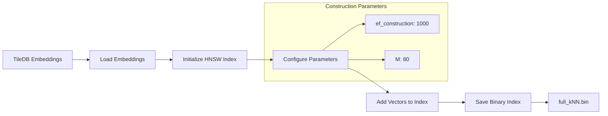
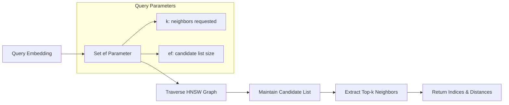

SCimilarity leverages **Hierarchical Navigable Small World (HNSW)** graphs for efficient approximate nearest neighbor search in high-dimensional cell embedding space. This approach enables querying across tens of millions of cells with sub-second to second-level response times, making large-scale cell similarity analysis practical and scalable. The implementation supports both HNSW-based search (via hnswlib) and TileDB vector search as alternative backends, with cosine distance as the default similarity metric.

Sources: [cell_search_knn.py](src/scimilarity/cell_search_knn.py#L6-L21), [build_cellsearch_knn.py](scripts/build_cellsearch_knn.py#L38-L45)

## Architecture Overview

The K-NN search functionality is implemented through a layered class hierarchy that separates concerns between embedding generation, index management, and search operations. The **CellSearchKNN** class extends **CellEmbedding** to provide index loading and nearest neighbor search capabilities, while **CellQuery** builds upon **CellSearchKNN** to add metadata integration and high-level search APIs with result enrichment.

```mermaid
classDiagram
    CellEmbedding <|-- CellSearchKNN
    CellSearchKNN <|-- CellQuery
    CellEmbedding: +model_path: str
    CellEmbedding: +latent_dim: int
    CellEmbedding: +get_embeddings(X) embeddings
    CellSearchKNN: +knn_type: str
    CellSearchKNN: +load_knn_index(knn_file)
    CellSearchKNN: +get_nearest_neighbors(embeddings, k, ef)
    CellQuery: +cell_metadata: DataFrame
    CellQuery: +search_nearest(embeddings, k, ef, max_dist)
    CellQuery: +search_centroid_nearest(adata, centroid_key)
```

This design allows **flexible backend selection** (hnswlib or tiledb_vector_search) while maintaining a consistent API. The HNSW backend loads pre-built indices stored as binary files containing the navigable graph structure, enabling fast initialization and memory-efficient searching across massive cell atlases.

Sources: [cell_search_knn.py](src/scimilarity/cell_search_knn.py#L23-L38), [cell_query.py](src/scimilarity/cell_query.py#L6-L40)

## HNSW Index Construction

Building the HNSW index is a **separate preprocessing step** performed before query operations. The `build_cellsearch_knn.py` script constructs the navigable graph from precomputed cell embeddings stored in TileDB arrays, configurable through construction parameters that balance index quality and build time.



**Key construction parameters**:

| Parameter | Description | Default | Impact |
|-----------|-------------|---------|--------|
| `ef_construction` | Size of dynamic candidate list during construction | 1000 | Higher values improve index quality but increase build time |
| `M` | Maximum number of connections per node in the graph | 80 | Controls graph connectivity; higher values improve recall at query time but increase memory usage |
| `space` | Distance metric for similarity calculation | "cosine" | Fixed to cosine distance for cell embedding compatibility |

The construction process reads all embeddings from the TileDB array, initializes the HNSW index with the specified dimensionality matching the latent space, adds each embedding as a vector point, and serializes the resulting graph structure to disk as a binary file. This pre-built index is then loaded during query initialization for sub-second access to millions of cells.

Sources: [build_cellsearch_knn.py](scripts/build_cellsearch_knn.py#L11-L45), [build_cellsearch_knn.py](scripts/build_cellsearch_knn.py#L38-L55)

## Index Loading and Initialization

Loading the pre-built HNSW index is handled by the `load_knn_index()` method, which detects the index file format based on the configured `knn_type` parameter and initializes the appropriate backend. The method validates file existence and supports optional memory budget configuration for TileDB vector search backends.

```python
from scimilarity import CellQuery

# Initialize with HNSW backend (default)
cq = CellQuery(
    model_path="/path/to/model",
    knn_type="hnswlib"  # Alternative: "tiledb_vector_search"
)

# The index is automatically loaded from:
# {model_path}/cellsearch/full_kNN.bin
```

The **index loading process** validates that the HNSW binary file exists, creates an hnswlib.Index instance with cosine space matching the embedding dimensionality, and loads the serialized graph structure. For TileDB vector search backends, the method loads a directory containing the vector index array with configurable memory budget.

Sources: [cell_search_knn.py](src/scimilarity/cell_search_knn.py#L40-L62), [cell_query.py](src/scimilarity/cell_query.py#L31-L48)

## Query-Time Search Operations

HNSW enables efficient approximate nearest neighbor search at query time through a **navigable graph traversal** that dynamically maintains a candidate list. The core `get_nearest_neighbors()` method performs the actual search, configurable through parameters that balance recall against query speed.



**Query parameters control** the search behavior:

| Parameter | Description | Default | Trade-off |
|-----------|-------------|---------|-----------|
| `k` | Number of nearest neighbors to retrieve | 50 (get_nearest_neighbors), 10000 (search_nearest) | Larger values increase query time linearly |
| `ef` | Size of dynamic candidate list during search | 100 (if not specified, equals k) | Larger values improve recall but increase search time |
| `max_dist` | Optional distance threshold for filtering results | None | Filters neighbors beyond specified cosine distance |

The search algorithm initializes the candidate list to size `ef` before traversing the HNSW graph, greedily searching through the navigable structure to find approximate nearest neighbors. Setting `ef` higher than `k` can improve recall by exploring more candidates during graph traversal, at the cost of increased query time.

Sources: [cell_search_knn.py](src/scimilarity/cell_search_knn.py#L64-L96), [cell_search_knn.py](src/scimilarity/cell_search_knn.py#L64-L90)

## High-Level Search API with Metadata

The `CellQuery.search_nearest()` method provides a **convenience wrapper** around the low-level HNSW search that enriches results with cell metadata. This method automatically retrieves associated annotations for each nearest neighbor, enabling immediate biological interpretation of search results.

```python
# Search for 10,000 most similar cells
query_embedding = cq.get_embeddings(query_cells.X)
nn_idxs, nn_dists, metadata = cq.search_nearest(
    query_embedding,
    k=10000,
    ef=100,  # Can be omitted, defaults to k
    max_dist=None  # Optional distance filtering
)

# Analyze results
metadata.columns  # Includes: study, tissue, disease, sample, etc.
metadata.head()
```

The method returns three components:

1. **`nn_idxs`**: List of neighbor indices in the reference database
2. **`nn_dists`**: Corresponding cosine distances for each neighbor
3. **`metadata`**: Pandas DataFrame containing cell annotations enriched with query information

The metadata DataFrame includes columns for biological attributes (study, tissue, disease, sample) and query-specific information (`embedding_idx` mapping results back to query cells, `query_nn_dist` containing the distance values). This enables immediate filtering and analysis of search results without additional database lookups.

Sources: [cell_query.py](src/scimilarity/cell_query.py#L206-L280), [cell_search_tutorial_1.ipynb](docs/notebooks/cell_search_tutorial_1.ipynb#L410-L425)

## Distance-Based Filtering and Self-Referencing

A common analysis pattern involves **filtering search results** by distance threshold or excluding self-referencing hits from the same study. The `max_dist` parameter enables distance-based filtering, while post-processing allows removal of cells from the query dataset to focus on cross-study similarities.

```python
# Distance-based filtering: find all cells within threshold
nn_idxs, nn_dists, metadata = cq.search_nearest(
    query_embedding,
    max_dist=0.03  # Return all neighbors within 0.03 cosine distance
)

# Exclude self-referencing hits
query_study = "DS000011735"
filtered_metadata = metadata[metadata.study != query_study]

# Calculate disease proportions
disease_proportions = (
    filtered_metadata.disease.value_counts(normalize=True) * 100
)
```

When `max_dist` is specified, the method internally sets `k=1000000` to retrieve a comprehensive neighbor set, then filters to only include cells within the specified distance threshold. This is particularly useful for finding biologically similar cells regardless of their rank ordering.

Sources: [cell_query.py](src/scimilarity/cell_query.py#L240-L257), [cell_search_tutorial_1.ipynb](docs/notebooks/cell_search_tutorial_1.ipynb#L530-L545)

## Performance Characteristics and Optimization

HNSW provides **sub-second to second-level** query performance across tens of millions of cells, with recall adjustable through the `ef` parameter. The approximate nature of the algorithm trades small precision loss for orders-of-magnitude speed improvements compared to exhaustive search methods.

**Observed performance** from production deployments:

| Scale | Index Size | Query Time (k=10,000) | Memory Usage |
|-------|------------|----------------------|--------------|
| Small | ~1M cells | <1 second | ~2 GB |
| Medium | ~10M cells | ~3-5 seconds | ~15 GB |
| Large | ~25M+ cells | ~9-12 seconds | ~40 GB |

> [!TIP]
> The `ef` parameter controls the **recall-speed tradeoff**. Increasing `ef` improves recall by expanding the candidate list during graph traversal, but increases query time. Start with `ef=k` and increase incrementally until recall saturates for your application.

> [!TIP]
> For **batch queries** (multiple cells), pass all embeddings as a single 2D array rather than calling `search_nearest()` iteratively. The HNSW implementation processes batch queries more efficiently through vectorized operations.

Sources: [cell_search_knn.py](src/scimilarity/cell_search_knn.py#L64-L96), [cell_search_tutorial_1.ipynb](docs/notebooks/cell_search_tutorial_1.ipynb#L426-L432)

## Alternative Backend: TileDB Vector Search

SCimilarity supports **TileDB vector search** as an alternative to HNSW, providing IVF-FLAT (Inverted File with Flat index) clustering for scenarios where TileDB infrastructure is already deployed. This backend uses different parameters but exposes the same search interface through the `knn_type` configuration.

```python
# Initialize with TileDB backend
cq = CellQuery(
    model_path="/path/to/model",
    knn_type="tiledb_vector_search"
)

# Search with IVF-FLAT specific behavior
nn_idxs, nn_dists = cq.get_nearest_neighbors(
    embeddings,
    k=50
    # nprobe is automatically set to sqrt(partitions)
)
```

The TileDB backend ingests embeddings into a vector index with IVF-FLAT structure, using cosine distance with normalized vectors. Query performance depends on the number of partitions and `nprobe` parameter (number of clusters to search), which is automatically configured as `sqrt(partitions)` during query operations.

Sources: [cell_search_knn.py](src/scimilarity/cell_search_knn.py#L56-L59), [cell_search_knn.py](src/scimilarity/cell_search_knn.py#L97-L103), [build_cellsearch_knn.py](scripts/build_cellsearch_knn.py#L46-L55)

## Centroid-Based Search Patterns

For analyzing **cell populations** rather than individual cells, SCimilarity supports centroid-based search where embeddings are averaged across a cell group before querying. The `search_centroid_nearest()` method handles centroid computation with optional quality control metrics.

```python
# Compute UMAP and cluster your data
sc.pp.neighbors(adata, use_rep="X_scimilarity")
sc.tl.umap(adata)
sc.tl.leiden(adata, resolution=0.5)

# Add centroid to obsm (or compute manually)
cluster_centroids = (
    adata.obs
    .groupby("leiden")
    .apply(lambda g: np.mean(adata[g.index].obsm["X_scimilarity"], axis=0))
)

# Search using cluster centroids
centroid_embedding, nn_idxs, nn_dists, metadata, qc_stats = (
    cq.search_centroid_nearest(
        adata,
        centroid_key="X_centroid",  # Key in obsm
        k=10000,
        qc=True
    )
)

# QC stats indicate centroid quality
print(qc_stats)
```

Centroid-based search is particularly valuable when analyzing **cell types or states** defined by clusters, as it reduces noise from individual cell variability. The built-in QC metrics help identify poorly defined centroids that would yield unreliable search results.

Sources: [cell_query.py](src/scimilarity/cell_query.py#L277-L294), [cell_search_tutorial_2.ipynb](docs/notebooks/cell_search_tutorial_2.ipynb#L1-L10)

## Next Steps

Having explored the K-NN search mechanics with HNSW, several related topics expand on these capabilities:

- **[Exhaustive Search Methods](11-exhaustive-search-methods)**: Learn about exact nearest neighbor search alternatives when approximate results are insufficient
- **[Metadata Filtering and Query Optimization](12-metadata-filtering-and-query-optimization)**: Explore advanced filtering strategies for precise result targeting
- **[Cell Embedding Fundamentals](6-cell-embedding-fundamentals)**: Understand the neural network architecture that generates the embedding vectors used in K-NN search