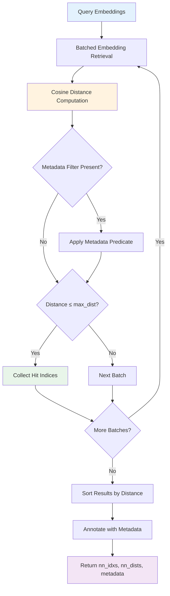

Exhaustive search methods in SCimilarity provide complete, distance-threshold-based cell similarity searches without the approximation inherent in K-NN indexing approaches. These methods compute pairwise cosine distances between query embeddings and every cell in the reference dataset, ensuring comprehensive retrieval of all cells within a specified maximum distance threshold. While computationally more intensive than HNSW-based K-NN searches, exhaustive methods guarantee complete coverage and are ideal for targeted analyses where precision outweighs query speed constraints.

Sources: [cell_query.py](src/scimilarity/cell_query.py#L475-L560), [cell_search_knn.py](src/scimilarity/cell_search_knn.py#L1-L70)

## Exhaustive Search Architecture

The exhaustive search architecture leverages precomputed embeddings stored in TileDB arrays, enabling efficient batch processing of large-scale cell atlases. The core design separates three computational concerns: embedding retrieval via TileDB I/O, pairwise distance computation using SciPy's optimized distance routines, and result filtering through metadata predicates and distance thresholds. This modular approach allows the system to scale to millions of cells through configurable buffering strategies while maintaining exact distance calculations.



The batch processing pipeline iterates through precomputed embeddings in chunks determined by the `buffer_size` parameter (default: 100,000 cells), preventing memory exhaustion on large datasets while maintaining computational efficiency. Each batch retrieves embeddings via `get_precomputed_embeddings()`, computes cosine distances using `scipy.spatial.distance.cdist()`, applies optional metadata filters, and collects cells meeting the distance threshold before proceeding to the next batch.

Sources: [cell_query.py](src/scimilarity/cell_query.py#L475-L560), [utils.py](src/scimilarity/utils.py#L733-L784)

## Core Exhaustive Search Method

The `search_exhaustive()` method implements the fundamental exhaustive search algorithm, accepting query embeddings as input and returning all cells within a specified cosine distance threshold. The method supports both single-cell queries (1D arrays reshaped to 2D) and batch queries (multi-row 2D arrays), with each row representing a distinct query that yields its own neighbor list.

**Parameters and Configuration:**

| Parameter | Type | Default | Description |
|-----------|------|---------|-------------|
| `embeddings` | numpy.ndarray | required | Query embeddings, shape (n_queries, latent_dim) or (latent_dim,) |
| `max_dist` | float | 0.03 | Maximum cosine distance threshold for neighbor inclusion |
| `metadata_filter` | dict | None | Metadata predicates as `{column: value}` pairs |
| `buffer_size` | int | 100,000 | Number of cells processed per batch |

The metadata filtering mechanism applies logical AND across all specified column-value pairs, enabling complex filtering like `{"tissue": "lung", "disease": "healthy"}`. When multiple filter conditions are specified, cells must satisfy all conditions to be retained as hits. This filtering occurs after distance computation, ensuring spatial filtering precedes metadata filtering for optimal performance.

> [!TIP]
> Adjust `buffer_size` based on available RAM and dataset size. Smaller values (10,000-50,000) reduce memory pressure but increase I/O overhead, while larger values (200,000+) improve throughput on systems with substantial memory.

Sources: [cell_query.py](src/scimilarity/cell_query.py#L475-L560)

## Centroid-Based Exhaustive Search

The `search_centroid_exhaustive()` method extends exhaustive search to centroid queries, where a single representative embedding is computed from a collection of cells marked in the input AnnData object. This approach is particularly useful for querying with cell type signatures, gene expression patterns, or manually curated cell populations. The method includes built-in quality control metrics to assess centroid coherence before proceeding with the search.

**Centroid Computation Process:**


The centroid is computed from raw counts using the `get_centroid()` utility function, which sums gene expression values across all marked cells and applies log1p normalization to a target sum of 10,000. This approach ensures the centroid represents the aggregate expression profile of the query population in the same space used during model training.

**Quality Control Mechanism:**

When `qc=True` (default), the method performs k-means clustering (k=10 by default) on the embeddings of all cells used to construct the centroid. For each cluster centroid, it performs a nearest neighbor search to identify overlapping cells with the exhaustive search results. The mean overlap across all clusters is reported as `query_coherence`—higher values indicate a more tightly clustered, coherent query population. Low coherence scores suggest the input cells are dispersed in embedding space, which may produce ambiguous search results.

Sources: [cell_query.py](src/scimilarity/cell_query.py#L561-L653), [utils.py](src/scimilarity/utils.py#L304-L326)

## Cluster Centroid Exhaustive Search

The `search_cluster_centroids_exhaustive()` method provides systematic centroid-based queries for all clusters identified in a dataset, or a specific cluster of interest. This is particularly valuable for comprehensive cell type annotation workflows where you need to compare multiple cell populations against a reference atlas simultaneously.

**Method Workflow:**

1. **Cluster Identification**: Extracts cluster labels from `adata.obs[cluster_key]`, optionally filtering to a single `cluster_label`
2. **Data Alignment**: Aligns gene expression data to the model's gene order using `align_dataset()`
3. **Centroid Computation**: Computes log-normalized centroids for each cluster using `get_cluster_centroids()`
4. **Batch Embedding**: Generates embeddings for all centroids via `get_embeddings()`
5. **Exhaustive Search**: Performs exhaustive search for each centroid through `search_exhaustive()`
6. **Result Organization**: Structures results with cluster labels as dictionary keys for easy access

The `skip_null` parameter (default: True) excludes cells with null/NaN cluster labels from centroid computation, ensuring robust centroids. When processing multiple clusters, results are returned as dictionaries keyed by cluster label, enabling straightforward analysis of cell type-specific similarity patterns across studies and tissues.

Sources: [cell_query.py](src/scimilarity/cell_query.py#L654-L744), [utils.py](src/scimilarity/utils.py#L374-L443)

## TileDB Integration and Performance Optimization

Exhaustive search methods rely on TileDB dense arrays for efficient storage and retrieval of precomputed embeddings. The `embedding_from_tiledb()` utility implements optimized I/O patterns with a default 50GB memory budget, enabling efficient slicing and multi-index queries on large-scale embedding matrices.

**Key Performance Characteristics:**

| Aspect | Implementation Detail | Performance Impact |
|--------|---------------------|-------------------|
| **Memory Budget** | 50GB default via TileDB config | Enables caching of frequently accessed regions |
| **Index Sorting** | Pre-sorts cell indices for sequential access | Maximizes TileDB's chunk-based I/O efficiency |
| **Batch Processing** | Configurable `buffer_size` parameter | Balances memory usage vs. I/O overhead |
| **Distance Metric** | SciPy's `cdist()` with cosine metric | Optimized C implementation, batch-parallel |

The indexing strategy requires sorting cell indices before TileDB queries, then unsorting results to match original order. This approach maximizes TileDB's ability to read contiguous chunks from disk, reducing seek operations and improving throughput for large-scale queries.

> [!TIP]
> For production deployments with frequent exhaustive searches, pre-warm the TileDB cache by accessing embeddings once before peak usage periods. This reduces first-query latency and ensures consistent performance.

Sources: [utils.py](src/scimilarity/utils.py#L733-L784), [build_cellsearch_knn.py](scripts/build_cellsearch_knn.py#L8-L9)

## Comparison with K-NN Search Methods

Exhaustive search methods provide fundamentally different guarantees compared to approximate K-NN search approaches, making them suitable for different analytical scenarios. Understanding these tradeoffs is essential for selecting the appropriate method for your use case.

**Method Comparison Matrix:**

| Characteristic | Exhaustive Search | K-NN Search (HNSW) |
|---------------|-------------------|-------------------|
| **Completeness** | 100% (all cells within threshold) | Approximate (may miss some cells) |
| **Distance Precision** | Exact cosine distances | Approximate distances |
| **Query Time** | O(n) linear with dataset size | O(log n) logarithmic with dataset size |
| **Memory Usage** | Higher (batch processing) | Lower (in-memory index) |
| **Result Size** | Variable (depends on threshold) | Fixed (k neighbors) |
| **Best Use Case** | Precision-critical analyses | Large-scale exploratory searches |

Exhaustive search is particularly valuable when you need complete coverage of similar cells, such as identifying all cells within a tight distance threshold for downstream differential expression analysis. K-NN methods, described in [K-NN Search with HNSW](10-k-nn-search-with-hnsw), are better suited for rapid prototyping and exploratory analysis where approximate results are acceptable.

Sources: [cell_query.py](src/scimilarity/cell_query.py#L206-L276), [cell_search_knn.py](src/scimilarity/cell_search_knn.py#L64-L104)

## Practical Implementation Guide

**Basic Exhaustive Search:**

```python
from scimilarity import CellQuery

# Initialize query object
cq = CellQuery(model_path="/path/to/model")

# Get query embeddings
embeddings = cq.get_embeddings(query_counts)

# Perform exhaustive search
nn_idxs, nn_dists, metadata = cq.search_exhaustive(
    embeddings,
    max_dist=0.03,
    metadata_filter={"tissue": "lung"},
    buffer_size=100000
)
```

**Centroid-Based Search with QC:**

```python
# Mark cells for centroid construction
adata.obs["used_in_query"] = (adata.obs["cell_type"] == "macrophage").astype(int)

# Perform centroid search with quality control
centroid_emb, nn_idxs, nn_dists, metadata, qc_stats = cq.search_centroid_exhaustive(
    adata,
    centroid_key="used_in_query",
    max_dist=0.03,
    qc=True,
    qc_params={"k_clusters": 10}
)

# Evaluate query coherence
print(f"Query coherence: {qc_stats['query_coherence']:.2%}")
```

**Multi-Cluster Analysis:**

```python
# Search all clusters in a dataset
centroids, cluster_labels, nn_dict, dist_dict, all_metadata = cq.search_cluster_centroids_exhaustive(
    adata,
    cluster_key="leiden",
    max_dist=0.035,
    buffer_size=150000
)

# Access results for specific clusters
for cluster in cluster_labels:
    cluster_hits = len(nn_dict[cluster][0])
    print(f"{cluster}: {cluster_hits} similar cells found")
```
