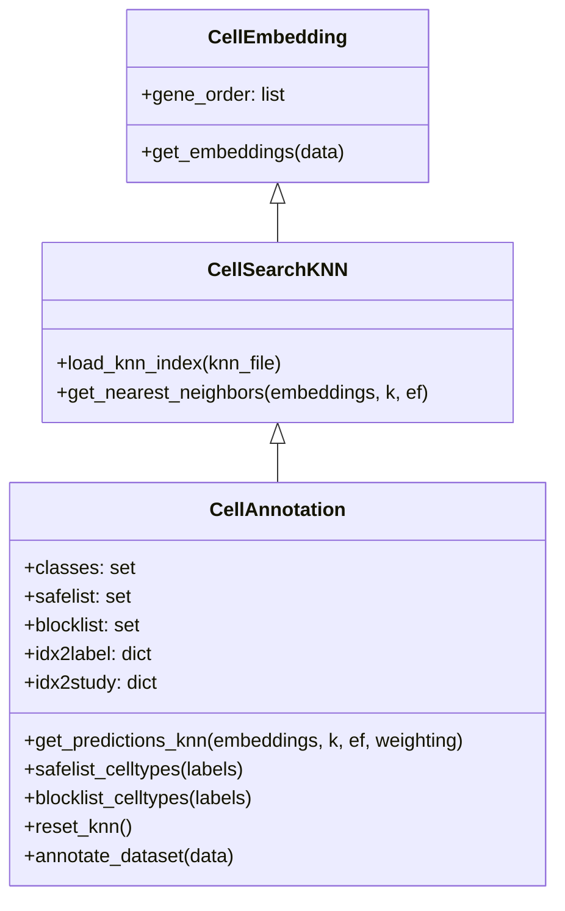
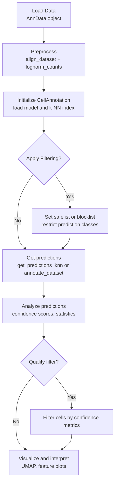

The Cell Annotation API provides automated cell type classification through similarity-based inference in latent space. By leveraging pre-trained embeddings and k-nearest neighbor search, this module enables high-throughput annotation of single-cell transcriptomics data with configurable filtering and prediction weighting strategies. The API is built on top of the CellSearchKNN infrastructure [cell_annotation.py#L6-L320](src/scimilarity/cell_annotation.py#L6-L320) and integrates seamlessly with AnnData workflows for end-to-end analysis pipelines.

## Core Architecture

CellAnnotation extends CellSearchKNN, inheriting embedding generation and k-NN search capabilities while adding specialized functionality for cell type prediction and reference dataset filtering. The class loads a pre-trained model along with a reference k-NN index containing labeled cell types, enabling rapid classification of query cells by their nearest neighbors in the embedding space [cell_annotation.py#L6-L50](src/scimilarity/cell_annotation.py#L6-L50).



The annotation system requires three key files at initialization: the trained model weights, the labeled k-NN index in HNSW format, and a reference labels TSV file mapping indices to cell type names [cell_annotation.py#L23-L50](src/scimilarity/cell_annotation.py#L23-L50). The `filenames` parameter supports custom file paths for flexibility in different deployment scenarios.

## Class Initialization

### Constructor Parameters

```python
CellAnnotation(model_path, use_gpu=False, filenames=None)
```

The CellAnnotation constructor initializes the annotation system by loading the neural network model and reference k-NN index from the specified model directory [cell_annotation.py#L23-L50](src/scimilarity/cell_annotation.py#L23-L50).

| Parameter | Type | Default | Description |
|-----------|------|---------|-------------|
| `model_path` | str | required | Path to directory containing model files (model weights, k-NN index, reference labels) |
| `use_gpu` | bool | False | Enable GPU acceleration for embedding computation |
| `filenames` | dict | None | Custom filename mappings for 'knn' and 'celltype_labels' files |

The constructor automatically creates an annotation subdirectory within `model_path` and establishes file paths for the k-NN index (`labelled_kNN.bin`) and reference labels (`reference_labels.tsv`) [cell_annotation.py#L32-L45](src/scimilarity/cell_annotation.py#L32-L45). The reference labels file is parsed to build `idx2label` and `idx2study` mappings that associate k-NN indices with cell type names and study origins.

## Cell Type Filtering

### Blocklist Cell Types

```python
blocklist_celltypes(labels)
```

The blocklist mechanism prevents certain cell types from being considered during annotation by marking corresponding k-NN indices as deleted [cell_annotation.py#L92-L116](src/scimilarity/cell_annotation.py#L92-L116). This is useful when you want to exclude broad or redundant categories (e.g., "T cell" when you only want specific T cell subtypes).

| Parameter | Type | Description |
|-----------|------|-------------|
| `labels` | List[str] or Set[str] | Cell type labels to exclude from predictions |

> [!TIP]
> Blocklists and safelists are mutually exclusive. Setting a blocklist automatically clears any existing safelist, and vice versa. The filter persists for the lifetime of the CellAnnotation instance until explicitly reset.

### Safelist Cell Types

```python
safelist_celltypes(labels)
```

Safelisting restricts predictions to only the specified cell types by marking all k-NN indices as deleted and then unmarking only the safelisted categories [cell_annotation.py#L118-L146](src/scimilarity/cell_annotation.py#L118-L146). This approach reduces annotation noise and classification conflicts, particularly useful when analyzing tissues with known cell type compositions.

| Parameter | Type | Description |
|-----------|------|-------------|
| `labels` | List[str] or Set[str] | Cell type labels to allow in predictions |

### Reset K-NN Filters

```python
reset_knn()
```

The reset method clears all blocklist and safelist filters by unmarking all deleted k-NN indices [cell_annotation.py#L74-L89](src/scimilarity/cell_annotation.py#L74-L89). This restores the full reference dataset for subsequent predictions, useful when switching between different annotation strategies.

## Prediction Methods

### Get Predictions K-NN

```python
get_predictions_knn(embeddings, k=50, ef=100, weighting=False, disable_progress=False)
```

This core method performs cell type prediction by finding nearest neighbors for query embeddings and computing consensus labels through majority voting or distance-weighted voting [cell_annotation.py#L148-L279](src/scimilarity/cell_annotation.py#L148-L279). The method returns comprehensive prediction statistics for downstream analysis.

| Parameter | Type | Default | Description |
|-----------|------|---------|-------------|
| `embeddings` | numpy.ndarray | required | Cell embeddings from the pre-trained model |
| `k` | int | 50 | Number of nearest neighbors to query |
| `ef` | int | 100 | Size of dynamic candidate list for HNSW search (higher = better accuracy, slower) |
| `weighting` | bool | False | Enable distance-weighted voting (closer neighbors get more influence) |
| `disable_progress` | bool | False | Hide tqdm progress bar |

> [!TIP]
> The `ef` parameter controls the search-time quality/speed tradeoff. For production deployments, start with `ef=100`. For critical applications requiring maximum precision, increase to `ef=200-500`. For rapid prototyping, decrease to `ef=50`.

**Return Values**

The method returns a tuple of four values:
- `predictions`: pandas.Series with predicted cell type labels for each query cell
- `nn_idxs`: 2D numpy array [num_cells × k] containing indices of nearest neighbors
- `nn_dists`: 2D numpy array [num_cells × k] containing distances to nearest neighbors
- `stats`: pandas.DataFrame with detailed prediction metrics

The statistics DataFrame includes the following columns:

| Column | Description |
|--------|-------------|
| `hits` | JSON string of cell type counts among k neighbors |
| `hits_weighted` | JSON string of distance-weighted cell type counts |
| `min_dist` | Minimum distance to any neighbor |
| `max_dist` | Maximum distance among k neighbors |
| `vs2nd` | Ratio of best hit count to sum of best + second best hits |
| `vsAll` | Ratio of best hit count to sum of all hits |
| `vs2nd_weighted` | Distance-weighted version of `vs2nd` |
| `vsAll_weighted` | Distance-weighted version of `vsAll` |

These metrics enable confidence scoring and quality filtering of predictions. High `vs2nd` values (e.g., >0.8) indicate unambiguous predictions, while low values suggest ambiguous classifications that may require manual review.

### Annotate Dataset

```python
annotate_dataset(data)
```

The `annotate_dataset` method provides a high-level interface for complete dataset annotation, handling embedding generation, alignment, and prediction statistics in a single call [cell_annotation.py#L281-L320](src/scimilarity/cell_annotation.py#L281-L320). The method assumes input data has been log-normalized and automatically aligns the gene order to match the model's training data.

| Parameter | Type | Description |
|-----------|------|-------------|
| `data` | anndata.AnnData | AnnData object with log-normalized expression matrix |

**Modifications to AnnData Object**

The method enriches the input AnnData object with several new fields:

| Field | Location | Description |
|-------|----------|-------------|
| `X_scimilarity` | `data.obsm` | Cell embeddings from the SCimilarity model |
| `celltype_hint` | `data.obs` | Predicted cell type labels |
| `min_dist` | `data.obs` | Minimum distance to nearest neighbors |
| `celltype_hits` | `data.obs` | JSON string of neighbor cell type counts |
| `celltype_hits_weighted` | `data.obs` | JSON string of weighted neighbor counts |
| `celltype_hint_stat` | `data.obs` | Confidence score (vsAll metric) |
| `celltype_hint_weighted_stat` | `data.obs` | Weighted confidence score |

## Properties

### Classes Property

```python
classes
```

The `classes` property returns the complete set of viable prediction classes available in the reference dataset [cell_annotation.py#L68-L71](src/scimilarity/cell_annotation.py#L68-L71). This read-only property is useful for inspecting the available cell types before configuring safelists or blocklists.

```python
>>> ca = CellAnnotation(model_path="/opt/data/model")
>>> print(f"Available classes: {len(ca.classes)}")
Available classes: 237
```

## Usage Workflow

The typical workflow for cell annotation involves initialization, optional filtering, prediction, and downstream analysis. The following diagram illustrates the complete process:



## Example Usage

### Basic Annotation Pipeline

```python
from scimilarity import CellAnnotation
from scimilarity.utils import align_dataset, lognorm_counts
import scanpy as sc

# Load data
data = sc.read("your_data.h5ad")

# Initialize annotation
ca = CellAnnotation(model_path="/opt/data/model")

# Preprocess data to match model requirements
data = align_dataset(data, ca.gene_order)
data = lognorm_counts(data)

# Annotate dataset
data = ca.annotate_dataset(data)

# Examine results
print(data.obs["celltype_hint"].value_counts())
```

### Constrained Annotation with Safelist

```python
# Define cell types of interest for lung tissue analysis
lung_celltypes = [
    "type I pneumocyte",
    "type II pneumocyte", 
    "alveolar macrophage",
    "endothelial cell of lymphatic vessel",
    "lung endothelial cell",
]

# Apply safelist filter
ca.safelist_celltypes(lung_celltypes)

# Get predictions with confidence filtering
embeddings = ca.get_embeddings(data.X)
predictions, nn_idxs, nn_dists, stats = ca.get_predictions_knn(
    embeddings, 
    k=50, 
    weighting=True
)

# Filter high-confidence predictions
high_conf_mask = stats["vsAll"] > 0.8
print(f"High-confidence predictions: {high_conf_mask.sum()}/{len(predictions)}")
```

### Blocklist-Based Filtering

```python
# Exclude broad categories to prevent generic predictions
ca.blocklist_celltypes([
    "T cell",
    "B cell",
    "myeloid cell",
    "epithelial cell",
])

# Predict only specific subtypes
predictions, _, _, stats = ca.get_predictions_knn(
    embeddings,
    k=50,
    weighting=True
)
```

> [!TIP]
> When working with novel cell types not in the reference, the nearest neighbor distances (`nn_dists`) provide a useful signal. Large minimum distances indicate that the cell may represent a novel state rather than a well-characterized type. Consider visualizing `data.obs["min_dist"]` on UMAP plots to identify ambiguous or novel populations.

## Performance Considerations

The CellAnnotation class is optimized for high-throughput annotation with several performance characteristics:

- **K-NN Search Speed**: Uses HNSWlib for efficient approximate nearest neighbor search with O(log n) query complexity
- **Memory Requirements**: K-NN index typically requires 50-100 MB of RAM (configurable via `memory_budget` in `load_knn_index`)
- **GPU Acceleration**: Enable `use_gpu=True` for embedding generation on compatible hardware, providing 3-5x speedup for large datasets
- **Batch Processing**: The `get_predictions_knn` method processes all embeddings in a single batch for optimal throughput

## Integration with Other SCimilarity Modules

CellAnnotation is part of the broader SCimilarity ecosystem and integrates with several complementary modules:

- **CellEmbedding**: Provides the underlying neural network encoder for generating latent representations [cell_embedding.py](src/scimilarity/cell_embedding.py)
- **CellSearchKNN**: Inherits k-NN search infrastructure for fast neighbor queries [cell_search_knn.py](src/scimilarity/cell_search_knn.py)
- **Utils**: Provides `align_dataset` and `lognorm_counts` functions for data preprocessing [utils.py](src/scimilarity/utils.py)
- **Ontologies**: Can reference Cell Ontology terms for standardized cell type naming [ontologies.py](src/scimilarity/ontologies.py)

For detailed understanding of the underlying cell search mechanisms and K-NN optimization, see [K-NN Search with HNSW](10-k-nn-search-with-hnsw). For advanced filtering strategies and interpretation of prediction statistics, refer to [Understanding Cell Type Classification](14-understanding-cell-type-classification) and [Safelist and Blocklist Cell Types](15-safelist-and-blocklist-cell-types).