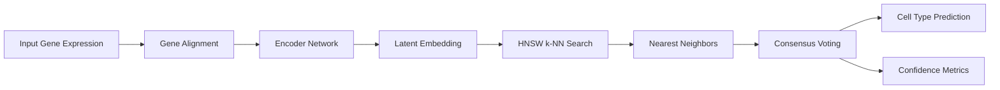

Cell type classification in scimilarity leverages a sophisticated k-nearest neighbors (KNN) approach operating in a learned embedding space. The system transforms high-dimensional gene expression data into compact latent representations through a trained encoder, then performs similarity search against a reference database of pre-annotated cells to generate type predictions based on consensus voting among nearest neighbors. This architecture enables rapid, scalable cell annotation across diverse biological contexts.

## Classification Architecture

The classification pipeline follows a three-stage process that transforms raw gene expression into confident cell type assignments. First, the encoder neural network projects input gene expression vectors into a 128-dimensional latent space optimized for semantic similarity between cells of the same type. Second, a hierarchical navigable small world (HNSW) index enables efficient approximate nearest neighbor search across potentially millions of reference cells. Finally, a weighted consensus mechanism aggregates predictions from the k nearest neighbors to produce final cell type labels with associated confidence metrics.

The `CellAnnotation` class orchestrates this workflow, inheriting embedding capabilities from `CellEmbedding` and k-nearest neighbor search functionality from `CellSearchKNN` [cell_annotation.py#L6](src/scimilarity/cell_annotation.py#L6-L7). During initialization, the class loads a pre-trained encoder model and a pre-built k-NN index containing reference cells with known cell type labels [cell_annotation.py#L23-L65](src/scimilarity/cell_annotation.py#L23-L65). The reference labels are stored in a TSV file mapping each index position to a cell type, with optional study metadata [cell_annotation.py#L52-L60](src/scimilarity/cell_annotation.py#L52-L60).

## KNN-Based Prediction Mechanism

The core prediction logic resides in the `get_predictions_knn` method, which retrieves k nearest neighbors for query embeddings and computes consensus predictions [cell_annotation.py#L148-L280](src/scimilarity/cell_annotation.py#L148-L280). The method supports two prediction modes: simple majority voting and distance-weighted voting controlled by the `weighting` parameter [cell_annotation.py#L210-L219](src/scimilarity/cell_annotation.py#L210-L219).

For each query cell, the system maintains two dictionaries: `celltype` counting raw occurrences and `celltype_weighted` accumulating inverse distance weights [cell_annotation.py#L201-L207](src/scimilarity/cell_annotation.py#L201-L207). When weighting is enabled, each neighbor's contribution is scaled by 1/distance, giving greater influence to more similar reference cells. The final prediction selects the cell type with maximum count or weighted count [cell_annotation.py#L211-L218](src/scimilarity/cell_annotation.py#L211-L218).

| Parameter | Default | Purpose | Impact |
|-----------|---------|---------|--------|
| `k` | 50 | Number of neighbors to retrieve | Larger values increase robustness but may dilute specificity |
| `ef` | 100 | HNSW search list size | Higher values improve recall at computational cost |
| `weighting` | False | Enable distance weighting | True gives preference to closer neighbors |

The HNSW index provides extremely fast approximate nearest neighbor search, with the `ef` parameter controlling the search quality-speed tradeoff [cell_search_knn.py#L64-L104](src/scimilarity/cell_search_knn.py#L64-L104). Setting `ef` higher than `k` typically improves accuracy by exploring a larger candidate set during traversal.

## Prediction Statistics and Confidence Metrics

Beyond simple predictions, the system computes comprehensive statistics quantifying classification confidence. The `stats` DataFrame returned by `get_predictions_knn` contains metrics that help assess prediction reliability [cell_annotation.py#L174-L193](src/scimilarity/cell_annotation.py#L174-L193):

- **hits**: JSON string with raw count for every cell type among k neighbors
- **hits_weighted**: JSON string with distance-weighted counts for each type
- **min_dist**: Minimum distance among k neighbors
- **max_dist**: Maximum distance among k neighbors
- **vs2nd**: Ratio of best count to sum of best and second-best counts
- **vsAll**: Ratio of best count to sum of all counts
- **vs2nd_weighted**: Weighted version of vs2nd
- **vsAll_weighted**: Weighted version of vsAll

The vs2nd metric measures dominance of the predicted type over the runner-up, while vsAll indicates relative strength compared to all alternatives. Values approaching 1.0 indicate high confidence, while lower values suggest ambiguous assignments. These metrics are computed for both unweighted and weighted versions to provide complementary perspectives [cell_annotation.py#L220-L240](src/scimilarity/cell_annotation.py#L220-L240).

> [!TIP]
> When analyzing vs2nd and vsAll metrics, consider a threshold of 0.7-0.8 as a reasonable indicator of high-confidence predictions, but validate this threshold for your specific biological context as the optimal value can vary by cell type diversity and reference database composition.

## Cell Type Filtering with Safelists and Blocklists

Scimilarity provides sophisticated control over the prediction space through safelist and blocklist mechanisms. These filters operate by marking specific cell type entries as deleted in the HNSW index, effectively removing them from consideration during neighbor search [cell_annotation.py#L92-L147](src/scimilarity/cell_annotation.py#L92-L147).

The `blocklist_celltypes` method excludes specified cell types from prediction, useful when you want to ignore known problematic or irrelevant categories [cell_annotation.py#L92-L107](src/scimilarity/cell_annotation.py#L92-L107). Conversely, `safelist_celltypes` restricts predictions to only specified types, implementing a conservative approach to classification [cell_annotation.py#L118-L147](src/scimilarity/cell_annotation.py#L118-L147). These operations are mutually exclusive—setting one clears the other—and persist for the lifetime of the class instance.

The filtering mechanism works by calling HNSW's `mark_deleted` and `unmark_deleted` methods, which efficiently remove or restore entries without index reconstruction [cell_annotation.py#L103-L105](src/scimilarity/cell_annotation.py#L103-L105), [cell_annotation.py#L141-L145](src/scimilarity/cell_annotation.py#L141-L145). This design enables rapid experimentation with different prediction scopes without computational overhead. The `reset_knn` method clears all filters, restoring the full prediction space [cell_annotation.py#L74-L90](src/scimilarity/cell_annotation.py#L74-L90).

## Dataset Annotation Workflow

For batch processing of single-cell datasets, the `annotate_dataset` method provides a streamlined workflow that handles the entire annotation pipeline from raw data to enriched results [cell_annotation.py#L281-L320](src/scimilarity/cell_annotation.py#L281-L320). This method accepts an AnnData object containing log-normalized gene expression and returns an annotated version with multiple useful fields.

The workflow begins by aligning the input dataset's gene order to match the encoder's expected format using the `align_dataset` utility function [cell_annotation.py#L298](src/scimilarity/cell_annotation.py#L298). After computing embeddings via the encoder, the method calls `get_predictions_knn` and stores results in the AnnData object:

- **obs["celltype_hint"]**: Predicted cell type labels
- **obs["X_scimilarity"]**: 128-dimensional latent embeddings
- **obs["min_dist"]**: Minimum neighbor distance for each cell
- **obs["celltype_hits"]**: JSON string of neighbor type counts
- **obs["celltype_hits_weighted"]**: Weighted neighbor type counts
- **obs["celltype_hint_stat"]**: vsAll confidence metric
- **obs["celltype_hint_weighted_stat"]**: Weighted vsAll confidence metric

> [!TIP]
> The embedding vectors stored in `X_scimilarity` can be used for downstream analyses such as UMAP visualization, clustering, or quality control—leverage these representations to understand how your data relates to the reference database structure.

This comprehensive annotation enables both immediate cell type assignment and retrospective analysis of prediction quality across the entire dataset.

## Relationship to Other Components

Cell type classification integrates closely with several other scimilarity systems. The encoder architecture used for projection is detailed in [Encoder and Decoder Architecture](7-encoder-and-decoder-architecture), while the underlying latent space properties are explained in [Understanding Latent Space Representations](8-understanding-latent-space-representations). The search mechanisms that power neighbor retrieval are covered in [K-NN Search with HNSW](10-k-nn-search-with-hnsw).

For advanced prediction control, [Safelist and Blocklist Cell Types](15-safelist-and-blocklist-cell-types) provides deeper exploration of filtering strategies, while [Prediction Weighting Strategies](16-prediction-weighting-strategies) offers guidance on selecting appropriate weighting schemes for different biological scenarios. These specialized topics build upon the foundational understanding presented here.

The practical application of these concepts is demonstrated in the [Cell Annotation Tutorial](tutorials), which walks through end-to-end annotation workflows with real data examples.