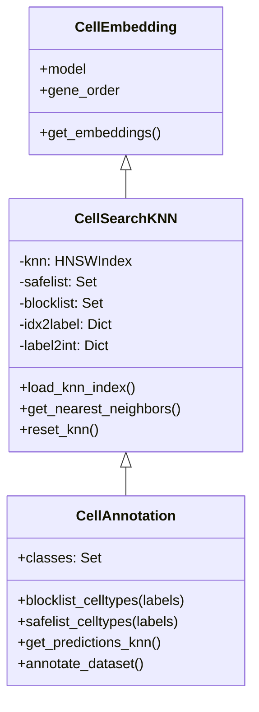
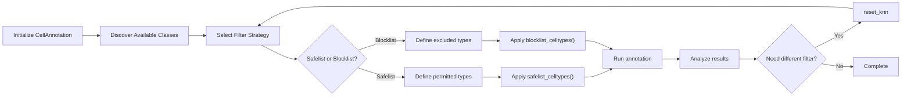

Cell type filtering in SCimilarity provides precise control over the annotation search space by enabling selective inclusion (safelist) or exclusion (blocklist) of cell types from the reference database. This mechanism allows researchers to constrain predictions to biologically relevant cell type subsets, reducing annotation noise and improving specificity for focused analyses.

## Architectural Foundation

The safelist and blocklist functionality is built upon the HNSW (Hierarchical Navigable Small World) k-nearest neighbor index architecture. The `CellAnnotation` class inherits filtering capabilities from `CellSearchKNN`, which manages the kNN index structure and cell type label mappings. When a safelist or blocklist is applied, the system manipulates the deletion status of nodes within the HNSW index rather than reconstructing the index, providing efficient runtime filtering.



The inheritance hierarchy places safelist/blocklist functionality in `CellSearchKNN` where the kNN index resides, while `CellAnnotation` provides domain-specific methods for applying these filters during cell type annotation workflows. The `idx2label` and `label2int` dictionaries maintain bidirectional mappings between integer indices in the kNN index and human-readable cell type labels.

Sources: [cell_search_knn.py](src/scimilarity/cell_search_knn.py#L1-L39), [cell_annotation.py](src/scimilarity/cell_annotation.py#L1-L30)

## Blocklist Mechanism

The blocklist operation explicitly removes specified cell types from consideration during k-nearest neighbor search. When you invoke `blocklist_celltypes()`, the system first resets the kNN index to clear any existing filters, then marks all reference cells belonging to the specified labels as deleted within the HNSW structure.

```python
def blocklist_celltypes(self, labels: Union[List[str], Set[str]]):
    """Blocklist celltypes.
    
    Blocking a celltype will persist for this instance of the class and 
    subsequent predictions will have this blocklist. Blocklists and 
    safelists are mutually exclusive, setting one will clear the other.
    """
    self.reset_knn()  # Clear previous state
    self.blocklist = set(labels)
    self.safelist = None  # Ensure mutual exclusivity
    
    for i, celltype_name in self.idx2label.items():
        if celltype_name in self.blocklist:
            self.knn.mark_deleted(i)  # Mark blocklist cells as deleted
```

The implementation iterates through all cells in the reference, checking each against the blocklist set. When a match is found, the cell's index is marked as deleted using the HNSW library's `mark_deleted()` method. This prevents those cells from being returned in subsequent nearest neighbor queries, effectively filtering them out without modifying the underlying index structure.

Sources: [cell_annotation.py](src/scimilarity/cell_annotation.py#L92-L117)

## Safelist Mechanism

The safelist operation takes an inclusionary approach, explicitly permitting only specified cell types to appear in annotation results. The implementation uses a "mark all, then unmark permitted" strategy: it first marks every cell in the reference as deleted, then selectively unmarks only those cells belonging to safelisted cell types.

```python
def safelist_celltypes(self, labels: Union[List[str], Set[str]]):
    """Safelist celltypes.
    
    Safelisting a celltype will persist for this instance of the class and 
    subsequent predictions will have this safelist. Blocklists and safelists 
    are mutually exclusive, setting one will clear the other.
    """
    self.blocklist = None  # Ensure mutual exclusivity
    self.safelist = set(labels)
    
    # Mark all cells as deleted first
    for i in self.idx2label:
        try:
            self.knn.mark_deleted(i)
        except:
            pass  # Ignore exceptions if already marked
    
    # Unmark only safelisted cell types
    for i, celltype_name in self.idx2label.items():
        if celltype_name in self.safelist:
            self.knn.unmark_deleted(i)  # Restore access to safelisted cells
```

This approach ensures that only explicitly permitted cell types can appear in results. The try-except block handles the case where a cell might already be marked as deleted, which can occur if the kNN index has pre-existing deletions or if the method is called multiple times.

Sources: [cell_annotation.py](src/scimilarity/cell_annotation.py#L118-L147)

## State Management and Reset

Both safelist and blocklist operations persist for the lifetime of the `CellAnnotation` instance, affecting all subsequent predictions. The system provides a reset mechanism to clear all filters and restore full access to the reference database.

```python
def reset_knn(self):
    """Reset the knn such that nothing is marked deleted."""
    self.blocklist = None
    self.safelist = None
    
    # HNSW does not track marked status, so we unmark all
    for i in self.idx2label:
        try:
            self.knn.unmark_deleted(i)
        except:
            pass  # Ignore if not marked
```

Calling `reset_knn()` clears both filter attributes and attempts to unmark all deleted indices in the HNSW index. The try-except pattern handles edge cases where indices may not be marked, ensuring robust operation across different index states.

Sources: [cell_annotation.py](src/scimilarity/cell_annotation.py#L74-L91)

## Practical Workflow

The typical workflow for applying safelist/blocklist filters involves three phases: discovery, selection, and annotation. The tutorial demonstrates this pattern using a lung tissue dataset, where the researcher first identifies available cell types, then selects a biologically relevant subset.



The `classes` property provides convenient access to all available cell type labels in the reference database, enabling informed filter selection based on domain knowledge.

Sources: [cell_annotation.py](src/scimilarity/cell_annotation.py#L68-L73)

## Practical Example: Lung Dataset Annotation

The cell annotation tutorial demonstrates safelist usage for analyzing lung scRNA-seq data from Adams et al., 2020. The researcher identifies lung-relevant cell types and applies a safelist to constrain predictions to biologically plausible annotations for this tissue context.

```python
# Discover available cell types
print("\n".join(ca.classes))

# Define lung-specific cell types
target_celltypes = [
    "lung macrophage",
    "alveolar macrophage",
    "classical monocyte",
    "non-classical monocyte",
    "conventional dendritic cell",
    "plasmacytoid dendritic cell",
    "CD4-positive, alpha-beta T cell",
    "regulatory T cell",
    "CD8-positive, alpha-beta T cell",
    "B cell",
    "plasma cell",
    "type I pneumocyte",
    "type II pneumocyte",
    "club cell",
    "lung ciliated cell",
    "basal cell",
    "endothelial cell of vascular tree",
    "fibroblast",
    "myofibroblast cell",
    # ... additional lung-specific types
]

# Apply safelist constraint
ca.safelist_celltypes(target_celltypes)

# Perform annotation with constrained search space
adams = ca.annotate_dataset(adams)
```

This approach eliminates biologically implausible annotations (such as "retinal bipolar neuron" or "keratinocyte") that might appear due to transcriptional similarities, ensuring results are biologically contextualized to lung tissue.

Sources: [cell_annotation_tutorial.ipynb](docs/notebooks/cell_annotation_tutorial.ipynb#L607-L681)

## API Reference

### safelist_celltypes

Explicitly permits only specified cell types to appear in annotation results. Mutually exclusive with blocklist.

```python
safelist_celltypes(labels: Union[List[str], Set[str]]) -> None
```

**Parameters:**
- `labels`: List or set of cell type labels to permit

**Behavior:**
- Clears any existing blocklist
- Marks all reference cells as deleted
- Unmarks cells belonging to specified labels
- Persists until changed or `reset_knn()` is called

**Example:**
```python
ca.safelist_celltypes(["T cell", "B cell", "macrophage"])
```

Sources: [cell_annotation.py](src/scimilarity/cell_annotation.py#L118-L147)

### blocklist_celltypes

Excludes specified cell types from annotation results. Mutually exclusive with safelist.

```python
blocklist_celltypes(labels: Union[List[str], Set[str]]) -> None
```

**Parameters:**
- `labels`: List or set of cell type labels to exclude

**Behavior:**
- Clears any existing safelist
- Marks cells belonging to specified labels as deleted
- Preserves access to all other cell types
- Persists until changed or `reset_knn()` is called

**Example:**
```python
ca.blocklist_celltypes(["unknown cell", "low quality cell"])
```

Sources: [cell_annotation.py](src/scimilarity/cell_annotation.py#L92-L117)

### reset_knn

Clears all safelist and blocklist filters, restoring full access to the reference database.

```python
reset_knn() -> None
```

**Behavior:**
- Sets `self.safelist = None`
- Sets `self.blocklist = None`
- Attempts to unmark all deleted indices in the kNN index

**Example:**
```python
ca.reset_knn()  # Clear all filters
```

Sources: [cell_annotation.py](src/scimilarity/cell_annotation.py#L74-L91)

### classes

Property that returns the set of all viable prediction cell type labels available in the reference.

```python
@property
classes -> set
```

**Returns:**
- Set of all cell type label strings from `label2int` keys

**Example:**
```python
available_types = ca.classes
print(f"Total available: {len(available_types)}")
print("Sample types:", list(available_types)[:5])
```

Sources: [cell_annotation.py](src/scimilarity/cell_annotation.py#L68-L73)

> [!TIP]
> The safelist operation marks all cells as deleted before unmarking permitted types, which can impact performance if safelisting a small subset of a large reference. For large-scale analyses where you need to annotate to a small subset of cell types repeatedly, consider creating a filtered kNN index rather than applying safelist at runtime.

## Comparison Table

| Feature | Safelist | Blocklist | No Filter |
|---------|----------|-----------|-----------|
| **Use Case** | Tissue-specific annotation | Removing low-quality/artifact types | Exploratory analysis |
| **Default State** | All excluded, then permitted types enabled | All enabled, then specified types excluded | All cell types enabled |
| **Performance** | Slower (marks all, then unmarks subset) | Faster (marks only subset) | Fastest (no marking) |
| **Semantics** | Inclusionary (white list) | Exclusionary (black list) | Unconstrained |
| **Best For** | Small number of relevant cell types | Few problematic cell types | Discovery and characterization |
| **Persistence** | Until changed or reset | Until changed or reset | N/A |

> [!TIP]
> Safelist and blocklist are mutually exclusive. Setting a safelist automatically clears the blocklist, and vice versa. This design prevents ambiguous filter states where a cell type might be both included and excluded.

## Integration with Annotation Pipeline

The safelist/blocklist filters integrate seamlessly with the two primary annotation methods in `CellAnnotation`:

```python
# Method 1: Using annotate_dataset (high-level, automatic embedding)
ca.safelist_celltypes(["T cell", "B cell", "macrophage"])
annotated_data = ca.annotate_dataset(data)
# Results constrained to safelisted types in data.obs["celltype_hint"]

# Method 2: Using get_predictions_knn (detailed control with stats)
ca.blocklist_celltypes(["unknown cell", "low quality cell"])
predictions, nn_idxs, nn_dists, stats = ca.get_predictions_knn(
    embeddings, 
    k=50, 
    weighting=True
)
# Results exclude blocklisted types, stats include full query metrics
```

Both methods respect the active filter state at the time of invocation, allowing dynamic filter application throughout an analysis workflow. The `annotate_dataset` method provides a streamlined interface that computes embeddings automatically, while `get_predictions_knn` offers granular control over kNN search parameters and returns detailed statistics for each prediction.

Sources: [cell_annotation.py](src/scimilarity/cell_annotation.py#L148-L280), [cell_annotation.py](src/scimilarity/cell_annotation.py#L281-L320)

## Next Steps

Having understood safelist and blocklist mechanisms, you may want to explore:

- **[Understanding Cell Type Classification](14-understanding-cell-type-classification)**: Learn about the underlying classification algorithms and consensus mechanisms that generate predictions
- **[Prediction Weighting Strategies](16-prediction-weighting-strategies)**: Understand how distance-based weighting affects consensus predictions and confidence metrics
- **[Cell Annotation API Reference](13-cell-annotation-api-reference)**: Complete API documentation for all annotation methods and parameters

The combination of precise filter control with robust classification algorithms enables sophisticated, biologically contextualized cell type annotation across diverse tissue types and experimental conditions.