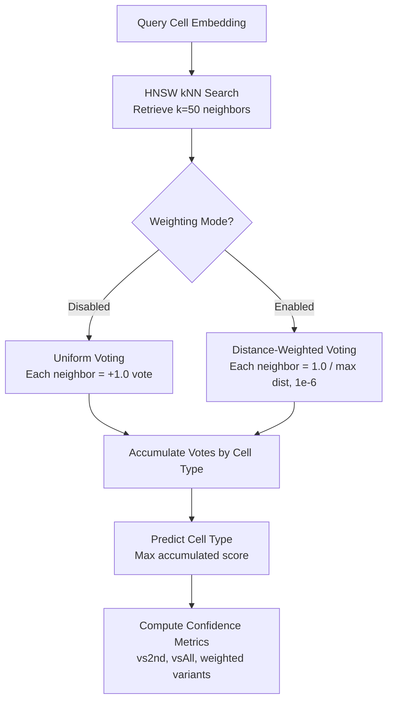
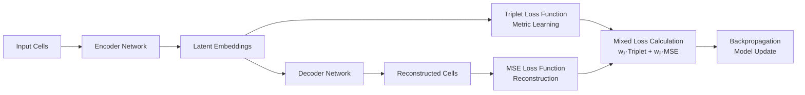

This page explores SCimilarity's prediction weighting mechanisms that enhance cell type annotation accuracy and confidence assessment through distance-aware voting, loss balancing during model training, and statistical confidence metrics. These strategies enable more nuanced predictions by leveraging proximity information in the embedding space and balancing different loss components during training.

## Distance-Weighted kNN Classification

The core prediction weighting strategy in SCimilarity operates within the k-nearest neighbors voting mechanism during cell type annotation. When enabled, this approach weights each neighbor's vote inversely proportional to its distance from the query cell, giving greater influence to closer and thus more similar reference cells.

**Implementation Mechanics**: The `get_predictions_knn` method in the `CellAnnotation` class accepts a `weighting` parameter that toggles this behavior. When `weighting=True`, each neighbor contributes `1.0 / max(distance, 1e-6)` to its corresponding cell type's accumulated score rather than a uniform vote count of 1.0. This mathematical formulation ensures that closer neighbors have exponentially higher influence while maintaining numerical stability with the epsilon guard term.

**Distance Calculation Flow**:

The distance weighting provides two key advantages: it reduces noise from borderline neighbors and improves precision when the embedding space has well-defined cell type boundaries with varying degrees of overlap.

Sources: [cell_annotation.py](src/scimilarity/cell_annotation.py#L148-L279)

## Weighted Confidence Metrics

SCimilarity computes comprehensive confidence statistics that distinguish between simple vote-based confidence and distance-weighted confidence, enabling users to assess prediction reliability through multiple lenses.

**Metrics Overview**:

| Metric | Description | Weighting Variant |
|--------|-------------|-------------------|
| `hits` | JSON string with vote counts per cell type | `hits_weighted` |
| `vs2nd` | Ratio of top cell type to second best | `vs2nd_weighted` |
| `vsAll` | Ratio of top cell type to total votes | `vsAll_weighted` |
| `min_dist` / `max_dist` | Distance range to nearest neighbors | — |

**Confidence Calculation Pattern**: For weighted metrics, the system first converts raw accumulated weights to comparable values by applying `max(weight, 1e-6)` to ensure non-zero denominators. The `vs2nd_weighted` metric divides the top-weighted cell type score by the sum of top and second-best scores, providing a value between 0.5 (ambiguous) and 1.0 (highly confident). Similarly, `vsAll_weighted` compares the top score to all summed weights, indicating dominance.

These metrics enable downstream filtering and quality control, allowing users to set thresholds on confidence scores and separate high-confidence predictions from uncertain classifications that may require manual review.

Sources: [cell_annotation.py](src/scimilarity/cell_annotation.py#L215-L273)

## Training Loss Weighting

During model training, SCimilarity employs a weighted loss combination that balances triplet loss (which enforces metric learning constraints) against reconstruction loss (which preserves gene expression information through the decoder). This weighting is critical for achieving both discriminative latent representations and faithful reconstruction capabilities.

**Mixed Loss Architecture**:

**Weight Parameter Configuration**: The `triplet_loss_weight` parameter (default: 0.001) controls the balance between the two loss components through the formula: `total_loss = (triplet_loss_weight × triplet_loss) + ((1.0 - triplet_loss_weight) × mse)`. Extreme values (0 or 1) produce pure reconstruction or pure metric learning models respectively, while intermediate values enable joint optimization.

The default heavily favors reconstruction, reflecting SCimilarity's design priority of maintaining gene expression interpretability while still learning meaningful distance metrics. Users may increase this weight for applications requiring stricter metric separation at the cost of reconstruction fidelity.

Sources: [training_models.py](src/scimilarity/training_models.py#L73-L93), [training_models.py](src/scimilarity/training_models.py#L293-L315)

## Practical Application Patterns

The choice of weighting strategy depends on data characteristics and analysis goals. Understanding when to employ each approach enables optimal annotation quality.

**Distance Weighting Decision Matrix**:

| Data Characteristic | Recommended Weighting | Rationale |
|---------------------|----------------------|-----------|
| Clear cell type clusters | Unweighted (default) | Simple majority voting sufficient |
| Overlapping cell type boundaries | Weighted (`weighting=True`) | Closer neighbors more discriminative |
| Sparse reference coverage | Weighted | Limited neighbors need emphasis |
| High-dimensional noise | Weighted | Distance weighting reduces outlier influence |
| Computational efficiency critical | Unweighted | Slightly faster without reciprocal calculations |

**Statistical Thresholding Pattern**: Use confidence metrics to filter predictions and create high-confidence annotation subsets. For example, filter cells where `vs2nd_weighted > 0.8` to retain only predictions with strong dominance over the second-best alternative, or use `vsAll_weighted` to ensure predictions account for a substantial proportion of weighted votes across all k neighbors.

**Tutorial Example**: The cell annotation tutorial demonstrates using `weighting=True` when calling `get_predictions_knn` on lung scRNA-seq data, showing how this parameter improves prediction coherence in heterogeneous tissue contexts where cell type boundaries may be less distinct.

Sources: [cell_annotation_tutorial.ipynb](docs/notebooks/cell_annotation_tutorial.ipynb#L330-L334)

## Advanced Configuration Strategies

For researchers requiring fine-grained control over prediction behavior, SCimilarity offers several advanced weighting configuration options that can be combined for specialized use cases.

**Custom Weighting Combinations**: Users can compute multiple prediction variants (weighted and unweighted) simultaneously and compare confidence metrics to identify cells where weighting significantly alters predictions—these often represent biologically interesting boundary cases or transitional states.

**Confidence Metric Integration**: Combine multiple confidence metrics in custom scoring schemes. For example, require both `vs2nd_weighted > 0.7` and `vsAll_weighted > 0.5` to ensure predictions are both dominant relative to the runner-up and represent a meaningful proportion of total neighborhood weight.

> [!TIP]
> When working with novel cell types not present in the reference, examine low-confidence predictions across all metrics—these may represent previously uncharacterized cell states or artifacts requiring further investigation.

**Loss Weight Optimization**: Experiment with `triplet_loss_weight` during model training for domain-specific applications. Increase this value for applications prioritizing cell type separation (e.g., classification tasks) or decrease it for applications requiring accurate gene expression reconstruction (e.g., differential expression analysis from embeddings).

Sources: [cell_annotation.py](src/scimilarity/cell_annotation.py#L234-L273), [training_models.py](src/scimilarity/training_models.py#L309-L314)

## Implementation Considerations

When deploying weighting strategies in production pipelines or large-scale analyses, several implementation factors influence performance and interpretability.

**Computational Overhead**: Distance weighting introduces minimal computational cost—a single reciprocal operation per neighbor. For large datasets with millions of cells, this remains negligible compared to the kNN search itself (dominated by HNSW index operations).

**Numerical Stability**: The epsilon term `1e-6` in distance weighting prevents division by zero and ensures well-defined behavior when query cells exactly match reference embeddings (distance = 0). This guard also provides a maximum weight cap, preventing any single neighbor from having infinite influence.

**Metric Consistency**: Weighted and unweighted metrics are computed simultaneously within the same loop, ensuring they reflect identical neighbor selections and distance measurements. This design enables direct comparison without re-running kNN searches.

> [!TIP]
> The `reset_knn` method allows clearing deletion marks applied by safelist/blocklist operations without reloading the reference, enabling efficient iterative refinement of annotation queries with different cell type constraints.

Sources: [cell_annotation.py](src/scimilarity/cell_annotation.py#L237-L239), [cell_annotation.py](src/scimilarity/cell_annotation.py#L74-L80)

## Next Steps

For comprehensive understanding of the annotation pipeline:
- Review [Understanding Cell Type Classification](14-understanding-cell-type-classification) for the complete annotation workflow
- Explore [Safelist and Blocklist Cell Types](15-safelist-and-blocklist-cell-types) for constraint-based annotation control
- Reference [Cell Annotation API Reference](13-cell-annotation-api-reference) for detailed method documentation

For foundational concepts:
- Study [Cell Embedding Fundamentals](6-cell-embedding-fundamentals) to understand the latent space where distance calculations occur
- Examine [Encoder and Decoder Architecture](7-encoder-and-decoder-architecture) for the model structures behind the loss calculations

For advanced customization:
- Explore [Training Configuration and Hyperparameters](20-training-configuration-and-hyperparameters) to experiment with loss weight optimization
- Review [Metric Learning with Triplet Loss](18-metric-learning-with-triplet-loss) for deeper understanding of the metric learning component