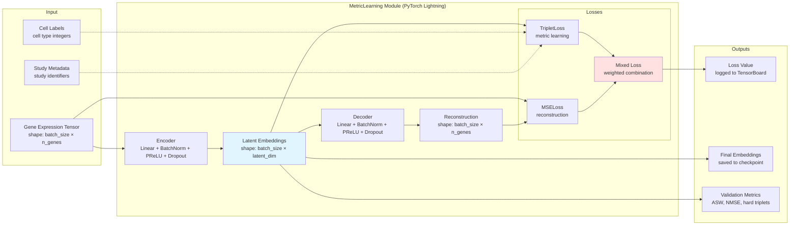

This page provides a comprehensive API reference for the training architecture in SCimilarity. The training system implements **metric learning** through a hybrid loss function combining triplet loss for cell type separation with reconstruction loss for preserving gene expression patterns. The framework is built on PyTorch Lightning, enabling scalable training with automatic optimization, validation, and checkpoint management.

The training module orchestrates three core components: neural network architectures ([Encoder](src/scimilarity/nn_models.py#L12-L112) and [Decoder](src/scimilarity/nn_models.py#L113-L207)), triplet selection strategies, and the training lifecycle management. This design enables learning latent representations where cells of the same type cluster together while different cell types are separated according to a configurable margin.

Sources: [training_models.py](src/scimilarity/training_models.py#L15-L689), [nn_models.py](src/scimilarity/nn_models.py#L1-L207)

## Architecture Overview

The training architecture follows a **hybrid autoencoder-metric learning** paradigm. During training, gene expression data passes through an encoder that compresses it into a latent space representation. The decoder then reconstructs the original expression from this latent representation. Simultaneously, the triplet loss function operates on the latent space embeddings to enforce that cells of the same type are closer together than cells of different types.



The **critical architectural insight** is that the encoder and decoder serve dual purposes: the encoder provides the latent space used for downstream tasks like cell search and annotation, while the decoder's reconstruction loss provides a strong regularization signal that prevents the model from collapsing to trivial solutions. The triplet loss operates directly in the latent space, allowing the margin parameter to control how tightly cells of the same type cluster versus how far apart different types should be.

Sources: [training_models.py](src/scimilarity/training_models.py#L187-L201), [training_models.py](src/scimilarity/training_models.py#L293-L316)

## Core Classes

### MetricLearning

The `MetricLearning` class is the primary training module, inheriting from `pl.LightningModule`. It encapsulates the entire training workflow including forward pass, loss computation, optimization, validation, and model persistence.

**Constructor Parameters**

| Parameter | Type | Default | Description |
|-----------|------|---------|-------------|
| `n_genes` | int | *required* | Number of genes in the input expression matrix |
| `latent_dim` | int | 128 | Dimensionality of the latent space embedding |
| `hidden_dim` | List[int] | [1024, 1024, 1024] | Layer sizes for encoder (reversed for decoder) |
| `dropout` | float | 0.5 | Dropout rate for hidden layers |
| `input_dropout` | float | 0.4 | Dropout rate for input layer |
| `triplet_loss_weight` | float | 0.001 | Weight for triplet loss in mixed objective |
| `margin` | float | 0.05 | Minimum distance for triplet loss margin |
| `negative_selection` | str | "semihard" | Strategy: "semihard", "hardest", or "random" |
| `sample_across_studies` | bool | True | Enforce anchor-positive pairs from different studies |
| `perturb_labels` | bool | False | Whether to perturb labels using ontology hierarchy |
| `perturb_labels_fraction` | float | 0.5 | Fraction of labels to perturb |
| `lr` | float | 5e-3 | Learning rate for AdamW optimizer |
| `l1` | float | 1e-4 | L1 regularization coefficient (encoder first layer) |
| `l2` | float | 0.01 | L2 regularization (weight decay) coefficient |
| `max_epochs` | int | 500 | Maximum number of training epochs |
| `cosine_annealing_tmax` | Optional[int] | None | Cosine annealing scheduler period |
| `track_triplets` | Optional[str] | None | Path to save triplet tracking files |
| `track_triplets_above_step` | int | -1 | Global step threshold for triplet tracking |

Sources: [training_models.py](src/scimilarity/training_models.py#L73-L170)

**Key Methods**

**`__init__(...)`**: Initializes the encoder, decoder, loss functions, optimizer configuration, and hyperparameters. Validates the `negative_selection` parameter against allowed values and constructs the neural network architecture with the specified layer dimensions. The encoder and decoder share hyperparameters but use reversed hidden dimensions to create a symmetric autoencoder structure.

Sources: [training_models.py](src/scimilarity/training_models.py#L73-L170)

**`forward(x)`**: Performs the forward pass through the autoencoder. Takes gene expression tensor `x` (shape: batch_size × n_genes) and returns a tuple of `(z, x_hat)` where `z` is the latent embedding (batch_size × latent_dim) and `x_hat` is the reconstructed expression. This method is automatically called by PyTorch Lightning during training steps.

Sources: [training_models.py](src/scimilarity/training_models.py#L187-L201)

**`get_losses(batch, use_studies=True, val_metrics=False)`**: Computes the component losses for a training batch. Accepts a batch tuple containing `(cells, labels, studies)` and returns either 4 or 6 values depending on whether `val_metrics` is enabled. For training mode, returns `(triplet_loss, mse, num_hard_triplets, num_viable_triplets)`. For validation mode, additionally returns `(asw, nmse)` where ASW is the Average Silhouette Width and NMSE is the Normalized Mean Squared Error. The `use_studies` parameter controls whether to enforce study-based constraints on triplet mining.

Sources: [training_models.py](src/scimilarity/training_models.py#L207-L292)

**`training_step(batch, batch_idx)`**: Implements the PyTorch Lightning training step. Calls `get_losses()` to obtain component losses, applies L1 regularization to the encoder's first linear layer (if `l1 > 0`), computes the mixed loss using `get_mixed_loss()`, and logs multiple metrics including train loss, triplet loss, MSE, hard triplet ratio, and triplet counts. Returns a dictionary with all computed metrics for monitoring.

Sources: [training_models.py](src/scimilarity/training_models.py#L317-L395)

**`validation_step(batch, batch_idx)`** and **`on_validation_epoch_end()`**: Together implement the validation workflow. The validation step computes metrics with `use_studies=False` (disabling study constraints) and includes validation-specific metrics like ASW and NMSE. The epoch end method aggregates metrics across all validation batches and logs comprehensive validation summaries.

Sources: [training_models.py](src/scimilarity/training_models.py#L401-L415), [training_models.py](src/scimilarity/training_models.py#L416-L422)

**`save_all(model_path)`**: Persists the complete trained model to a directory. Saves encoder and decoder checkpoints as `encoder.ckpt` and `decoder.ckpt`, layer sizes as `layer_sizes.json`, hyperparameters as `hyperparameters.json`, gene order as `gene_order.tsv`, label mappings as `label_ints.csv`, and metadata including timestamps and data paths as `metadata.json`. For TileDB-backed training, also saves compressed training and validation cell lists.

Sources: [training_models.py](src/scimilarity/training_models.py#L568-L640)

**`load_state(encoder_filename, decoder_filename, use_gpu=False, freeze=False)`**: Loads encoder and decoder states from checkpoint files. The `freeze` parameter enables a pretraining mode where all encoder layers except the final bottleneck layer are frozen, allowing fine-tuning of only the latent representation layer. This is useful for transfer learning scenarios where the encoder has been pretrained on a large corpus and needs adaptation to a specific task.

Sources: [training_models.py](src/scimilarity/training_models.py#L642-L689)

> [!TIP]
> When loading a pretrained model with `freeze=True`, only the final linear layer in the encoder (the bottleneck) will have `requires_grad=True`. All other encoder layers including batch normalization will be frozen, preserving the pretrained feature extraction capabilities while allowing the latent space to adapt to new data distributions.

### Encoder

The `Encoder` class maps high-dimensional gene expression to a compact latent representation through a series of linear transformations with batch normalization and dropout regularization.

**Constructor Parameters**

| Parameter | Type | Default | Description |
|-----------|------|---------|-------------|
| `n_genes` | int | *required* | Input dimension (number of genes) |
| `latent_dim` | int | 128 | Output dimension (latent space size) |
| `hidden_dim` | List[int] | [1024, 1024] | Hidden layer dimensions |
| `dropout` | float | 0.5 | Dropout rate for hidden layers |
| `input_dropout` | float | 0.4 | Dropout rate for input layer |

**Architecture Details**

The encoder constructs a sequence of blocks where each hidden layer block contains:
- `nn.Dropout(p=dropout)`: Dropout for regularization
- `nn.Linear(in_features, out_features)`: Linear transformation
- `nn.BatchNorm1d(out_features)`: Batch normalization
- `nn.PReLU()`: Parametric ReLU activation function

The input layer uses `input_dropout` instead of the regular `dropout` parameter. The final output layer is a pure linear transformation (no dropout, batch norm, or activation) to produce the latent embedding directly.

Sources: [nn_models.py](src/scimilarity/nn_models.py#L31-L62)

**`forward(x)`**: Maps input tensor `x` (batch_size × n_genes) to latent embedding `z` (batch_size × latent_dim). Each layer sequentially transforms the input through dropout, linear transformation, batch normalization, and activation.

Sources: [nn_models.py](src/scimilarity/nn_models.py#L64-L81)

**`save_state(filename)`** and **`load_state(filename, use_gpu=False)`**: Model persistence methods that save/load the encoder's state dictionary. The `use_gpu` parameter determines whether to load weights to GPU memory.

Sources: [nn_models.py](src/scimilarity/nn_models.py#L82-L112)

### Decoder

The `Decoder` class reconstructs gene expression from latent embeddings, forming the decoder half of the autoencoder architecture. It mirrors the encoder structure with reversed layer dimensions.

**Constructor Parameters**

| Parameter | Type | Default | Description |
|-----------|------|---------|-------------|
| `n_genes` | int | *required* | Output dimension (number of genes) |
| `latent_dim` | int | 128 | Input dimension (latent space size) |
| `hidden_dim` | List[int] | [1024, 1024] | Hidden layer dimensions (decoded in reverse order) |
| `dropout` | float | 0.5 | Dropout rate for all layers |

**Architecture Details**

The decoder creates layers by iterating through `reversed(hidden_dim)`. Each layer block contains:
- `nn.Dropout(p=dropout)`: Dropout for regularization
- `nn.Linear(in_features, out_features)`: Linear transformation (reversed dimensions)
- `nn.BatchNorm1d(out_features)`: Batch normalization
- `nn.PReLU()`: Parametric ReLU activation function

The final output layer is a pure linear transformation producing reconstructed gene expression (batch_size × n_genes).

Sources: [nn_models.py](src/scimilarity/nn_models.py#L130-L160)

**`forward(x)`**: Maps latent embedding `x` (batch_size × latent_dim) to reconstructed expression `x_hat` (batch_size × n_genes). Applies dropout, linear transformation, batch normalization, and PReLU activation sequentially through all hidden layers, ending with the final linear output layer.

Sources: [nn_models.py](src/scimilarity/nn_models.py#L161-L177)

### TripletSelector

The `TripletSelector` class implements mining strategies for generating training triplets (anchor, positive, negative) based on cell embeddings and type labels. It supports multiple selection strategies and optional label perturbation using the cell ontology hierarchy.

**Constructor Parameters**

| Parameter | Type | Default | Description |
|-----------|------|---------|-------------|
| `margin` | float | *required* | Triplet loss margin distance |
| `negative_selection` | str | "semihard" | Negative selection strategy |
| `perturb_labels` | bool | False | Enable ontology-based label perturbation |
| `perturb_labels_fraction` | float | 0.5 | Fraction of labels to perturb |

**Key Methods**

**`get_triplets_idx(embeddings, labels, int2label, studies=None)`**: Mines triplets from a batch of embeddings. Computes pairwise distances between all cells, identifies anchors with positive pairs (same label), and selects negatives using the configured strategy. When `sample_across_studies=True` and `studies` is provided, enforces that anchor-positive pairs come from different studies. Returns a tuple of `(anchor_idx, positive_idx, negative_idx)` lists plus counts of hard and viable triplets.

Sources: [triplet_selector.py](src/scimilarity/triplet_selector.py#L53-L200)

**`get_asw(embeddings, labels, int2label, metric='cosine')`**: Computes the Average Silhouette Width (ASW) for assessing cluster separation quality. Uses cosine distance by default to evaluate how well cell types cluster together in the latent space. Higher ASW values indicate better separation.

Sources: [triplet_selector.py](src/scimilarity/triplet_selector.py#L280-L356)

**Negative Selection Strategies**

| Strategy | Description | Characteristics |
|----------|-------------|----------------|
| **"semihard"** | Selects negatives with distance between anchor and positive | Balanced learning, avoids trivial cases |
| **"hardest"** | Selects the negative closest to the anchor | Aggressive, may cause instability |
| **"random"** | Selects negatives uniformly at random | Stable but slower convergence |

Sources: [triplet_selector.py](src/scimilarity/triplet_selector.py#L223-L279)

### TripletLoss

The `TripletLoss` class wraps PyTorch's `TripletMarginLoss` with integrated triplet mining through `TripletSelector`. It provides the core metric learning objective that separates different cell types in the latent space.

**Constructor Parameters**

| Parameter | Type | Default | Description |
|-----------|------|---------|-------------|
| `margin` | float | *required* | Minimum distance between anchor-positive and anchor-negative |
| `sample_across_studies` | bool | True | Require anchor-positive pairs from different studies |
| `negative_selection` | str | "semihard" | Strategy for selecting negatives |
| `perturb_labels` | bool | False | Enable ontology-based label perturbation |
| `perturb_labels_fraction` | float | 0.5 | Fraction of labels to perturb |

**`forward(embeddings, labels, int2label, studies)`**: Mines triplets using the configured selector, extracts anchor, positive, and negative embeddings, and computes the triplet margin loss. Returns a tuple of `(loss, num_violating_triplets, num_viable_triplets, triplets_idx)` where `triplets_idx` contains the indices for monitoring triplet composition during training.

Sources: [triplet_selector.py](src/scimilarity/triplet_selector.py#L399-L437)

> [!TIP]
> The triplet loss is computed with `reduction="none"` to preserve per-triplet loss values. The `MetricLearning` class then averages these values, enabling tracking of the fraction of non-zero losses which indicates how many triplets are contributing to gradient updates at each step.

## Training Workflow

### Configuration and Initialization

Training begins by instantiating a `MetricLearning` module with appropriate hyperparameters for your dataset and computational resources. The configuration process involves setting the neural network architecture (number of genes, latent dimension, hidden layers), loss function parameters (margin, triplet loss weight), regularization coefficients (L1, L2), and optimization settings (learning rate, cosine annealing schedule).

```python
from scimilarity.training_models import MetricLearning

model = MetricLearning(
    n_genes=20000,
    latent_dim=128,
    hidden_dim=[1024, 1024, 1024],
    dropout=0.5,
    input_dropout=0.4,
    triplet_loss_weight=0.001,
    margin=0.05,
    negative_selection="semihard",
    sample_across_studies=True,
    lr=5e-3,
    l1=1e-4,
    l2=0.01,
    max_epochs=500,
)
```

The model's `configure_optimizers()` method automatically configures an AdamW optimizer with the specified learning rate and L2 weight decay, plus a cosine annealing learning rate scheduler that reduces the learning rate over training to enable convergence.

Sources: [training_models.py](src/scimilarity/training_models.py#L171-L186)

### Data Module Integration

The `MetricLearning` module expects a PyTorch Lightning data module that provides batches with `(cells, labels, studies)` tuples. The data module should expose:
- `train_dataset`: Training data loader
- `val_dataset`: Optional validation data loader
- `batch_size`: Batch size for logging
- `gene_order`: List of gene names matching the input dimension
- `int2label`: Dictionary mapping label integers to cell type names
- `sparse`: Boolean indicating if input is sparse

The training tutorial demonstrates using `CellMultisetDataModule` with TileDB-backed storage for scalable training on large cell corpora.

Sources: [scripts/train.py](src/scimilarity/training_models.py#L64-L100), [training_tutorial.ipynb](docs/notebooks/training_tutorial.ipynb#L1-L50)

### Training Loop Execution

PyTorch Lightning manages the training loop, calling `training_step()` for each batch. The workflow for each batch is:

1. Forward pass through encoder and decoder
2. Triplet mining and loss computation
3. Reconstruction (MSE) loss computation
4. L1 regularization application (if configured)
5. Mixed loss combination: `loss = triplet_loss + triplet_loss_weight * mse`
6. Metric logging to TensorBoard
7. Gradient computation and optimizer step

The trainer automatically handles device placement (CPU/GPU), gradient accumulation, and learning rate scheduling based on the epoch progress.

Sources: [training_models.py](src/scimilarity/training_models.py#L317-L395)

### Validation and Testing

Validation occurs at epoch end if a validation dataset is provided. The validation pipeline differs from training in two key aspects:
1. `use_studies=False`: Study constraints are disabled to evaluate true cell type separation
2. Additional metrics computed: ASW (cluster quality) and NMSE (normalized reconstruction error)

The evaluation metric combines both aspects: `evaluation_metric = (1 - asw) / 2 + nmse`, where lower values indicate better performance (lower NMSE, higher ASW).

Sources: [training_models.py](src/scimilarity/training_models.py#L450-L567)

## Model Persistence and Loading

### Saving Trained Models

After training completes, call `save_all(model_path)` to persist the complete model state. This creates a directory containing:

| File | Description |
|------|-------------|
| `encoder.ckpt` | Encoder neural network weights |
| `decoder.ckpt` | Decoder neural network weights |
| `layer_sizes.json` | Architecture specification |
| `hyperparameters.json` | Training configuration |
| `gene_order.tsv` | Gene names in input order |
| `label_ints.csv` | Cell type label mappings |
| `metadata.json` | Timestamp and data provenance |
| `train_cells.csv.gz` | Training cell metadata (TileDB) |
| `val_cells.csv.gz` | Validation cell metadata (TileDB) |

This comprehensive persistence enables exact model reproduction and downstream use for inference or further fine-tuning.

Sources: [training_models.py](src/scimilarity/training_models.py#L568-L640)

### Loading Pretrained Models

Load a saved model by instantiating `MetricLearning` with matching architecture parameters, then calling `load_state(encoder_filename, decoder_filename, use_gpu=False, freeze=False)`:

```python
model = MetricLearning(
    n_genes=20000,  # Must match saved architecture
    latent_dim=128,
    hidden_dim=[1024, 1024, 1024],
    # ... other matching parameters
)
model.load_state(
    encoder_filename="path/to/encoder.ckpt",
    decoder_filename="path/to/decoder.ckpt",
    use_gpu=True,
    freeze=False,  # Set True for transfer learning
)
```

When using `freeze=True`, the encoder's lower layers remain frozen, allowing fine-tuning of only the bottleneck layer for adaptation to new datasets or tasks.

Sources: [training_models.py](src/scimilarity/training_models.py#L642-L689)

## Hyperparameter Tuning Guidance

The training system exposes numerous hyperparameters that affect learning dynamics and final model quality. Key considerations for hyperparameter selection:

**Latent Dimension** (`latent_dim`): Controls the information capacity of the learned representation. Values of 128-256 are typical for cell atlases. Lower dimensions may force compression that loses biological information; higher dimensions increase memory and compute requirements.

**Hidden Layer Architecture** (`hidden_dim`): The depth and width of encoder/decoder networks. Deeper networks ([1024, 1024, 1024, 1024]) can capture more complex patterns but increase overfitting risk. Shallower networks ([512, 512]) train faster but may underfit.

**Triplet Loss Weight** (`triplet_loss_weight`): Balances metric learning against reconstruction loss. Values around 0.001 give modest emphasis to clustering. Increase if cell type separation is insufficient; decrease if reconstruction quality degrades too much.

**Margin** (`margin`): The minimum distance enforced between anchor-positive and anchor-negative pairs. Typical values range from 0.01 to 0.1. Larger margins enforce stricter separation but may be harder to satisfy, especially early in training.

**Negative Selection Strategy** (`negative_selection`): Start with "semihard" for balanced learning. Switch to "hardest" if convergence is slow, or "random" if training becomes unstable.

**Learning Rate** (`lr`): The AdamW learning rate. Values of 1e-3 to 5e-3 work well. Higher rates may cause divergence; lower rates slow convergence unnecessarily.

**Regularization** (`l1`, `l2`): Control overfitting. L1 (1e-4) applied only to the first layer encourages sparsity in the feature extraction. L2 (0.01) is applied as weight decay throughout the network.

Sources: [training_models.py](src/scimilarity/training_models.py#L73-L170), [train.py](scripts/train.py#L64-L100)

## Next Steps

- **[Metric Learning with Triplet Loss](18-metric-learning-with-triplet-loss)**: Deep dive into the mathematical foundations and implementation details of triplet loss for cell type separation
- **[Triplet Selection Strategies](19-triplet-selection-strategies)**: Comprehensive analysis of semihard, hardest, and random negative selection methods with comparative performance
- **[Training Configuration and Hyperparameters](20-training-configuration-and-hyperparameters)**: Detailed guidance on hyperparameter tuning, regularization strategies, and optimization techniques
- **[PyTorch Lightning Integration](21-pytorch-lightning-integration)**: Advanced techniques for distributed training, mixed precision, and custom callbacks