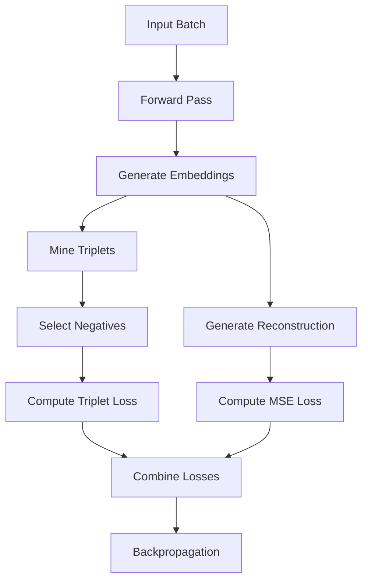

Triplet loss forms the core of SCimilarity's metric learning approach, enabling the model to learn a latent space where cells of similar types are clustered together while maintaining meaningful separation between different cell types. This documentation explores the theoretical foundations, implementation details, and practical considerations for triplet-based metric learning in single-cell analysis.

## Triplet Loss Fundamentals

The triplet loss framework operates on triplets of data points: an anchor sample, a positive sample (same class as the anchor), and a negative sample (different class). The objective is to learn embeddings such that the distance between the anchor and positive is smaller than the distance between the anchor and negative by at least a specified margin. In SCimilarity, this is implemented through the `TripletLoss` class which extends PyTorch's `TripletMarginLoss` [src/scimilarity/triplet_selector.py](src/scimilarity/triplet_selector.py#L357-L436).

The loss function is computed as:

$$L = \max(0, d(a,p) - d(a,n) + \text{margin})$$

where $d(a,p)$ is the distance between anchor and positive, $d(a,n)$ is the distance between anchor and negative, and the margin is a hyperparameter (default: 0.05) that enforces the desired separation [src/scimilarity/triplet_selector.py](src/scimilarity/triplet_selector.py#L381-L398).

The implementation generates triplets dynamically during training using the `TripletSelector` class, which mines appropriate positive and negative pairs based on current embeddings and cell ontology labels [src/scimilarity/triplet_selector.py](src/scimilarity/triplet_selector.py#L17-L52).

## Triplet Selection Strategies

SCimilarity implements three distinct strategies for negative sample selection, each with different characteristics affecting training dynamics and final embedding quality. The selection is configured through the `negative_selection` parameter in the `MetricLearning` class [src/scimilarity/training_models.py](src/scimilarity/training_models.py#L82-L83).

### Semihard Negative Selection (Default)

The semihard strategy selects negatives that are closer to the anchor than the positive, but still satisfy the margin constraint. This provides informative gradients while avoiding collapse to trivial solutions [src/scimilarity/triplet_selector.py](src/scimilarity/triplet_selector.py#L257-L278):

```python
semihard_negatives = np.where(
    np.logical_and(loss_values < self.margin, loss_values > 0)
)[0]
```

Semihard negatives maintain $0 < L < \text{margin}$, offering balanced learning signal that prevents both premature convergence and excessive difficulty.

### Hardest Negative Selection

The hardest strategy selects the negative that maximizes the triplet loss value, representing the most challenging negative example [src/scimilarity/triplet_selector.py](src/scimilarity/triplet_selector.py#L223-L238). While this can accelerate learning in early stages, it may lead to overfitting on hard examples and instability in later training phases:

```python
hard_negative = np.argmax(loss_values)
return hard_negative if loss_values[hard_negative] > 0 else None
```

### Random Negative Selection

The random strategy randomly selects from all violating negatives (those with loss > 0) [src/scimilarity/triplet_selector.py](src/scimilarity/triplet_selector.py#L240-L255). This provides a diverse training signal and can be useful when combined with other strategies or when dealing with noisy labels:

```python
hard_negatives = np.where(loss_values > 0)[0]
return np.random.choice(hard_negatives) if len(hard_negatives) > 0 else None
```

| Strategy | Description | Pros | Cons | Best Use Case |
|----------|-------------|------|------|---------------|
| **semihard** | Negatives with 0 < loss < margin | Stable training, balanced gradients | May slow initial convergence | Default choice for most scenarios |
| **hardest** | Negative with maximum loss | Faster initial learning | Can become unstable, overfit on outliers | Early training phases |
| **random** | Random violating negative | Diverse signal, robust to noise | Slower convergence, less informative | Noisy label scenarios |

> [!TIP]
> The semihard negative selection strategy is recommended as the default for most training scenarios, as it provides a balanced trade-off between learning efficiency and training stability. Switch to hardest negative selection only if training plateaus early, or random selection if working with particularly noisy annotations.

## Ontological Triplet Mining

SCimilarity incorporates cell ontology awareness into triplet mining through hierarchical relationships in the Cell Ontology. The `TripletSelector` integrates ontology information by loading the ontology structure and maintaining mappings between term IDs and names [src/scimilarity/triplet_selector.py](src/scimilarity/triplet_selector.py#L46-L48).

For each cell type label, the system identifies violating terms that should not serve as negative examples:

```python
ancestors = get_all_ancestors(self.onto, term_id)
descendants = get_all_descendants(self.onto, term_id)
violating_terms = ancestors.union(descendants)
```

Negatives are filtered to exclude cells from violating terms, ensuring that semantically related cell types are not pushed too far apart in the latent space [src/scimilarity/triplet_selector.py](src/scimilarity/triplet_selector.py#L144-L147):

```python
negative_indices = np.where(
    np.logical_not(label_mask | np.isin(labels_ids, list(violating_terms)))
)[0]
```

This ontological constraint respects biological hierarchies—for example, when training on "T cell" as the anchor, the system would not select "CD4+ T cell" or "helper T cell" as negatives since these are descendant terms in the ontology. This design choice preserves meaningful semantic relationships in the learned embedding space.

## Study-Aware Triplet Sampling

To enhance model generalization across different experimental conditions and batches, SCimilarity implements study-aware triplet sampling. When `sample_across_studies` is enabled (default: `True`), the system enforces that anchor and positive pairs must originate from different studies [src/scimilarity/training_models.py](src/scimilarity/training_models.py#L83-L84).

This constraint is applied during triplet generation:

```python
if studies is not None:
    anchor_positives = [
        (anchor, positive)
        for anchor, positive in anchor_positives
        if studies[anchor] != studies[positive]
    ]
```

By ensuring anchor-positive pairs come from different studies, the model learns study-invariant representations rather than memorizing study-specific artifacts or batch effects. This is particularly important for single-cell data where technical variation between studies can dominate biological signals if not properly addressed [src/scimilarity/triplet_selector.py](src/scimilarity/triplet_selector.py#L152-L158).

The study-aware sampling works synergistically with ontological constraints to create a robust metric learning framework that generalizes across both biological hierarchies and technical variations.

## Label Perturbation for Regularization

SCimilarity includes an optional label perturbation mechanism that can improve model robustness and prevent overfitting to specific cell type annotations. When `perturb_labels` is enabled, a fraction of labels (controlled by `perturb_labels_fraction`, default: 0.5) are coarsened by moving up one level in the ontology hierarchy [src/scimilarity/triplet_selector.py](src/scimilarity/triplet_selector.py#L98-L128).

The perturbation process:
1. Randomly selects a subset of cells based on `perturb_labels_fraction`
2. For each selected cell, finds parent terms in the ontology
3. Replaces the label with a parent term that exists in the current dataset

This regularization technique encourages the model to learn representations at multiple levels of the cell type hierarchy, improving flexibility for downstream applications that may operate at different resolutions.

```python
perturb_list = random.choices(
    np.arange(len(labels)),
    k=int(len(labels) * self.perturb_labels_fraction),
)
```

Label perturbation is particularly valuable when working with datasets that have inconsistent annotation granularity or when the model needs to generalize to unseen cell type subtypes.

## Loss Computation and Integration

The triplet loss is computed within the training pipeline through a multi-stage process that integrates embedding generation, triplet mining, and loss calculation. The `get_losses` method in the `MetricLearning` class orchestrates this process [src/scimilarity/training_models.py](src/scimilarity/training_models.py#L207-L291).

The computation flow:



First, the encoder generates embeddings for the batch, and simultaneously the decoder produces reconstructions. The triplet loss function receives the embeddings along with labels and study information to mine appropriate triplets [src/scimilarity/training_models.py](src/scimilarity/training_models.py#L238-L244):

```python
embedding, reconstruction = self(cells)
triplet_loss, num_hard_triplets, num_viable_triplets, triplets_idx = (
    self.triplet_loss_fn(
        embedding, labels, self.trainer.datamodule.int2label, studies
    )
)
```

The triplet loss is computed per-sample using PyTorch's triplet margin loss function with `reduction="none"`, allowing for detailed tracking of triplet statistics [src/scimilarity/triplet_selector.py](src/scimilarity/triplet_selector.py#L422-L432). This per-sample computation enables monitoring of metrics like the proportion of violating triplets, which serves as an indicator of embedding quality during training.

## Mixed Loss Architecture

SCimilarity employs a mixed loss objective that combines triplet loss with mean squared error (MSE) reconstruction loss. This dual-objective approach ensures that the latent space preserves metric learning properties while maintaining sufficient information for accurate reconstruction of gene expression profiles [src/scimilarity/training_models.py](src/scimilarity/training_models.py#L293-L315).

The mixed loss is calculated as:

$$L_{\text{mixed}} = w \cdot L_{\text{triplet}} + (1 - w) \cdot L_{\text{MSE}}$$

where $w$ is the `triplet_loss_weight` parameter (default: 0.001). This heavily weights reconstruction loss during training while still providing metric learning signal through triplet loss. The asymmetric weighting reflects the challenge of triplet loss optimization and the importance of maintaining reconstruction fidelity.

```python
if self.triplet_loss_weight == 0:
    return mse
if self.triplet_loss_weight == 1:
    return triplet_loss
return (self.triplet_loss_weight * triplet_loss) + (
    (1.0 - self.triplet_loss_weight) * mse
)
```

The training step integrates this mixed loss with L1 regularization applied to the encoder's first layer, creating a comprehensive regularization strategy that prevents overfitting while encouraging sparse representations [src/scimilarity/training_models.py](src/scimilarity/training_models.py#L343-L352).

## Training Metrics and Monitoring

The training pipeline logs multiple metrics to monitor triplet loss effectiveness and overall training progress. These metrics provide insights into embedding quality and guide hyperparameter tuning decisions [src/scimilarity/training_models.py](src/scimilarity/training_models.py#L370-L385).

Key metrics include:
- **train triplet loss**: Mean triplet loss across the batch
- **train mse**: Mean squared reconstruction error
- **train hard triplets**: Ratio of violating triplets to viable triplets (proxy for embedding quality)
- **train num nonzero loss**: Number of triplets with positive loss values
- **train num viable triplets**: Total number of possible triplets considered

The hard triplets ratio is particularly important for understanding triplet mining effectiveness:

```python
hard_triplets = num_hard_triplets / num_viable_triplets
```

As training progresses, this ratio should decrease, indicating that fewer triplets are violating the margin constraint and the embedding space is better organized. During validation, additional metrics such as Average Silhouette Width (ASW) are computed to assess cluster separation in the embedding space [src/scimilarity/training_models.py](src/scimilarity/training_models.py#L247-L249).

## Configuration and Hyperparameters

The triplet loss system exposes several key hyperparameters that control its behavior. These are initialized in the `MetricLearning` class constructor [src/scimilarity/training_models.py](src/scimilarity/training_models.py#L73-L170).

| Parameter | Type | Default | Description |
|-----------|------|---------|-------------|
| `triplet_loss_weight` | float | 0.001 | Weight of triplet loss in mixed objective |
| `margin` | float | 0.05 | Minimum distance required between anchor-negative and anchor-positive |
| `negative_selection` | str | "semihard" | Strategy for selecting negative samples |
| `sample_across_studies` | bool | True | Enforce anchor-positive pairs from different studies |
| `perturb_labels` | bool | False | Enable ontology-based label perturbation |
| `perturb_labels_fraction` | float | 0.5 | Fraction of labels to perturb when enabled |

The margin parameter is particularly critical: too small a margin may not provide sufficient separation between different cell types, while too large a margin can make the optimization problem infeasible. The default value of 0.05 is calibrated for cosine distance on normalized embeddings.

> [!TIP]
> When tuning triplet loss parameters, start with the default configuration and adjust the margin based on validation metrics. If the hard triplets ratio remains high (>0.3) throughout training, consider increasing the margin. If the ratio drops too quickly (<0.05) or triplet loss becomes near-zero, the margin may be too small.

## Next Steps

Having understood the triplet loss architecture, you can explore related topics:

- For detailed implementation of triplet selection strategies and negative mining algorithms, see [Triplet Selection Strategies](19-triplet-selection-strategies)
- To understand how these parameters are configured in training workflows, refer to [Training Configuration and Hyperparameters](20-training-configuration-and-hyperparameters)
- For integration with PyTorch Lightning training orchestration, see [PyTorch Lightning Integration](21-pytorch-lightning-integration)
- To learn about the encoder architecture that produces embeddings for triplet loss, see [Encoder and Decoder Architecture](7-encoder-and-decoder-architecture)